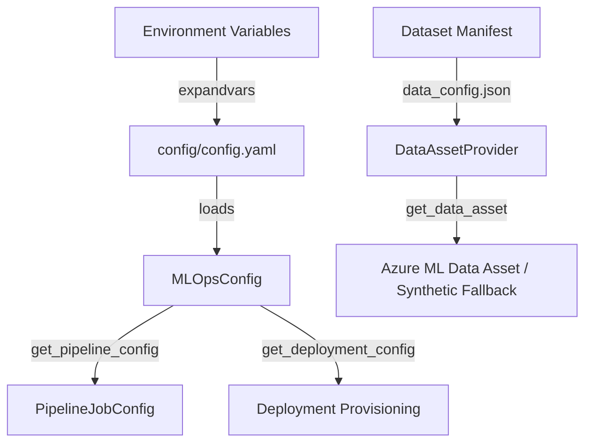
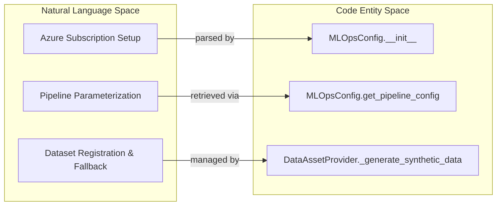

<!-- source: DeepWiki mcp.deepwiki.com · repo microsoft/dstoolkit-mlops-v2 · page 2 Configuration System · fetched 2026-11-09 -->

# Configuration System

Relevant source files

The following files were used as context for generating this wiki page:

- [config/config.yaml](config/config.yaml)
- [config/data_config.json](config/data_config.json)
- [mlops/common/config_utils.py](mlops/common/config_utils.py)
- [mlops/london_taxi/src/mlops_pipeline.py](mlops/london_taxi/src/mlops_pipeline.py)
- [mlops/sequence_model/src/mlops_pipeline.py](mlops/sequence_model/src/mlops_pipeline.py)
- [model/london_taxi/batch_test_data/london_taxi.csv](model/london_taxi/batch_test_data/london_taxi.csv)
- [model/london_taxi/online_test_data/sample-request.json](model/london_taxi/online_test_data/sample-request.json)

## Purpose and Scope
The Configuration System provides a centralized, configuration-driven approach for managing Azure Machine Learning (AML) environments, pipeline definitions, deployment parameters, and data assets within `dstoolkit-mlops-v2`. Instead of hardcoding infrastructure or pipeline parameters, the platform relies on `config.yaml` [config/config.yaml:1-178] and `data_config.json` [config/data_config.json:1-45], parsed and resolved at runtime by configuration utility classes in `mlops/common/config_utils.py` [mlops/common/config_utils.py:9-147].

This page serves as a high-level parent overview of the configuration system. For granular implementation details, schema breakdowns, and data registration workflows, please refer to the child pages:
- [config.yaml and MLOpsConfig](#2.1)
- [Data Assets & Registration](#2.2)

---

## Configuration Architecture Overview

The configuration framework bridges raw environment variables, YAML configuration files, and dataset registration manifests into structured Python objects utilized by AML pipeline builders and deployment scripts.

*Figure 1: Configuration Flow from Environment and Files to Pipeline Execution.*

Sources: [config/config.yaml:1-178](), [mlops/common/config_utils.py:9-147](), [config/data_config.json:1-45]()

---

## Core Configuration Components

### 1. `config.yaml` Structure
The primary configuration file located at `config/config.yaml` [config/config.yaml:1-178] defines four primary sections:
- **`aml_config`**: Core Azure subscription, resource group, and workspace identifiers utilizing environment variable expansion (e.g., `${SUBSCRIPTION_ID}`) [config/config.yaml:2-6].
- **`environment_configuration`**: Base container images and build identifiers like `${BUILD_BUILDID}` [config/config.yaml:7-10].
- **`pipeline_configs`**: Per-model and per-environment pipeline specifications (clusters, conda paths, dataset bindings, and synthetic fallback parameters) [config/config.yaml:11-71].
- **`deployment_configs`**: Online and batch scoring configurations, endpoint names, VM sizes, and scoring script directories [config/config.yaml:72-178].

### 2. `MLOpsConfig` Utility Class
Defined in `mlops/common/config_utils.py` [mlops/common/config_utils.py:108-147], the `MLOpsConfig` class loads the YAML configuration, processes environment variables via `os.path.expandvars`, and provides helper methods such as `get_pipeline_config(pipeline_name)` and `get_deployment_config(deployment_name)` scoped to active execution environments (e.g., `pr`, `dev`).

### 3. `DataAssetProvider` & `data_config.json`
Data asset definitions are cataloged in `config/data_config.json` [config/data_config.json:1-45] and registered via utility scripts. At pipeline construction time, `DataAssetProvider` [mlops/common/config_utils.py:9-106] handles fetching registered data assets from Azure ML, offering automatic synthetic data fallback when assets are absent or local testing is enabled.

Sources: [config/config.yaml:1-178](), [mlops/common/config_utils.py:9-147](), [config/data_config.json:1-45]()

---

## Code Entity Mapping

The diagram below connects natural language concepts of configuration management to their concrete code entities within the repository.

*Figure 2: Mapping configuration concepts to codebase classes and methods.*

Sources: [mlops/common/config_utils.py:9-147]()

---

## Child Pages

- [config.yaml and MLOpsConfig](#2.1) — Detailed schema breakdown of `aml_config`, `environment_configuration`, `pipeline_configs`, and `deployment_configs`, alongside programmatic usage of `MLOpsConfig`.
- [Data Assets & Registration](#2.2) — Comprehensive guide to `data_config.json`, `register_data_asset.py`, dataset workflows, and `DataAssetProvider` synthetic fallback behavior.

---

