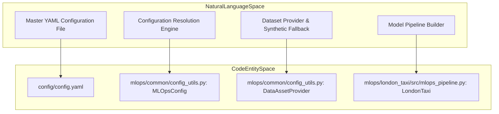

<!-- source: DeepWiki mcp.deepwiki.com · repo microsoft/dstoolkit-mlops-v2 · page 2.1 config.yaml and MLOpsConfig · fetched 2026-11-09 -->

# config.yaml and MLOpsConfig

<details>
<summary>Relevant source files</summary>

The following files were used as context for generating this wiki page:

- [config/config.yaml](config/config.yaml)
- [mlops/common/config_utils.py](mlops/common/config_utils.py)
- [mlops/london_taxi/src/mlops_pipeline.py](mlops/london_taxi/src/mlops_pipeline.py)
- [mlops/sequence_model/src/mlops_pipeline.py](mlops/sequence_model/src/mlops_pipeline.py)
- [vars.json](vars.json)

</details>


## Purpose and Scope
This page details the configuration-driven MLOps system in `dstoolkit-mlops-v2`, focusing on the master configuration file `config/config.yaml` and the resolution utility class `MLOpsConfig` defined in `mlops/common/config_utils.py`. It outlines the schema for Azure ML workspace settings, environment configurations, pipeline options, deployment targets, and how runtime environment interpolation and environment-suffix lookups work.

Sources: `config/config.yaml:1-10`(), `mlops/common/config_utils.py:108-148`()

---

## Master Configuration Schema (`config.yaml`)
The master configuration file `config/config.yaml` defines all operational parameters across environments (`pr`, `dev`, etc.). It is partitioned into four primary top-level blocks:

1. **`aml_config`**: Contains core Azure subscription identifiers, resource group names, and Azure Machine Learning workspace names [config/config.yaml:1-6]().
2. **`environment_configuration`**: Defines base container images (e.g., `mcr.microsoft.com/azureml/openmpi4.1.0-ubuntu22.04`) and build metadata references such as `${BUILD_BUILDID}` [config/config.yaml:7-10]().
3. **`pipeline_configs`**: Stores per-model and per-environment execution specs (e.g., `london_taxi_pr`, `sequence_model_dev`). Each entry specifies cluster names, regions, VM sizes (`cluster_size`), conda or Docker build paths, target dataset names or URI folders, and synthetic data fallback parameters [config/config.yaml:11-71]().
4. **`deployment_configs`**: Defines online and batch endpoint provisioning settings (e.g., `london_taxi_batch_pr`, `sequence_model_online_pr`), including scoring directories, entry script names (`score.py`), instance counts, VM sizes, and traffic allocation rules [config/config.yaml:72-178]().

Sources: `config/config.yaml:1-178`()

---

## `MLOpsConfig` Implementation & Resolution Logic
The `MLOpsConfig` class in `mlops/common/config_utils.py` handles loading, environment variable interpolation, and dynamic configuration retrieval.

- **Initialization & Environment Interpolation**: The `__init__` method loads environment variables via `load_dotenv()`, opens `config/config.yaml`, and evaluates shell-style environment variables using `os.path.expandvars` before passing the stream to `yaml.safe_load` [mlops/common/config_utils.py:113-121]().
- **Dynamic Attribute Access**: The `__getattr__` magic method maps top-level YAML keys directly to class attributes [mlops/common/config_utils.py:123-125]().
- **Pipeline Configuration Resolution**: `get_pipeline_config(pipeline_name)` appends the active environment suffix (e.g., `_pr`) to the requested pipeline name (e.g., `london_taxi`) to look up keys in `self.pipeline_configs`, raising a descriptive `KeyError` if the configuration is missing [mlops/common/config_utils.py:127-136]().
- **Deployment Configuration Resolution**: `get_deployment_config(deployment_name)` similarly resolves deployment keys by appending the active environment suffix [mlops/common/config_utils.py:138-147]().

Sources: `mlops/common/config_utils.py:108-148`()

---

## Data Asset Resolution and Synthetic Fallback
The `DataAssetProvider` class collaborates with pipeline configurations to locate registered Azure ML data assets or seamlessly fall back to local synthetic data generation [mlops/common/config_utils.py:9-106]().

- **Asset Retrieval**: `get_data_asset()` attempts to fetch the latest registered data asset from Azure ML using `ml_client.data.get()` [mlops/common/config_utils.py:46-48]().
- **Synthetic Fallback**: If the asset is not found and `allow_synthetic_fallback: true` is set in `config.yaml`, `_generate_synthetic_data()` invokes model-specific synthetic data generators (such as `save_synthetic_data()` for sequence models) and returns a local directory path [mlops/common/config_utils.py:50-81]().

Sources: `mlops/common/config_utils.py:9-106`(), `config/config.yaml:28-31`()

---

## Architecture & Configuration Resolution Diagrams

### Configuration Loading and Resolution Flow
```mermaid
graph TD
  A["config/config.yaml"] -->|Reads raw YAML & expands env vars| B["MLOpsConfig.__init__"]
  B -->|Stores parsed dict| C["MLOpsConfig._raw_config"]
  C -->|Access top-level keys| D["AMLConfig & EnvironmentConfig"]
  C -->|get_pipeline_config(name)| E["Pipeline Config Dict"]
  C -->|get_deployment_config(name)| F["Deployment Config Dict"]
  E -->|Passed to| G["DataAssetProvider"]
  G -->|Azure ML Client Data Get| H["Registered Data Asset"]
  G -->|If missing & allow_synthetic_fallback=true| I["Synthetic Data Generation"]
```
Sources: `config/config.yaml:1-178`(), `mlops/common/config_utils.py:108-148`()

### Natural Language Space to Code Entity Space Mapping

Sources: `config/config.yaml:1-178`(), `mlops/common/config_utils.py:9-148`(), `mlops/london_taxi/src/mlops_pipeline.py:74-114`()

---

