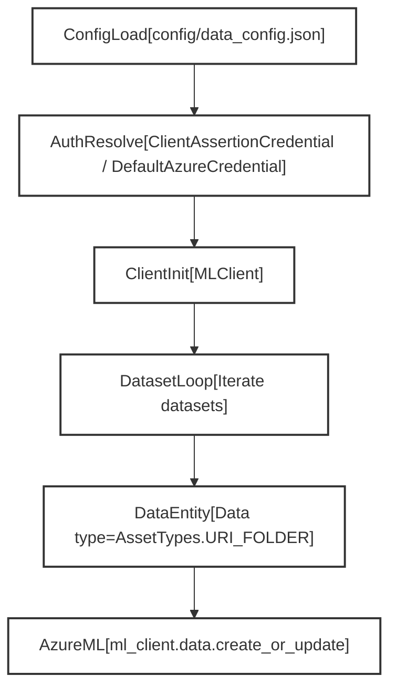
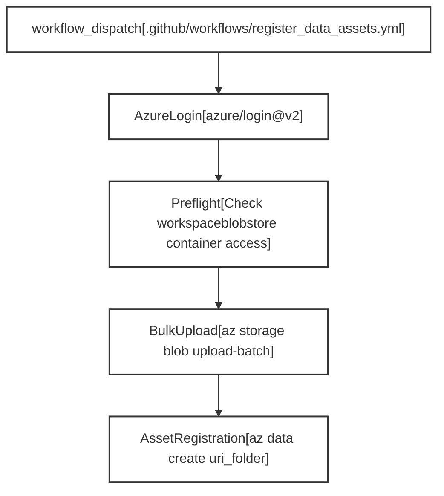

<!-- source: DeepWiki mcp.deepwiki.com · repo microsoft/dstoolkit-mlops-v2 · page 2.2 Data Assets & Registration · fetched 2026-11-09 -->

# Data Assets & Registration

<details>
<summary>Relevant source files</summary>

The following files were used as context for generating this wiki page:

- [.azure-pipelines/london_taxi_ci_pipeline.yml](.azure-pipelines/london_taxi_ci_pipeline.yml)
- [.azure-pipelines/nyc_taxi_ci_pipeline.yml](.azure-pipelines/nyc_taxi_ci_pipeline.yml)
- [.azure-pipelines/register_data_assets.yml](.azure-pipelines/register_data_assets.yml)
- [.github/workflows/register_data_assets.yml](.github/workflows/register_data_assets.yml)
- [config/data_config.json](config/data_config.json)
- [mlops/common/register_data_asset.py](mlops/common/register_data_asset.py)
- [model/london_taxi/batch_test_data/london_taxi.csv](model/london_taxi/batch_test_data/london_taxi.csv)
- [model/london_taxi/online_test_data/sample-request.json](model/london_taxi/online_test_data/sample-request.json)
- [src/sequence_model/common/synthetic_data.py](src/sequence_model/common/synthetic_data.py)
- [src/sequence_model/predict/predict.py](src/sequence_model/predict/predict.py)

</details>


## Purpose and Scope
This page details the data asset management architecture within the `dstoolkit-mlops-v2` platform. It covers declarative data configuration via `config/data_config.json`, programmatic registration using `mlops/common/register_data_asset.py`, CI/CD automation through the GitHub Actions workflow `.github/workflows/register_data_assets.yml`, and runtime synthetic data generation routines used as fallbacks when external datastore files are absent.

---

## 1. Declarative Data Configuration (`data_config.json`)

The platform defines all trackable datasets in a centralized JSON manifest located at `config/data_config.json`. Each entry specifies the dataset's purpose, local path, Azure ML asset name, and description.

```json
{
    "datasets": [
        {
            "DATA_PURPOSE": "pr_data",
            "DATA_PATH": "mlops/london_taxi/data",
            "DATASET_NAME": "london_taxi_pr_data",
            "DATASET_DESC": "this dataset is for pr validation only"
        },
        ...
    ]
}
```[config/data_config.json:1-45]()

### Dataset Schema Attributes
* `DATA_PURPOSE`: Categorizes the workflow usage (e.g., `pr_data`, `batch_test_data`, `training_data`).
* `DATA_PATH`: Local directory or file path within the repository where the raw data resides before upload/registration.
* `DATASET_NAME`: Unique name assigned to the registered Azure Machine Learning data asset.
* `DATASET_DESC`: Human-readable description stored alongside the asset metadata in Azure ML.

Sources: `config/data_config.json:1-45`

---

## 2. Programmatic Registration (`register_data_asset.py`)

The registration script `mlops/common/register_data_asset.py` reads `data_config.json`, establishes an authenticated connection to the Azure ML workspace, and iterates through the dataset definitions to create or update `uri_folder` data assets.


*Figure 1: Code Entity Space mapping for `register_data_asset.py`.*

### Authentication & Client Initialization
The script configures environment authentication for Azure Storage (`AZURE_STORAGE_AUTH_MODE = "login"`) [mlops/common/register_data_asset.py:31-32](). It attempts to use Workload Identity via `ClientAssertionCredential` if `AZURE_FEDERATED_TOKEN_FILE` is present, falling back to `DefaultAzureCredential` [mlops/common/register_data_asset.py:40-47](). An instance of `MLClient` is then instantiated using workspace configuration parameters from `MLOpsConfig` [mlops/common/register_data_asset.py:34,49-54]().

### Asset Creation Logic
For each dataset element parsed from the config file, a `Data` entity is constructed with `AssetTypes.URI_FOLDER` [mlops/common/register_data_asset.py:69-79]() and registered via `ml_client.data.create_or_update(aml_dataset)` [mlops/common/register_data_asset.py:82]().

Sources: `mlops/common/register_data_asset.py:1-93`

---

## 3. CI/CD Orchestration: "Register Datasets" Workflow

The GitHub Actions workflow `.github/workflows/register_data_assets.yml` automates dataset uploads and versioning in Azure ML. It is triggered via `workflow_dispatch` [.github/workflows/register_data_assets.yml:1-5]() and performs explicit preflight checks against the workspace default datastore (`workspaceblobstore`) [.github/workflows/register_data_assets.yml:41-72]().


*Figure 2: Workflow execution pipeline linking natural language pipeline triggers to Azure CLI execution steps.*

### Workflow Execution Steps
1. **OIDC Authentication**: Logs into Azure using workload identity credentials (`ARM_CLIENT_ID`, `ARM_TENANT_ID`, `SUBSCRIPTION_ID`) [.github/workflows/register_data_assets.yml:6-29]().
2. **Preflight Validation**: Queries the default `workspaceblobstore` account and container names using `az ml datastore show` and verifies AAD storage container read/write access [.github/workflows/register_data_assets.yml:52-71]().
3. **Bulk Upload & Registration**: Iterates over `config/data_config.json`, uploads source folders to container paths (`datasets/<NAME>/<TS>`) via `az storage blob upload-batch`, and registers them as `uri_folder` data assets via `az ml data create` [.github/workflows/register_data_assets.yml:111-150]().

Sources: `.github/workflows/register_data_assets.yml:1-159`, `mlops/common/register_data_asset.py:1-93`

---

## 4. Synthetic Data Fallback (`synthetic_data.py`)

When runtime environments lack pre-registered datastore assets or require isolated unit testing, sequence models rely on programmatic synthetic data generators located in `src/sequence_model/common/synthetic_data.py`.

```python
def generate_synthetic_text_data(
    num_sequences: int = 100, sequence_length: int = 20
) -> List[List[str]]:
    vocabulary = [
        "the", "quick", "brown", "fox", "jumps", "over", "lazy", "dog",
        ...
    ]
    sequences = []
    for _ in range(num_sequences):
        sequence = [random.choice(vocabulary) for _ in range(sequence_length)]
        sequences.append(sequence)
    return sequences
```[src/sequence_model/common/synthetic_data.py:9-35]()

### Save & Train/Test Split
The `save_synthetic_data` function generates a corpus from a predefined vocabulary, splits it into an 80/20 train/test ratio, and serializes them into `train.pkl` and `test.pkl` under the target dataset directory [src/sequence_model/common/synthetic_data.py:38-70]().

Sources: `src/sequence_model/common/synthetic_data.py:1-71`

---

