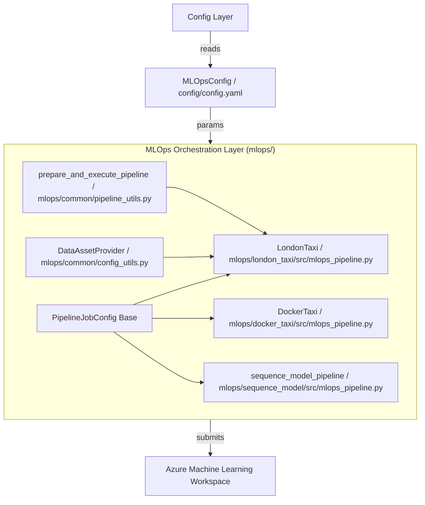

<!-- source: DeepWiki mcp.deepwiki.com · repo microsoft/dstoolkit-mlops-v2 · page 3 MLOps Orchestration Layer (mlops/) · fetched 2026-11-09 -->

# MLOps Orchestration Layer (mlops/)

Relevant source files

The following files were used as context for generating this wiki page:

- [.vscode/launch.json](.vscode/launch.json)
- [config/config.yaml](config/config.yaml)
- [mlops/common/config_utils.py](mlops/common/config_utils.py)
- [mlops/common/naming_utils.py](mlops/common/naming_utils.py)
- [mlops/common/pipeline_job_config.py](mlops/common/pipeline_job_config.py)
- [mlops/common/pipeline_utils.py](mlops/common/pipeline_utils.py)
- [mlops/docker_taxi/src/mlops_pipeline.py](mlops/docker_taxi/src/mlops_pipeline.py)
- [mlops/docker_taxi/start_local_pipeline.py](mlops/docker_taxi/start_local_pipeline.py)
- [mlops/london_taxi/src/mlops_pipeline.py](mlops/london_taxi/src/mlops_pipeline.py)
- [mlops/sequence_model/src/mlops_pipeline.py](mlops/sequence_model/src/mlops_pipeline.py)

The `mlops/` directory contains the core orchestration logic responsible for defining, configuring, and submitting Azure Machine Learning (AML) v2 pipelines. It acts as the bridge between high-level configuration declarations in `config/config.yaml` [config/config.yaml:1-178]() and concrete execution steps running on Azure compute targets.

*Sources: `config/config.yaml`, `mlops/common/config_utils.py`, `mlops/common/pipeline_utils.py`, `mlops/london_taxi/src/mlops_pipeline.py`*

---

## 3.1. Common Azure ML Utilities

The orchestration layer relies on a shared set of utility modules located under `mlops/common/`. These modules encapsulate boilerplate operations for resolving AML workspaces, provisioned compute clusters, reusable software environments, unique naming conventions, and run metadata tracking. 

For full technical details, implementation specifics, and RBAC handling, see [Common Azure ML Utilities](#3.1).

*Sources: `mlops/common/config_utils.py`, `mlops/common/naming_utils.py`, `mlops/common/pipeline_job_config.py`, `mlops/common/pipeline_utils.py`*

---

## 3.2. Pipeline Definitions per Model

Each model type (`london_taxi`, `docker_taxi`, and `sequence_model`) implements its own pipeline entrypoint script named `mlops_pipeline.py`. These scripts define the Directed Acyclic Graph (DAG) of component execution using the AML SDK v2 `@pipeline` decorator. Components are loaded dynamically from per-model YAML files [mlops/london_taxi/src/mlops_pipeline.py:96-103]() and wired together via strongly-typed input/output bindings.

For detailed DAG structures, component YAML wiring, and dataset ingestion steps, see [Pipeline Definitions per Model](#3.2).

*Sources: `mlops/london_taxi/src/mlops_pipeline.py`, `mlops/sequence_model/src/mlops_pipeline.py`, `mlops/docker_taxi/src/mlops_pipeline.py`*

---

## 3.3. Execution Environments (conda & Docker)

Pipeline steps and online/batch endpoints execute inside isolated environments configured via Conda specifications or custom Docker images. The orchestration layer maps environment references defined in `config.yaml` to these runtime definitions, ensuring reproducibility across local development runs and cloud deployments.

For detailed breakdown of conda specs, requirements files, and container build contexts, see [Execution Environments (conda & Docker)](#3.3).

*Sources: `config/config.yaml`*

---

