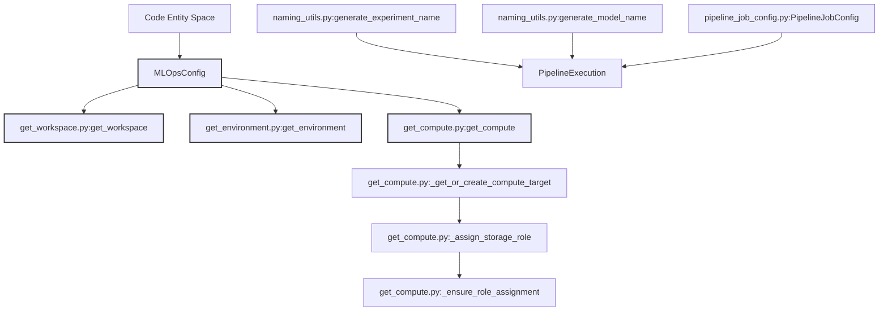
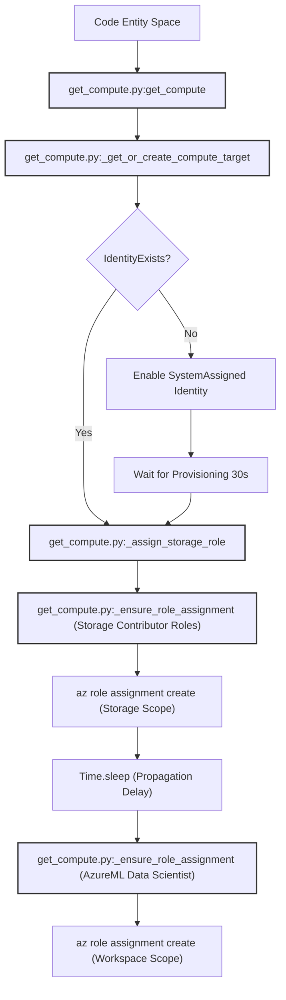

<!-- source: DeepWiki mcp.deepwiki.com · repo microsoft/dstoolkit-mlops-v2 · page 3.1 Common Azure ML Utilities · fetched 2026-11-09 -->

# Common Azure ML Utilities

Relevant source files

The following files were used as context for generating this wiki page:

- [.vscode/launch.json](.vscode/launch.json)
- [mlops/common/get_compute.py](mlops/common/get_compute.py)
- [mlops/common/get_environment.py](mlops/common/get_environment.py)
- [mlops/common/get_run_metadata.py](mlops/common/get_run_metadata.py)
- [mlops/common/get_workspace.py](mlops/common/get_workspace.py)
- [mlops/common/naming_utils.py](mlops/common/naming_utils.py)
- [mlops/common/pipeline_job_config.py](mlops/common/pipeline_job_config.py)
- [mlops/common/pipeline_utils.py](mlops/common/pipeline_utils.py)
- [mlops/docker_taxi/src/mlops_pipeline.py](mlops/docker_taxi/src/mlops_pipeline.py)
- [mlops/docker_taxi/start_local_pipeline.py](mlops/docker_taxi/start_local_pipeline.py)

## Purpose and Scope

The `mlops/common/` directory provides a suite of reusable utility modules designed to abstract and standardize interactions with Azure Machine Learning services. These utilities form the backbone of the MLOps orchestration layer, handling routine operations such as workspace connection, compute cluster provisioning with automatic managed identity configuration, environment compilation (via Conda or Docker contexts), dynamic naming conventions, metadata extraction, and role-based access control (RBAC) assignments.

This page documents the internal mechanics, implementation details, and functional flows of each core utility module.

---

## Workspace and Environment Management

### Workspace Access (`get_workspace.py`)

The workspace utility provides a centralized function to authenticate against Azure using `DefaultAzureCredential` and retrieve a reference to an Azure Machine Learning workspace instance via the Azure ML Python SDK (`azure-ai-ml`) [mlops/common/get_workspace.py:1-41]().

*   **Key Function**: `get_workspace(subscription_id: str, resource_group_name: str, workspace_name: str)` [mlops/common/get_workspace.py:13-]
*   **Behavior**: Instantiates an `MLClient` with default credentials and calls `client.workspaces.get(workspace_name)` [mlops/common/get_workspace.py:27-34]().

Sources: [mlops/common/get_workspace.py:1-41]()

### Environment Provisioning (`get_environment.py`)

The environment utility handles the creation or update of Azure ML execution environments, supporting both Conda-based specifications and custom Docker build contexts [mlops/common/get_environment.py:1-73]().

*   **Key Function**: `get_environment(...)` [mlops/common/get_environment.py:14-24]
*   **Parameters**:
    *   `conda_path`: Path to a Conda specification YAML file [mlops/common/get_environment.py:21]().
    *   `docker_context_path` & `dockerfile_path`: Path to local/remote Docker contexts and associated `Dockerfile` [mlops/common/get_environment.py:22-23]().
*   **Implementation**: Utilizes either `Environment(image=..., conda_file=...)` or `Environment(build=BuildContext(...))` depending on provided arguments, invoking `client.environments.create_or_update()` [mlops/common/get_environment.py:49-64]().

Sources: [mlops/common/get_environment.py:1-73]()

---

## Compute Provisioning and RBAC Handling (`get_compute.py`)

Compute target management is handled by `mlops/common/get_compute.py`, which ensures compute clusters exist with proper system-assigned managed identities and necessary RBAC role assignments for data and workspace access [mlops/common/get_compute.py:1-176]().

### Core Functions

*   `_get_or_create_compute_target(...)`: Checks for an existing AML compute target using `client.compute.get()`. If absent, provisions a new `AmlCompute` cluster with a `SystemAssigned` identity [mlops/common/get_compute.py:120-164]().
*   `_assign_storage_role(...)`: Evaluates the compute instance's managed identity `principal_id` and assigns required data plane roles on the workspace storage account [mlops/common/get_compute.py:82-118]().
*   `get_compute(...)`: Top-level orchestrator that fetches or creates the cluster and triggers role assignment enforcement [mlops/common/get_compute.py:166-176]().

### RBAC Handling & Propagation

To ensure batch scoring and pipeline execution can securely interact with Azure Storage and AML workspaces, the utility programmatically invokes Azure CLI (`az role assignment`) via subprocess calls if existing assignments are missing [mlops/common/get_compute.py:18-80]().

The assigned roles include:
1.  **Storage Blob Data Contributor** on the workspace storage scope [mlops/common/get_compute.py:101]()
2.  **Storage Table Data Contributor** on the workspace storage scope [mlops/common/get_compute.py:102]()
3.  **Storage Queue Data Contributor** on the workspace storage scope [mlops/common/get_compute.py:103]()
4.  **AzureML Data Scientist** on the AML workspace resource scope [mlops/common/get_compute.py:113]()

Because Azure RBAC changes are asynchronous, `_ensure_role_assignment` includes built-in sleep delays (e.g., 30 to 120 seconds) to allow token and permission propagation before downstream pipeline steps execute [mlops/common/get_compute.py:43-80]().

Sources: [mlops/common/get_compute.py:1-176]()

---

## Naming Conventions (`naming_utils.py`)

To prevent naming collisions across parallel branch deployments and experiments, `mlops/common/naming_utils.py` generates standardized resource names [mlops/common/naming_utils.py:1-81]().

*   `generate_experiment_name(model_name: str)`: Combines the model prefix with the active Git branch name (retrieved from `BUILD_SOURCEBRANCHNAME` or local `git rev-parse`) [mlops/common/naming_utils.py:8-28]().
*   `generate_model_name(model_name: str)`: Appends branch identifiers to establish unique registered model names [mlops/common/naming_utils.py:31-50]().
*   `generate_run_name(build_id: str)`: Constructs run identifiers prefixed with `run_` using `BUILD_BUILDID` [mlops/common/naming_utils.py:53-65]().
*   `generate_environment_name(environment_name: str, environment_version: str)`: Formats environment references for AML pipelines (`azureml:name:version`) [mlops/common/naming_utils.py:68-81]().

Sources: [mlops/common/naming_utils.py:1-81]()

---

## Pipeline Job Configuration and Metadata

### Base Pipeline Configuration (`pipeline_job_config.py`)

`PipelineJobConfig` serves as the foundational data class for configuring pipeline jobs across different model architectures (e.g., London Taxi, Docker Taxi, Sequence Models) [mlops/common/pipeline_job_config.py:4-38]().

*   **Attributes**: Stores `environment_name`, `build_reference`, `published_model_name`, `dataset_name`, `build_environment`, `wait_for_completion`, `output_file`, and `model_name` [mlops/common/pipeline_job_config.py:31-38]().

Sources: [mlops/common/pipeline_job_config.py:1-38]()

### Run Metadata Extraction (`get_run_metadata.py`)

Used predominantly in CI/CD pipelines to query job outcomes and export references for downstream reporting [mlops/common/get_run_metadata.py:1-82]().

*   **Key Function**: `get_run_metadata(subscription_id, resource_group_name, workspace_name, run_id, output_file_name)` [mlops/common/get_run_metadata.py:16-54]
*   **Behavior**: Queries `client.jobs.get(run_id)` and serializes attributes such as `job_url` (Studio URL), `aml_display_name`, `aml_run_name`, `aml_run_id`, and `aml_name` to a JSON output file [mlops/common/get_run_metadata.py:41-54]().

Sources: [mlops/common/get_run_metadata.py:1-82]()

---

## Utility Interactions and Execution Flow

*Figure 1: Relationship between utility modules and pipeline orchestration inputs.*

Sources: [mlops/common/get_workspace.py:13-36](), [mlops/common/get_environment.py:14-66](), [mlops/common/get_compute.py:166-176](), [mlops/common/naming_utils.py:8-50](), [mlops/common/pipeline_job_config.py:4-38]()

---

## Managed Identity & RBAC Provisioning Sequence

*Figure 2: Execution sequence for compute cluster creation and RBAC propagation.*

Sources: [mlops/common/get_compute.py:82-164]()

---

