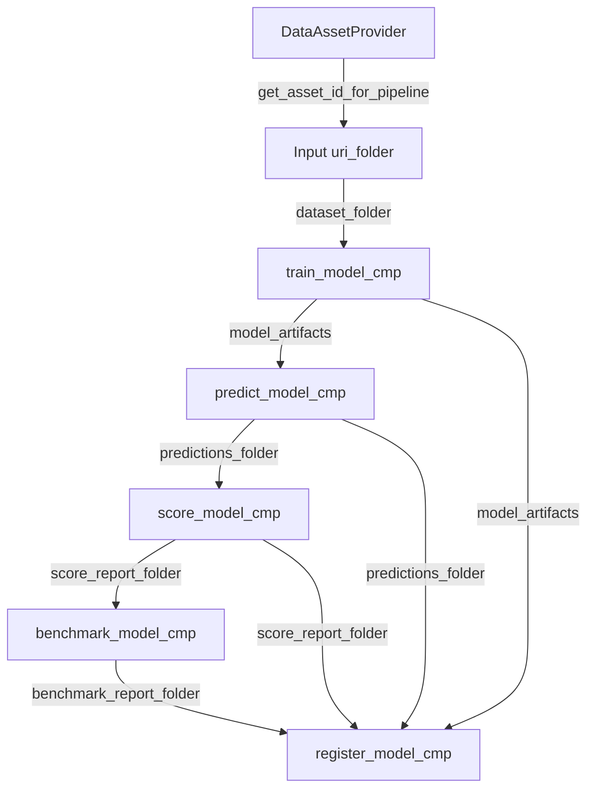
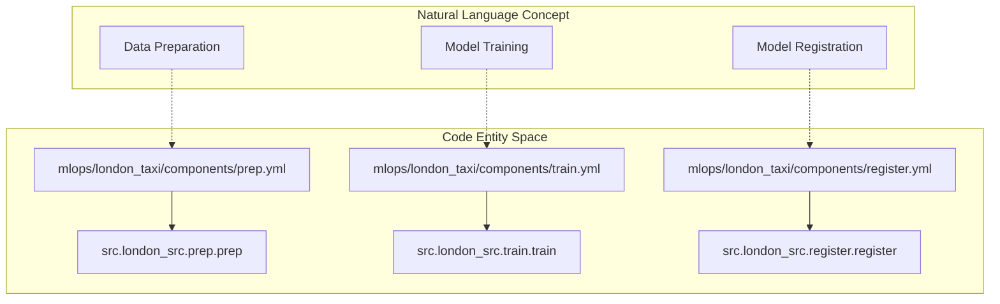

<!-- source: DeepWiki mcp.deepwiki.com · repo microsoft/dstoolkit-mlops-v2 · page 3.2 Pipeline Definitions per Model · fetched 2026-11-09 -->

# Pipeline Definitions per Model

Relevant source files

The following files were used as context for generating this wiki page:

- [config/config.yaml](config/config.yaml)
- [mlops/common/config_utils.py](mlops/common/config_utils.py)
- [mlops/docker_taxi/components/train.yml](mlops/docker_taxi/components/train.yml)
- [mlops/london_taxi/components/predict.yml](mlops/london_taxi/components/predict.yml)
- [mlops/london_taxi/components/prep.yml](mlops/london_taxi/components/prep.yml)
- [mlops/london_taxi/components/register.yml](mlops/london_taxi/components/register.yml)
- [mlops/london_taxi/components/score.yml](mlops/london_taxi/components/score.yml)
- [mlops/london_taxi/components/train.yml](mlops/london_taxi/components/train.yml)
- [mlops/london_taxi/components/transform.yml](mlops/london_taxi/components/transform.yml)
- [mlops/london_taxi/src/mlops_pipeline.py](mlops/london_taxi/src/mlops_pipeline.py)
- [mlops/sequence_model/components/train.yml](mlops/sequence_model/components/train.yml)
- [mlops/sequence_model/src/mlops_pipeline.py](mlops/sequence_model/src/mlops_pipeline.py)
- [mlops/sequence_model/start_local_pipeline.py](mlops/sequence_model/start_local_pipeline.py)
- [setup.cfg](setup.cfg)

## Purpose and Scope

This page covers section 3.2 of the MLOps orchestration layer (`mlops/`), detailing how machine learning pipelines are defined, constructed, and executed for different model types (`london_taxi`, `docker_taxi`, and `sequence_model`). It explains the pipeline graph definitions using the Azure Machine Learning (AML) DSL (`@pipeline`), how individual component YAML files wire CLI entry points to pipeline inputs/outputs, and how configuration-driven parameterization (`MLOpsConfig`) and data providers (`DataAssetProvider`) manage assets and synthetic fallbacks.

Sources: `[config/config.yaml:11-41](), [mlops/london_taxi/src/mlops_pipeline.py:1-22]()`

---

## London Taxi Pipeline (`london_taxi`)

The London taxi regression pipeline chains six discrete data and model processing stages: preparation, transformation, training, prediction, scoring, and model registration.

### Pipeline Graph and Wiring (`london_taxi_data_regression`)

The graph is defined using the `@pipeline` decorator in `[mlops/london_taxi/src/mlops_pipeline.py:27-72]()`. It sequentially wires component outputs to subsequent inputs:
1. `prepare_sample_data` consumes raw data (`pipeline_job_input`) and produces `prep_data` `[mlops/london_taxi/src/mlops_pipeline.py:40-42]()`.
2. `transform_sample_data` takes `prep_data` and outputs `transformed_data` `[mlops/london_taxi/src/mlops_pipeline.py:43-45]()`.
3. `train_with_sample_data` takes `transformed_data` and outputs `model_output`, `test_data`, and `model_metadata` `[mlops/london_taxi/src/mlops_pipeline.py:46-48]()`.
4. `predict_with_sample_data` takes the trained model and test data, outputting `predictions` `[mlops/london_taxi/src/mlops_pipeline.py:49-52]()`.
5. `score_with_sample_data` evaluates predictions against the model, generating a `score_report` `[mlops/london_taxi/src/mlops_pipeline.py:53-56]()`.
6. `register` consumes model metadata and score reports to register the final artifact in the Azure ML registry `[mlops/london_taxi/src/mlops_pipeline.py:57-62]()`.

### Configuration and Construction (`LondonTaxi`)

The `LondonTaxi` class inherits from `PipelineJobConfig` and implements `construct_pipeline(self, ml_client)` `[mlops/london_taxi/src/mlops_pipeline.py:74-115]()`. It queries the latest registered dataset asset using `self.dataset_name`, dynamically loads component definitions from `mlops/london_taxi/components/`, attaches the designated compute/environment settings, and invokes `london_taxi_data_regression` `[mlops/london_taxi/src/mlops_pipeline.py:92-109]()`.

Sources: `[mlops/london_taxi/src/mlops_pipeline.py:27-115]()`

---

## Component YAML Definitions (`london_taxi`)

Each step in the London taxi pipeline is governed by a declarative command component YAML file located in `mlops/london_taxi/components/`. These components map inputs and outputs to underlying python modules under `src/london_src/`.

### Component Manifest Table

| Component File | Name Property | Command Invocation |
| --- | --- | --- |
| `prep.yml` | `prepare_taxi_data` | `python -m src.london_src.prep.prep --raw_data ${{inputs.raw_data}} --prep_data ${{outputs.prep_data}}` `[mlops/london_taxi/components/prep.yml:1-18]()` |
| `transform.yml` | `taxi_feature_engineering` | `python -m src.london_src.transform.transform --clean_data ${{inputs.clean_data}} --transformed_data ${{outputs.transformed_data}}` `[mlops/london_taxi/components/transform.yml:1-18]()` |
| `train.yml` | `train_linear_regression_model` | `python -m src.london_src.train.train --training_data ${{inputs.training_data}} --test_data ${{outputs.test_data}} --model_output ${{outputs.model_output}} --model_metadata ${{outputs.model_metadata}}` `[mlops/london_taxi/components/train.yml:1-24]()` |
| `predict.yml` | `predict_taxi_fares` | `python -m src.london_src.predict.predict --model_input ${{inputs.model_input}} --test_data ${{inputs.test_data}} --predictions ${{outputs.predictions}}` `[mlops/london_taxi/components/predict.yml:1-21]()` |
| `score.yml` | `score_model` | `python -m src.london_src.score.score --predictions ${{inputs.predictions}} --model ${{inputs.model}} --score_report ${{outputs.score_report}}` `[mlops/london_taxi/components/score.yml:1-21]()` |
| `register.yml` | `register_taxi_model` | `python -m src.london_src.register.register --model_metadata ${{inputs.model_metadata}} --model_name ${{inputs.model_name}} --score_report ${{outputs.score_report}} --build_reference ${{inputs.build_reference}}` `[mlops/london_taxi/components/register.yml:1-23]()` |

Sources: `[mlops/london_taxi/components/prep.yml:1-18](), [mlops/london_taxi/components/transform.yml:1-18](), [mlops/london_taxi/components/train.yml:1-24](), [mlops/london_taxi/components/predict.yml:1-21](), [mlops/london_taxi/components/score.yml:1-21](), [mlops/london_taxi/components/register.yml:1-23]()`

---

## Sequence Model Pipeline (`sequence_model`)

The sequence model pipeline (`mlops/sequence_model/src/mlops_pipeline.py`) handles specialized sequence-based deep learning workflows, consisting of training, prediction, scoring, benchmarking, and registration stages.

### Pipeline Topology and Flexible Data Assets

The `sequence_model_pipeline` coordinates steps via `gl_pipeline_components` `[mlops/sequence_model/src/mlops_pipeline.py:35-80]()`. Unlike the London Taxi pipeline, `construct_pipeline` leverages `DataAssetProvider` to support flexible loading and automatic synthetic data fallback when registered assets are missing in development or PR environments `[mlops/sequence_model/src/mlops_pipeline.py:82-169]()`.

*Figure 1: Sequence model component graph execution flow.*

Sources: `[mlops/sequence_model/src/mlops_pipeline.py:35-169](), [mlops/common/config_utils.py:9-106]()`

---

## Component Wiring Architecture (Natural Language to Code Entity Space)

The following diagram bridges conceptual pipeline steps to their concrete Python modules and component YAML definitions in the codebase:

*Figure 2: Association of pipeline concepts to component YAMLs and Python module entry points.*

Sources: `[mlops/london_taxi/components/prep.yml:1-18](), [mlops/london_taxi/components/train.yml:1-24](), [mlops/london_taxi/components/register.yml:1-23](), [mlops/london_taxi/src/mlops_pipeline.py:27-72]()`

---

