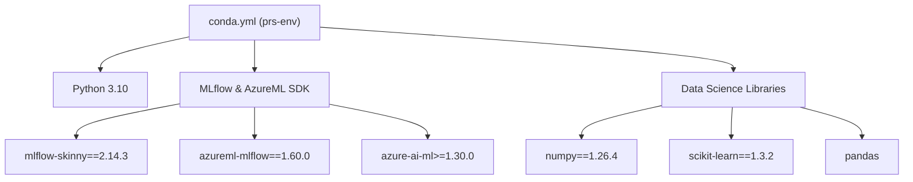
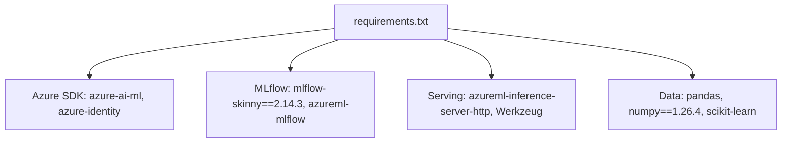
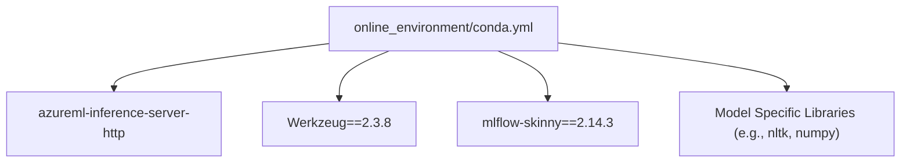
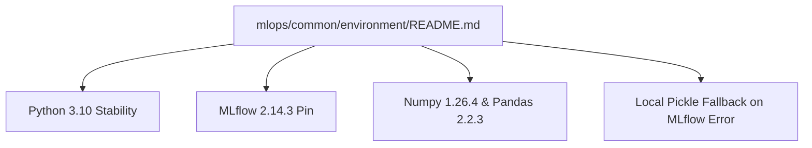

<!-- source: DeepWiki mcp.deepwiki.com · repo microsoft/dstoolkit-mlops-v2 · page 3.3 Execution Environments (conda & Docker) · fetched 2026-11-09 -->

# Execution Environments (conda & Docker)

<details>
<summary>Relevant source files</summary>

The following files were used as context for generating this wiki page:

- [mlops/common/environment/README.md](mlops/common/environment/README.md)
- [mlops/common/environment/training_requirements.txt](mlops/common/environment/training_requirements.txt)
- [mlops/docker_taxi/environment/requirements.txt](mlops/docker_taxi/environment/requirements.txt)
- [mlops/london_taxi/environment/conda.yml](mlops/london_taxi/environment/conda.yml)
- [mlops/sequence_model/environment/conda.yml](mlops/sequence_model/environment/conda.yml)
- [mlops/sequence_model/environment/reqs.txt](mlops/sequence_model/environment/reqs.txt)
- [model/docker_taxi/online_environment/conda.yml](model/docker_taxi/online_environment/conda.yml)
- [model/london_taxi/online_environment/conda.yml](model/london_taxi/online_environment/conda.yml)
- [model/sequence_model/online_environment/conda.yml](model/sequence_model/online_environment/conda.yml)

</details>


## Purpose and Scope
This page details the execution environments used across the `dstoolkit-mlops-v2` codebase for model training, pipeline execution, and online/batch model serving. It covers the structure and pinning strategy of Conda specifications (`conda.yml`), pip requirements files (`requirements.txt`, `reqs.txt`), and online scoring environments (`model/<type>/online_environment/conda.yml`). These environments ensure reproducibility and compatibility between local development, Azure Machine Learning (AML) compute targets, and containerized deployments.

---

## 1. Conda Specifications for Training & Pipelines (`conda.yml`)
Model pipelines define their runtime requirements using Conda specification files. The primary training environment across models uses a named environment `prs-env` running Python 3.10 with pinned packages to ensure MLflow and Azure ML SDK v2 compatibility.

For example, the London Taxi training pipeline specifies its dependencies in `mlops/london_taxi/environment/conda.yml:1-17`:
- Python runtime: `python=3.10` [mlops/london_taxi/environment/conda.yml:5-5]()
- Core ML ecosystem: `numpy==1.26.4`, `scikit-learn==1.3.2`, `pandas` [mlops/london_taxi/environment/conda.yml:9-11]()
- Tracking & Cloud SDKs: `mlflow-skinny==2.14.3`, `azureml-mlflow==1.60.0`, `azure-ai-ml>=1.30.0` [mlops/london_taxi/environment/conda.yml:12-14]()
- Security & Credentials: `azure-identity>=1.15.0`, `azure-keyvault-secrets>=4.7.0` [mlops/london_taxi/environment/conda.yml:15-16]()

Similarly, the Sequence Model defines a richer environment including Natural Language Processing (NLP) libraries and development tools under `mlops/sequence_model/environment/conda.yml:1-33`, incorporating dependencies such as `nltk`, `tqdm`, `pyyaml`, `flake8`, and `black` [mlops/sequence_model/environment/conda.yml:20-32]().


*Sources: `mlops/london_taxi/environment/conda.yml:1-17`, `mlops/sequence_model/environment/conda.yml:1-33`*

---

## 2. Requirements & Pip-based Environments (`requirements.txt`)
Alternative execution workflows, such as the `docker_taxi` variant and lightweight platform validation jobs, utilize flat `requirements.txt` files instead of full Conda specs. 

The `docker_taxi` training environment (`mlops/docker_taxi/environment/requirements.txt:1-11`) defines the minimal pip packages required for building custom Docker container contexts:
```text
azure-ai-ml>=1.30.0
azure-identity>=1.15.0
azure-keyvault-secrets>=4.7.0
mlflow-skinny==2.14.3
azureml-mlflow==1.60.0
pandas
numpy==1.26.4
python-dotenv
scikit-learn==1.3.2
azureml-inference-server-http
Werkzeug==2.3.8
```
[mlops/docker_taxi/environment/requirements.txt:1-11]()

For more extensive pipeline tasks, `mlops/sequence_model/environment/reqs.txt:1-29` includes legacy AzureML v1 compatibility pins alongside modern SDK packages.


*Sources: `mlops/docker_taxi/environment/requirements.txt:1-11`, `mlops/sequence_model/environment/reqs.txt:1-29`*

---

## 3. Online Scoring & Serving Environments (`model/<type>/online_environment/conda.yml`)
When models are registered and deployed to online managed endpoints, they require dedicated serving environments that bundle HTTP inference servers alongside model dependencies.

- **London Taxi Serving**: `model/london_taxi/online_environment/conda.yml:1-17` includes `azureml-inference-server-http` and `Werkzeug==2.3.8` to power the Flask/Werkzeug inference routing layer in Azure ML online deployments [model/london_taxi/online_environment/conda.yml:16-17]().
- **Docker Taxi Serving**: `model/docker_taxi/online_environment/conda.yml:1-19` adapts to curated platform base images, commenting out conflicting plugins and leveraging image-provided `azureml-mlflow` plugins [model/docker_taxi/online_environment/conda.yml:11-13]().
- **Sequence Model Serving**: `model/sequence_model/online_environment/conda.yml:1-19` includes specialized text processing dependencies like `tqdm`, `nltk`, and `pyyaml` for tokenization and inference parsing [model/sequence_model/online_environment/conda.yml:15-18]().


*Sources: `model/london_taxi/online_environment/conda.yml:1-17`, `model/docker_taxi/online_environment/conda.yml:1-19`, `model/sequence_model/online_environment/conda.yml:1-19`*

---

## 4. Version Rationale and Dependency Management
To prevent artifact logging failures and dependency resolution conflicts across Azure ML clusters, environment versions are centrally documented and governed.

The shared training requirements file (`mlops/common/environment/training_requirements.txt:1-16`) establishes project-wide baselines:
- Python runtime: `3.10.x` [mlops/common/environment/README.md:3-3]()
- MLflow tracking: `mlflow-skinny==2.14.3` [mlops/common/environment/README.md:4-4]()
- AzureML plugin: `azureml-mlflow>=1.6.3,<2.0.0` [mlops/common/environment/README.md:5-5]()
- Numerical libraries: `numpy==1.26.4`, `pandas==2.2.3` [mlops/common/environment/README.md:6-7]()

As outlined in `mlops/common/environment/README.md:1-15`, maintaining strict alignment between `mlflow==2.14.3` and `azureml-mlflow` prevents plugin-to-constructor mismatches during AML run logging. If curated environment images introduce conflicts, training scripts implement a local fallback to pickle models when `mlflow.log_model` encounters upstream environment errors [mlops/common/environment/README.md:13-13]().


*Sources: `mlops/common/environment/training_requirements.txt:1-16`, `mlops/common/environment/README.md:1-15`*

---

