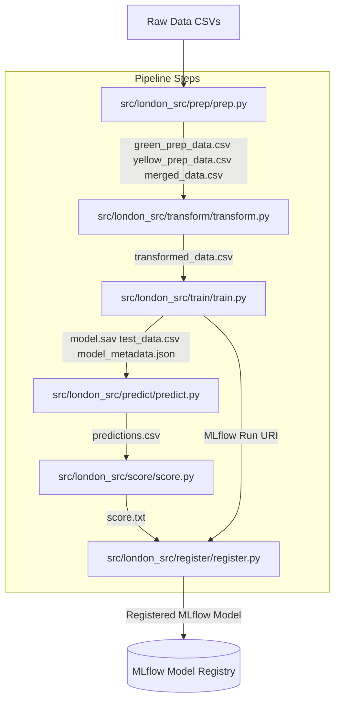
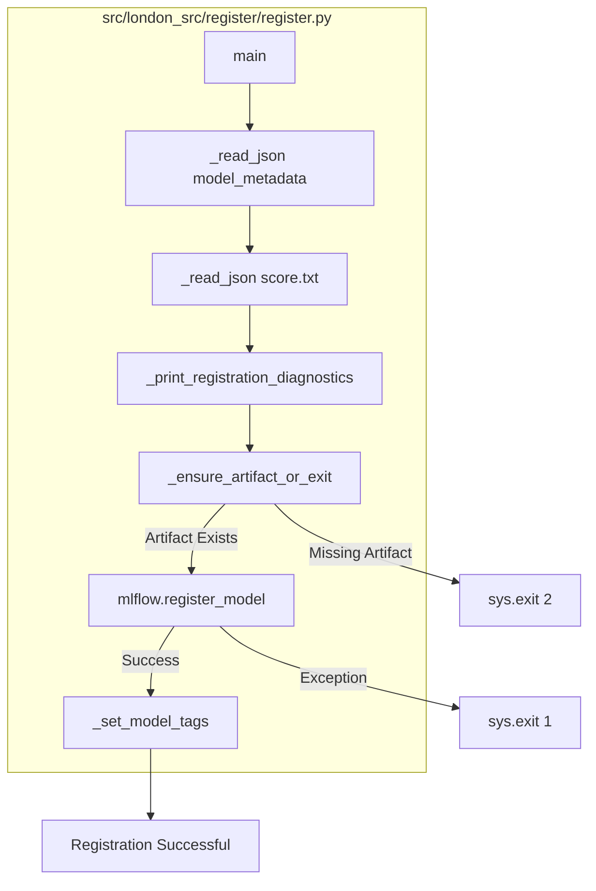

<!-- source: DeepWiki mcp.deepwiki.com · repo microsoft/dstoolkit-mlops-v2 · page 4.1 London Taxi Pipeline Steps · fetched 2026-11-09 -->

# London Taxi Pipeline Steps

Relevant source files

The following files were used as context for generating this wiki page:

- [src/london_src/predict/predict.py](src/london_src/predict/predict.py)
- [src/london_src/prep/prep.py](src/london_src/prep/prep.py)
- [src/london_src/register/register.py](src/london_src/register/register.py)
- [src/london_src/score/score.py](src/london_src/score/score.py)
- [src/london_src/train/train.py](src/london_src/train/train.py)
- [src/london_src/transform/transform.py](src/london_src/transform/transform.py)

This page details the technical implementation of the `london_src` data science pipeline. The pipeline implements a standard supervised regression workflow divided into six sequential execution steps: data preparation, transformation, training, prediction, scoring, and registration. Each step is structured as a standalone CLI script configured via arguments and integrated with MLflow for tracking and artifact management.

---

## Pipeline Architecture & Data Flow

The pipeline consumes raw multi-vendor taxi data, processes through cleaning and feature engineering, fits a scikit-learn Linear Regression model, evaluates predictions, and registers the validated model artifact in MLflow.

**Sources:**
- `src/london_src/prep/prep.py:16-129`
- `src/london_src/transform/transform.py:21-156`
- `src/london_src/train/train.py:23-169`
- `src/london_src/predict/predict.py:22-119`
- `src/london_src/score/score.py:21-104`
- `src/london_src/register/register.py:131-164`

---

## 1. Preparation Step (`prep.py`)

The preparation step reads raw input CSV files corresponding to green and yellow taxi vendors, normalizes vendor-specific column names to a unified schema, removes null records, and merges the datasets.

### Key Functions
- `main(raw_data, prep_data)` [src/london_src/prep/prep.py:16-49] — Discovers files in the raw data directory, extracts green and yellow data frames, and invokes `data_prep`.
- `data_prep(green_data, yellow_data, prep_data)` [src/london_src/prep/prep.py:51-129] — Applies column mapping and filtering dictionaries via `cleansedata`, concatenates the cleaned data frames, and serializes outputs (`green_prep_data.csv`, `yellow_prep_data.csv`, `merged_data.csv`).
- `cleansedata(data, columns, useful_columns)` [src/london_src/prep/prep.py:152-173] — Strips out null rows (`dropna(how="all")`), renames columns using mapped definitions, and subsets to `useful_columns`.

**Sources:**
- `src/london_src/prep/prep.py:16-173`

---

## 2. Transformation Step (`transform.py`)

The transformation step applies geographic boundary filters, cleans feature anomalies, extracts granular datetime features, and removes statistical outliers.

### Key Functions
- `main(clean_data, transformed_data)` [src/london_src/transform/transform.py:21-53] — Loads prepped CSV files from the input path, executes `transform_data`, and outputs `transformed_data.csv`.
- `transform_data(combined_df)` [src/london_src/transform/transform.py:62-156] — Performs the following operations:
  - Casts coordinate columns to `float64` [src/london_src/transform/transform.py:74-81].
  - Filters records within specified latitude/longitude bounds [src/london_src/transform/transform.py:83-92].
  - Replaces missing `store_forward` flags with `'N'` and missing distances with `0` [src/london_src/transform/transform.py:97-105].
  - Parses `pickup_datetime` and `dropoff_datetime` into granular fields (`weekday`, `month`, `monthday`, `hour`, `minute`, `second`) and drops raw timestamps [src/london_src/transform/transform.py:111-144].
  - Converts `store_forward` to binary indicator (0 for 'N', 1 otherwise) [src/london_src/transform/transform.py:146-148].
  - Filters out records where `distance <= 0` or `cost <= 0` [src/london_src/transform/transform.py:150-153].

**Sources:**
- `src/london_src/transform/transform.py:21-168`

---

## 3. Training Step (`train.py`)

The training step splits transformed data into training and testing partitions, trains a scikit-learn `LinearRegression` model, logs parameters and metrics via MLflow, and saves the trained model artifact and metadata.

### Key Functions
- `main(training_data, test_data, model_output, model_metadata)` [src/london_src/train/train.py:23-61] — Reads input CSV files, calls `split`, persists test data, and triggers model training.
- `split(train_data)` [src/london_src/train/train.py:63-115] — Isolates the target variable `cost` from feature columns, encodes categorical columns using `.cat.codes`, and splits data 70/30 using `train_test_split` with `random_state=42`.
- `train_model(train_x, trainy)` [src/london_src/train/train.py:118-153] — Fits a `LinearRegression` model under an active MLflow run (`mlflow.start_run`), logs the model artifact (`mlflow.sklearn.log_model`), exports model metadata containing the `run_id` and `run_uri`, and serializes the model binary (`model.sav`) via pickle.
- `write_test_data(test_x, testy)` [src/london_src/train/train.py:155-169] — Combines test features and targets and writes `test_data.csv`.

**Sources:**
- `src/london_src/train/train.py:23-169`

---

## 4. Prediction Step (`predict.py`)

The prediction step loads the serialized model and test dataset, computes batch predictions, and writes out an evaluation dataset containing both predicted and actual costs.

### Key Functions
- `main(model_input, test_data, prediction_path)` [src/london_src/predict/predict.py:22-41] — Orchestrates loading test data and generating predictions.
- `load_test_data(test_data)` [src/london_src/predict/predict.py:44-92] — Reads test CSV files, separates target values (`testy`) from feature matrix (`test_x`).
- `predict(test_x, testy, model_input, prediction_path)` [src/london_src/predict/predict.py:95-119] — Loads the model from `model.sav`, generates predictions, assigns `predicted_cost` and `actual_cost` columns, and writes `predictions.csv`.

**Sources:**
- `src/london_src/predict/predict.py:22-119`

---

## 5. Scoring Step (`score.py`)

The scoring step reads predictions, computes regression metrics (Mean Squared Error and Coefficient of Determination $R^2$), logs metrics to MLflow, and exports a score report JSON.

### Key Functions
- `main(predictions, model, score_report)` [src/london_src/score/score.py:21-61] — Loads prediction data frames and the pickled model, invoking `write_results`.
- `write_results(model, predictions, test_data, score_report)` [src/london_src/score/score.py:66-104] — Calculates MSE and $R^2$ using scikit-learn metrics, logs `scoring_mse` and `scoring_r2` to MLflow, and writes a structured score dictionary (`mse`, `coff`, `cod`) to `score.txt`.

**Sources:**
- `src/london_src/score/score.py:21-104`

---

## 6. Registration Step (`register.py`)

The registration step reads run metadata and score reports, validates the presence of required MLflow artifacts, registers the model version under the target model name, and applies evaluation tags.

### Key Functions & Diagnostic Lifecycle
- `main(model_metadata, model_name, score_report, build_reference)` [src/london_src/register/register.py:131-164] — Coordinates package version printing, MLflow tracking URI configuration, metadata ingestion, metric extraction, diagnostic validation, and model registration.
- `_ensure_artifact_or_exit(run_uri)` [src/london_src/register/register.py:95-113] — Validates artifact existence; exits with code `2` if the `model` artifact is missing.
- `_register_and_tag(run_uri, model_name, tags)` [src/london_src/register/register.py:116-129] — Registers the MLflow model and applies performance tags (`mse`, `coff`, `cod`, `build_id`), exiting with code `1` on failure.

**Sources:**
- `src/london_src/register/register.py:11-164`

---

