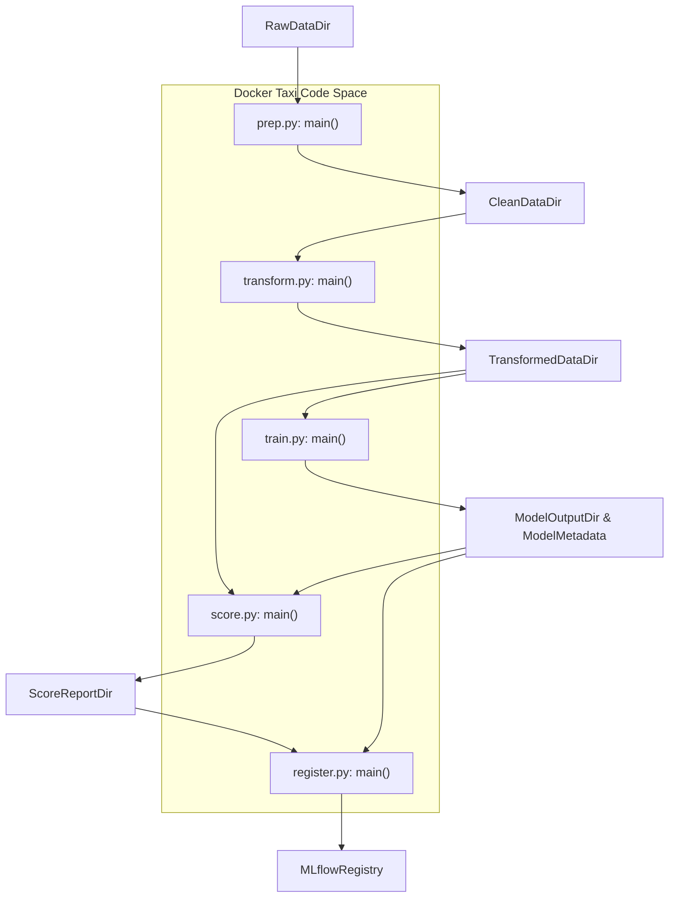

<!-- source: DeepWiki mcp.deepwiki.com · repo microsoft/dstoolkit-mlops-v2 · page 4.2 Docker Taxi Variant · fetched 2026-11-09 -->

# Docker Taxi Variant

Relevant source files

The following files were used as context for generating this wiki page:

- [mlops/docker_taxi/data/greenTaxiData.csv](mlops/docker_taxi/data/greenTaxiData.csv)
- [model/docker_taxi/online/score.py](model/docker_taxi/online/score.py)
- [model/london_taxi/online/score.py](model/london_taxi/online/score.py)
- [src/docker_taxi_src/prep/prep.py](src/docker_taxi_src/prep/prep.py)
- [src/docker_taxi_src/register/register.py](src/docker_taxi_src/register/register.py)
- [src/docker_taxi_src/score/score.py](src/docker_taxi_src/score/score.py)
- [src/docker_taxi_src/train/train.py](src/docker_taxi_src/train/train.py)
- [src/docker_taxi_src/transform/transform.py](src/docker_taxi_src/transform/transform.py)

## Purpose and Scope

The `docker_taxi_src` variant implements an end-to-end MLOps pipeline for the New York/London taxi fare prediction task, mirroring the business logic of the standard London Taxi pipeline while introducing a custom Docker build context execution environment. This variant exercises custom container image provisioning for Azure Machine Learning (AML) job steps and online/batch serving endpoints, bypassing default curated Conda environments.

Sources: 
- `src/docker_taxi_src/train/train.py:1-186` ()

---

## Pipeline Step Implementation Details

The `docker_taxi_src` pipeline is structured into five distinct script-driven execution stages managed via command-line arguments: preparation, transformation, training, scoring, and registration.

### 1. Data Preparation (`prep.py`)
The preparation script reads raw green and yellow taxi CSV datasets, maps vendor-specific columns to a unified schema, removes null records, and concatenates them into intermediate outputs [src/docker_taxi_src/prep/prep.py:1-128]().

*   **`main(raw_data, prep_data)`**: Orchestrates directory file enumeration, reading CSV files via `pandas`, and passing dataframes into `data_prep()` [src/docker_taxi_src/prep/prep.py:16-49]().
*   **`data_prep(green_data, yellow_data, prep_data)`**: Defines column mappings for green (`vendorID`, `lpepPickupDatetime`, etc.) and yellow (`vendorID`, `tpepPickupDateTime`, etc.) datasets, cleans them using `cleansedata()`, and exports `green_prep_data.csv`, `yellow_prep_data.csv`, and `merged_data.csv` [src/docker_taxi_src/prep/prep.py:51-128]().
*   **`cleansedata(data, columns, useful_columns)`**: Strips null records and subsets datasets to retained feature columns [src/docker_taxi_src/prep/prep.py:154-174]().

Sources:
- `src/docker_taxi_src/prep/prep.py:1-192` ()

### 2. Data Transformation (`transform.py`)
The transformation step filters geographical anomalies, normalizes features, and extracts granular temporal components from timestamps [src/docker_taxi_src/transform/transform.py:1-166]().

*   **`main(clean_data, transformed_data)`**: Loads prepped dataframes and passes the merged dataset to `transform_data()` [src/docker_taxi_src/transform/transform.py:18-50]().
*   **`transform_data(combined_df)`**: Enforces bounding box filters on pickup/longitude/latitude coordinates (New York/London limits), converts data types, derives temporal features (`pickup_weekday`, `pickup_hour`, etc.), drops raw datetime attributes, and filters out zero-cost/distance outliers [src/docker_taxi_src/transform/transform.py:59-166]().

Sources:
- `src/docker_taxi_src/transform/transform.py:1-176` ()

### 3. Model Training (`train.py`)
The training step fits a scikit-learn `LinearRegression` model, logs parameters and metrics via MLflow, and exports serialized artifacts and run metadata [src/docker_taxi_src/train/train.py:1-185]().

*   **`main(training_data, test_data, model_output, model_metadata)`**: Loads training data chunks, calls `split()`, writes out test partitions, and triggers training [src/docker_taxi_src/train/train.py:23-61]().
*   **`split(train_data)`**: Separates target label (`cost`) from feature columns, encodes categorical columns using `.cat.codes`, and splits data into training/testing partitions via `train_test_split` [src/docker_taxi_src/train/train.py:63-115]().
*   **`train_model(train_x, trainy)`**: Executes `LinearRegression().fit()`, logs models using `mlflow.sklearn.log_model()`, dumps the active run URI to metadata JSON, and saves the binary model (`model.sav`) [src/docker_taxi_src/train/train.py:118-153]().

Sources:
- `src/docker_taxi_src/train/train.py:1-186` ()

### 4. Model Scoring (`score.py`)
The evaluation script compares model predictions against actual outcomes to compute error metrics [src/docker_taxi_src/score/score.py:1-121]().

*   **`main(predictions, model, score_report)`**: Loads test predictions and unpickles the model file from `model.sav` [src/docker_taxi_src/score/score.py:21-61]().
*   **`write_results(model, predictions, test_data, score_report)`**: Calculates Mean Squared Error (MSE) and Coefficient of Determination ($R^2$), logs metrics using `mlflow.log_metric()`, and writes performance output to `score.txt` [src/docker_taxi_src/score/score.py:66-104]().

Sources:
- `src/docker_taxi_src/score/score.py:1-122` ()

### 5. Model Registration (`register.py`)
The registration script registers the MLflow model version with strict fail-fast diagnostics and custom version tagging [src/docker_taxi_src/register/register.py:1-189]().

*   **`main(model_metadata, model_name, score_report, build_reference)`**: Reads run metadata URIs, parses scoring metrics from `score.txt`, generates diagnostic traces, validates artifact existence, and registers the model [src/docker_taxi_src/register/register.py:131-165]().
*   **`_ensure_artifact_or_exit(run_uri)`**: Checks if the required `model` artifact exists under the given MLflow run; exits with status code `2` if missing [src/docker_taxi_src/register/register.py:95-113]().
*   **`_register_and_tag(run_uri, model_name, tags)`**: Calls `mlflow.register_model()` and applies custom tracking tags (`mse`, `coff`, `cod`, `build_id`) [src/docker_taxi_src/register/register.py:116-129]().

Sources:
- `src/docker_taxi_src/register/register.py:1-190` ()

---

## Pipeline Execution Flow Diagram

Sources:
- `src/docker_taxi_src/prep/prep.py:16-49` ()
- `src/docker_taxi_src/transform/transform.py:18-50` ()
- `src/docker_taxi_src/train/train.py:23-61` ()
- `src/docker_taxi_src/score/score.py:21-61` ()
- `src/docker_taxi_src/register/register.py:131-165` ()

---

## Custom Docker Build Context Environment

Unlike standard configurations that rely on managed Conda environments, the Docker Taxi variant packages its runtime dependencies via a custom container build context. 

### Online Inference Scoring Script (`model/docker_taxi/online/score.py`)
When deployed to online endpoints, the model is initialized within the custom container context using standard joblib deserialization:

*   **`init()`**: Resolves `AZUREML_MODEL_DIR`, loads `model.pkl` via `joblib.load()`, and configures logging [model/docker_taxi/online/score.py:9-21]().
*   **`run(raw_data)`**: Parses incoming JSON requests, converts payloads to `numpy.array`, performs inference via `model.predict()`, and returns results as lists [model/docker_taxi/online/score.py:23-37]().

Sources:
- `model/docker_taxi/online/score.py:1-38` ()

### Component to Code Entity Mapping

```mermaid
graph LR
    subgraph "Natural Language Space"
        LS1["Data Preparation"]
        LS2["Feature Transformation"]
        LS3["Model Training"]
        LS4["Model Scoring"]
        LS5["Model Registration"]
        LS6["Online Inference Serving"]
    end

    subgraph "Code Entity Space"
        CE1["src/docker_taxi_src/prep/prep.py::main"]
        CE2["src/docker_taxi_src/transform/transform.py::main"]
        CE3["src/docker_taxi_src/train/train.py::main"]
        CE4["src/docker_taxi_src/score/score.py::main"]
        CE5["src/docker_taxi_src/register/register.py::main"]
        CE6["model/docker_taxi/online/score.py::init"]
    end

    LS1 --> CE1
    LS2 --> CE2
    LS3 --> CE3
    LS4 --> CE4
    LS5 --> CE5
    LS6 --> CE6
```

Sources:
- `src/docker_taxi_src/prep/prep.py:16-49` ()
- `src/docker_taxi_src/transform/transform.py:18-50` ()
- `src/docker_taxi_src/train/train.py:23-61` ()
- `src/docker_taxi_src/score/score.py:21-61` ()
- `src/docker_taxi_src/register/register.py:131-165` ()
- `model/docker_taxi/online/score.py:9-21` ()

---

