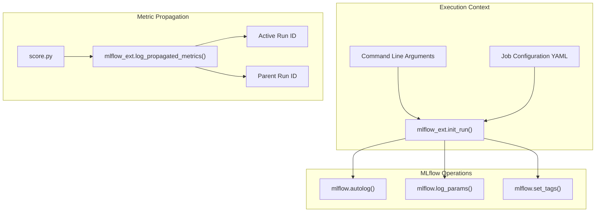

<!-- source: DeepWiki mcp.deepwiki.com · repo microsoft/dstoolkit-mlops-v2 · page 4.3 Sequence Model · fetched 2026-11-09 -->

# Sequence Model

<details>
<summary>Relevant source files</summary>

The following files were used as context for generating this wiki page:

- [src/sequence_model/benchmark/benchmark.py](src/sequence_model/benchmark/benchmark.py)
- [src/sequence_model/common/mlflow_ext.py](src/sequence_model/common/mlflow_ext.py)
- [src/sequence_model/common/seq_model.py](src/sequence_model/common/seq_model.py)
- [src/sequence_model/common/synthetic_data.py](src/sequence_model/common/synthetic_data.py)
- [src/sequence_model/common/tokenizer.py](src/sequence_model/common/tokenizer.py)
- [src/sequence_model/predict/predict.py](src/sequence_model/predict/predict.py)
- [src/sequence_model/register/register.py](src/sequence_model/register/register.py)
- [src/sequence_model/score/score.py](src/sequence_model/score/score.py)
- [src/sequence_model/train/train.py](src/sequence_model/train/train.py)

</details>


## Purpose and Scope

The `src/sequence_model` package implements an end-to-end n-gram sequence prediction pipeline within the `dstoolkit-mlops-v2` architecture. It handles synthetic data generation, vocabulary tokenization, n-gram model training, evaluation, scoring, benchmarking, and model registration via Azure ML and MLflow. 

---

## 1. Core Utilities & Data Generation

The sequence model relies on dedicated utility modules for synthetic dataset generation, token mapping, and n-gram probability estimation.

### Synthetic Data Generation
Synthetic text data is generated via `src/sequence_model/common/synthetic_data.py`, which populates a predefined vocabulary and splits data into training and test sets [src/sequence_model/common/synthetic_data.py:9-70]().
- `generate_synthetic_text_data()`: Creates a list of token sequences using random word choices from a static vocabulary list [src/sequence_model/common/synthetic_data.py:9-35]().
- `save_synthetic_data()`: Splits generated sequences 80/20 into `train.pkl` and `test.pkl` within the target data path [src/sequence_model/common/synthetic_data.py:38-70]().

### Tokenization (`Tokenizer`)
The `Tokenizer` class in `src/sequence_model/common/tokenizer.py` manages vocabulary indexing, handling special tokens `[EOS]` and `[UNK]`, and encoding/decoding textual data [src/sequence_model/common/tokenizer.py:8-113]().
- `train(corpus)`: Builds word-to-index (`words_to_i`) and index-to-word (`i_to_words`) mapping dictionaries [src/sequence_model/common/tokenizer.py:50-77]().
- `tokenize(corpus)`: Converts a sequence of strings into integer tokens, mapping out-of-vocabulary words to `[UNK]` [src/sequence_model/common/tokenizer.py:78-95]().

### N-Gram Model (`NgramModel`)
The `NgramModel` class in `src/sequence_model/common/seq_model.py` computes conditional probabilities of token sequences using maximum likelihood estimation over n-grams [src/sequence_model/common/seq_model.py:8-169]().
- `count(corpus)`: Counts occurrences of n-grams up to `max_ngram_length` [src/sequence_model/common/seq_model.py:97-125]().
- `train()`: Calculates probabilities for unigrams and higher-order n-grams [src/sequence_model/common/seq_model.py:161-169]().
- `predict(prior_tokens, top_n)`: Returns the top-n most likely succeeding tokens given prior context [src/sequence_model/common/seq_model.py:45-46]().

Sources:
- `src/sequence_model/common/synthetic_data.py:1-71`
- `src/sequence_model/common/tokenizer.py:1-114`
- `src/sequence_model/common/seq_model.py:1-169`

---

## 2. Pipeline Execution Steps

The sequence model pipeline executes distinct modular CLI scripts for training, predicting, scoring, benchmarking, and registration.

```mermaid
graph TD
    A["SyntheticDataGen: synthetic_data.py"] -->| "train.pkl / test.pkl" | B["TrainingStep: train.py"]
    B -->| "model_dict.pkl / tokenizer.json" | C["PredictionStep: predict.py"]
    C -->| "predictions.npy" | D["ScoringStep: score.py"]
    D -->| "score_report.json" | E["BenchmarkStep: benchmark.py"]
    E -->| "benchmark.json" | F["RegistrationStep: register.py"]
    F -->| "Azure ML Model Registry" | G["Model Registry"]

    sub-class1["src/sequence_model/common/synthetic_data.py"]
    sub-class2["src/sequence_model/train/train.py"]
    sub-class3["src/sequence_model/predict/predict.py"]
    sub-class4["src/sequence_model/score/score.py"]
    sub-class5["src/sequence_model/benchmark/benchmark.py"]
    sub-class6["src/sequence_model/register/register.py"]
```
*Sources: `src/sequence_model/common/synthetic_data.py:38-71](), [src/sequence_model/train/train.py:53-163](), [src/sequence_model/predict/predict.py:56-198](), [src/sequence_model/score/score.py:48-146](), [src/sequence_model/benchmark/benchmark.py:186-222](), [src/sequence_model/register/register.py:141-177]()`*

### Training (`train.py`)
- **Inputs**: `--dataset_folder`, `--model_artifacts`, `--model_config` [src/sequence_model/train/train.py:57-75]().
- **Behavior**: Loads training data (`train.pkl`), instantiates and trains `Tokenizer`, tokenizes the corpus, fits `NgramModel`, and serializes artifacts (`model_dict.pkl`, `tokenizer.json`, metadata) [src/sequence_model/train/train.py:133-163]().

### Prediction (`predict.py`)
- **Inputs**: `--dataset_folder`, `--model_artifacts`, `--predictions_folder`, `--model_config` [src/sequence_model/predict/predict.py:60-90]().
- **Behavior**: Loads the trained model and tokenizer, reads test data (`test.pkl`), and generates top-n token predictions saved as `predictions.npy` [src/sequence_model/predict/predict.py:115-198]().

### Scoring (`score.py`)
- **Inputs**: `--predictions_folder`, `--score_report_folder`, `--model_config` [src/sequence_model/score/score.py:52-74]().
- **Behavior**: Compares predicted top-n tokens against ground truth tokens across test sequences to compute accuracy metrics, writing results to `score_report.json` [src/sequence_model/score/score.py:116-143]().

### Benchmarking (`benchmark.py`)
- **Inputs**: `--model_config`, `--score_report_folder`, `--benchmark_report_folder` [src/sequence_model/benchmark/benchmark.py:31-44]().
- **Behavior**: Validates scoring metrics against threshold criteria defined in `model_config.yml` and compares against prior model versions in the workspace. Outputs `benchmark.json` [src/sequence_model/benchmark/benchmark.py:186-220]().

### Registration (`register.py`)
- **Inputs**: `--model_config`, `--model_name`, `--score_report_folder`, `--model_artifacts`, `--benchmark_report_folder`, `--predictions_folder` [src/sequence_model/register/register.py:28-63]().
- **Behavior**: Consolidates evaluation artifacts, model binaries, and prediction folders into an `artifacts/model_registration/` directory and registers a custom model asset with Azure ML using `MLClient` [src/sequence_model/register/register.py:68-134]().

Sources:
- `src/sequence_model/train/train.py:1-164`
- `src/sequence_model/predict/predict.py:1-199`
- `src/sequence_model/score/score.py:1-147`
- `src/sequence_model/benchmark/benchmark.py:1-222`
- `src/sequence_model/register/register.py:1-178`

---

## 3. MLflow Extension & Configuration

### MLflow Tracking Integration (`mlflow_ext.py`)
`src/sequence_model/common/mlflow_ext.py` provides wrapper functions around standard MLflow calls to standardize experiment logging, parameter tracking, and metric propagation across pipeline components [src/sequence_model/common/mlflow_ext.py:1-152]().
- `init_run()`: Initializes MLflow tracking, configures local/remote URIs, autologging, and logs combined command-line arguments and job configurations [src/sequence_model/common/mlflow_ext.py:13-48]().
- `log_propagated_metrics()`: Records metrics to both the active run and its parent run context [src/sequence_model/common/mlflow_ext.py:122-138]().


*Sources: `src/sequence_model/common/mlflow_ext.py:13-48](), [src/sequence_model/common/mlflow_ext.py:122-138]()`*

Sources:
- `src/sequence_model/common/mlflow_ext.py:1-153`

---

