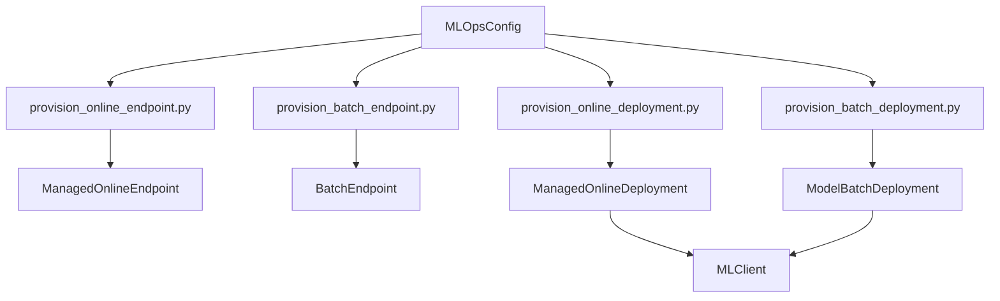
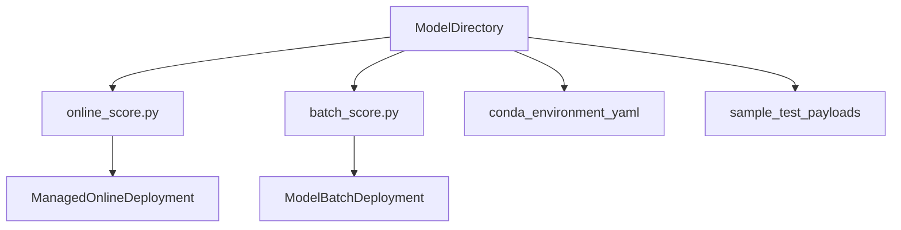

<!-- source: DeepWiki mcp.deepwiki.com · repo microsoft/dstoolkit-mlops-v2 · page 5 Deployment & Serving · fetched 2026-11-09 -->

# Deployment & Serving

Relevant source files

The following files were used as context for generating this wiki page:

- [mlops/common/deployment/provision_batch_deployment.py](mlops/common/deployment/provision_batch_deployment.py)
- [mlops/common/deployment/provision_batch_endpoint.py](mlops/common/deployment/provision_batch_endpoint.py)
- [mlops/common/deployment/provision_online_deployment.py](mlops/common/deployment/provision_online_deployment.py)
- [mlops/common/deployment/provision_online_endpoint.py](mlops/common/deployment/provision_online_endpoint.py)

The Deployment & Serving layer bridges registered Azure ML models from the model registry to operational online (real-time managed) and batch endpoints. This section covers how configurations defined in `config.yaml` drive endpoint and deployment provisioning, how scoring scripts are executed inside container environments, and how models undergo validation, promotion, and artifact cleanup prior to production release.

Since this is a parent page, high-level summaries and architectural pointers are provided below. For deep technical walkthroughs, refer to the respective child pages.

## 5.1 Endpoint & Deployment Provisioning

Provisioning in the MLOps pipeline separates endpoint creation from deployment creation. Online and batch endpoints are provisioned via dedicated scripts (`provision_online_endpoint.py` and `provision_batch_endpoint.py`) using `MLClient` and configuration retrieved through `MLOpsConfig`. Deployments (`provision_online_deployment.py` and `provision_batch_deployment.py`) bind the registered model, scoring code, compute targets, and container environments (such as `prs-env`) to those provisioned endpoints.

For complete details, including parameter inputs and retry logic configurations, see [Endpoint & Deployment Provisioning](#5.1).

*Diagram: Provisioning Architecture & Code Entities*

Sources: `mlops/common/deployment/provision_batch_deployment.py:76-169` [mlops/common/deployment/provision_batch_deployment.py:76-169](), `mlops/common/deployment/provision_online_deployment.py:1-174` [mlops/common/deployment/provision_online_deployment.py:1-174](), `mlops/common/deployment/provision_online_endpoint.py:68-132` [mlops/common/deployment/provision_online_endpoint.py:68-132](), `mlops/common/deployment/provision_batch_endpoint.py:67-130` [mlops/common/deployment/provision_batch_endpoint.py:67-130]()

## 5.2 Scoring Scripts & Serving Environments

Model serving relies on specialized scoring assets located under individual model directories (`model/<type>/online` and `model/<type>/batch`). These directories house the entrypoint `score.py` scripts (implementing initialization and execution hooks) along with custom Conda environment configurations (`conda.yml`) and sample test payloads used for validation.

For complete details on execution runtimes and payload schemas, see [Scoring Scripts & Serving Environments](#5.2).

*Diagram: Serving Runtime Structure*

Sources: `mlops/common/deployment/provision_batch_deployment.py:141-168` [mlops/common/deployment/provision_batch_deployment.py:141-168](), `mlops/common/deployment/provision_online_deployment.py:1-174` [mlops/common/deployment/provision_online_deployment.py:1-174]()

## 5.3 Model Promotion, Testing & Artifact Cleanup

Before models transition to downstream stages or production, they undergo validation via test suites (`run_test_model_on_aml` and `run_test_batch_deployment`). Successful models are tagged using `approve_model` to designate governance approval. Additionally, workspace hygiene is maintained via automated routines that query and clean up stale registered models and unused run artifacts.

For full validation workflows and cleanup routines, see [Model Promotion, Testing & Artifact Cleanup](#5.3).

Sources: `mlops/common/deployment/provision_batch_deployment.py:99-130` [mlops/common/deployment/provision_batch_deployment.py:99-130](), `mlops/common/deployment/provision_online_deployment.py:1-174` [mlops/common/deployment/provision_online_deployment.py:1-174]()

---

