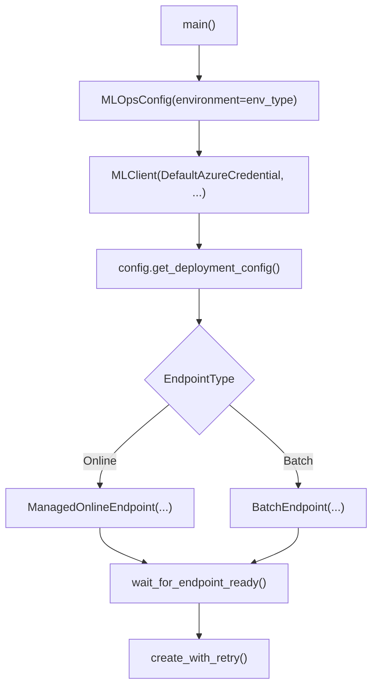
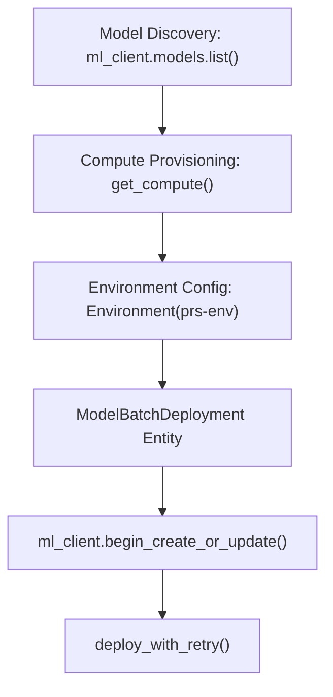

<!-- source: DeepWiki mcp.deepwiki.com · repo microsoft/dstoolkit-mlops-v2 · page 5.1 Endpoint & Deployment Provisioning · fetched 2026-11-09 -->

# Endpoint & Deployment Provisioning

Relevant source files

The following files were used as context for generating this wiki page:

- [mlops/common/deployment/provision_batch_deployment.py](mlops/common/deployment/provision_batch_deployment.py)
- [mlops/common/deployment/provision_batch_endpoint.py](mlops/common/deployment/provision_batch_endpoint.py)
- [mlops/common/deployment/provision_online_deployment.py](mlops/common/deployment/provision_online_deployment.py)
- [mlops/common/deployment/provision_online_endpoint.py](mlops/common/deployment/provision_online_endpoint.py)

## Purpose and Scope
This page details the provisioning scripts and configuration workflows responsible for deploying registered machine learning models to Azure Machine Learning online (real-time managed) and batch endpoints. The provisioning framework utilizes the Azure Machine Learning Python SDK (`MLClient`) and is driven by the centralized MLOps configuration system (`MLOpsConfig`). 

The scope covers four core orchestration scripts located under `mlops/common/deployment/`:
* Online endpoint creation (`provision_online_endpoint.py`) [mlops/common/deployment/provision_online_endpoint.py:1-132]()
* Batch endpoint creation (`provision_batch_endpoint.py`) [mlops/common/deployment/provision_batch_endpoint.py:1-130]()
* Online model deployment (`provision_online_deployment.py`) [mlops/common/deployment/provision_online_deployment.py:1-332]()
* Batch model deployment (`provision_batch_deployment.py`) [mlops/common/deployment/provision_batch_deployment.py:1-214]()

Sources: 
- `mlops/common/deployment/provision_online_endpoint.py:1-133`
- `mlops/common/deployment/provision_batch_endpoint.py:1-131`
- `mlops/common/deployment/provision_online_deployment.py:1-333`
- `mlops/common/deployment/provision_batch_deployment.py:1-215`

---

## 1. Endpoint Provisioning Workflow
Endpoint provisioning establishes the control plane routing targets (either `ManagedOnlineEndpoint` or `BatchEndpoint`) before any model artifacts are bound to compute resources. 

### CLI Arguments and Inputs
All endpoint provisioning scripts accept three standard command-line arguments parsed via `argparse`:
* `--model_type`: The registered model type identifier (e.g., `london_taxi`, `sequence_model`) [mlops/common/deployment/provision_online_endpoint.py:71-73](), [mlops/common/deployment/provision_batch_endpoint.py:70-72]().
* `--environment_name`: The target deployment environment (`dev`, `test`, `prod`) [mlops/common/deployment/provision_online_endpoint.py:74-78](), [mlops/common/deployment/provision_batch_endpoint.py:73-77]().
* `--run_id`: The Azure ML pipeline run identifier that generated the model [mlops/common/deployment/provision_online_endpoint.py:79-82](), [mlops/common/deployment/provision_batch_endpoint.py:78-81]().

### Endpoint Entity Creation
The scripts initialize `MLClient` using `DefaultAzureCredential()` and pull deployment properties via `MLOpsConfig.get_deployment_config()` [mlops/common/deployment/provision_online_endpoint.py:89-112](), [mlops/common/deployment/provision_batch_endpoint.py:88-112](). 

Sources: 
- `mlops/common/deployment/provision_online_endpoint.py:68-129`
- `mlops/common/deployment/provision_batch_endpoint.py:67-127`

---

## 2. Deployment Provisioning & Compute Binding
Once endpoints exist, specific model versions are attached to managed compute infrastructure through `provision_online_deployment.py` and `provision_batch_deployment.py`.

### Batch Deployment Architecture
`provision_batch_deployment.py` resolves the latest registered model version matching `generate_model_name(model_type)` [mlops/common/deployment/provision_batch_deployment.py:108-127](), provisions or validates batch compute targets using `get_compute()` [mlops/common/deployment/provision_batch_deployment.py:132-139](), and constructs a `ModelBatchDeployment` entity [mlops/common/deployment/provision_batch_deployment.py:147-168]().

Key configuration components for batch deployments include:
* **Environment (`prs-env`)**: Built from `deployment_conda_path` and `deployment_base_image` [mlops/common/deployment/provision_batch_deployment.py:141-145]().
* **CodeConfiguration**: Specifies `score_dir` and `score_file_name` [mlops/common/deployment/provision_batch_deployment.py:153-155]().
* **ModelBatchDeploymentSettings**: Configures `instance_count`, `max_concurrency_per_instance`, `mini_batch_size`, `output_action` (`BatchDeploymentOutputAction.APPEND_ROW`), and `BatchRetrySettings` [mlops/common/deployment/provision_batch_deployment.py:157-167]().

Sources: 
- `mlops/common/deployment/provision_batch_deployment.py:97-169`

---

## 3. Resilience, Retries, and Diagnostics
Because Azure ML control plane operations frequently experience concurrent operation conflicts (`ResourceExistsError`), all provisioning modules implement exponential backoff retry wrappers and diagnostic collection hooks.

### Retry Logic and Error Handling
* `wait_for_endpoint_ready()` polls endpoint `provisioning_state` every 30 seconds up to a maximum wait time (default 600s) [mlops/common/deployment/provision_online_endpoint.py:15-39](), [mlops/common/deployment/provision_batch_endpoint.py:15-39]().
* `create_with_retry()` catches `ResourceExistsError` or operation conflicts, applying an exponential backoff factor (`initial_delay * (2 ** attempt)`) [mlops/common/deployment/provision_online_endpoint.py:42-65](), [mlops/common/deployment/provision_batch_endpoint.py:42-64]().
* `_dump_deployment_diagnostics()` and `_fetch_and_save_async_operation()` extract detailed failure payloads from Azure async operation URIs when online or batch deployments enter `Failed` or `Canceled` states [mlops/common/deployment/provision_online_deployment.py:22-115]().

Sources: 
- `mlops/common/deployment/provision_online_endpoint.py:15-65`
- `mlops/common/deployment/provision_batch_endpoint.py:15-64`
- `mlops/common/deployment/provision_online_deployment.py:22-165`
- `mlops/common/deployment/provision_batch_deployment.py:24-73`

---

