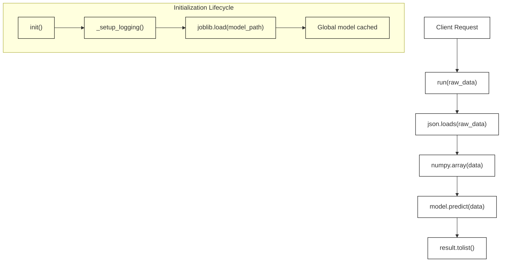
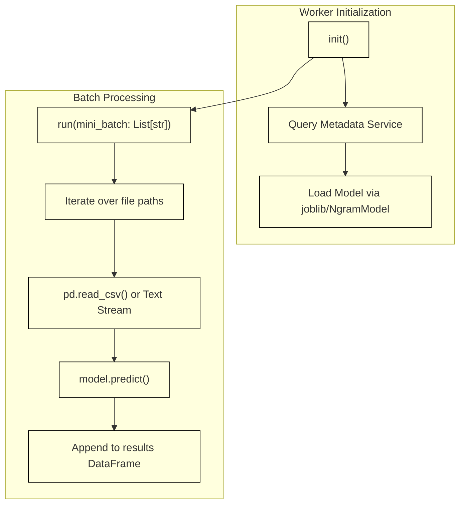

<!-- source: DeepWiki mcp.deepwiki.com · repo microsoft/dstoolkit-mlops-v2 · page 5.2 Scoring Scripts & Serving Environments · fetched 2026-11-09 -->

# Scoring Scripts & Serving Environments

Relevant source files

The following files were used as context for generating this wiki page:

- [.vscode/settings.json](.vscode/settings.json)
- [model/docker_taxi/batch/score.py](model/docker_taxi/batch/score.py)
- [model/docker_taxi/batch_environment/conda.yml](model/docker_taxi/batch_environment/conda.yml)
- [model/docker_taxi/online/score.py](model/docker_taxi/online/score.py)
- [model/docker_taxi/online_test_data/sample-request.json](model/docker_taxi/online_test_data/sample-request.json)
- [model/london_taxi/batch/score.py](model/london_taxi/batch/score.py)
- [model/london_taxi/batch_environment/conda.yml](model/london_taxi/batch_environment/conda.yml)
- [model/london_taxi/online/score.py](model/london_taxi/online/score.py)
- [model/sequence_model/batch/score.py](model/sequence_model/batch/score.py)
- [model/sequence_model/batch_environment/conda.yml](model/sequence_model/batch_environment/conda.yml)
- [model/sequence_model/batch_test_data/sequence_model.csv](model/sequence_model/batch_test_data/sequence_model.csv)
- [model/sequence_model/online/score.py](model/sequence_model/online/score.py)
- [model/sequence_model/online_test_data/sample-request.json](model/sequence_model/online_test_data/sample-request.json)
- [src/docker_taxi_src/score/score.py](src/docker_taxi_src/score/score.py)
- [src/docker_taxi_src/train/train.py](src/docker_taxi_src/train/train.py)
- [src/docker_taxi_src/transform/transform.py](src/docker_taxi_src/transform/transform.py)

## Purpose and Scope
This section details the scoring implementation and runtime serving environments for online and batch model deployments across model types (`london_taxi`, `docker_taxi`, and `sequence_model`). Scoring scripts define the inference contract required by Azure Machine Learning (AML) managed endpoints and parallel run steps (PRS). They handle artifact deserialization, runtime environment diagnostics, request parsing, and model execution via standard `init()` and `run()` entrypoints.

---

## Online Scoring Architecture & Implementation
Online endpoints invoke `score.py` scripts located under `model/<type>/online/`. These scripts expose an initialization hook and a request execution hook.

For `london_taxi`, the online scoring script initializes logging and loads the scikit-learn model from the `AZUREML_MODEL_DIR` environment variable [model/london_taxi/online/score.py:19-41](). The `run` function processes JSON payloads, converts input features into a NumPy array, invokes prediction, and returns serialized outputs [model/london_taxi/online/score.py:43-66]().

*Diagram 1: Online scoring execution flow linking client payload parsing to model prediction.*

**Sources:**
- `model/london_taxi/online/score.py`

---

## Batch Scoring & Parallel Run Step (PRS) Implementation
Batch scoring scripts under `model/<type>/batch/` handle high-throughput, distributed batch inferencing using Azure ML Parallel Run Step (PRS). 

The batch scoring lifecycle consists of:
1. **`init()`**: Executes upon worker startup. It queries the Azure instance metadata service to log managed identity diagnostics, reads environment configuration, and loads model binaries (and tokenizers for sequence models) into memory [model/london_taxi/batch/score.py:10-53](), [model/sequence_model/batch/score.py:13-54]().
2. **`run(mini_batch)`**: Iterates over assigned file paths within the `mini_batch` list, executes domain-specific data loading (e.g., pandas CSV reading or text stream tokenization), executes predictions, and accumulates structured outputs into a `pd.DataFrame` [model/london_taxi/batch/score.py:55-81](), [model/sequence_model/batch/score.py:56-89]().

*Diagram 2: Batch inference execution pipeline across PRS workers.*

**Sources:**
- `model/london_taxi/batch/score.py`
- `model/docker_taxi/batch/score.py`
- `model/sequence_model/batch/score.py`

---

## Serving Environments & Conda Specifications
Serving and batch execution environments define the runtime dependencies required by scoring scripts. These are declared as Conda environment configuration files (`conda.yml`) stored in `model/<type>/batch_environment/` or online environment folders.

The sequence model batch environment (`prs-env`) specifies Python 3.10 along with core data science and NLP packages, as well as `azureml-core` and dataset runtimes [model/sequence_model/batch_environment/conda.yml:1-16](). Similarly, the london taxi batch environment defines pinned versions of `numpy`, `scikit-learn`, and pandas [model/london_taxi/batch_environment/conda.yml:1-12]().

| Environment Name | Target Path | Key Dependencies | Purpose |
| :--- | :--- | :--- | :--- |
| `prs-env` | `model/sequence_model/batch_environment/conda.yml` | `python=3.10`, `tqdm`, `nltk`, `azureml-core==1.60.0` | Sequence model batch execution [model/sequence_model/batch_environment/conda.yml:1-16]() |
| `prs-env` | `model/london_taxi/batch_environment/conda.yml` | `python=3.10`, `numpy==1.26.4`, `scikit-learn==1.3.2` | London Taxi batch scoring [model/london_taxi/batch_environment/conda.yml:1-12]() |

**Sources:**
- `model/sequence_model/batch_environment/conda.yml`
- `model/london_taxi/batch_environment/conda.yml`

---

## Sample Test Payloads & Inference Data
To validate online endpoints and batch scoring pipelines locally or post-deployment, sample test payloads are provided alongside model configurations.

- **Online Test Payloads**: JSON payloads structured for HTTP request bodies, such as `sample-request.json` providing input tokens for the sequence model [model/sequence_model/online_test_data/sample-request.json:1-3]().
- **Batch Test Data**: CSV or text files located under `batch_test_data/`, such as `sequence_model.csv` containing multi-line input sequences for distributed file-based batch scoring [model/sequence_model/batch_test_data/sequence_model.csv:1-3]().

**Sources:**
- `model/sequence_model/online_test_data/sample-request.json`
- `model/sequence_model/batch_test_data/sequence_model.csv`

---

