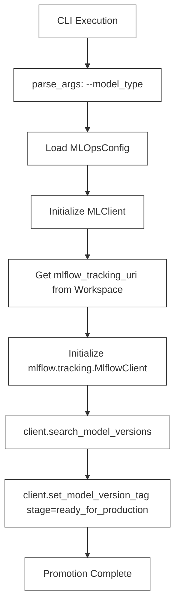
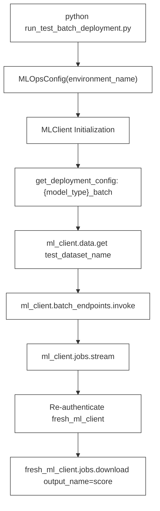
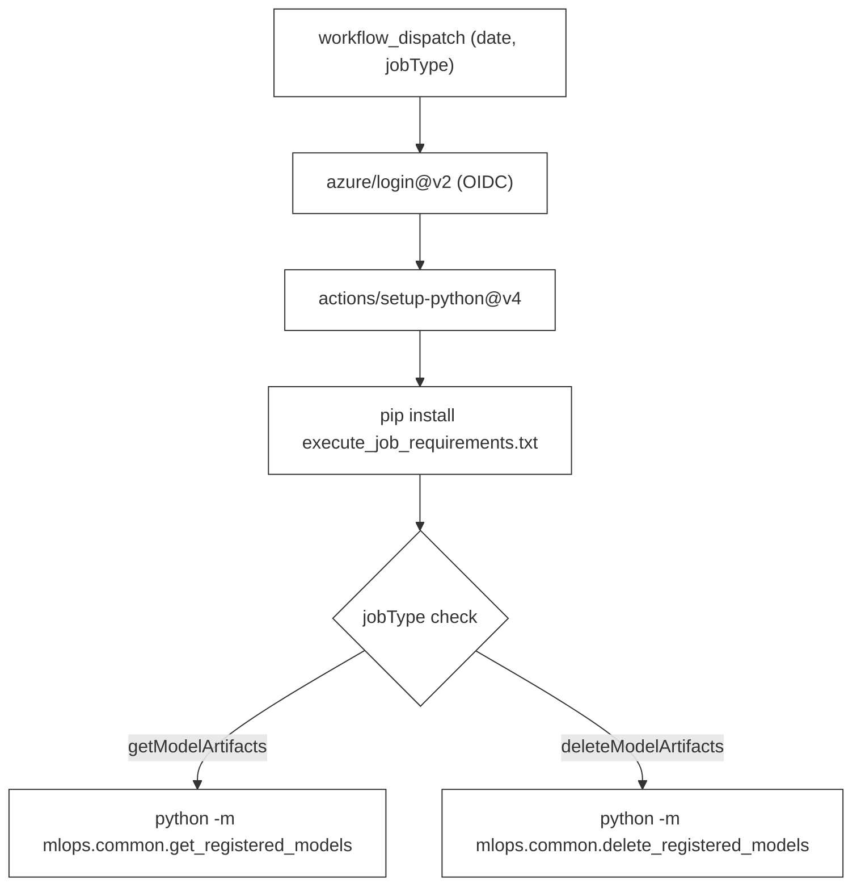

<!-- source: DeepWiki mcp.deepwiki.com · repo microsoft/dstoolkit-mlops-v2 · page 5.3 Model Promotion, Testing & Artifact Cleanup · fetched 2026-11-09 -->

# Model Promotion, Testing & Artifact Cleanup

Relevant source files

The following files were used as context for generating this wiki page:

- [.github/workflows/cleanup_model_artifacts.yml](.github/workflows/cleanup_model_artifacts.yml)
- [docs/design-decisions/ModelPromotion.md](docs/design-decisions/ModelPromotion.md)
- [docs/how-to/ModelFactoryAssetMgmt.md](docs/how-to/ModelFactoryAssetMgmt.md)
- [docs/media/cleanup-registered-models.png](docs/media/cleanup-registered-models.png)
- [docs/media/conceptual-overview.png](docs/media/conceptual-overview.png)
- [docs/media/dataset-lifecycle.png](docs/media/dataset-lifecycle.png)
- [docs/media/delete-job-types.png](docs/media/delete-job-types.png)
- [docs/media/delete-model-artifacts.png](docs/media/delete-model-artifacts.png)
- [docs/media/get-model-artifacts.png](docs/media/get-model-artifacts.png)
- [docs/media/github-workflows.png](docs/media/github-workflows.png)
- [docs/media/model-factory-workflow.png](docs/media/model-factory-workflow.png)
- [mlops/common/deployment/approve_model.py](mlops/common/deployment/approve_model.py)
- [mlops/common/deployment/delete_registered_models.py](mlops/common/deployment/delete_registered_models.py)
- [mlops/common/deployment/get_registered_models.py](mlops/common/deployment/get_registered_models.py)
- [mlops/common/deployment/run_test_batch_deployment.py](mlops/common/deployment/run_test_batch_deployment.py)
- [mlops/common/deployment/run_test_model_on_aml.py](mlops/common/deployment/run_test_model_on_aml.py)

## Purpose and Scope
This section covers the post-registration lifecycle phases within the model factory architecture: model promotion through version tagging, validation testing for both online and batch deployments, and automated registry cleanup workflows for obsolete model artifacts.

Sources: `mlops/common/deployment/approve_model.py:1-51` [mlops/common/deployment/approve_model.py:1-51](), `mlops/common/deployment/run_test_model_on_aml.py:1-54` [mlops/common/deployment/run_test_model_on_aml.py:1-53](), `mlops/common/deployment/run_test_batch_deployment.py:1-76` [mlops/common/deployment/run_test_batch_deployment.py:1-75]()

---

## Model Approval and Promotion Tagging (`approve_model.py`)
Once a model is successfully trained and registered, promotion to production readiness is managed via the `approve_model.py` script [mlops/common/deployment/approve_model.py:1-51](). 

### Implementation Details
The script accepts a `--model_type` argument, instantiates `MLOpsConfig` [mlops/common/config_utils.py](), and connects to the Azure Machine Learning workspace using `DefaultAzureCredential` and `MLClient` [mlops/common/deployment/approve_model.py:24-31](). It retrieves the MLflow tracking URI from the workspace, configures MLflow, and queries the model registry for the latest model version [mlops/common/deployment/approve_model.py:35-43](). Finally, it applies a metadata tag (`stage: ready_for_production`) to that specific model version [mlops/common/deployment/approve_model.py:45-47](). Downstream continuous delivery (CD) workflows evaluate this tag to trigger production deployment.

*Figure 1: Model Approval and Promotion Data Flow.*

Sources: `mlops/common/deployment/approve_model.py:14-48` [mlops/common/deployment/approve_model.py:14-48]()

---

## Online Endpoint Testing (`run_test_model_on_aml.py`)
Validation of deployed online scoring endpoints is handled by `run_test_model_on_aml.py` [mlops/common/deployment/run_test_model_on_aml.py:1-53]().

### Key Functions and Logic
* **Arguments**: Requires `--model_type` and `--environment_name` (e.g., `dev`, `test`, `prod`) [mlops/common/deployment/run_test_model_on_aml.py:10-20]().
* **Configuration Lookup**: Resolves online deployment settings via `config.get_deployment_config(deployment_name=f"{model_type}_online")` [mlops/common/deployment/run_test_model_on_aml.py:34]().
* **Invocation**: Uses `ml_client.online_endpoints.invoke` passing the target `endpoint_name`, `deployment_name`, and payload `request_file` path defined in the environment configuration [mlops/common/deployment/run_test_model_on_aml.py:43-47]().

Sources: `mlops/common/deployment/run_test_model_on_aml.py:8-53` [mlops/common/deployment/run_test_model_on_aml.py:8-53]()

---

## Batch Endpoint Testing (`run_test_batch_deployment.py`)
Asynchronous batch deployments are tested via `run_test_batch_deployment.py` [mlops/common/deployment/run_test_batch_deployment.py:1-75]().

### Execution Flow
1. **Config & Client Initialization**: Loads environment configuration and establishes an `MLClient` instance [mlops/common/deployment/run_test_batch_deployment.py:28-35]().
2. **Dataset Resolution**: Retrieves the test dataset reference from the batch deployment configuration (`config.get_deployment_config`) and wraps it in an AML `Input` object [mlops/common/deployment/run_test_batch_deployment.py:37-43]().
3. **Job Invocation & Monitoring**: Invokes the batch endpoint (`ml_client.batch_endpoints.invoke`), streams job execution logs (`ml_client.jobs.stream`), and inspects the parent/child scoring job status [mlops/common/deployment/run_test_batch_deployment.py:45-56]().
4. **Artifact Download**: Re-authenticates to prevent token expiration during long-running batch executions, then downloads scoring results via `fresh_ml_client.jobs.download` [mlops/common/deployment/run_test_batch_deployment.py:63-71]().

*Figure 2: Batch Endpoint Testing and Result Download Flow.*

Sources: `mlops/common/deployment/run_test_batch_deployment.py:11-72` [mlops/common/deployment/run_test_batch_deployment.py:11-72]()

---

## Model Artifact Lifecycle Management (`get_registered_models.py` & `delete_registered_models.py`)
To prevent storage bloat and maintain governance in the Azure Machine Learning model registry, utility scripts identify and remove obsolete model artifacts based on a clean-up threshold date.

### Identification (`get_registered_models.py`)
* Connects to the legacy Azure ML workspace using `Workspace.get()` [mlops/common/deployment/get_registered_models.py:52-55]().
* Lists all registered models via `Model.list(ws)` [mlops/common/deployment/get_registered_models.py:57]().
* Filters models where `model.created_time.date() < clean_up_date` and prints candidates for deletion [mlops/common/deployment/get_registered_models.py:37-41]().

### Deletion (`delete_registered_models.py`)
* Iterates through models matching the date threshold filter and invokes `model.delete()` on each artifact [mlops/common/deployment/delete_registered_models.py:38-44]().

Sources: `mlops/common/deployment/get_registered_models.py:1-61` [mlops/common/deployment/get_registered_models.py:1-60](), `mlops/common/deployment/delete_registered_models.py:1-64` [mlops/common/deployment/delete_registered_models.py:1-63]()

---

## Automated Cleanup Workflow (`cleanup_model_artifacts.yml`)
Model artifact cleanup is automated via the GitHub Actions workflow `.github/workflows/cleanup_model_artifacts.yml` [.github/workflows/cleanup_model_artifacts.yml:1-63]().

### Workflow Parameters and Steps
* **Trigger**: Workflow dispatch (`workflow_dispatch`) with inputs for `date` (format `YYYY-MM-DD`) and `jobType` (choice of `getModelArtifacts` or `deleteModelArtifacts`) [.github/workflows/cleanup_model_artifacts.yml:4-18]().
* **Authentication**: Logs into Azure using OpenID Connect (OIDC) via `azure/login@v2` with `id-token: write` permissions [.github/workflows/cleanup_model_artifacts.yml:30-46]().
* **Execution**: Installs job requirements and conditionally executes either `mlops.common.get_registered_models` or `mlops.common.delete_registered_models` [.github/workflows/cleanup_model_artifacts.yml:51-63]().

*Figure 3: GitHub Actions Cleanup Workflow Architecture.*

Sources: `.github/workflows/cleanup_model_artifacts.yml:1-64` [.github/workflows/cleanup_model_artifacts.yml:1-63]()

---

