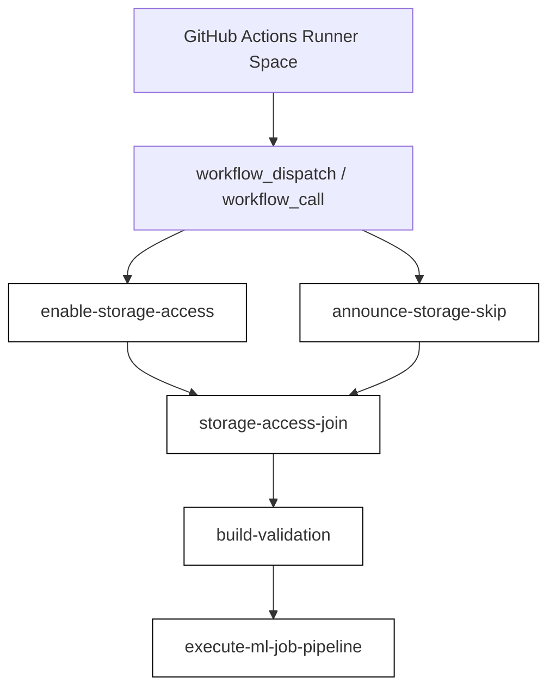
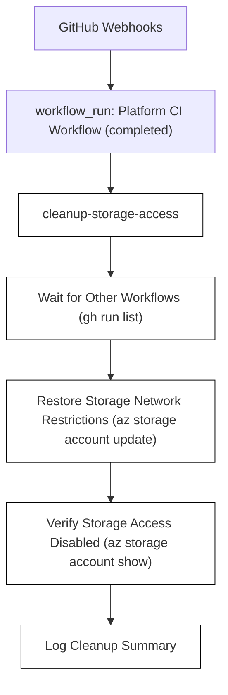
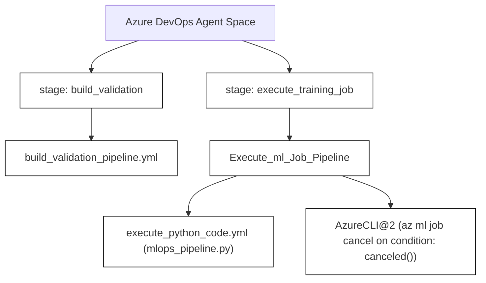

<!-- source: DeepWiki mcp.deepwiki.com · repo microsoft/dstoolkit-mlops-v2 · page 6.1 Platform CI/CD Workflows · fetched 2026-11-09 -->

# Platform CI/CD Workflows

<details>
<summary>Relevant source files</summary>

The following files were used as context for generating this wiki page:

- [.azure-pipelines/templates/platform_ci_pipeline.yml](.azure-pipelines/templates/platform_ci_pipeline.yml)
- [.github/workflows/deploy_online_only.yml](.github/workflows/deploy_online_only.yml)
- [.github/workflows/platform_cd_workflow.yml](.github/workflows/platform_cd_workflow.yml)
- [.github/workflows/platform_ci_workflow.yml](.github/workflows/platform_ci_workflow.yml)
- [.github/workflows/storage_access_cleanup.yml](.github/workflows/storage_access_cleanup.yml)
- [.gitignore](.gitignore)
- [test_model_discovery.ps1](test_model_discovery.ps1)

</details>


## Purpose and Scope
This page details the platform-level Continuous Integration (CI) and Continuous Deployment (CD) workflows defined for Model Factory (`dstoolkit-mlops-v2`). These workflows—principally `.github/workflows/platform_ci_workflow.yml`, `.github/workflows/platform_cd_workflow.yml`, and `.github/workflows/storage_access_cleanup.yml`—orchestrate end-to-end model validation, training job execution, continuous deployment, and network security hardening (such as dynamic storage account access toggling) [.github/workflows/platform_ci_workflow.yml:1-153](), [.github/workflows/platform_cd_workflow.yml:1-175](), [.github/workflows/storage_access_cleanup.yml:1-142]().

---

## 1. Platform CI Workflow (`platform_ci_workflow.yml`)

The platform CI workflow is designed as both a standalone workflow (triggered via `workflow_dispatch`) and a reusable workflow (`workflow_call`) that per-model entry workflows can invoke [.github/workflows/platform_ci_workflow.yml:1-48](). It uses OpenID Connect (OIDC) via `id-token: write` to securely authenticate against Azure without storing long-lived credentials [.github/workflows/platform_ci_workflow.yml:49-62]().

### Workflow Inputs and Environment
The workflow accepts several parameters to control execution behavior:
* `exec_environment`: Target execution environment string (default: `"pr"`) [.github/workflows/platform_ci_workflow.yml:6-8]()
* `model_type`: Target model type identifier (e.g., `london_taxi`, `sequence_model`) [.github/workflows/platform_ci_workflow.yml:9-11]()
* `is_docker`: Boolean flag determining whether Docker is used for build validation [.github/workflows/platform_ci_workflow.yml:12-14]()
* `enable_storage_public_access`: Boolean flag to temporarily lift storage account network restrictions during training job execution [.github/workflows/platform_ci_workflow.yml:15-17]()

### Job Topology
The CI workflow comprises five interconnected jobs:


*Sources: [.github/workflows/platform_ci_workflow.yml:63-153]()*

1. **`enable-storage-access`**: Conditionally executes if `enable_storage_public_access` is `true`. It authenticates via `configure_azureml_agent` and updates the Azure Storage Account via `az storage account update` to set `--default-action Allow` and `--public-network-access Enabled`, waiting 15 seconds for propagation [.github/workflows/platform_ci_workflow.yml:64-94]().
2. **`announce-storage-skip`**: Executes if `enable_storage_public_access` is `false`, logging diagnostic guidance regarding RBAC and private endpoint configurations [.github/workflows/platform_ci_workflow.yml:104-114]().
3. **`storage-access-join`**: A join job with `if: ${{ always() }}` that synchronizes execution paths regardless of whether storage was opened or skipped [.github/workflows/platform_ci_workflow.yml:115-124]().
4. **`build-validation`**: Depends on `storage-access-join` and calls `build_validation_workflow.yml` to run linting, unit tests, and image building [.github/workflows/platform_ci_workflow.yml:95-103]().
5. **`execute-ml-job-pipeline`**: Configures the Azure ML agent and triggers the Python MLOps orchestration script via `execute_shell_code`:
   ```bash
   python -m mlops.${{ inputs.model_type }}.src.mlops_pipeline \
       --build_environment ${{ inputs.exec_environment }} \
       --wait_for_completion True
   ```
   [.github/workflows/platform_ci_workflow.yml:125-153]()

Sources: [.github/workflows/platform_ci_workflow.yml:1-153]()

---

## 2. Platform CD Workflow (`platform_cd_workflow.yml`)

The platform CD workflow (`platform_cd_workflow.yml`) automates training execution, run metadata extraction, and continuous deployment of registered models to online endpoints [.github/workflows/platform_cd_workflow.yml:1-175]().

### Execution Stages
1. **`execute-training-job`**:
   * Checks out code and configures the Azure ML agent [.github/workflows/platform_cd_workflow.yml:20-29]().
   * Optionally toggles storage public network access if requested [.github/workflows/platform_cd_workflow.yml:30-46]().
   * Executes the standard MLOps pipeline script, outputting the Azure ML Run ID to `run_id.txt` [.github/workflows/platform_cd_workflow.yml:47-58]().
   * Reads the run ID into GitHub environment variables (`RUN_NAME`) and queries run metadata using `mlops.common.get_run_metadata` into `metadata.txt` [.github/workflows/platform_cd_workflow.yml:59-81]().
2. **`deploy-online`**:
   * Triggers conditionally when `vars.IS_ONLINE_DEPLOYMENT == 'True'` and depends on `execute-training-job` [.github/workflows/platform_cd_workflow.yml:82-89]().
   * Copies model-specific common scoring files (`src/${{ inputs.model_type }}/common/*`) to `model/${{ inputs.model_type }}/online` [.github/workflows/platform_cd_workflow.yml:101-110]().
   * Runs storage configuration diagnostics (`az storage account show`) and tests Azure Active Directory (AD) blob access mode login (`az storage container list --auth-mode login`) [.github/workflows/platform_cd_workflow.yml:111-131]().
   * Discovers the latest published model name using `naming_utils.generate_model_name`, lists matching models via `az ml model list`, and executes an AD-auth model download smoke test (`az ml model download`) [.github/workflows/platform_cd_workflow.yml:132-175]().

Sources: [.github/workflows/platform_cd_workflow.yml:1-175]()

---

## 3. Storage Network Access Toggling and Cleanup

To comply with enterprise security baselines while supporting training jobs that require broad data egress or ingress, the platform supports temporary public network access toggling on the Azure Storage Account. Because multiple parallel CI runs may interact with the storage account simultaneously, `storage_access_cleanup.yml` manages safe reversion [.github/workflows/storage_access_cleanup.yml:1-142]().

### Cleanup Workflow Architecture (`storage_access_cleanup.yml`)


*Sources: [.github/workflows/storage_access_cleanup.yml:1-142]()*

### Implementation Details of Cleanup Logic
* **Trigger**: Activated automatically upon the completion of any `Platform CI Workflow` run [.github/workflows/storage_access_cleanup.yml:1-7]().
* **Concurrency Guard**: Polls GitHub CLI (`gh run list`) up to 60 iterations (30-minute timeout at 30-second intervals) to verify that no other active `platform_ci_workflow.yml` or `storage_access_cleanup.yml` instances are running against the same commit SHA and branch [.github/workflows/storage_access_cleanup.yml:34-88]().
* **Restoration**: Once all concurrent runs finish (or timeout is reached), it updates the storage account to restrict access [.github/workflows/storage_access_cleanup.yml:89-98]():
  ```bash
  az storage account update \
    --name ${{ env.STORAGE_ACCOUNT_NAME }} \
    --resource-group ${{ env.RESOURCE_GROUP_NAME }} \
    --subscription ${{ env.SUBSCRIPTION_ID }} \
    --default-action Deny \
    --public-network-access Disabled
  ```
* **Verification**: Queries current properties (`publicNetworkAccess` and `networkRuleSet.defaultAction`) to ensure storage restrictions are successfully enforced [.github/workflows/storage_access_cleanup.yml:100-121]().

Sources: [.github/workflows/storage_access_cleanup.yml:1-142]()

---

## 4. Legacy Azure DevOps Pipelines (`platform_ci_pipeline.yml`)

Prior to GitHub Actions adoption, pipeline logic was defined via Azure DevOps templates. The legacy template `.azure-pipelines/templates/platform_ci_pipeline.yml` mirrors the build validation and training execution stages [.azure-pipelines/templates/platform_ci_pipeline.yml:1-55]().


*Sources: [.azure-pipelines/templates/platform_ci_pipeline.yml:1-55]()*

The legacy Azure DevOps pipeline features an explicit cancellation handler (`AzureCLI@2`) that parses `run_id.txt` and invokes `az ml job cancel` if a user cancels the pipeline mid-execution [.azure-pipelines/templates/platform_ci_pipeline.yml:39-55]().

Sources: [.azure-pipelines/templates/platform_ci_pipeline.yml:1-55]()

---

