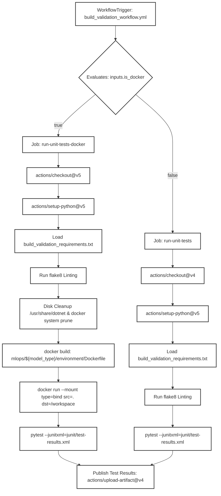
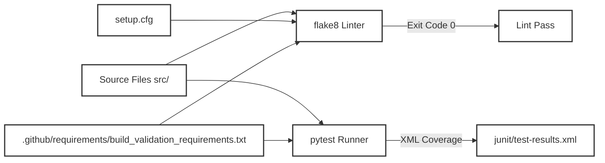

<!-- source: DeepWiki mcp.deepwiki.com · repo microsoft/dstoolkit-mlops-v2 · page 6.2 Build Validation & Agent Setup · fetched 2026-11-09 -->

# Build Validation & Agent Setup

<details>
<summary>Relevant source files</summary>

The following files were used as context for generating this wiki page:

- [.amlignore](.amlignore)
- [.devcontainer/base/Dockerfile](.devcontainer/base/Dockerfile)
- [.devcontainer/base/README.md](.devcontainer/base/README.md)
- [.devcontainer/base/devcontainer.json](.devcontainer/base/devcontainer.json)
- [.devcontainer/docker_taxi/devcontainer.json](.devcontainer/docker_taxi/devcontainer.json)
- [.github/actions/configure_azureml_agent/action.yml](.github/actions/configure_azureml_agent/action.yml)
- [.github/requirements/build_validation_requirements.txt](.github/requirements/build_validation_requirements.txt)
- [.github/requirements/execute_job_requirements.txt](.github/requirements/execute_job_requirements.txt)
- [.github/workflows/build_validation_workflow.yml](.github/workflows/build_validation_workflow.yml)
- [.github/workflows/infra_provision_bicep.yml](.github/workflows/infra_provision_bicep.yml)
- [infra/bicep/README.md](infra/bicep/README.md)
- [mlops/docker_taxi/environment/Dockerfile](mlops/docker_taxi/environment/Dockerfile)
- [mlops/london_taxi/components/predict.yml](mlops/london_taxi/components/predict.yml)
- [mlops/london_taxi/components/prep.yml](mlops/london_taxi/components/prep.yml)
- [mlops/london_taxi/components/register.yml](mlops/london_taxi/components/register.yml)
- [mlops/london_taxi/components/score.yml](mlops/london_taxi/components/score.yml)
- [mlops/london_taxi/components/train.yml](mlops/london_taxi/components/train.yml)
- [mlops/london_taxi/components/transform.yml](mlops/london_taxi/components/transform.yml)
- [setup.cfg](setup.cfg)

</details>


## Purpose and Scope

This page documents the continuous integration (CI) build validation mechanics, linting standards, test execution environments (native vs. Docker), requirement dependency separation, and reusable composite actions defined within the `microsoft/dstoolkit-mlops-v2` repository. The build validation pipeline guarantees that all pull requests and workflow dispatches undergo rigorous static analysis, unit testing, and artifact publishing prior to MLOps pipeline orchestration.

---

## 1. Build Validation Workflow Topology (Docker vs. Native)

The core build validation orchestration is defined in `.github/workflows/build_validation_workflow.yml` [.github/workflows/build_validation_workflow.yml:1-146()]. This reusable workflow accepts inputs `image_name`, `model_type`, and `is_docker` [.github/workflows/build_validation_workflow.yml:5-18()] to branch between a native GitHub-hosted runner execution and a custom Docker container validation path.

### Execution Path Selection

- **Native Execution (`run-unit-tests`)**: Executed when `is_docker` is `false` [.github/workflows/build_validation_workflow.yml:101-103()]. Runs directly on `ubuntu-latest` by checking out the code, setting up Python, loading build validation requirements, running `flake8`, and executing `pytest` with coverage [.github/workflows/build_validation_workflow.yml:104-146()].
- **Docker Execution (`run-unit-tests-docker`)**: Executed when `is_docker` is `true` [.github/workflows/build_validation_workflow.yml:24-26()]. Cleans up runner disk space, builds the target model's container from `mlops/${{ inputs.model_type }}/environment/Dockerfile`, and mounts the workspace to run linters and tests inside the isolated container runtime [.github/workflows/build_validation_workflow.yml:65-94()].



**Sources:** `.github/workflows/build_validation_workflow.yml:1-146()`, `mlops/docker_taxi/environment/Dockerfile:1-36()`

---

## 2. Linting and Testing Configuration

Code formatting and static analysis are strictly enforced via `flake8` [setup.cfg:1-7()], using configurations specified in `setup.cfg`. Unit testing and code coverage utilize `pytest` alongside plugins for mocking and XML/Azure DevOps test reporting [.github/requirements/build_validation_requirements.txt:1-15()].

### Flake8 Configuration Rules

The linter ignores specific docstring and line-break warnings while enforcing code complexity thresholds:
- `ignore = D104 W503` [setup.cfg:2()]
- `exclude = __pycache__, .venv, test` [setup.cfg:3()]
- `max-complexity = 10` [setup.cfg:4()]
- `max-line-length = 120` [setup.cfg:5()]



**Sources:** `setup.cfg:1-7()`, `.github/requirements/build_validation_requirements.txt:1-15()`

---

## 3. Requirements Files & Environment Dependency Management

The repository maintains isolated requirements lists depending on whether the job is validating code via CI checks or executing Azure Machine Learning (AML) jobs.

| Requirements File | Target Context | Key Packages Included |
|-------------------|----------------|-----------------------|
| `.github/requirements/build_validation_requirements.txt` | CI Build Validation & PR checks | `flake8`, `pytest`, `pytest-cov`, `pytest-mock`, `mlflow-skinny==2.14.3`, `azure-ai-ml>=1.30.0` |
| `.github/requirements/execute_job_requirements.txt` | AML Execution & Orchestration | `azure-ai-ml==1.30.0`, `azure-identity==1.16.1`, `mlflow-skinny==2.14.3`, `mldesigner==0.1.0b4`, `marshmallow==3.20.2` |

**Sources:** `.github/requirements/build_validation_requirements.txt:1-15()`, `.github/requirements/execute_job_requirements.txt:1-10()`

---

## 4. Composite Actions & Agent Configuration

To standardize runner bootstrapping across GitHub workflows, the repository defines a composite action located at `.github/actions/configure_azureml_agent/action.yml` [.github/actions/configure_azureml_agent/action.yml:1-73()].

### Composite Action Execution Flow

1. **Input Debugging**: Validates length and format presence for `arm_client_id`, `arm_tenant_id`, and `subscription_id` [.github/actions/configure_azureml_agent/action.yml:22-48()].
2. **Cache Purging**: Clears residual Azure CLI and MSAL caches (`msal_http_cache.bin`, `msal_token_cache.bin`, `service_principal_entries.bin`) to prevent authentication token collisions on self-hosted or persistent runners [.github/actions/configure_azureml_agent/action.yml:49-57()].
3. **Azure Authentication**: Executes `azure/login@v2` using OIDC workload identity parameters [.github/actions/configure_azureml_agent/action.yml:58-64()].
4. **Environment Setup**: Provisions Python via `actions/setup-python@v5` and upgrades `pip`, installing execution dependencies from `execute_job_requirements.txt` [.github/actions/configure_azureml_agent/action.yml:65-73()].

```mermaid
sequenceDiagram
    participant GH as "GitHub Workflow"
    participant ACT as "configure_azureml_agent/action.yml"
    participant AZ as "Azure CLI / login@v2"
    participant PY as "Python Environment"

    GH->>ACT: Invokes composite action with ARM inputs
    ACT->>ACT: Debug inputs & print masked ID snippets
    ACT->>ACT: Clear ~/.azure/*.bin token caches
    ACT->>AZ: azure/login@v2 (OIDC Service Principal)
    AZ--conf-->ACT: Authentication established
    ACT->>PY: actions/setup-python@v5 (versionSpec)
    PY->>PY: python -m pip install --upgrade pip
    PY->>PY: pip install -r execute_job_requirements.txt
    ACT-->>GH: Runner ready for MLOps orchestration
```

**Sources:** `.github/actions/configure_azureml_agent/action.yml:1-73()`

---

