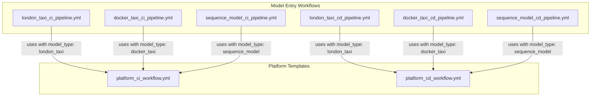
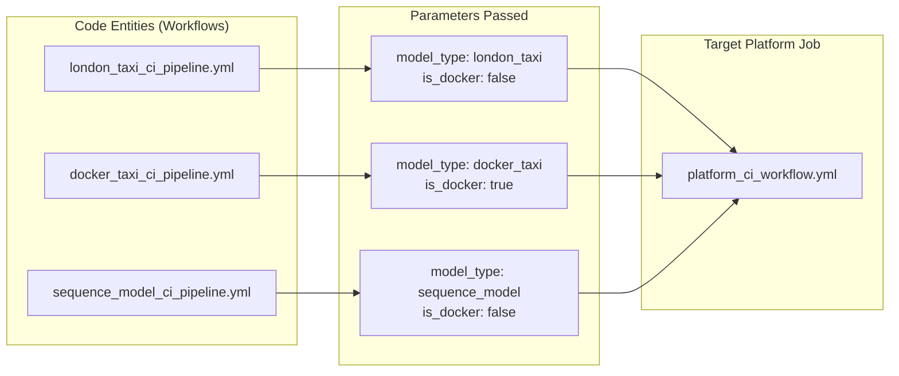

<!-- source: DeepWiki mcp.deepwiki.com · repo microsoft/dstoolkit-mlops-v2 · page 6.3 Per-Model CI/CD Entry Workflows · fetched 2026-11-09 -->

# Per-Model CI/CD Entry Workflows

Relevant source files

The following files were used as context for generating this wiki page:

- [.github/actions/execute_shell_code/action.yml](.github/actions/execute_shell_code/action.yml)
- [.github/workflows/docker_taxi_cd_pipeline.yml](.github/workflows/docker_taxi_cd_pipeline.yml)
- [.github/workflows/docker_taxi_ci_pipeline.yml](.github/workflows/docker_taxi_ci_pipeline.yml)
- [.github/workflows/london_taxi_cd_pipeline.yml](.github/workflows/london_taxi_cd_pipeline.yml)
- [.github/workflows/london_taxi_ci_pipeline.yml](.github/workflows/london_taxi_ci_pipeline.yml)
- [.github/workflows/sequence_model_cd_pipeline.yml](.github/workflows/sequence_model_cd_pipeline.yml)
- [.github/workflows/sequence_model_ci_pipeline.yml](.github/workflows/sequence_model_ci_pipeline.yml)
- [mlops/sequence_model/components/benchmark.yml](mlops/sequence_model/components/benchmark.yml)
- [mlops/sequence_model/components/predict.yml](mlops/sequence_model/components/predict.yml)
- [mlops/sequence_model/components/register.yml](mlops/sequence_model/components/register.yml)
- [mlops/sequence_model/components/score.yml](mlops/sequence_model/components/score.yml)

### Purpose and Scope
This page documents the per-model continuous integration (CI) and continuous deployment (CD) entry workflows implemented in GitHub Actions for the Model Factory (`dstoolkit-mlops-v2`) platform. It covers the specific configurations, trigger criteria, path filtering logic, and input propagation mechanisms for `london_taxi`, `docker_taxi` (Custom Object Detection), and `sequence_model`, detailing how these per-model entry points delegate execution to centralized platform templates.

Sources: 
- `[.github/workflows/london_taxi_ci_pipeline.yml:1-44]()`
- `[.github/workflows/docker_taxi_ci_pipeline.yml:1-57]()`
- `[.github/workflows/sequence_model_ci_pipeline.yml:1-36]()`

---

## 1. Workflow Architecture & Platform Template Delegation

The Model Factory architecture separates model-specific triggers and path scopes from core execution logic. Each model type (`london_taxi`, `docker_taxi`, `sequence_model`) provides dedicated CI (`_ci_pipeline.yml`) and CD (`_cd_pipeline.yml`) workflow files. These files act as thin wrappers that define:
1. **Event Triggers**: `pull_request`, `push` to `main`, `workflow_dispatch`, and `workflow_call`.
2. **Path Filters**: Restricting execution to files modified within specific `mlops/`, `model/`, `src/`, and `test/` subdirectories.
3. **Template Parameters**: Passing specific values for `model_type` and `is_docker` to the reusable core workflows (`platform_ci_workflow.yml` and `platform_cd_workflow.yml`).

*Figure 1: Delegation topology from model-specific entry workflows to core platform templates.*

Sources: 
- `[.github/workflows/london_taxi_ci_pipeline.yml:1-44]()`
- `[.github/workflows/docker_taxi_ci_pipeline.yml:1-57]()`
- `[.github/workflows/sequence_model_ci_pipeline.yml:1-36]()`
- `[.github/workflows/london_taxi_cd_pipeline.yml:1-40]()`
- `[.github/workflows/docker_taxi_cd_pipeline.yml:1-33]()`
- `[.github/workflows/sequence_model_cd_pipeline.yml:1-33]()`

---

## 2. London Taxi Workflows

The London Taxi model pipelines manage standard tabular processing and regression tasks via native Python environments (`is_docker: false`).

### London Taxi CI Workflow (`london_taxi_ci_pipeline.yml`)
The CI pipeline triggers on pull requests targeting `main`, manual dispatches, or external workflow calls. It scopes checks using explicit path filters across the London taxi directory tree.

- **Triggers**: `workflow_dispatch`, `pull_request` (branch `main`), `workflow_call` [`[.github/workflows/london_taxi_ci_pipeline.yml:3-23]()`].
- **Path Filtering**: `.github/**`, `mlops/common/**`, `mlops/london_taxi/**`, `model/london_taxi/**`, `src/london_src/**`, `test/london_taxi/**` [`[.github/workflows/london_taxi_ci_pipeline.yml:15-21]()`].
- **Permissions**: Requires `id-token: write` and `contents: read` to support OIDC workload identity federation with Azure [`[.github/workflows/london_taxi_ci_pipeline.yml:34-36]()`].
- **Job Execution**: Invokes `run-ci-workflow` using `.github/workflows/platform_ci_workflow.yml` with `exec_environment`, `model_type: london_taxi`, and `is_docker: false` [`[.github/workflows/london_taxi_ci_pipeline.yml:38-43]()`].

### London Taxi CD Workflow (`london_taxi_cd_pipeline.yml`)
The CD pipeline executes continuous deployment routines upon pushing changes to `main` or via manual triggers.

- **Triggers**: `workflow_dispatch`, `push` (branch `main`), `workflow_call` [`[.github/workflows/london_taxi_cd_pipeline.yml:2-20]()`].
- **Path Filtering**: `mlops/common/**`, `mlops/london_taxi/**`, `model/london_taxi/**`, `src/london_src/**`, `test/london_taxi/**` [`[.github/workflows/london_taxi_cd_pipeline.yml:14-19]()`].
- **Job Execution**: Invokes `run-cd-workflow` using `.github/workflows/platform_cd_workflow.yml` with `exec_environment: dev` and `model_type: london_taxi` [`[.github/workflows/london_taxi_cd_pipeline.yml:36-40]()`].

Sources: 
- `[.github/workflows/london_taxi_ci_pipeline.yml:1-44]()`
- `[.github/workflows/london_taxi_cd_pipeline.yml:1-40]()`

---

## 3. Custom Object Detection Workflows (`docker_taxi`)

The `docker_taxi` model workflow handles custom containerized workloads where build validation and training environments depend on a custom Docker build context.

### Custom Object Detection CI Workflow (`docker_taxi_ci_pipeline.yml`)
- **Triggers**: `pull_request` (branch `main`), `workflow_dispatch`, `workflow_call` [`[.github/workflows/docker_taxi_ci_pipeline.yml:3-31]()`].
- **Inputs**: Supports `exec_environment`, `model_type`, and `is_docker` (default: `true`) [`[.github/workflows/docker_taxi_ci_pipeline.yml:15-30]()`].
- **Path Filtering**: Scoped to `.github/**`, `mlops/common/**`, `mlops/docker_taxi/**`, `model/docker_taxi/**`, `src/docker_taxi_src/**`, and `test/docker_taxi/**` [`[.github/workflows/docker_taxi_ci_pipeline.yml:7-13]()`].
- **Job Execution**: Calls `platform_ci_workflow.yml`, resolving `is_docker` dynamically: evaluates to `true` during pull requests or reads the input parameter for manual dispatches [`[.github/workflows/docker_taxi_ci_pipeline.yml:52-57]()`].

### Custom Object Detection CD Workflow (`docker_taxi_cd_pipeline.yml`)
- **Triggers**: `push` (branch `main`), `workflow_call` [`[.github/workflows/docker_taxi_cd_pipeline.yml:3-13]()`].
- **Job Execution**: Dispatches `platform_cd_workflow.yml` with `model_type: docker_taxi` [`[.github/workflows/docker_taxi_cd_pipeline.yml:29-33]()`].

Sources: 
- `[.github/workflows/docker_taxi_ci_pipeline.yml:1-57]()`
- `[.github/workflows/docker_taxi_cd_pipeline.yml:1-33]()`

---

## 4. Sequence Model Workflows

The sequence model pipeline orchestrates sequence-based processing, evaluation, benchmarking, and registration tasks.

### Sequence Model CI Workflow (`sequence_model_ci_pipeline.yml`)
- **Triggers**: `pull_request` (branch `main`), `workflow_call` [`[.github/workflows/sequence_model_ci_pipeline.yml:3-14]()`].
- **Path Filtering**: Restricted to `.github/**`, `mlops/common/**`, `mlops/sequence_model/**`, `model/sequence_model/**`, `src/sequence_model/**`, and `test/sequence_model/**` [`[.github/workflows/sequence_model_ci_pipeline.yml:7-13]()`].
- **Job Execution**: Invokes `run-pr-workflow` referencing `.github/workflows/platform_ci_workflow.yml` with `model_type: sequence_model` and `is_docker: false` [`[.github/workflows/sequence_model_ci_pipeline.yml:29-35]()`].

### Sequence Model CD Workflow (`sequence_model_cd_pipeline.yml`)
- **Triggers**: `push` (branch `main`), `workflow_call` [`[.github/workflows/sequence_model_cd_pipeline.yml:3-13]()`].
- **Job Execution**: Calls `platform_cd_workflow.yml` with `model_type: sequence_model` and `exec_environment: dev` [`[.github/workflows/sequence_model_cd_pipeline.yml:28-33]()`].

Sources: 
- `[.github/workflows/sequence_model_ci_pipeline.yml:1-36]()`
- `[.github/workflows/sequence_model_cd_pipeline.yml:1-33]()`

---

## 5. Parameter Propagation and Code Entity Mapping

The integration between the model wrappers and platform workflows relies on strict schema inputs (`model_type`, `exec_environment`, `is_docker`).

*Figure 2: Mapping model entry workflow files to platform CI workflow parameter contracts.*

Sources: 
- `[.github/workflows/london_taxi_ci_pipeline.yml:38-43]()`
- `[.github/workflows/docker_taxi_ci_pipeline.yml:52-57]()`
- `[.github/workflows/sequence_model_ci_pipeline.yml:29-35]()`

---

