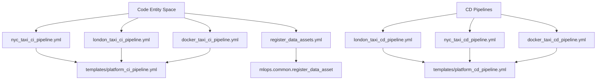
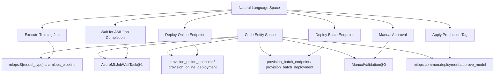

<!-- source: DeepWiki mcp.deepwiki.com · repo microsoft/dstoolkit-mlops-v2 · page 6.4 Legacy Azure DevOps Pipelines · fetched 2026-11-09 -->

# Legacy Azure DevOps Pipelines

Relevant source files

The following files were used as context for generating this wiki page:

- [.azure-pipelines/docker_taxi_cd_pipeline.yml](.azure-pipelines/docker_taxi_cd_pipeline.yml)
- [.azure-pipelines/docker_taxi_ci_pipeline.yml](.azure-pipelines/docker_taxi_ci_pipeline.yml)
- [.azure-pipelines/london_taxi_cd_pipeline.yml](.azure-pipelines/london_taxi_cd_pipeline.yml)
- [.azure-pipelines/london_taxi_ci_pipeline.yml](.azure-pipelines/london_taxi_ci_pipeline.yml)
- [.azure-pipelines/nyc_taxi_cd_pipeline.yml](.azure-pipelines/nyc_taxi_cd_pipeline.yml)
- [.azure-pipelines/nyc_taxi_ci_pipeline.yml](.azure-pipelines/nyc_taxi_ci_pipeline.yml)
- [.azure-pipelines/register_data_assets.yml](.azure-pipelines/register_data_assets.yml)
- [.azure-pipelines/requirements/build_validation_requirements.txt](.azure-pipelines/requirements/build_validation_requirements.txt)
- [.azure-pipelines/requirements/execute_job_requirements.txt](.azure-pipelines/requirements/execute_job_requirements.txt)
- [.azure-pipelines/templates/build_validation_pipeline.yml](.azure-pipelines/templates/build_validation_pipeline.yml)
- [.azure-pipelines/templates/configure_azureml_agent.yml](.azure-pipelines/templates/configure_azureml_agent.yml)
- [.azure-pipelines/templates/platform_cd_pipeline.yml](.azure-pipelines/templates/platform_cd_pipeline.yml)

### Purpose and Scope
This section details the legacy Azure DevOps pipeline configurations located in the `.azure-pipelines/` directory. Although Azure DevOps is fully retired as the primary CI/CD platform in favor of GitHub Actions, these template definitions, per-model pipelines, and requirements files are retained for historical and reference purposes until their scheduled removal on `2026-01-31` [/.azure-pipelines/register_data_assets.yml:1-1](), [/.azure-pipelines/nyc_taxi_ci_pipeline.yml:1-1]().

---

## 1. Directory Overview and Architecture

The legacy pipeline architecture is structured around centralized templates in `.azure-pipelines/templates/` that accept parameters from model-specific entrypoint YAML files (`_ci_pipeline.yml` and `_cd_pipeline.yml`) for different model variants such as `london_taxi`, `nyc_taxi`, and `docker_taxi` [/.azure-pipelines/london_taxi_ci_pipeline.yml:1-25](), [/.azure-pipelines/docker_taxi_ci_pipeline.yml:1-28]().

*Figure 1: Mapping of legacy entrypoint YAML files to platform templates.*

Sources: 
- `[/.azure-pipelines/register_data_assets.yml:1-26]()`
- `[/.azure-pipelines/nyc_taxi_ci_pipeline.yml:1-25]()`
- `[/.azure-pipelines/london_taxi_ci_pipeline.yml:1-25]()`
- `[/.azure-pipelines/docker_taxi_ci_pipeline.yml:1-28]()`
- `[/.azure-pipelines/docker_taxi_cd_pipeline.yml:1-24]()`
- `[/.azure-pipelines/london_taxi_cd_pipeline.yml:1-26]()`
- `[/.azure-pipelines/nyc_taxi_cd_pipeline.yml:1-26]()`

---

## 2. Continuous Delivery (CD) and Execution Flow

The continuous delivery workflow is encapsulated in `templates/platform_cd_pipeline.yml`, executing sequential stages: training, job completion polling, online/batch deployments, manual review, and model tagging [/.azure-pipelines/templates/platform_cd_pipeline.yml:1-170]().

*Figure 2: Bridging CD stage descriptions to underlying python modules and Azure DevOps tasks.*

The CD execution flow details:
1. **Training Trigger**: Invokes `mlops.${model_type}.src.mlops_pipeline` with `--build_environment` and outputs the run ID to `run_id.txt` [/.azure-pipelines/templates/platform_cd_pipeline.yml:17-23]().
2. **Metadata Reading**: Extracts the run metadata using `mlops.common.get_run_metadata` [/.azure-pipelines/templates/platform_cd_pipeline.yml:38-40]().
3. **Job Polling**: Uses the `AzureMLJobWaitTask@1` task on a server pool (`pool: server`) to block until the Azure ML job resolves [/.azure-pipelines/templates/platform_cd_pipeline.yml:47-61]().
4. **Deployment**: Conditionally provisions online endpoints/deployments or batch endpoints/deployments and executes test validation scripts [/.azure-pipelines/templates/platform_cd_pipeline.yml:63-139]().
5. **Governance**: Pauses via `ManualValidation@0` utilizing the run metadata instructions before invoking model tag updates [/.azure-pipelines/templates/platform_cd_pipeline.yml:140-170]().

Sources:
- `[/.azure-pipelines/templates/platform_cd_pipeline.yml:1-170]()`

---

## 3. Build Validation and Agent Configuration Templates

The pipeline infrastructure relies on reusable configuration and test templates to standardize agent execution.

### Build Validation Pipeline (`templates/build_validation_pipeline.yml`)
Provides two separate jobs based on the `is_docker` boolean parameter:
- **Docker-based Validation (`Build_Validation_Pipeline_Docker`)**: Builds the container image specified by `image_name`, runs `flake8`, and executes `pytest` with coverage reporting inside the container mount (`--mount type=bind,src=.,dst=/workspace`) [/.azure-pipelines/templates/build_validation_pipeline.yml:14-48]().
- **Native Python Validation (`Build_Validation_Pipeline`)**: Sets up Python 3.10, caches pip dependencies via `Cache@2`, lints with `flake8`, and executes `pytest` on the native agent host [/.azure-pipelines/templates/build_validation_pipeline.yml:49-90]().

### Agent Configuration (`templates/configure_azureml_agent.yml`)
Configures the execution agent by provisioning Python 3.10, setting up pip caching directories, and executing an `AzureCLI@2` task to install `execute_job_requirements.txt` [/.azure-pipelines/templates/configure_azureml_agent.yml:1-28]().

Sources:
- `[/.azure-pipelines/templates/build_validation_pipeline.yml:1-90]()`
- `[/.azure-pipelines/templates/configure_azureml_agent.yml:1-28]()`

---

## 4. Requirement Dependencies

The execution and validation jobs rely on pinned dependency manifests stored within the `.azure-pipelines/requirements/` path.

| Requirement File | Purpose | Key Dependencies |
|------------------|---------|------------------|
| `execute_job_requirements.txt` | Runtime dependencies for submitting Azure ML jobs and interacting with SDKv2. | `azure-cli==2.64.0`, `azure-ai-ml>=1.30.0`, `azure-identity==1.16.1`, `mlflow-skinny==2.14.3`, `azureml-mlflow==1.60.0` [/.azure-pipelines/requirements/execute_job_requirements.txt:1-8]() |
| `build_validation_requirements.txt` | Linting, code coverage, and unit test requirements. | `flake8==6.1.0`, `pytest==7.1.2`, `pytest-cov==3.0.0`, `azure-ai-ml>=1.30.0` [/.azure-pipelines/requirements/build_validation_requirements.txt:1-13]() |

Sources:
- `[/.azure-pipelines/requirements/execute_job_requirements.txt:1-8]()`
- `[/.azure-pipelines/requirements/build_validation_requirements.txt:1-13]()`

---

