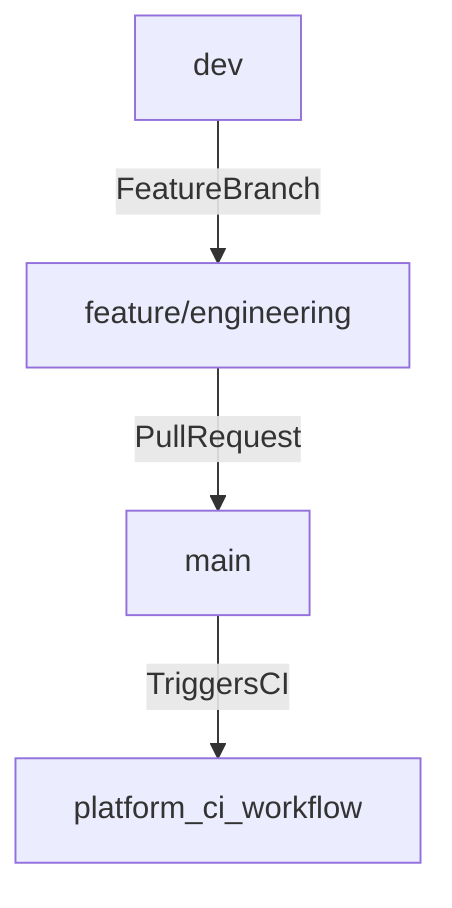
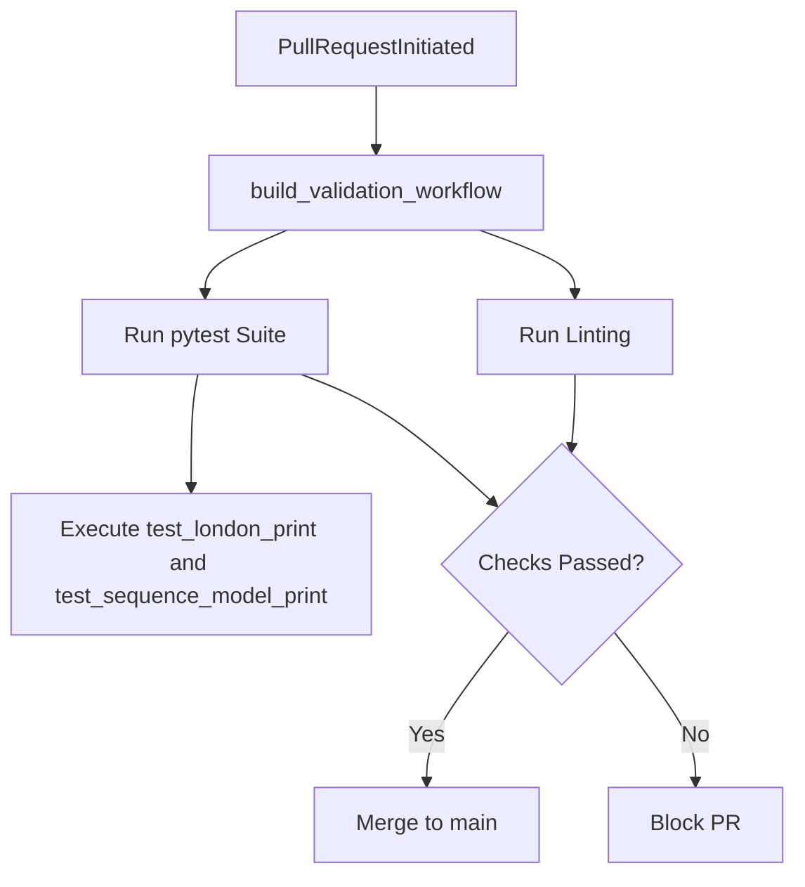

<!-- source: DeepWiki mcp.deepwiki.com · repo microsoft/dstoolkit-mlops-v2 · page 6.5 Branching Strategy & Testing · fetched 2026-11-09 -->

# Branching Strategy & Testing

Relevant source files

The following files were used as context for generating this wiki page:

- [docs/how-to/BranchingStrategy.md](docs/how-to/BranchingStrategy.md)
- [docs/how-to/InfrastructureDesign.md](docs/how-to/InfrastructureDesign.md)
- [test/london_taxi/test_london_to_delete.py](test/london_taxi/test_london_to_delete.py)
- [test/sequence_model/test_sequence_model_to_delete.py](test/sequence_model/test_sequence_model_to_delete.py)

## Purpose and Scope
This section details the branching governance, Pull Request (PR) validation flow, and unit test directory structures defined in `dstoolkit-mlops-v2`. It outlines how code flows from development branches to the `main` branch, how continuous integration (CI) validates changes, and how the `test/` directory is organized to support model validation.

---

## 1. Branching Topology & Policies

The repository follows a Git branching model centered around `dev` and `main` branches. Sub-branches (such as feature engineering branches and hotfixes) are branched from `dev`. 

- **`dev` Branch**: The integration branch where developers merge feature work and execute local or staging validation pipelines.
- **`main` Branch**: The production-ready branch. Any changes applied to `main` must be done strictly via a Pull Request. Approved PRs to `main` trigger continuous integration and deployment processes across environments (DEV, TEST, PROD).

**Sources:** `docs/how-to/BranchingStrategy.md:1-26`, `docs/how-to/InfrastructureDesign.md:1-9`

---

## 2. Pull Request (PR) Validation Flow

Continuous Integration (CI) execution occurs during the Pull Request phase prior to merging code into `main`. The validation flow executes static code analysis (linting), unit tests, data checks, and pre-publish validations for Azure Machine Learning (AML) pipelines.

**Sources:** `docs/how-to/BranchingStrategy.md:19-26`

---

## 3. Unit Test Layout (`test/`)

The `test/` directory mirrors the model architecture patterns in the repository. Unit tests are partitioned by model types to validate standalone execution elements, print/utility functions, and model-specific sanity checks.

Key file implementations located in the test directory include:
- `test/london_taxi/test_london_to_delete.py`: Validates base printing and setup execution for the London Taxi pipeline variant using `test_london_print()` [test/london_taxi/test_london_to_delete.py:1-6]().
- `test/sequence_model/test_sequence_model_to_delete.py`: Validates base printing and setup execution for the sequence model variant using `test_sequence_model_print()` [test/sequence_model/test_sequence_model_to_delete.py:1-6]().

**Sources:** `test/london_taxi/test_london_to_delete.py:1-7`, `test/sequence_model/test_sequence_model_to_delete.py:1-7`

---

