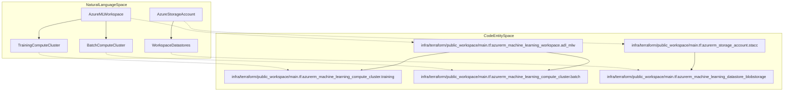

<!-- source: DeepWiki mcp.deepwiki.com · repo microsoft/dstoolkit-mlops-v2 · page 7 Infrastructure as Code · fetched 2026-11-09 -->

# Infrastructure as Code

Relevant source files

The following files were used as context for generating this wiki page:

- [.github/workflows/infra_provision_terraform.yml](.github/workflows/infra_provision_terraform.yml)
- [docs/how-to/BranchingStrategy.md](docs/how-to/BranchingStrategy.md)
- [docs/how-to/InfrastructureDesign.md](docs/how-to/InfrastructureDesign.md)
- [infra/terraform/public_workspace/main.tf](infra/terraform/public_workspace/main.tf)
- [infra/terraform/public_workspace/provider.tf](infra/terraform/public_workspace/provider.tf)
- [infra/terraform/public_workspace/terraform.tf](infra/terraform/public_workspace/terraform.tf)
- [infra/terraform/public_workspace/terraform.tfvars](infra/terraform/public_workspace/terraform.tfvars)
- [infra/terraform/public_workspace/variables.tf](infra/terraform/public_workspace/variables.tf)

## Purpose and Scope

The **Infrastructure as Code (IaC)** module of Model Factory automates the provisioning of Azure cloud resources required to run MLOps pipelines and host Azure Machine Learning (AML) workloads. The platform supports standard public network configurations [docs/how-to/InfrastructureDesign.md:6-6] and provides two parallel IaC paths: **Terraform** and **Bicep**. 

This parent page provides a high-level architectural overview of the resources provisioned and introduces the two deployment paths. For exhaustive implementation details, see [Terraform public_workspace](#7.1) and [Bicep public_workspace](#7.2).

*Sources: [docs/how-to/InfrastructureDesign.md:1-8](), [infra/terraform/public_workspace/main.tf:25-158]()*

---

## Azure Resources Architecture

Both IaC paths provision an identical set of core Azure foundational services required for MLOps orchestration:

1. **Resource Group**: A dedicated container (`azurerm_resource_group.rg`) managing all deployed assets [infra/terraform/public_workspace/main.tf:2-6].
2. **Azure Machine Learning Workspace**: The central AML instance (`azurerm_machine_learning_workspace.adl_mlw`) configured with system-assigned managed identities and public network access enabled [infra/terraform/public_workspace/main.tf:69-87].
3. **Storage Account**: Provisioned without shared access keys (`shared_access_key_enabled = false`) to enforce identity-based datastores [infra/terraform/public_workspace/main.tf:25-34], featuring dedicated containers and file shares for workspace blobs, files, artifacts, and working directories [infra/terraform/public_workspace/main.tf:36-58]. Associated datastores are linked to the AML workspace [infra/terraform/public_workspace/main.tf:89-120].
4. **Key Vault & Application Insights**: Secure secret management (`azurerm_key_vault.akv`) [infra/terraform/public_workspace/main.tf:16-23] and telemetry collection (`azurerm_application_insights.aml_appins`) [infra/terraform/public_workspace/main.tf:8-14].
5. **Container Registry**: An Azure Container Registry (`azurerm_container_registry.acr`) instance to build and store custom execution environments [infra/terraform/public_workspace/main.tf:60-67].
6. **Compute Clusters**: Dedicated CPU/GPU clusters for model training (`azurerm_machine_learning_compute_cluster.training`) and batch scoring (`azurerm_machine_learning_compute_cluster.batch`) with configurable autoscaling rules [infra/terraform/public_workspace/main.tf:124-158].
7. **RBAC Role Assignments**: Security bindings linking workspace managed identities and compute clusters to storage blob contributor roles [infra/terraform/public_workspace/main.tf:160-170].

*Sources: [infra/terraform/public_workspace/main.tf:1-170]*

---

## IaC Deployment Paths

The repository offers two choices for provisioning infrastructure:

### 1. Terraform (`infra/terraform/public_workspace`)
The Terraform path uses the HashiCorp AzureRM provider (`~> 4.0`) [infra/terraform/public_workspace/terraform.tf:1-8] configured with OIDC authentication (`use_oidc = true`) [infra/terraform/public_workspace/provider.tf:1-17]. Remote state is managed via an Azure Storage account dynamically prepared by GitHub Actions workflows [pkg: .github/workflows/infra_provision_terraform.yml:103-120]. Token replacement is applied to `terraform.tfvars` prior to execution [pkg: .github/workflows/infra_provision_terraform.yml:77-101].

For complete details, variables, module structure, and remote state management, see [Terraform public_workspace](#7.1).

*Sources: [.github/workflows/infra_provision_terraform.yml:1-140](), [infra/terraform/public_workspace/provider.tf:1-17](), [infra/terraform/public_workspace/terraform.tf:1-8]*

### 2. Bicep (`infra/bicep/public_workspace`)
An alternative native Azure Resource Manager template structure using modular Bicep scripts to provision storage accounts, key vaults, container registries, application insights, and AML workspaces. 

For deployment steps, module decomposition, and parameterization, see [Bicep public_workspace](#7.2).

*Sources: [docs/how-to/InfrastructureDesign.md:1-8]*

---

