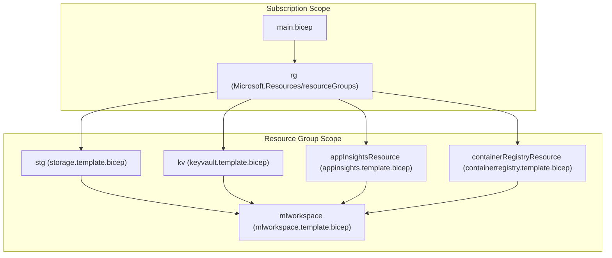
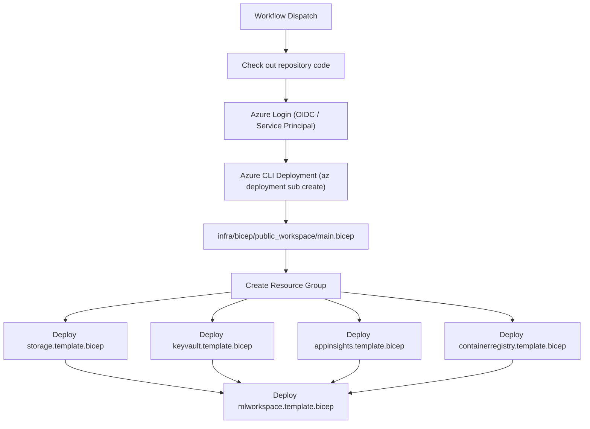

<!-- source: DeepWiki mcp.deepwiki.com · repo microsoft/dstoolkit-mlops-v2 · page 7.2 Bicep public_workspace · fetched 2026-11-09 -->

# Bicep public_workspace

Relevant source files

The following files were used as context for generating this wiki page:

- [.azure-pipelines/infra/bicep/infra_provision_bicep_pipeline.yml](.azure-pipelines/infra/bicep/infra_provision_bicep_pipeline.yml)
- [.azure-pipelines/infra/terraform/infra_provision_terraform_pipeline.yml](.azure-pipelines/infra/terraform/infra_provision_terraform_pipeline.yml)
- [.github/actions/configure_azureml_agent/action.yml](.github/actions/configure_azureml_agent/action.yml)
- [.github/workflows/infra_provision_bicep.yml](.github/workflows/infra_provision_bicep.yml)
- [README.md](README.md)
- [infra/bicep/README.md](infra/bicep/README.md)
- [infra/bicep/public_workspace/main.bicep](infra/bicep/public_workspace/main.bicep)
- [infra/bicep/public_workspace/modules/appinsights.template.bicep](infra/bicep/public_workspace/modules/appinsights.template.bicep)
- [infra/bicep/public_workspace/modules/containerregistry.template.bicep](infra/bicep/public_workspace/modules/containerregistry.template.bicep)
- [infra/bicep/public_workspace/modules/keyvault.template.bicep](infra/bicep/public_workspace/modules/keyvault.template.bicep)
- [infra/bicep/public_workspace/modules/mlworkspace.template.bicep](infra/bicep/public_workspace/modules/mlworkspace.template.bicep)
- [infra/bicep/public_workspace/modules/storage.template.bicep](infra/bicep/public_workspace/modules/storage.template.bicep)

## Purpose and Scope
This page details the Bicep Infrastructure-as-Code (IaC) templates and modules used to provision an Azure Machine Learning public workspace and its dependent platform services (`storage`, `keyvault`, `containerregistry`, `appinsights`, and `mlworkspace`). Note that this Bicep implementation is deprecated in favor of Terraform, but the files are retained for reference [infra/bicep/README.md:1-23]().

Sources: [infra/bicep/README.md:1-23]()

---

## 1. Main Template Architecture (`main.bicep`)

The root Bicep deployment orchestrator is configured with a subscription-level target scope (`targetScope = 'subscription'`) [infra/bicep/public_workspace/main.bicep:1-1](). It declares parameters for the resource group, location, storage SKU, and resource names [infra/bicep/public_workspace/main.bicep:3-32](). 

The template first provisions a resource group (`Microsoft.Resources/resourceGroups`) [infra/bicep/public_workspace/main.bicep:33-37]() and subsequently invokes modular resource deployments scoped to that resource group:
- Storage Account via `storage.template.bicep` [infra/bicep/public_workspace/main.bicep:40-50]()
- Key Vault via `keyvault.template.bicep` [infra/bicep/public_workspace/main.bicep:53-60]()
- Application Insights via `appinsights.template.bicep` [infra/bicep/public_workspace/main.bicep:63-70]()
- Container Registry via `containerregistry.template.bicep` [infra/bicep/public_workspace/main.bicep:73-80]()
- Azure Machine Learning Workspace via `mlworkspace.template.bicep` [infra/bicep/public_workspace/main.bicep:83-94]()

### Architecture Diagram: Resource Provisioning Topology

Sources: [infra/bicep/public_workspace/main.bicep:1-94]()

---

## 2. Bicep Infrastructure Modules

The workspace architecture relies on five core modules located in `infra/bicep/public_workspace/modules/`.

### 2.1 Storage Module (`storage.template.bicep`)
Provisions a general-purpose v2 storage account (`Microsoft.Storage/storageAccounts@2022-09-01`) configured with HTTPS traffic enforcement and specified access tiers [infra/bicep/public_workspace/modules/storage.template.bicep:1-22]().

### 2.2 Key Vault Module (`keyvault.template.bicep`)
Deploys a standard Azure Key Vault (`Microsoft.KeyVault/vaults@2022-07-01`) with template deployment access enabled (`enabledForTemplateDeployment: true`) and an empty access policies array [infra/bicep/public_workspace/modules/keyvault.template.bicep:1-24]().

### 2.3 Container Registry Module (`containerregistry.template.bicep`)
Deploys an Azure Container Registry (`Microsoft.ContainerRegistry/registries@2023-01-01-preview`) using the `Basic` SKU with admin user authentication enabled [infra/bicep/public_workspace/modules/containerregistry.template.bicep:1-18]().

### 2.4 Application Insights Module (`appinsights.template.bicep`)
Provisions an Application Insights component (`Microsoft.Insights/components@2020-02-02`) of kind `web` for tracking telemetry [infra/bicep/public_workspace/modules/appinsights.template.bicep:1-14]().

### 2.5 Machine Learning Workspace Module (`mlworkspace.template.bicep`)
Deploys the Azure Machine Learning workspace (`Microsoft.MachineLearningServices/workspaces@2022-12-01-preview`) [infra/bicep/public_workspace/modules/mlworkspace.template.bicep:35-53](). 
- Explicitly enforces a `dependsOn` relationship on the storage, key vault, application insights, and container registry resources [infra/bicep/public_workspace/modules/mlworkspace.template.bicep:38-43]().
- Configures a `SystemAssigned` managed identity [infra/bicep/public_workspace/modules/mlworkspace.template.bicep:44-46]().
- Binds dependent resource IDs (`keyVault`, `applicationInsights`, `containerRegistry`, `storageAccount`) in its resource properties [infra/bicep/public_workspace/modules/mlworkspace.template.bicep:47-52]().

Sources: 
[infra/bicep/public_workspace/modules/storage.template.bicep:1-22](),
[infra/bicep/public_workspace/modules/keyvault.template.bicep:1-24](),
[infra/bicep/public_workspace/modules/containerregistry.template.bicep:1-18](),
[infra/bicep/public_workspace/modules/appinsights.template.bicep:1-14](),
[infra/bicep/public_workspace/modules/mlworkspace.template.bicep:1-53]()

---

## 3. Deployment Workflow & CI/CD

Infrastructure deployment can be executed via GitHub Actions or legacy Azure Pipelines using Azure CLI subscription-level deployments.

### 3.1 GitHub Actions Workflow (`infra_provision_bicep.yml`)
The workflow `[DEPRECATED] ModelFactory-Bicep-Deployment` runs on `workflow_dispatch`, logs into Azure using OIDC workload identity (`azure/login@v2`), and executes an `az deployment sub create` command against `infra/bicep/public_workspace/main.bicep` [.github/workflows/infra_provision_bicep.yml:1-66]().

### 3.2 Legacy Azure DevOps Pipeline (`infra_provision_bicep_pipeline.yml`)
The deprecated pipeline performs equivalent subscription deployments using the `AzureCLI@2` task [.azure-pipelines/infra/bicep/infra_provision_bicep_pipeline.yml:1-43]().

### Diagram: Bicep Deployment Pipeline Flow

Sources: 
[.github/workflows/infra_provision_bicep.yml:1-66](), 
[.azure-pipelines/infra/bicep/infra_provision_bicep_pipeline.yml:1-43]()

---

