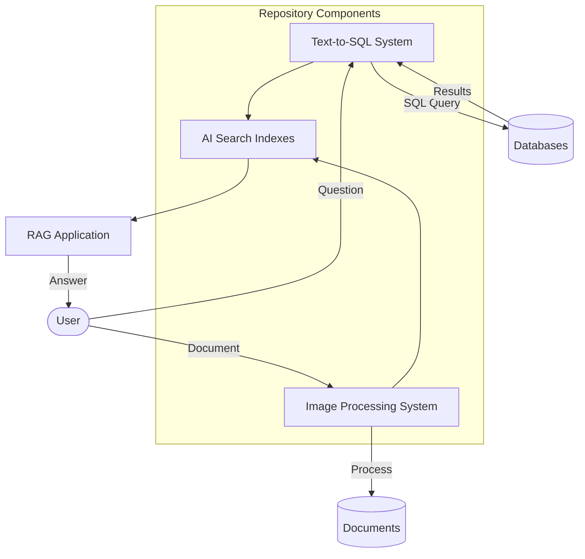
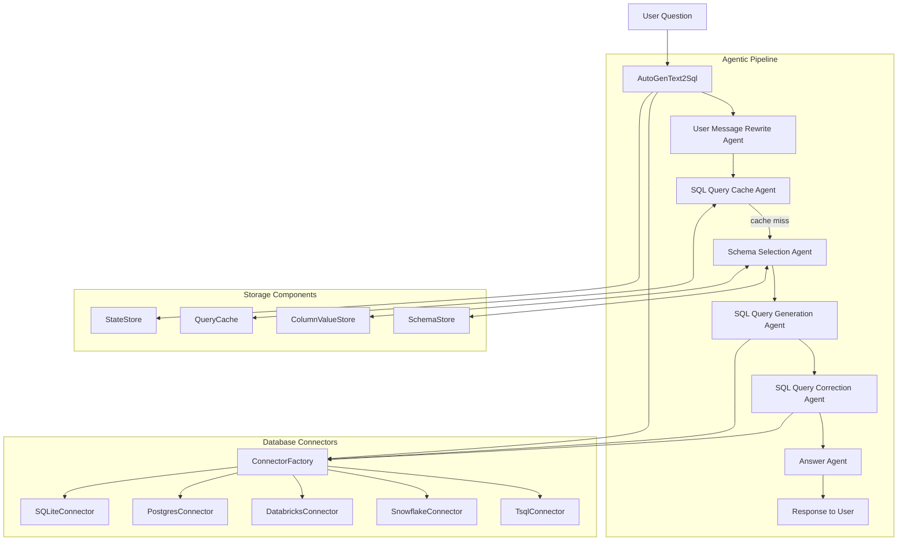
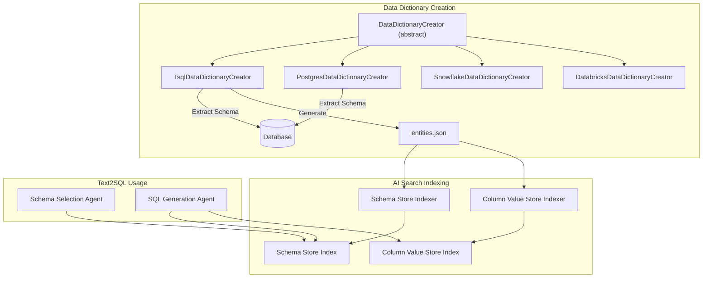
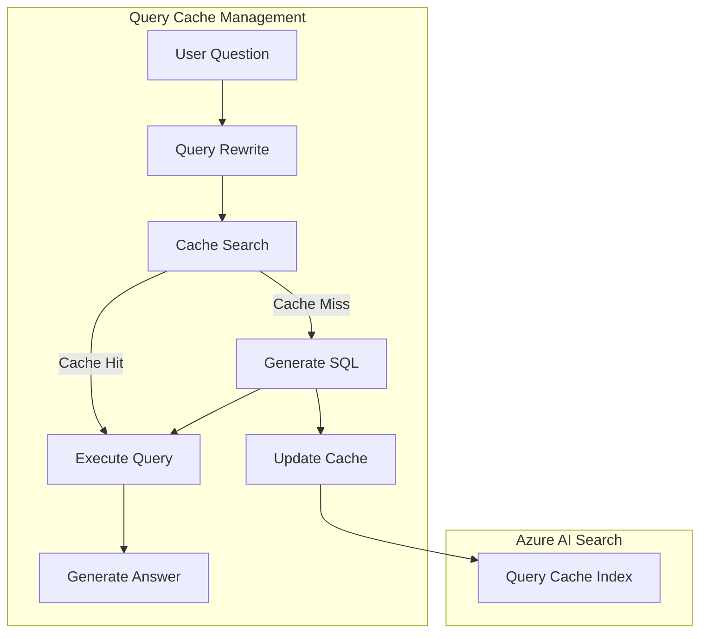
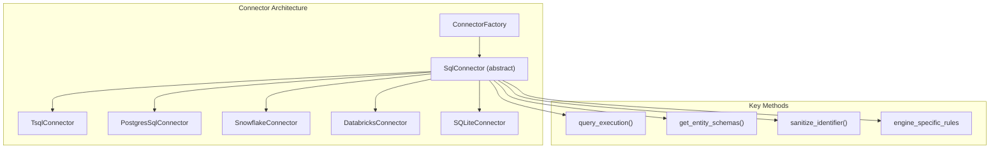
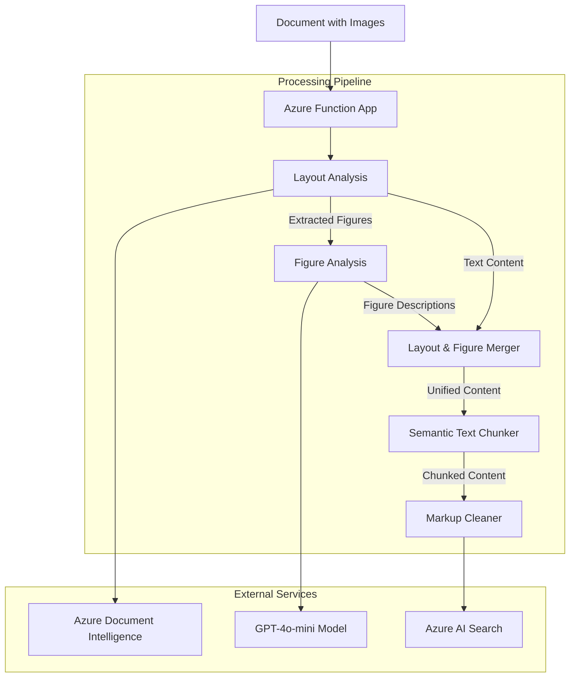
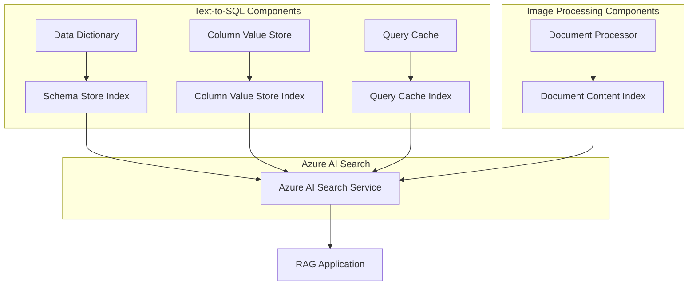
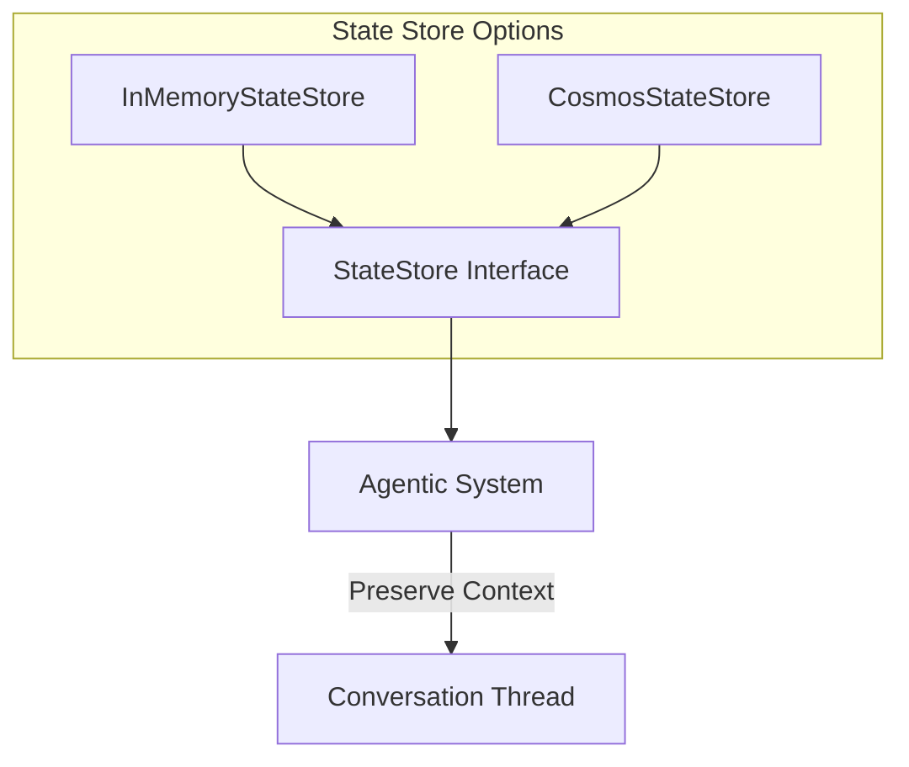

<!-- source: DeepWiki mcp.deepwiki.com · repo microsoft/dstoolkit-text2sql-and-imageprocessing · page 1 Overview · fetched 2026-10-26 -->

# Overview

Relevant source files

The following files were used as context for generating this wiki page:

- [.gitignore](.gitignore)
- [.pre-commit-config.yaml](.pre-commit-config.yaml)
- [README.md](README.md)
- [deploy_ai_search_indexes/pyproject.toml](deploy_ai_search_indexes/pyproject.toml)
- [image_processing/pyproject.toml](image_processing/pyproject.toml)
- [pyproject.toml](pyproject.toml)
- [text_2_sql/GETTING_STARTED.md](text_2_sql/GETTING_STARTED.md)
- [text_2_sql/README.md](text_2_sql/README.md)
- [text_2_sql/text_2_sql_core/src/text_2_sql_core/connectors/postgres_sql.py](text_2_sql/text_2_sql_core/src/text_2_sql_core/connectors/postgres_sql.py)
- [text_2_sql/text_2_sql_core/src/text_2_sql_core/data_dictionary/postgres_data_dictionary_creator.py](text_2_sql/text_2_sql_core/src/text_2_sql_core/data_dictionary/postgres_data_dictionary_creator.py)

The DSToolkit Text2SQL and Image Processing repository provides accelerator components designed to enhance Retrieval-Augmented Generation (RAG) applications by enabling access to structured data sources and improving document processing capabilities. This repository contains two primary systems that can be integrated into new or existing RAG applications:

1. **Text-to-SQL System**: A sophisticated multi-agent system that converts natural language questions into SQL queries, allowing RAG applications to retrieve information from structured databases in real-time.

2. **Image Processing System**: A document processing pipeline that enhances RAG applications by extracting meaning from documents containing images, charts, and complex layouts.

This overview provides a high-level understanding of these systems and how they work together. For detailed setup instructions, see [Setup and Deployment Guide](#5).

## Repository Structure and Components

The repository consists of these main components:

* **Text-to-SQL System** (`/text_2_sql`): Converts natural language questions into SQL queries using a multi-agent architecture. 

* **Image Processing System** (`/image_processing`): Processes documents with complex layouts, images, and charts using Azure Document Intelligence and multimodal models.

* **AI Search Integration** (`/deploy_ai_search_indexes`): Utilities for deploying Azure AI Search indexes for both systems, enabling efficient storage and retrieval of metadata, cached queries, and processed document content.

Sources: [README.md:1-17](), [text_2_sql/README.md:1-21](), [image_processing/pyproject.toml:1-51]()

## Text-to-SQL System Architecture

The Text-to-SQL system uses an agentic approach with multiple specialized components that work together to convert natural language questions into SQL queries and execute them against various database engines.

Sources: [text_2_sql/README.md:37-49](), [text_2_sql/autogen/README.md:58-67]()

### Agent Types and Responsibilities

The Text-to-SQL system consists of the following specialized agents:

1. **Query Rewrite Agent**: Preprocesses questions by resolving relative dates (e.g., "last month" → "November 2024") and decomposing complex questions into simpler sub-questions.

2. **SQL Query Cache Agent**: Checks for previously asked similar questions in the cache to avoid redundant query generation.

3. **Schema Selection Agent**: Extracts key terms from the question and identifies relevant database schemas needed to answer it.

4. **SQL Disambiguation Agent**: Clarifies ambiguities in schema selection and ensures correct tables and columns are selected.

5. **SQL Query Generation Agent**: Generates SQL queries using the selected schemas to answer the question.

6. **SQL Query Correction Agent**: Verifies and corrects generated SQL queries, ensuring syntactic correctness and executing them against the database.

7. **Answer and Sources Agent**: Formats the final response with standardized output, formatted query results, and combined sources.

Sources: [text_2_sql/autogen/README.md:15-63](), [text_2_sql/README.md:58-69]()

### Data Dictionary and Schema Management

The Text-to-SQL system uses a data dictionary to provide metadata about database schemas to guide the LLM in generating accurate SQL queries.

The data dictionary (`entities.json`) includes:
- `Entity`: Fully qualified table/view name (e.g., "SalesLT.SalesOrderDetail")
- `Definition`: Detailed description of the entity's purpose and content
- `EntityName`: User-friendly name
- `Columns`: Array of column metadata (name, data type, definition, sample values)
- `EntityRelationships`: Foreign key relationships to other entities
- `CompleteEntityRelationshipsGraph`: Relationship paths for complex joins

Database-specific creator classes (`TsqlDataDictionaryCreator`, `PostgresDataDictionaryCreator`, etc.) generate this metadata automatically using SQL queries tailored to each database engine.

Sources: [text_2_sql/README.md:134-204](), [text_2_sql/text_2_sql_core/src/text_2_sql_core/data_dictionary/postgres_data_dictionary_creator.py:14-120]()

### Query Cache System

The query cache improves performance by storing previously asked questions and their corresponding SQL queries. When a user asks a similar question, the system can retrieve the cached query, potentially bypassing schema selection and query generation.

Key features of the query cache:
- Stores questions and corresponding SQL queries, not results (to ensure real-time data)
- Significantly improves response time for similar questions
- Supports multiple caching strategies (pre-population, always update, positive indication)
- Preserves row and column level security by executing queries at runtime

Sources: [text_2_sql/README.md:41-82](), [text_2_sql/autogen/README.md:140-156]()

### Database Connectors

The Text-to-SQL system supports multiple database engines through a connector factory pattern:

| Database Engine | Connector Class | Key Methods |
|-----------------|----------------|-------------|
| Microsoft TSQL | `TsqlConnector` | `query_execution`, `get_entity_schemas` |
| PostgreSQL | `PostgresSqlConnector` | `query_execution`, `get_entity_schemas` |
| Snowflake | `SnowflakeConnector` | `query_execution`, `get_entity_schemas` |
| Databricks | `DatabricksConnector` | `query_execution`, `get_entity_schemas` |
| SQLite | `SQLiteConnector` | `query_execution`, `get_entity_schemas` |

Each connector implements database-specific query execution logic and SQL dialect rules, making the system adaptable to various database environments. The `ConnectorFactory` instantiates the appropriate connector based on configuration.

Sources: [text_2_sql/text_2_sql_core/src/text_2_sql_core/connectors/postgres_sql.py:13-171](), [text_2_sql/text_2_sql_core/src/text_2_sql_core/connectors/sql.py](), [deploy_ai_search_indexes/pyproject.toml:33-45]()

## Image Processing System Architecture

The Image Processing system processes documents with images and charts to make them usable in RAG applications. It uses Azure Document Intelligence and multi-modal models to extract and interpret visual content.

Sources: [image_processing/pyproject.toml:11-35](), [README.md:18]()

The Image Processing system consists of these main components:

1. **Layout Analysis**: Uses Azure Document Intelligence to analyze document structure, identifying text, figures, tables, and other elements.

2. **Figure Analysis**: Extracts figures and charts from documents and uses GPT-4o-mini to generate descriptions of these visual elements.

3. **Semantic Text Chunking**: Intelligently groups similar sentences while preserving the relationship between text and visual elements.

Sources: [README.md:13-15](), [image_processing/pyproject.toml:10-35]()

## Integration with Azure AI Search

Both systems integrate with Azure AI Search for storing and retrieving metadata, cached queries, and processed document content:

The repository includes utilities in the `/deploy_ai_search_indexes` directory for deploying the required Azure AI Search indexes, indexers, and skillsets.

Key features:
- Schema Store Index: Stores metadata about database entities
- Column Value Store Index: Stores sample values for database columns
- Query Cache Index: Stores questions and corresponding SQL queries
- Document Content Index: Stores processed document content with figure descriptions

Sources: [deploy_ai_search_indexes/pyproject.toml:1-46](), [text_2_sql/GETTING_STARTED.md:1-27]()

## State Management

For managing conversational state across multiple interactions, the system provides state store implementations:

The state management allows:
- Preservation of conversation context across multiple turns
- Persistence of agent state for long-running conversations
- Thread-based conversation management

Sources: [text_2_sql/autogen/src/autogen_text_2_sql/state_store.py:1-58](), [text_2_sql/autogen/README.md:124-127]()

## Key Benefits

The DSTK Text2SQL and Image Processing toolkit provides several key benefits for RAG applications:

1. **Real-time data access**: The Text-to-SQL system enables access to up-to-date structured data without pre-computing reports.

2. **Accurate numerical calculations**: Pushes numerical calculations to the database engine for accuracy.

3. **Complex query handling**: Supports aggregations, complex joins, and filtering in natural language.

4. **Rich document understanding**: Processes documents with images, charts, and complex layouts.

5. **Efficient performance**: Uses query caching and efficient indexing to improve response time.

For detailed implementation and deployment instructions, see [Setup and Deployment Guide](#5).

Sources: [text_2_sql/README.md:11-21](), [README.md:3-17]()

---

