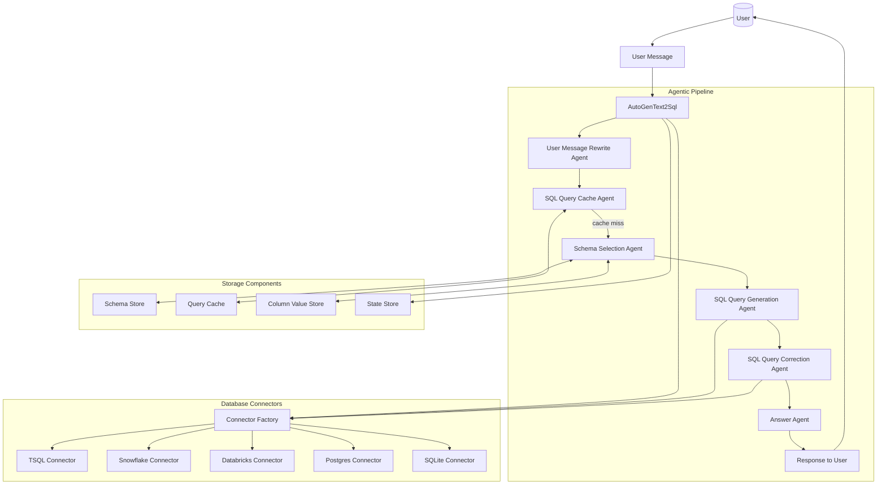
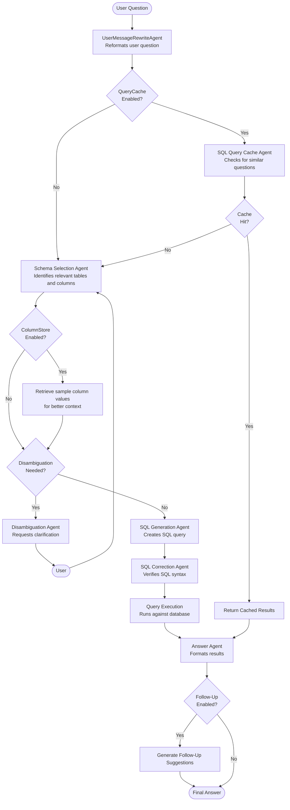
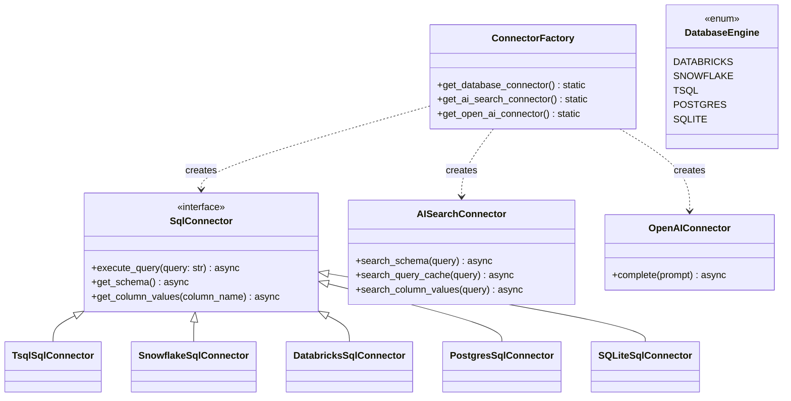
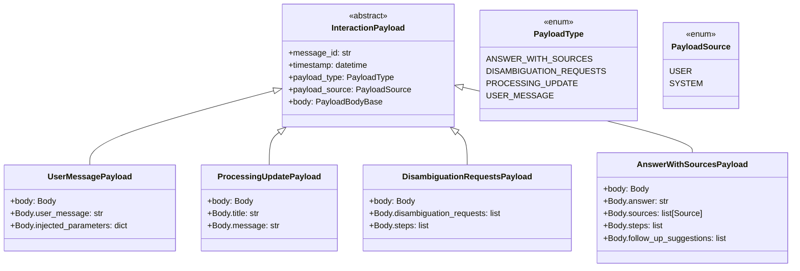
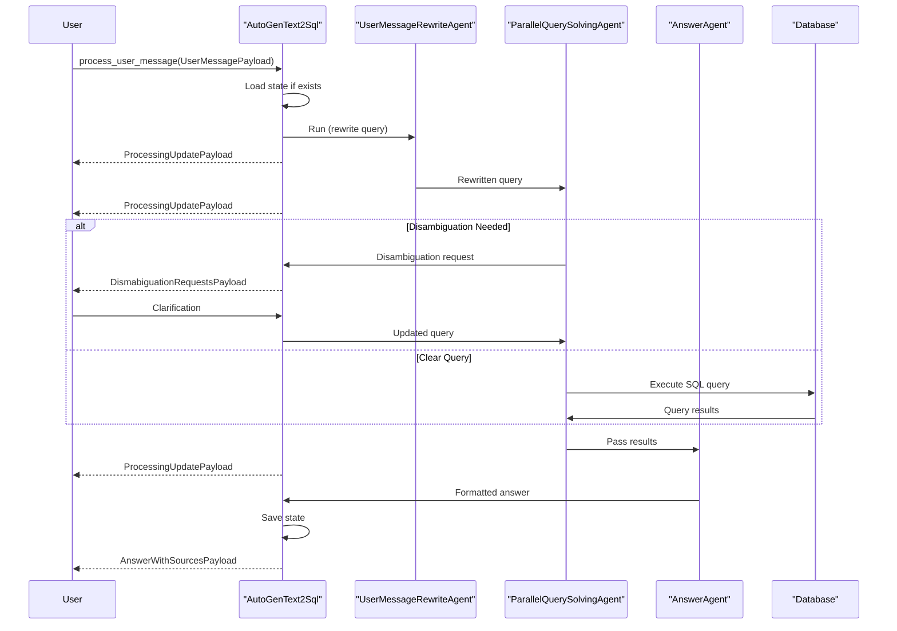
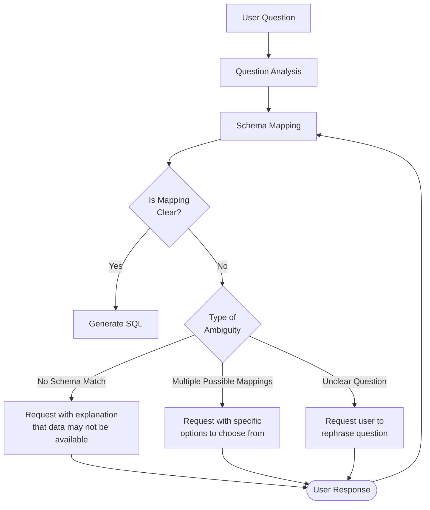

<!-- source: DeepWiki mcp.deepwiki.com · repo microsoft/dstoolkit-text2sql-and-imageprocessing · page 2 Text-to-SQL System · fetched 2026-10-26 -->

# Text-to-SQL System

<details>
<summary>Relevant source files</summary>

The following files were used as context for generating this wiki page:

- [text_2_sql/.env.example](text_2_sql/.env.example)
- [text_2_sql/autogen/pyproject.toml](text_2_sql/autogen/pyproject.toml)
- [text_2_sql/autogen/src/autogen_text_2_sql/__init__.py](text_2_sql/autogen/src/autogen_text_2_sql/__init__.py)
- [text_2_sql/text_2_sql_core/pyproject.toml](text_2_sql/text_2_sql_core/pyproject.toml)
- [text_2_sql/text_2_sql_core/src/text_2_sql_core/connectors/factory.py](text_2_sql/text_2_sql_core/src/text_2_sql_core/connectors/factory.py)
- [text_2_sql/text_2_sql_core/src/text_2_sql_core/payloads/__init__.py](text_2_sql/text_2_sql_core/src/text_2_sql_core/payloads/__init__.py)
- [text_2_sql/text_2_sql_core/src/text_2_sql_core/utils/database.py](text_2_sql/text_2_sql_core/src/text_2_sql_core/utils/database.py)
- [uv.lock](uv.lock)

</details>


The Text-to-SQL system transforms natural language questions into SQL queries that can be executed against various database engines. By leveraging a multi-agent architecture powered by the AutoGen framework, the system can understand user queries, identify relevant database schemas, generate appropriate SQL commands, and return results in a user-friendly format. This document describes the architecture, components, and functionality of the Text-to-SQL system.

The Text-to-SQL system is one of the core components in the repository, working alongside the [Image Processing System](#3) and integrated with [AI Search Indexes](#4) to enhance Retrieval-Augmented Generation applications.

Sources: [text_2_sql/autogen/src/autogen_text_2_sql/__init__.py](), [text_2_sql/autogen/pyproject.toml]()

## System Architecture

The system employs an agentic approach that breaks down the complex task of natural language to SQL conversion into smaller, specialized components handled by different AI agents.

### High-Level Architecture



Sources: [text_2_sql/autogen/src/autogen_text_2_sql/autogen_text_2_sql.py](), [text_2_sql/text_2_sql_core/src/text_2_sql_core/connectors/factory.py]()

Sources: [text_2_sql/autogen/src/autogen_text_2_sql/autogen_text_2_sql.py](). [text_2_sql/text_2_sql_core/src/text_2_sql_core/connectors/factory.py]()

## Core Components

The Text-to-SQL system is centered around the `AutoGenText2Sql` class, which orchestrates the entire natural language to SQL conversion process. This class integrates various components to form a complete pipeline from user question to formatted answer.

### Key Classes and Interfaces

| Component | Description | Source File |
|-----------|-------------|-------------|
| `AutoGenText2Sql` | Main orchestration class that manages the agent flow and interactions | autogen_text_2_sql/autogen_text_2_sql.py |
| `StateStore` | Interface for conversation state management with two implementations: `InMemoryStateStore` and `CosmosStateStore` | autogen_text_2_sql/state_store.py |
| `ConnectorFactory` | Factory that creates appropriate database, AI Search, and OpenAI connectors based on configuration | text_2_sql_core/connectors/factory.py |
| `DatabaseEngine` | Enum representing supported database engines (TSQL, Snowflake, Databricks, PostgreSQL, SQLite) | text_2_sql_core/utils/database.py |
| `InteractionPayload` | Base class for structured communication payloads between the system and user interface | text_2_sql_core/payloads/interaction_payloads.py |

The system depends on several key packages:
- AutoGen framework components (`autogen-agentchat`, `autogen-core`, `autogen-ext`)
- Database connectors specific to each supported database engine
- Azure services integration for state management and AI services
- NLP and SQL processing tools for query analysis and generation

Sources: [text_2_sql/autogen/src/autogen_text_2_sql/__init__.py](), [text_2_sql/autogen/pyproject.toml](), [text_2_sql/text_2_sql_core/src/text_2_sql_core/utils/database.py]()

## Agentic Flow

The system uses a multi-agent architecture powered by AutoGen to break down the natural language to SQL conversion process into specialized tasks. Each agent has a specific responsibility in the pipeline, allowing for complex problem decomposition and expert handling of each subtask.



The flow begins with a user question and proceeds through multiple specialized agents that each handle a different aspect of the process:

1. **User Message Rewrite Agent**: Reformats complex questions to be more amenable to SQL generation
2. **SQL Query Cache Agent**: Checks if similar questions have been processed before to avoid redundant computation
3. **Schema Selection Agent**: Identifies the relevant database tables and columns for the question
4. **SQL Generation Agent**: Creates a syntactically correct SQL query for the target database
5. **SQL Correction Agent**: Verifies and fixes any issues in the generated SQL
6. **Answer Agent**: Formats the query results into a natural language response for the user

The system also includes optional components that can be enabled or disabled via configuration:
- Query Cache for improved performance with similar questions
- Column Value Store to provide better context during schema selection
- Disambiguation handling for unclear or ambiguous questions
- Follow-up suggestion generation to enhance the conversational experience

Sources: [text_2_sql/autogen/src/autogen_text_2_sql/autogen_text_2_sql.py](), [text_2_sql/.env.example:3-9]()

### Agent Configuration and Initialization

The agents are configured and initialized in the `AutoGenText2Sql` class, which manages the agent workflow. The configuration is driven by environment variables that control features like query caching, column value store usage, and follow-up suggestion generation.

```mermaid
classDiagram
    class AutoGenText2Sql {
        -_use_query_cache: bool
        -_pre_run_query_cache: bool
        -_use_column_value_store: bool
        -_generate_follow_up_suggestions: bool
        -_row_limit: int
        -state_store: StateStore
        -agentic_flow: AgentWorkflow
        +__init__(state_store, **kwargs)
        +get_all_agents()
        +process_user_message(thread_id, message_payload)
    }
    
    class StateStore {
        <<interface>>
        +save_state(thread_id, state)
        +get_state(thread_id)
    }
    
    class InMemoryStateStore {
        -_state_map: dict
        +save_state(thread_id, state)
        +get_state(thread_id)
    }
    
    class CosmosStateStore {
        -_cosmos_client
        -_container_client
        +save_state(thread_id, state)
        +get_state(thread_id)
    }
    
    StateStore <|-- InMemoryStateStore
    StateStore <|-- CosmosStateStore
    
    AutoGenText2Sql --> StateStore: uses
    AutoGenText2Sql --> "ConnectorFactory": uses
```

The system reads configuration from environment variables to determine which features to enable:

```
Text2Sql__UseQueryCache=True            # Enable/disable query caching
Text2Sql__PreRunQueryCache=True         # Pre-run cached queries for faster responses
Text2Sql__UseColumnValueStore=True      # Use column values for schema selection
Text2Sql__GenerateFollowUpSuggestions=True  # Generate follow-up question suggestions
Text2Sql__RowLimit=100                  # Maximum rows returned in results
```

Sources: [text_2_sql/autogen/src/autogen_text_2_sql/__init__.py](), [text_2_sql/.env.example:3-9]()

## Database Support

The system supports multiple database engines through an extensible connector architecture. This design allows the same Text-to-SQL pipeline to work with various database backends with minimal changes.



The connector selection is implemented in the `get_database_connector` method of the `ConnectorFactory` class:

```python
@staticmethod
def get_database_connector():
    try:
        if os.environ["Text2Sql__DatabaseEngine"].upper() == "DATABRICKS":
            from text_2_sql_core.connectors.databricks_sql import DatabricksSqlConnector
            return DatabricksSqlConnector()
        elif os.environ["Text2Sql__DatabaseEngine"].upper() == "SNOWFLAKE":
            from text_2_sql_core.connectors.snowflake_sql import SnowflakeSqlConnector
            return SnowflakeSqlConnector()
        elif os.environ["Text2Sql__DatabaseEngine"].upper() == "TSQL":
            from text_2_sql_core.connectors.tsql_sql import TsqlSqlConnector
            return TsqlSqlConnector()
        elif os.environ["Text2Sql__DatabaseEngine"].upper() == "POSTGRES":
            from text_2_sql_core.connectors.postgres_sql import PostgresSqlConnector
            return PostgresSqlConnector()
        elif os.environ["Text2Sql__DatabaseEngine"].upper() == "SQLITE":
            from text_2_sql_core.connectors.sqlite_sql import SQLiteSqlConnector
            return SQLiteSqlConnector()
        else:
            raise ValueError(f"Database engine not found")
    except ImportError:
        raise ValueError("Failed to import SQL Connector. Check optional dependencies.")
```

Each database connector implements a common interface but handles the specifics of connecting to and querying its respective database system. Database-specific configuration options are provided through environment variables, as shown in the example configuration:

```
# Database Type Selection
Text2Sql__DatabaseEngine=TSQL  # TSQL, Postgres, Snowflake, Databricks, or SQLite

# Database-Specific Connection Details
# TSQL
Text2Sql__Tsql__ConnectionString=...
Text2Sql__Tsql__Database=...

# Postgres
Text2Sql__Postgres__ConnectionString=...
Text2Sql__Postgres__Database=...
Text2Sql__Postgres__User=...
# Additional Postgres configuration parameters...

# Snowflake
Text2Sql__Snowflake__User=...
Text2Sql__Snowflake__Password=...
# Additional Snowflake configuration parameters...

# Databricks
Text2Sql__Databricks__Catalog=...
Text2Sql__Databricks__ServerHostname=...
# Additional Databricks configuration parameters...
```

Sources: [text_2_sql/text_2_sql_core/src/text_2_sql_core/connectors/factory.py](), [text_2_sql/text_2_sql_core/src/text_2_sql_core/utils/database.py](), [text_2_sql/.env.example:27-50](), [text_2_sql/text_2_sql_core/pyproject.toml:43-55]()

## Communication Payloads

The Text-to-SQL system uses structured payload objects for communication between components and with the user interface. These payloads provide a consistent and type-safe approach to message passing.



The system uses four main types of payloads:

1. **UserMessagePayload**: Contains the user's natural language question and any injected parameters
2. **ProcessingUpdatePayload**: Provides status updates during processing to inform the user of progress
3. **DisambiguationRequestsPayload**: Requests clarification from the user when a question is ambiguous
4. **AnswerWithSourcesPayload**: Delivers the final answer, including sources, processing steps, and optional follow-up suggestions

These payloads are exchanged asynchronously during the processing flow. The `process_user_message` method of `AutoGenText2Sql` takes a `UserMessagePayload` as input and yields various payloads as the processing progresses:

```python
async def process_user_message(
    self,
    thread_id: str,
    message_payload: UserMessagePayload,
) -> AsyncGenerator[InteractionPayload, None]:
    """Process a user message and yield interaction payloads."""
    
    # Load existing state if available
    state = self.state_store.get_state(thread_id)
    if state is not None:
        await self.agentic_flow.load_state(state)
    
    # Process the message through agents
    async for message in self.agentic_flow.run_stream(task=json.dumps(agent_input)):
        # Different message types generate different payloads
        if isinstance(message, TextMessage):
            # Progress updates based on which agent is active
            payload = ProcessingUpdatePayload(message="Processing...")
            
        elif isinstance(message, TaskResult):
            # Final results or disambiguation requests
            if "disambiguation_requests" in message.content:
                payload = DisambiguationRequestsPayload(...)
            else:
                payload = AnswerWithSourcesPayload(...)
        
        yield payload
    
    # Save state for future interactions
    assistant_state = await self.agentic_flow.save_state()
    self.state_store.save_state(thread_id, assistant_state)
```

This payload system enables the Text-to-SQL component to provide a rich, interactive experience with appropriate status updates, disambiguation capabilities, and detailed, formatted answers.

Sources: [text_2_sql/autogen/src/autogen_text_2_sql/__init__.py:6-12](), [text_2_sql/text_2_sql_core/src/text_2_sql_core/payloads/interaction_payloads.py]()

Sources: [text_2_sql/autogen/src/autogen_text_2_sql/autogen_text_2_sql.py:277-368]()

## Processing Flow

The complete processing flow follows this sequence:



Sources: [text_2_sql/autogen/src/autogen_text_2_sql/autogen_text_2_sql.py:277-368]()

## Disambiguation Process

When a user's query is ambiguous, the system can request clarification through the disambiguation process:



The disambiguation logic is implemented in the `extract_disambiguation_request` method:

```python
def extract_disambiguation_request(self, messages: list) -> DismabiguationRequestsPayload:
    """Extract the disambiguation request from the answer."""
    all_disambiguation_requests = self.parse_message_content(messages[-1].content)
    
    steps = self.extract_steps(messages)
    request_payload = DismabiguationRequestsPayload(steps=steps)
    
    for per_question_disambiguation_request in all_disambiguation_requests["disambiguation_requests"].values():
        for disambiguation_request in per_question_disambiguation_request:
            request = DismabiguationRequestsPayload.Body.DismabiguationRequest(
                assistant_question=disambiguation_request["assistant_question"],
                user_choices=disambiguation_request["user_choices"],
            )
            request_payload.body.disambiguation_requests.append(request)
    
    return request_payload
```

Sources: [text_2_sql/autogen/src/autogen_text_2_sql/autogen_text_2_sql.py:181-204](), [text_2_sql/text_2_sql_core/src/text_2_sql_core/prompts/disambiguation_and_sql_query_generation_agent.yaml:155-242]()

## SQL Query Generation

SQL query generation is primarily handled by the `ParallelQuerySolvingAgent`, which uses the following process:

1. Analyze the user question to identify entities, filters, and aggregations
2. Map these components to database schema elements (tables, columns)
3. Generate a syntactically correct SQL query for the target database engine
4. Execute the query against the database

The prompting system uses structured rules to guide the LLM:

```yaml
<sql_query_generation_rules>
  <engine_specific_rules>
      {{ engine_specific_rules }}
      Rows returned will be automatically limited to {{ row_limit }}.
  </engine_specific_rules>

  Your primary focus is on:
    1. Understanding what data the user wants to retrieve
    2. Identifying the necessary tables and their relationships
    3. Determining any required calculations or aggregations
    4. Specifying any filtering conditions based on the user's criteria
```

Sources: [text_2_sql/text_2_sql_core/src/text_2_sql_core/prompts/disambiguation_and_sql_query_generation_agent.yaml:103-153]()

## State Management

The system provides two state store implementations to maintain conversation context:

1. `InMemoryStateStore`: For testing or single-instance deployments
2. `CosmosStateStore`: For distributed deployments using Azure Cosmos DB

```python
async def process_user_message(self, thread_id: str, message_payload: UserMessagePayload):
    # Processing code...
    
    state = self.state_store.get_state(thread_id)
    if state is not None:
        await self.agentic_flow.load_state(state)
        
    # Processing continues...
    
    # Before returning final result
    assistant_state = await self.agentic_flow.save_state()
    self.state_store.save_state(thread_id, assistant_state)
```

Sources: [text_2_sql/autogen/src/autogen_text_2_sql/autogen_text_2_sql.py:300-304](), [text_2_sql/autogen/src/autogen_text_2_sql/autogen_text_2_sql.py:362-364](), [text_2_sql/autogen/src/autogen_text_2_sql/__init__.py]()

## Dependencies

The system has dependencies on several key packages:

**Core Dependencies:**
- AutoGen framework components (`autogen-agentchat`, `autogen-core`, `autogen-ext`)
- Database connectors (specific to each database type)
- Azure services integration (`azure-cosmos`, `azure-search`)
- NLP and SQL processing tools (`nltk`, `sqlparse`, `sqlglot`)

**Database-Specific Dependencies:**
```toml
snowflake = ["snowflake-connector-python>=3.12.3"]
databricks = ["databricks-sql-connector>=3.0.1", "pyarrow>=14.0.2,<17"]
postgres = ["psycopg>=3.2.3"]
sqlite = ["aiosqlite>=0.19.0"]
```

Sources: [text_2_sql/autogen/pyproject.toml](), [text_2_sql/text_2_sql_core/pyproject.toml]()

## Conclusion

The Text-to-SQL system provides a powerful natural language interface to databases by leveraging a specialized multi-agent architecture. The system's key strengths include:

1. Support for multiple database engines (TSQL, Snowflake, Databricks, PostgreSQL, SQLite)
2. Sophisticated disambiguation capabilities for handling unclear questions
3. Stateful conversation management for context preservation
4. Extensible architecture for adding new database connectors

For more information about specific components, see:
- [Agentic Architecture](#2.1) for details on the agent system design
- [Data Dictionary](#2.3) for information on schema metadata management
- [Query Cache](#2.6) for details on the caching mechanism to improve performance

---

