<!-- source: DeepWiki mcp.deepwiki.com · repo microsoft/dstoolkit-text2sql-and-imageprocessing · page 2.1 Agentic Architecture · fetched 2026-10-26 -->

# Agentic Architecture

Relevant source files

The following files were used as context for generating this wiki page:

- [text_2_sql/autogen/README.md](text_2_sql/autogen/README.md)
- [text_2_sql/autogen/src/autogen_text_2_sql/autogen_text_2_sql.py](text_2_sql/autogen/src/autogen_text_2_sql/autogen_text_2_sql.py)
- [text_2_sql/autogen/src/autogen_text_2_sql/state_store.py](text_2_sql/autogen/src/autogen_text_2_sql/state_store.py)
- [text_2_sql/previous_iterations/semantic_kernel/README.md](text_2_sql/previous_iterations/semantic_kernel/README.md)
- [text_2_sql/previous_iterations/semantic_kernel/plugins/vector_based_sql_plugin/vector_based_sql_plugin.py](text_2_sql/previous_iterations/semantic_kernel/plugins/vector_based_sql_plugin/vector_based_sql_plugin.py)
- [text_2_sql/text_2_sql_core/src/text_2_sql_core/payloads/interaction_payloads.py](text_2_sql/text_2_sql_core/src/text_2_sql_core/payloads/interaction_payloads.py)

This document explains the multi-agent architecture that powers the Text-to-SQL system. The architecture consists of specialized, cooperating agents that work together to convert natural language questions into SQL queries, execute them against a database, and format the results into natural language answers.

For information about the specific agent types and their detailed responsibilities, see [Agent Types and Responsibilities](#2.2).

## Core Architecture Overview

The Text-to-SQL system implements a multi-agent architecture where specialized agents collaborate in a predefined flow to process user questions. Each agent is responsible for a specific task in the overall pipeline, allowing for separation of concerns and modular design.

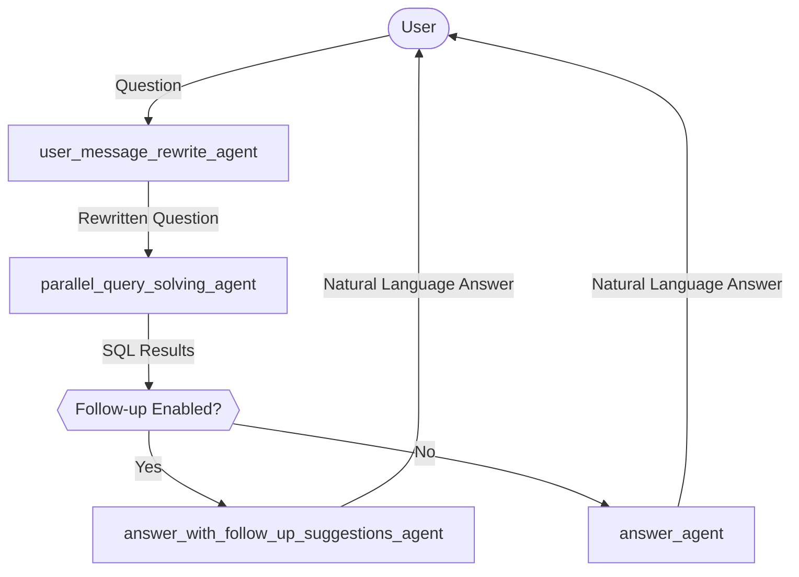

The system follows a sequential flow where each agent processes the output of the previous agent. The core flow as implemented in `get_all_agents()` is:

1. **User Message Rewrite Agent**: Processes the user's initial question, resolving relative dates and breaking down complex questions
2. **Parallel Query Solving Agent**: Coordinates schema selection, query generation, and execution across multiple specialized sub-agents
3. **Answer Agent**: Formats the results as a natural language response to the user, with optional follow-up suggestions

The choice between `answer_agent` and `answer_with_follow_up_suggestions_agent` is determined by the `_generate_follow_up_suggestions` configuration parameter, which is controlled by the `Text2Sql__GenerateFollowUpSuggestions` environment variable.

Sources: [text_2_sql/autogen/src/autogen_text_2_sql/autogen_text_2_sql.py:56-78](), [text_2_sql/autogen/src/autogen_text_2_sql/autogen_text_2_sql.py:91-117](), [text_2_sql/autogen/README.md:5-15]()

## Agent Implementation and Creation

Agents in the system are implemented as specialized classes that extend from `BaseChatAgent` from the AutoGen framework. The system uses a factory pattern to create and configure agents, which allows for flexible agent configuration and reuse.

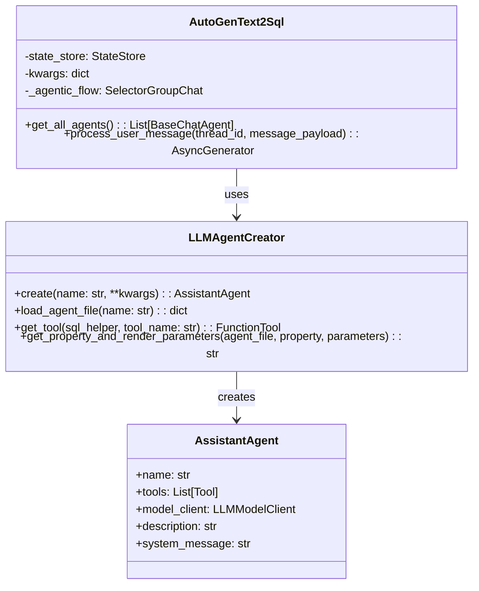

The `LLMAgentCreator` is a factory class that:
1. Loads prompt templates from YAML files
2. Creates and configures agents with the appropriate tools
3. Sets up model clients with the right LLM configurations
4. Renders agent system messages with the provided parameters

Sources: [text_2_sql/autogen/src/autogen_text_2_sql/creators/llm_agent_creator.py:18-144]()

## Agent Orchestration

The agents are orchestrated using AutoGen's `SelectorGroupChat`, which provides a framework for agent communication and flow control. The selector function determines which agent should speak next based on the current state of the conversation.

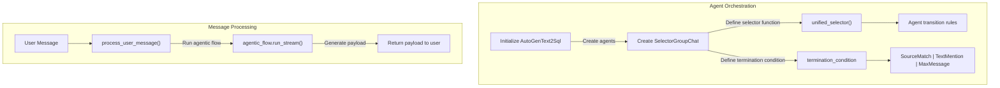

The orchestration is defined in the `AutoGenText2Sql` class, which:
1. Initializes all the required agents
2. Creates a `SelectorGroupChat` with a custom selector function
3. Defines termination conditions for the conversation
4. Processes user messages through the agent flow
5. Tracks and manages conversation state between interactions

The agent flow is managed by a sophisticated selector function (`unified_selector`) that determines the next agent to act based on the current conversation state:

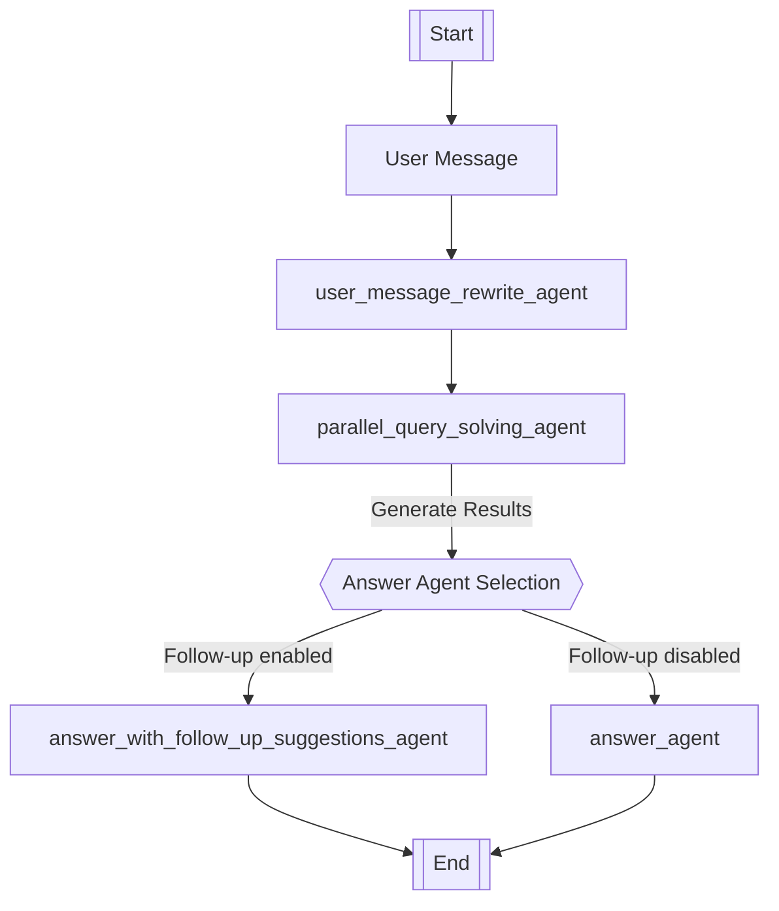

The termination conditions for the conversation are defined in the `termination_condition` property to ensure the flow completes properly:
1. When either `answer_agent` or `answer_with_follow_up_suggestions_agent` has spoken (indicating a complete answer)
2. When a disambiguation request is detected via `TextMentionTermination("contains_disambiguation_requests")`
3. When a maximum message limit is reached via `MaxMessageTermination(5)`

Sources: [text_2_sql/autogen/src/autogen_text_2_sql/autogen_text_2_sql.py:119-135](), [text_2_sql/autogen/src/autogen_text_2_sql/autogen_text_2_sql.py:80-117](), [text_2_sql/autogen/README.md:18-63]()

## Parallel Query Solving Process

The core of the system is the `ParallelQuerySolvingAgent`, which coordinates the complex process of converting natural language to SQL:

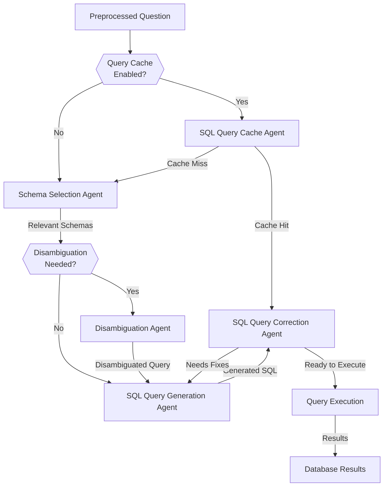

This specialized agent encapsulates multiple sub-agents that work together:

1. **Query Cache Agent**: Checks if similar questions have been asked before
2. **Schema Selection Agent**: Identifies relevant database schemas using vector search
3. **Disambiguation Agent**: Clarifies any ambiguities in schema selection
4. **SQL Generation Agent**: Creates SQL queries based on selected schemas
5. **SQL Correction Agent**: Verifies and fixes the generated queries
6. **Query Execution**: Runs the queries against the database

The agent handles an iterative correction process, where generated SQL may be sent back to the generation agent if corrections are needed. This ensures high-quality SQL queries that are syntactically correct and properly optimized.

Based on the query execution results and cache status, the agent can follow different paths to reach the final answer as efficiently as possible.

Sources: [text_2_sql/autogen/src/autogen_text_2_sql/custom_agents/parallel_query_solving_agent.py](), [text_2_sql/autogen/README.md:18-63](), [text_2_sql/autogen/README.md:72-94]()

## Payload Structure and Communication

The agents communicate with each other through structured payloads defined in the system. These payloads follow a consistent format and carry the required information between agents.

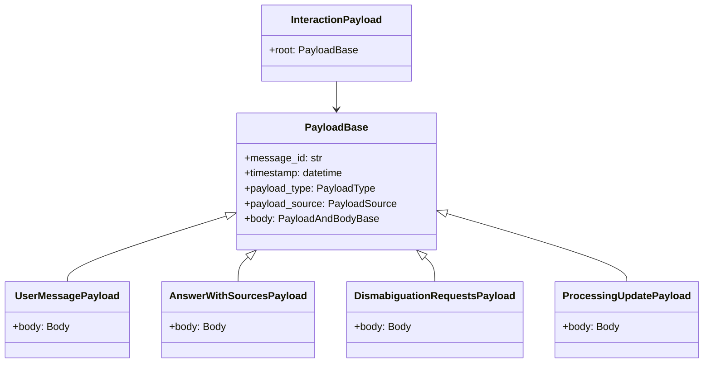

The structured payload approach allows for:
1. Consistent communication between agents
2. Standard format for user and system messages
3. Clear differentiation between message types
4. Structured storage of query results and answers

Sources: [text_2_sql/text_2_sql_core/src/text_2_sql_core/payloads/interaction_payloads.py:1-189]()

## State Management

The architecture includes state management to maintain conversation context across multiple interactions. This allows for follow-up questions and multi-turn conversations.

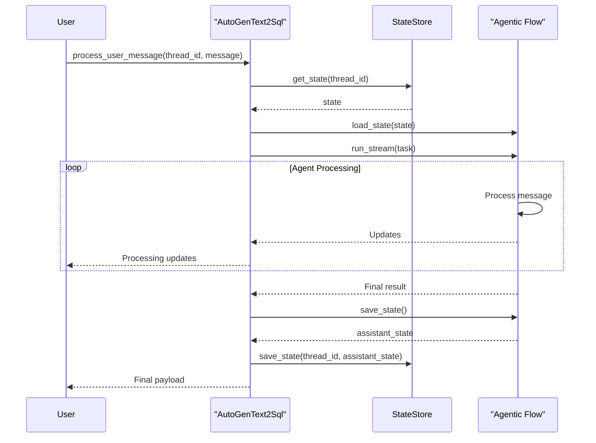

The system uses a pluggable state store interface with multiple implementations:

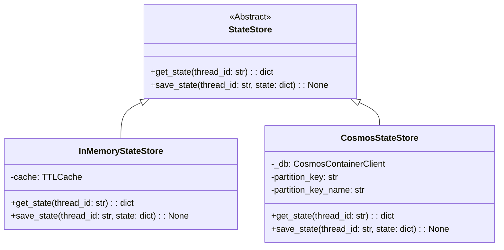

State management involves:
1. Loading the conversation state at the beginning of processing
2. Running the agent flow with the loaded state
3. Saving the updated state at the end of processing
4. Using a pluggable state store interface for flexibility

The system provides two built-in state store implementations:

1. **InMemoryStateStore**: Uses a time-based cache (TTLCache) to store conversation state in memory with a default expiration time of 4 hours. This is suitable for testing and simple deployments.

2. **CosmosStateStore**: Stores conversation state in Azure Cosmos DB, providing persistence across application restarts. This is suitable for production deployments.

Sources: [text_2_sql/autogen/src/autogen_text_2_sql/autogen_text_2_sql.py:277-368](), [text_2_sql/autogen/src/autogen_text_2_sql/state_store.py:1-57]()

## Tools and External Integrations

Agents are equipped with specialized tools that enable them to interact with databases and other external systems.

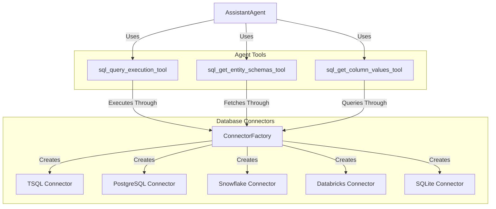

The tools provide a way for agents to:
1. Execute SQL queries against the database
2. Retrieve schema information for tables and views
3. Fetch column values for better query formulation
4. Access database-specific functionality

Sources: [text_2_sql/autogen/src/autogen_text_2_sql/creators/llm_agent_creator.py:33-60]()

## Practical Usage Example

The system can be easily instantiated and used through a simple API:

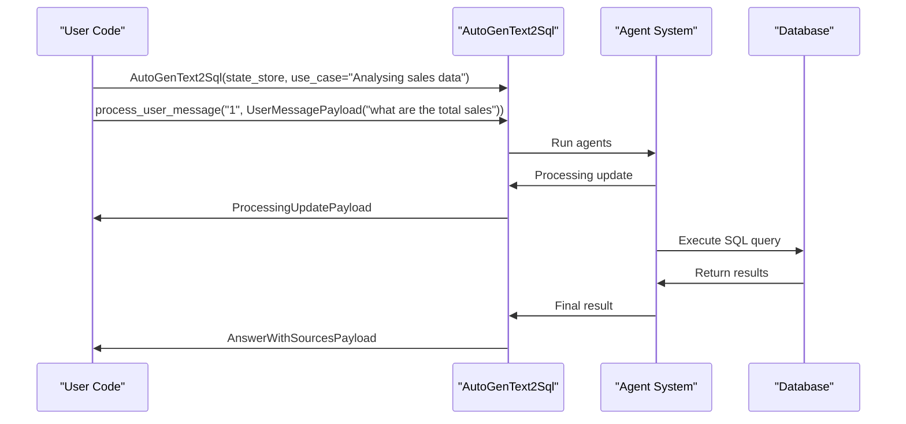

This simple interface allows developers to:
1. Create a Text-to-SQL instance with a specific use case
2. Send user messages with unique thread IDs
3. Receive processing updates during execution
4. Get structured answers with the SQL query and results

Sources: [text_2_sql/autogen/Iteration 5 - Agentic Vector Based Text2SQL.ipynb:65-108]()

## Component Interaction

The following diagram illustrates how the natural language processing components interact with database components:

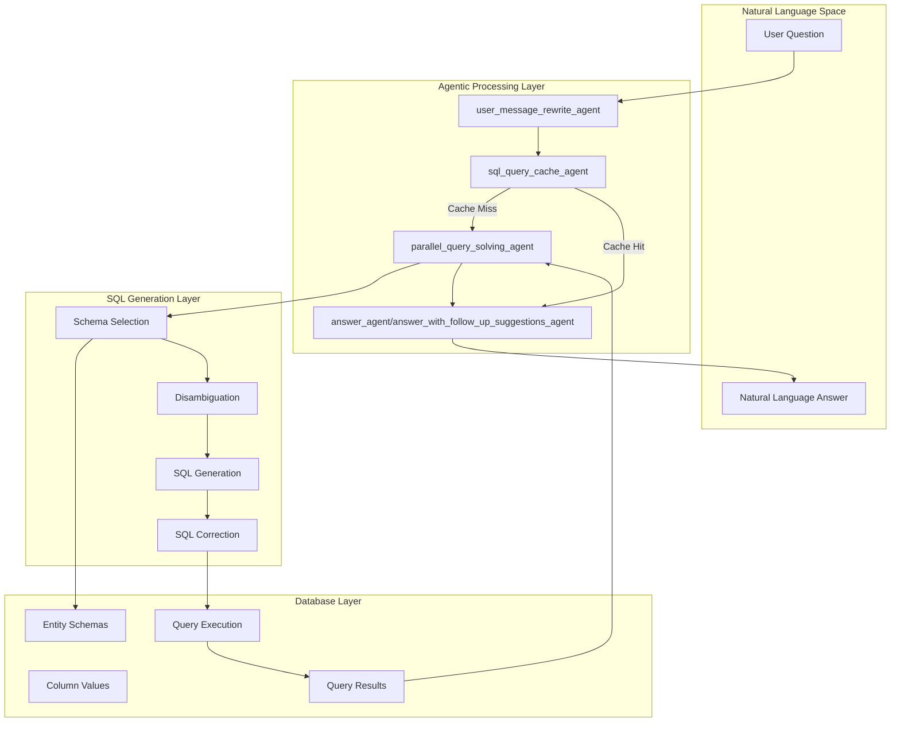

This multi-layered architecture enables:
1. Clear separation between natural language and database interactions
2. Modular components that can be improved independently
3. Flexible processing flow with multiple checkpoints
4. Consistent data transformation between layers

Sources: [text_2_sql/autogen/src/autogen_text_2_sql/autogen_text_2_sql.py:34-369]()

## Summary

The Text-to-SQL system uses a sophisticated agentic architecture where specialized agents collaborate in a structured flow to convert natural language questions into SQL queries and present the results as natural language answers. This architecture provides:

1. **Modularity**: Each agent has a specific responsibility, making the system easier to maintain and extend
2. **Flexibility**: Agents can be replaced or upgraded independently
3. **Robustness**: The system can handle disambiguation and error correction at multiple stages
4. **Extensibility**: New capabilities can be added by introducing new agents or enhancing existing ones
5. **Maintainability**: Clear interfaces between agents make the system easier to understand and modify

This approach enables a more reliable and accurate text-to-SQL conversion compared to single-agent approaches.

Sources: [text_2_sql/autogen/src/autogen_text_2_sql/autogen_text_2_sql.py:34-369]()

---

