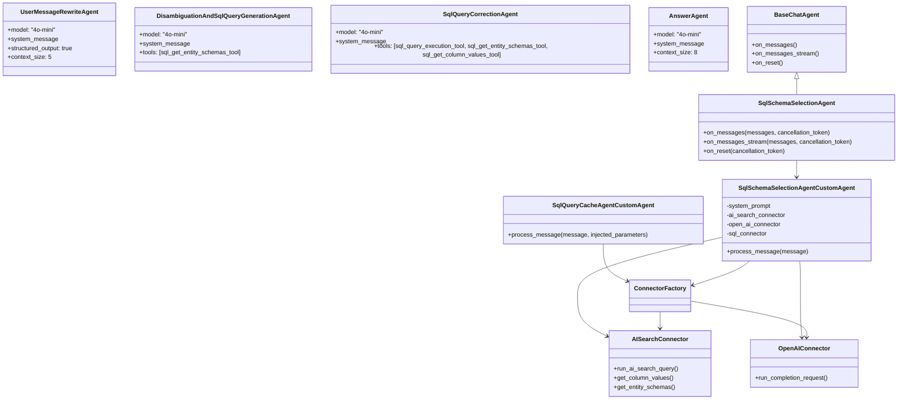
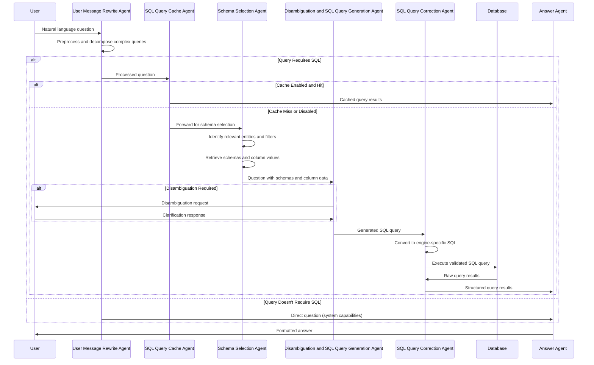
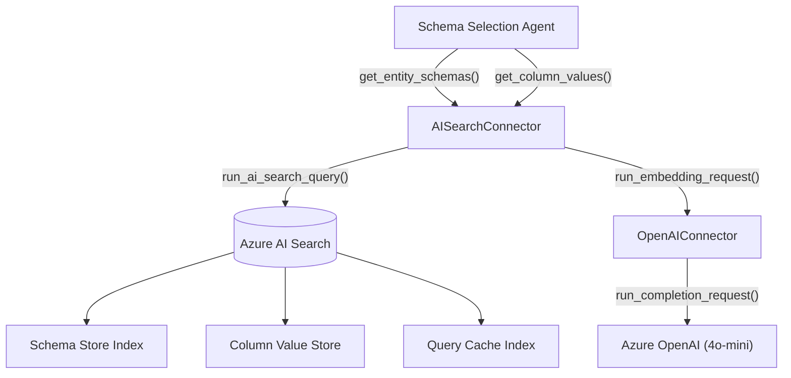

<!-- source: DeepWiki mcp.deepwiki.com · repo microsoft/dstoolkit-text2sql-and-imageprocessing · page 2.2 Agent Types and Responsibilities · fetched 2026-10-26 -->

# Agent Types and Responsibilities

<details>
<summary>Relevant source files</summary>

The following files were used as context for generating this wiki page:

- [text_2_sql/autogen/src/autogen_text_2_sql/custom_agents/sql_schema_selection_agent.py](text_2_sql/autogen/src/autogen_text_2_sql/custom_agents/sql_schema_selection_agent.py)
- [text_2_sql/text_2_sql_core/src/text_2_sql_core/connectors/ai_search.py](text_2_sql/text_2_sql_core/src/text_2_sql_core/connectors/ai_search.py)
- [text_2_sql/text_2_sql_core/src/text_2_sql_core/connectors/open_ai.py](text_2_sql/text_2_sql_core/src/text_2_sql_core/connectors/open_ai.py)
- [text_2_sql/text_2_sql_core/src/text_2_sql_core/custom_agents/sql_query_cache_agent.py](text_2_sql/text_2_sql_core/src/text_2_sql_core/custom_agents/sql_query_cache_agent.py)
- [text_2_sql/text_2_sql_core/src/text_2_sql_core/custom_agents/sql_schema_selection_agent.py](text_2_sql/text_2_sql_core/src/text_2_sql_core/custom_agents/sql_schema_selection_agent.py)
- [text_2_sql/text_2_sql_core/src/text_2_sql_core/prompts/answer_agent.yaml](text_2_sql/text_2_sql_core/src/text_2_sql_core/prompts/answer_agent.yaml)
- [text_2_sql/text_2_sql_core/src/text_2_sql_core/prompts/disambiguation_and_sql_query_generation_agent.yaml](text_2_sql/text_2_sql_core/src/text_2_sql_core/prompts/disambiguation_and_sql_query_generation_agent.yaml)
- [text_2_sql/text_2_sql_core/src/text_2_sql_core/prompts/sql_query_correction_agent.yaml](text_2_sql/text_2_sql_core/src/text_2_sql_core/prompts/sql_query_correction_agent.yaml)
- [text_2_sql/text_2_sql_core/src/text_2_sql_core/prompts/sql_schema_selection_agent.yaml](text_2_sql/text_2_sql_core/src/text_2_sql_core/prompts/sql_schema_selection_agent.yaml)
- [text_2_sql/text_2_sql_core/src/text_2_sql_core/prompts/user_message_rewrite_agent.yaml](text_2_sql/text_2_sql_core/src/text_2_sql_core/prompts/user_message_rewrite_agent.yaml)

</details>


This document details the different agent types within the Text-to-SQL system and their specific responsibilities. It provides a technical overview of each agent's role in the pipeline, from processing user input to generating the final answer. For information on the overall multi-agent architecture, see [Agentic Architecture](#2.1). For details on SQL query generation, see [SQL Query Generation and Execution](#2.5).

## Overview of Agent System

The Text-to-SQL system employs a specialized multi-agent architecture where each agent performs a specific task in the pipeline. This approach enables complex natural language questions to be broken down into manageable steps, with specialized agents handling different aspects of the process.

```mermaid
flowchart TD
    User([User]) -->|"Natural Language Question"| RewriteAgent["User Message Rewrite Agent"]
    RewriteAgent -->|"Processed Question"| CacheDecision{"Cache Enabled?"}
    
    CacheDecision -->|"Yes"| CacheAgent["SQL Query Cache Agent"]
    CacheDecision -->|"No"| SchemaAgent["Schema Selection Agent"]
    
    CacheAgent -->|"Cache Hit"| AnswerAgent["Answer Agent"]
    CacheAgent -->|"Cache Miss"| SchemaAgent
    
    SchemaAgent -->|"Selected Schemas"| DisambigGenAgent["Disambiguation and SQL Query Generation Agent"]
    
    alt "Disambiguation Required"
        DisambigGenAgent -->|"Disambiguation Request"| User
        User -->|"Disambiguation Response"| DisambigGenAgent
    end
    
    DisambigGenAgent -->|"Generated SQL"| CorrectionAgent["SQL Query Correction Agent"]
    
    CorrectionAgent -->|"Validated SQL"| Database[(Database)]
    Database -->|"Query Results"| AnswerAgent
    
    AnswerAgent -->|"Answer"| User
```

*Diagram: Agent Flow in the Text-to-SQL System*

Sources:
- [text_2_sql/text_2_sql_core/src/text_2_sql_core/prompts/user_message_rewrite_agent.yaml:1-182]()
- [text_2_sql/text_2_sql_core/src/text_2_sql_core/custom_agents/sql_schema_selection_agent.py:1-99]()
- [text_2_sql/text_2_sql_core/src/text_2_sql_core/custom_agents/sql_query_cache_agent.py:1-43]()
- [text_2_sql/text_2_sql_core/src/text_2_sql_core/prompts/disambiguation_and_sql_query_generation_agent.yaml:1-278]()

## Agent Types and Code Mapping

The following diagram maps the agent types to their corresponding code implementations, showing the relationship between the conceptual agents and their actual code entities:



*Diagram: Agent Implementation Class Structure*

Sources:
- [text_2_sql/autogen/src/autogen_text_2_sql/custom_agents/sql_schema_selection_agent.py:1-63]()
- [text_2_sql/text_2_sql_core/src/text_2_sql_core/custom_agents/sql_schema_selection_agent.py:1-99]()
- [text_2_sql/text_2_sql_core/src/text_2_sql_core/custom_agents/sql_query_cache_agent.py:1-43]()
- [text_2_sql/text_2_sql_core/src/text_2_sql_core/prompts/disambiguation_and_sql_query_generation_agent.yaml:1-280]()
- [text_2_sql/text_2_sql_core/src/text_2_sql_core/prompts/sql_query_correction_agent.yaml:1-135]()
- [text_2_sql/text_2_sql_core/src/text_2_sql_core/connectors/ai_search.py:1-283]()

## Agent Responsibilities

Each agent in the Text-to-SQL system has specific responsibilities and roles in processing user questions:

### User Message Rewrite Agent

The User Message Rewrite Agent preprocesses user inputs by analyzing and potentially restructuring complex queries.

**Key Responsibilities:**
- Breaking down complex queries into simpler steps that can be processed independently
- Filtering out malicious or unrelated queries based on allowed topics
- Determining if SQL queries are required to answer the question
- Resolving relative date references using the current date
- Maintaining the original intent of user questions while enhancing clarity

**Implementation:**
This agent is implemented as a prompt-based agent using GPT-4o-mini and returns a JSON structure with steps for processing.

Sources:
- [text_2_sql/text_2_sql_core/src/text_2_sql_core/prompts/user_message_rewrite_agent.yaml:1-182]()

### SQL Query Cache Agent

The SQL Query Cache Agent checks for previously processed similar questions to avoid redundant processing.

**Key Responsibilities:**
- Checking if the current question is similar to previously processed questions
- Retrieving cached SQL queries and results when a match is found
- Passing cached results to the Answer Agent when appropriate

**Implementation:**
This agent is implemented in the `SqlQueryCacheAgentCustomAgent` class which uses connector factory to interact with database connectors.

```python
# Key methods
async def process_message(self, message: str, injected_parameters: dict) -> dict:
    # Fetch cached queries based on the question
    cached_query = await self.sql_connector.fetch_sql_queries_with_schemas_from_cache(message, injected_parameters)
    # Process and return results
```

Sources:
- [text_2_sql/text_2_sql_core/src/text_2_sql_core/custom_agents/sql_query_cache_agent.py:1-43]()

### Schema Selection Agent

The Schema Selection Agent identifies the relevant database schemas needed to answer the user's question.

**Key Responsibilities:**
- Parsing the user's question to identify mentioned entities and filter conditions
- Retrieving relevant schemas from the database metadata
- Fetching column value information for potential filter conditions
- Selecting the most appropriate database when multiple options are available
- Providing schema information to downstream agents for SQL generation

**Implementation:**
This agent is implemented in both AutoGen-compatible (`SqlSchemaSelectionAgent`) and core (`SqlSchemaSelectionAgentCustomAgent`) classes.

Sources:
- [text_2_sql/autogen/src/autogen_text_2_sql/custom_agents/sql_schema_selection_agent.py:1-63]()
- [text_2_sql/text_2_sql_core/src/text_2_sql_core/custom_agents/sql_schema_selection_agent.py:1-99]()

### Disambiguation and SQL Query Generation Agent

This agent combines disambiguation and SQL query generation capabilities in a single component. It specializes in disambiguating user questions and mapping them to database schemas before generating appropriate SQL queries.

**Key Responsibilities:**
- Disambiguating user questions by identifying unclear or ambiguous references
- Verifying mappings between user intent and available database schemas
- Requesting clarification from users when necessary through structured disambiguation requests
- Generating SQL queries once mappings are clear
- Mapping text filters, aggregations, and relationships to appropriate SQL constructs
- Following engine-specific SQL syntax rules

**Implementation:**
The agent is implemented as a YAML-defined prompt template using GPT-4o-mini and includes comprehensive instructions for:
- Understanding key database concepts
- Mapping question components to schema elements
- Generating proper SQL syntax for various operations
- Creating disambiguation requests when needed

```yaml
# Key disambiguation logic excerpt
<disambiguation_rules>
  Before carrying out disambiguation, ensure that you have checked all available database schemas 
  and filters for a most probable mapping...
  
  1. **No Match in Database Schemas or Uncertain Schema Availability**:
     - Generate a single disambiguation request with explanation
  
  2. **Multiple Possible Mappings**:
     - Generate disambiguation request with specific options for user choice
     - May generate multiple disambiguation requests for different ambiguities
  
  3. **Unclear or Ambiguous Question**:
     - Generate a single disambiguation request asking user to rephrase
</disambiguation_rules>
```

Sources:
- [text_2_sql/text_2_sql_core/src/text_2_sql_core/prompts/disambiguation_and_sql_query_generation_agent.yaml:1-278]()

### SQL Query Correction Agent

The SQL Query Correction Agent specializes in SQL syntax correction and query execution for the target database engine.

**Key Responsibilities:**
- Converting standard SQL to engine-specific syntax
- Fixing syntax issues while preserving query logic
- Executing the corrected queries against the database
- Handling common error types and applying appropriate fixes
- Verifying that query results will answer all user questions

**Implementation:**
This agent is implemented as a YAML-defined prompt template using GPT-4o-mini with specialized tools for:
- SQL query execution
- Entity schema retrieval
- Column value retrieval

The agent follows a systematic workflow:
```
1. Initial Analysis:
   - Identify standard SQL patterns needing conversion
   - Check for engine-specific syntax requirements
   
2. Systematic Conversion:
   - Convert row limiting syntax
   - Convert date/time functions
   - Convert string functions
   - Convert aggregation syntax
   
3. Execution Process:
   - Try executing the converted query
   - Apply targeted fixes based on error type
   - Retry execution
   
4. Result Handling:
   - Format successful results
   - Include both original and converted queries
```

Sources:
- [text_2_sql/text_2_sql_core/src/text_2_sql_core/prompts/sql_query_correction_agent.yaml:1-132]()

### Answer Agent

The Answer Agent formats the SQL query results into a natural language response for the user.

**Key Responsibilities:**
- Interpreting SQL query results to answer the user's question
- Formatting complex data in a human-readable format using Markdown
- Ensuring the response directly addresses all parts of the user's question
- Converting technical SQL results into business-friendly language

**Implementation:**
This agent is implemented as a prompt-based agent with a structured output format.

```yaml
# Key prompt elements
<role_and_objective>
  You are Senior Data Analyst, specializing in providing data driven answers to a user's question...
</role_and_objective>

<output>
  {
    "answer": "The response to the user's question.",
  }
</output>
```

Sources:
- [text_2_sql/text_2_sql_core/src/text_2_sql_core/prompts/answer_agent.yaml:1-30]()

### Answer Agent

The Answer Agent formulates data-driven responses to the user's question based on the SQL query results.

**Key Responsibilities:**
- Providing clear and concise responses based on SQL query results
- Using Markdown formatting for better readability
- Ensuring responses directly address all parts of the user's question
- Taking a data-driven approach to generate accurate answers
- Explaining system capabilities when users ask about them

**Implementation:**
This agent is implemented as a YAML-defined prompt template using GPT-4o-mini with a context size of 8.

```yaml
# Key system information
<system_information>
  - You are part of an overall system that provides Text2SQL and subsequent data analysis functionality only.
  - You can assume that the SQL queries are correct and that the results are accurate.
  - You and the wider system can only generate SQL queries and process the results of these queries.
  - The main ability of the system is to perform natural language understanding and generate SQL queries.
</system_information>

<output>
  {
    "answer": "The response to the user's question."
  }
</output>
```

Sources:
- [text_2_sql/text_2_sql_core/src/text_2_sql_core/prompts/answer_agent.yaml:1-29]()

## Agent Interaction Flow

The interaction between agents follows a specific flow, with decision points determining which agents are invoked:



*Diagram: Agent Interaction Sequence*

The sequence shows the complete flow from user question to final answer, including:
1. Initial query preprocessing and decomposition
2. Cache checking for previously answered similar questions
3. Schema selection for relevant database tables and columns
4. Disambiguation when the user's intent is unclear
5. SQL generation, correction, and execution
6. Answer formulation based on query results

Sources:
- [text_2_sql/text_2_sql_core/src/text_2_sql_core/prompts/user_message_rewrite_agent.yaml:1-182]()
- [text_2_sql/text_2_sql_core/src/text_2_sql_core/custom_agents/sql_schema_selection_agent.py:1-99]()
- [text_2_sql/text_2_sql_core/src/text_2_sql_core/custom_agents/sql_query_cache_agent.py:1-43]()
- [text_2_sql/text_2_sql_core/src/text_2_sql_core/prompts/disambiguation_and_sql_query_generation_agent.yaml:1-278]()
- [text_2_sql/text_2_sql_core/src/text_2_sql_core/prompts/sql_query_correction_agent.yaml:1-132]()
- [text_2_sql/text_2_sql_core/src/text_2_sql_core/prompts/answer_agent.yaml:1-29]()

## Integration with AI Services

The agents in the Text-to-SQL system interact with various AI services, primarily through the OpenAI and AI Search connectors:

| Agent | AI Service Integrations | Tools/Connectors |
|-------|-------------------------|-----------------|
| User Message Rewrite Agent | OpenAI (GPT-4o-mini) | - |
| Schema Selection Agent | OpenAI (GPT-4o-mini), Azure AI Search | `AISearchConnector`, `ConnectorFactory` |
| SQL Query Cache Agent | Azure AI Search | `ConnectorFactory` |
| Disambiguation and SQL Query Generation Agent | OpenAI (GPT-4o-mini) | `sql_get_entity_schemas_tool` |
| SQL Query Correction Agent | OpenAI (GPT-4o-mini) | `sql_query_execution_tool`, `sql_get_entity_schemas_tool`, `sql_get_column_values_tool` |
| Answer Agent | OpenAI (GPT-4o-mini) | - |

The AI Search connector provides critical functionality for both schema retrieval and column value lookups:



*Diagram: AI Service Integration*

The `AISearchConnector` class offers these key methods:

1. `get_entity_schemas`: Retrieves database schema information based on natural language text
   ```python
   async def get_entity_schemas(
       self,
       text: str,
       excluded_entities: list[str] = [],
       engine_specific_fields: list[DatabaseEngineSpecificFields] = [],
   ) -> str:
       # Performs semantic and vector search to find schemas
       schemas = await self.run_ai_search_query(...)
       # Returns filtered schemas based on relevance
   ```

2. `get_column_values`: Retrieves sample column values to assist with query generation
   ```python
   async def get_column_values(self, text: str):
       # Adds tildes for fuzzy search
       text = " ".join([f"{word}~" for word in text.split()])
       # Gets column values from AI Search
       values = await self.run_ai_search_query(...)
       return values
   ```

Sources:
- [text_2_sql/text_2_sql_core/src/text_2_sql_core/connectors/ai_search.py:107-141]()
- [text_2_sql/text_2_sql_core/src/text_2_sql_core/connectors/ai_search.py:142-232]()
- [text_2_sql/text_2_sql_core/src/text_2_sql_core/connectors/open_ai.py:30-76]()
- [text_2_sql/text_2_sql_core/src/text_2_sql_core/prompts/disambiguation_and_sql_query_generation_agent.yaml:279-281]()
- [text_2_sql/text_2_sql_core/src/text_2_sql_core/prompts/sql_query_correction_agent.yaml:132-136]()

## Agent Output Structures

The agents use structured outputs to ensure consistent communication between components:

| Agent | Output Structure | Key Fields |
|-------|------------------|------------|
| User Message Rewrite Agent | `UserMessageRewriteAgentOutput` | `steps`, `requires_sql_queries` |
| Schema Selection Agent | `SQLSchemaSelectionAgentOutput` | `entities`, `filter_conditions` |
| SQL Query Cache Agent | Dictionary | `cached_sql_queries_with_schemas_from_cache`, `contains_cached_sql_queries_with_schemas_from_cache_database_results` |
| Answer Agent | `AnswerAgentOutput` | `answer` |
| Answer With Follow-Up Agent | `AnswerWithFollowUpSuggestionsAgentOutput` | `answer`, `follow_up_suggestions` |

Sources:
- [text_2_sql/text_2_sql_core/src/text_2_sql_core/structured_outputs/__init__.py:1-20]()
- [text_2_sql/text_2_sql_core/src/text_2_sql_core/structured_outputs/answer_with_follow_up_suggestions_agent.py:1-11]()

---

