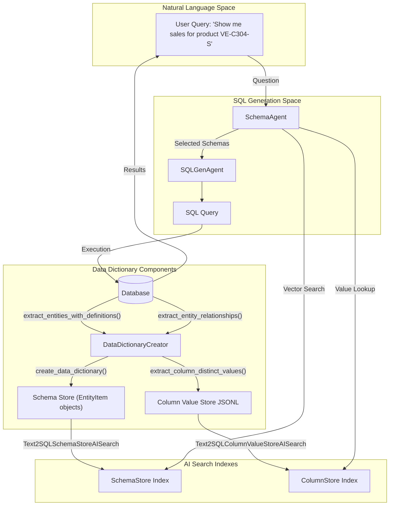
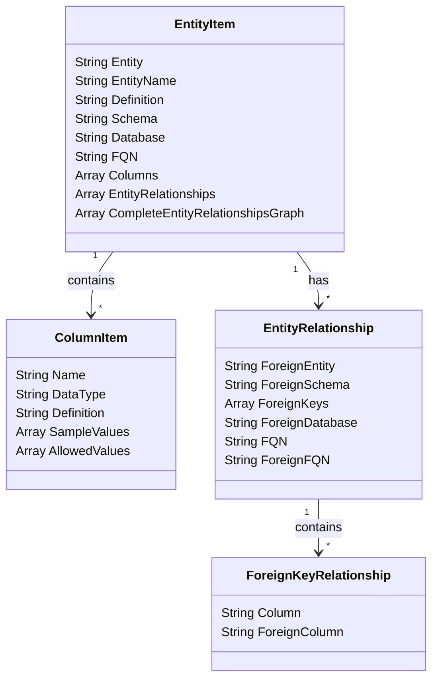
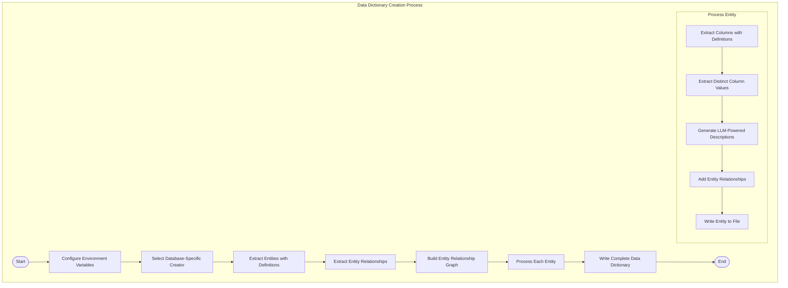
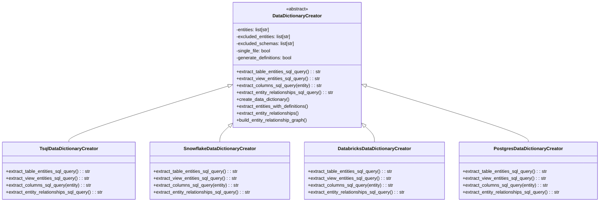
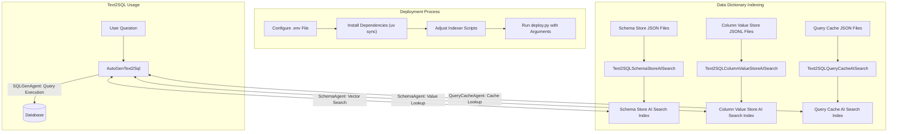
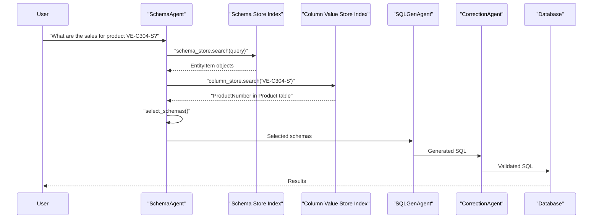

<!-- source: DeepWiki mcp.deepwiki.com · repo microsoft/dstoolkit-text2sql-and-imageprocessing · page 2.3 Data Dictionary · fetched 2026-10-26 -->

# Data Dictionary

<details>
<summary>Relevant source files</summary>

The following files were used as context for generating this wiki page:

- [deploy_ai_search_indexes/README.md](deploy_ai_search_indexes/README.md)
- [text_2_sql/data_dictionary/README.md](text_2_sql/data_dictionary/README.md)
- [text_2_sql/text_2_sql_core/src/text_2_sql_core/data_dictionary/cli.py](text_2_sql/text_2_sql_core/src/text_2_sql_core/data_dictionary/cli.py)
- [text_2_sql/text_2_sql_core/src/text_2_sql_core/data_dictionary/data_dictionary_creator.py](text_2_sql/text_2_sql_core/src/text_2_sql_core/data_dictionary/data_dictionary_creator.py)
- [text_2_sql/text_2_sql_core/src/text_2_sql_core/data_dictionary/databricks_data_dictionary_creator.py](text_2_sql/text_2_sql_core/src/text_2_sql_core/data_dictionary/databricks_data_dictionary_creator.py)
- [text_2_sql/text_2_sql_core/src/text_2_sql_core/data_dictionary/snowflake_data_dictionary_creator.py](text_2_sql/text_2_sql_core/src/text_2_sql_core/data_dictionary/snowflake_data_dictionary_creator.py)
- [text_2_sql/text_2_sql_core/src/text_2_sql_core/data_dictionary/tsql_data_dictionary_creator.py](text_2_sql/text_2_sql_core/src/text_2_sql_core/data_dictionary/tsql_data_dictionary_creator.py)
- [text_2_sql/text_2_sql_core/src/text_2_sql_core/utils/environment.py](text_2_sql/text_2_sql_core/src/text_2_sql_core/utils/environment.py)

</details>


The Data Dictionary component serves as a critical metadata repository for the Text-to-SQL system, providing structured information about database schemas, relationships, and column values to enable accurate natural language to SQL query conversion. This document explains how the data dictionary is created, maintained, and utilized in the Text-to-SQL system.

For information about the broader Text-to-SQL system architecture, see [Text-to-SQL System](#2).

## Overview

The Data Dictionary is a fundamental component that powers the knowledge of Large Language Models (LLMs) in the Text-to-SQL system. Rather than having the LLM query the database at runtime to discover schema information, storing this metadata in structured files reduces system latency and allows for metadata enhancement through prompt engineering.

The Data Dictionary consists of two primary components:
1. **Schema Store** - JSON files containing metadata about database tables/views, columns, and relationships
2. **Column Value Store** - JSONL files containing dimension table values to provide context for user queries



Sources: [text_2_sql/data_dictionary/README.md:1-5](), [text_2_sql/text_2_sql_core/src/text_2_sql_core/data_dictionary/data_dictionary_creator.py:226-250]()

## Data Dictionary Structure

### Schema Store JSON

The Schema Store contains detailed metadata about database tables and views in JSON format. Each entity (table or view) is represented as a JSON object with comprehensive information about its structure and relationships.

Key components of a Schema Store entry include:

| Property | Description |
|----------|-------------|
| Entity | The actual name of the table/view used in SQL queries |
| EntityName | A human-readable name for the entity |
| Definition | A comprehensive description of what information the entity contains |
| Schema | The database schema the entity belongs to |
| Database | The database the entity belongs to |
| FQN | Fully Qualified Name of the entity |
| Columns | Array of column definitions with name, data type, definition, and sample values |
| EntityRelationships | Mapping of immediate relationships to other entities with foreign key details |
| CompleteEntityRelationshipsGraph | Directed graph showing how this entity relates to all others |

Here's a diagram illustrating the structure of a Schema Store entry:



Sources: [text_2_sql/data_dictionary/README.md:3-160](), [text_2_sql/text_2_sql_core/src/text_2_sql_core/data_dictionary/data_dictionary_creator.py:125-194]()

### Column Value Store JSONL

The Column Value Store contains dimension table values in JSONL format. This helps the LLM understand the context of user questions by providing a searchable index of string-based values in the database.

Each line in the Column Value Store represents a single value in a dimension table column:

```
{"Entity": "Product", "Schema": "SalesLT", "Database": "text2sql-adventure-works", "FQN": "text2sql-adventure-works.SalesLT.Product.ProductNumber", "Column": "ProductNumber", "Value": "WB-H098", "Synonyms": []}
```

The Column Value Store is particularly useful for identifying specific values mentioned in user queries. For example, if a user asks "What are the total sales for VE-C304-S?", the system can use the Column Value Store to determine that "VE-C304-S" is a Product Number in the Product entity.

Sources: [text_2_sql/data_dictionary/README.md:177-202]()

## Automatic Generation

Manually creating a Data Dictionary is time-consuming. The Text-to-SQL system provides utilities to automatically generate the Data Dictionary from database metadata using a combination of SQL queries and LLM-powered descriptions.



The `DataDictionaryCreator` is an abstract base class that provides the core functionality for extracting database metadata. Database-specific implementations are provided for:

- **TSQL**: `TsqlDataDictionaryCreator`
- **Postgres**: `PostgresDataDictionaryCreator`
- **Snowflake**: `SnowflakeDataDictionaryCreator`
- **Databricks**: `DatabricksDataDictionaryCreator`

This class hierarchy enables database-specific SQL queries while maintaining a consistent interface:



Sources: [text_2_sql/text_2_sql_core/src/text_2_sql_core/data_dictionary/data_dictionary_creator.py:226-250](), [text_2_sql/text_2_sql_core/src/text_2_sql_core/data_dictionary/tsql_data_dictionary_creator.py:13-32](), [text_2_sql/text_2_sql_core/src/text_2_sql_core/data_dictionary/snowflake_data_dictionary_creator.py:14-26](), [text_2_sql/text_2_sql_core/src/text_2_sql_core/data_dictionary/databricks_data_dictionary_creator.py:14-26]()

To generate a data dictionary, follow these steps:

1. Configure environment variables in a `.env` file based on the provided `.env.example` template
2. Run the data dictionary creator for your database engine with:
   ```
   uv run data_dictionary <DATABASE_ENGINE>
   ```
3. Optional command line arguments:
   - `--output-directory` or `-o`: Specify the output directory
   - `--single_file` or `-s`: Write all schemas to a single file
   - `--generate_definitions` or `-gen`: Use OpenAI to generate descriptions

For more control, you can directly use the code-based API and specify:
- `entities`: A list of entities to extract
- `excluded_entities`: A list of entities to exclude
- `excluded_schemas`: A list of schemas to exclude

Sources: [text_2_sql/data_dictionary/README.md:208-245](), [text_2_sql/text_2_sql_core/src/text_2_sql_core/data_dictionary/cli.py:16-139](), [text_2_sql/text_2_sql_core/src/text_2_sql_core/data_dictionary/data_dictionary_creator.py:226-828]()

## Indexing with Azure AI Search

Once the Data Dictionary is generated, it's indexed using Azure AI Search to make it searchable for the Text-to-SQL system. Two primary indexes are created:

1. **Schema Store Index**: Contains the database schema information
2. **Column Value Store Index**: Contains dimension table values



The indexing process is handled by deployment scripts in the `deploy_ai_search_indexes` directory:

- `text_2_sql_schema_store.py`: Deploys the Schema Store index
- `text_2_sql_column_value_store.py`: Deploys the Column Value Store index
- `text_2_sql_query_cache.py`: Deploys the Query Cache index (optional)

The deployment process involves these steps:

1. Configure environment variables in a `.env` file based on the provided `.env.example` template
2. Install dependencies using `uv sync` within the `deploy_ai_search_indexes` directory
3. Adjust the indexer scripts if needed to customize the skills pipeline
4. Run `uv run deploy.py` with appropriate arguments:
   - `index_type`: Specifies which type of index to deploy (e.g., `text_2_sql_schema_store`)
   - `rebuild`: Flag to delete and rebuild the index
   - `suffix`: Optional parameter to apply a suffix to the deployed index and indexer
   - Additional parameters specific to each index type

Sources: [deploy_ai_search_indexes/README.md:26-80]()

Sources: [text_2_sql/data_dictionary/README.md:204-207](), [deploy_ai_search_indexes/README.md:26-60]()

## Schema Selection Process

The Data Dictionary plays a crucial role in the schema selection phase of the Text-to-SQL pipeline. When a user asks a question, the system uses the Data Dictionary to identify the relevant tables and columns needed to construct the SQL query.



Sources: [text_2_sql/data_dictionary/README.md:177-196]()

The Schema Selection Agent uses:
1. **Vector/Semantic Search**: To find relevant entities and columns based on the question semantics
2. **Value Recognition**: To identify specific values mentioned in the question and map them to database columns
3. **Relationship Analysis**: To understand how to join tables based on the entity relationships in the Data Dictionary

This two-step approach (schema selection followed by SQL generation) allows the system to focus the LLM's attention on relevant database objects, significantly improving accuracy and reducing hallucinations.

Sources: [text_2_sql/data_dictionary/README.md:5-6]()

## Impact on Query Accuracy

The quality and completeness of the Data Dictionary directly influences the accuracy of the Text-to-SQL system. Well-defined and comprehensive metadata helps the LLM:

1. **Select the correct tables and columns**: Accurate definitions help the system understand what data is available
2. **Interpret data correctly**: Sample values and data types guide the system in formulating correct WHERE clauses
3. **Create proper joins**: Entity relationship information ensures correct table joining
4. **Handle ambiguity**: Detailed definitions help resolve ambiguous terms in user questions

For example, if a column definition explains that a "status" field contains values like "active," "pending," or "cancelled" and describes what each means, the LLM can correctly map natural language references like "completed orders" to the appropriate SQL filter condition.

Sources: [text_2_sql/data_dictionary/README.md:173-175]()

## Conclusion

The Data Dictionary is a foundational component of the Text-to-SQL system that bridges the gap between natural language and database schema. By providing rich metadata about the database structure, it enables the LLM to accurately translate user questions into SQL queries.

The automated generation capabilities make it practical to implement even with large and complex databases, while the integration with Azure AI Search provides efficient retrieval of relevant schema information during query generation.

For teams implementing this system, investing time in refining the Data Dictionary definitions and ensuring comprehensive coverage of all relevant tables will yield significant improvements in query accuracy and system performance.

---

