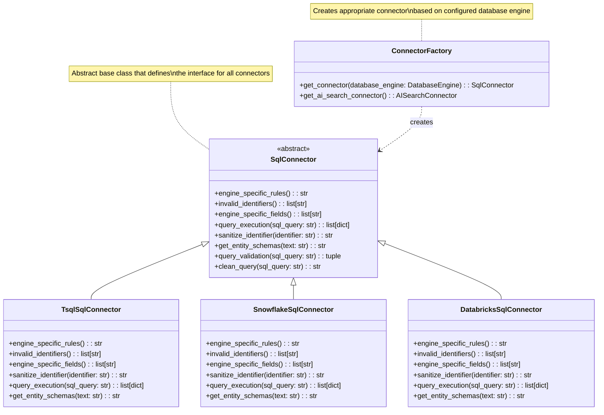
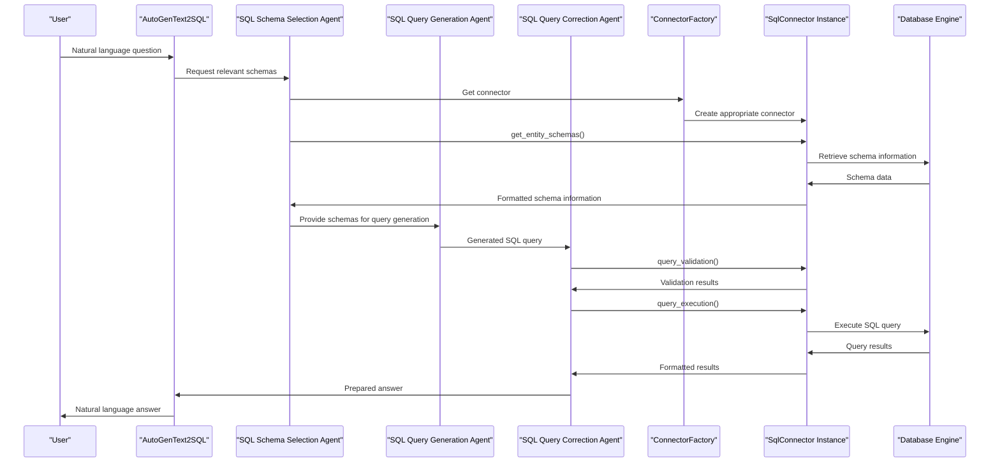
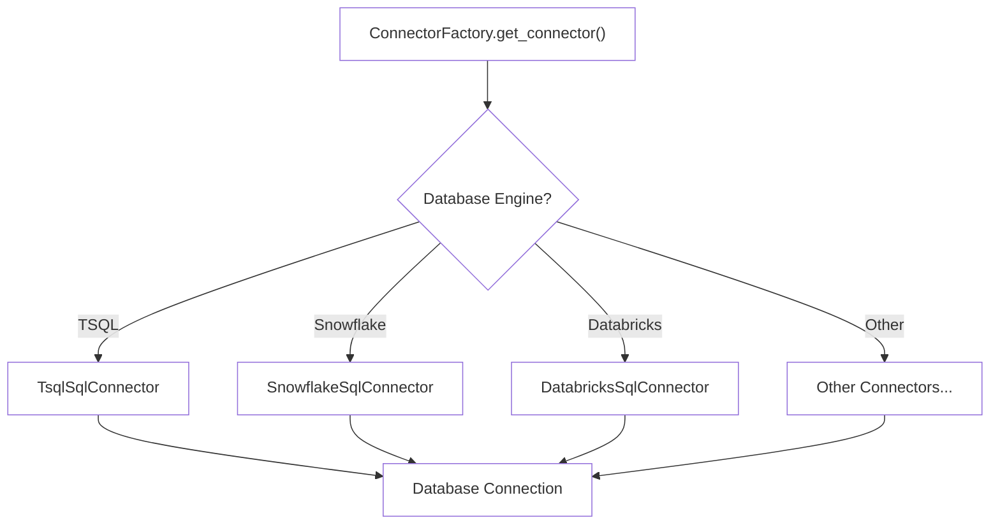
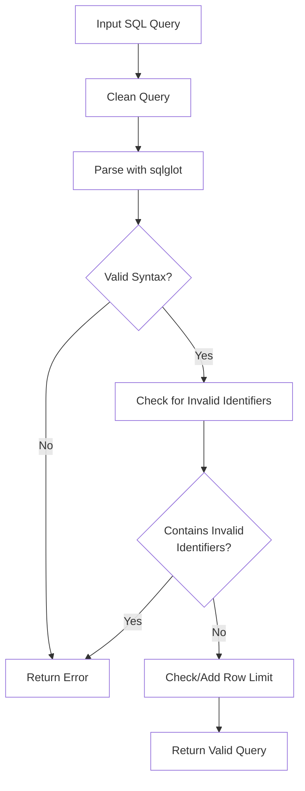
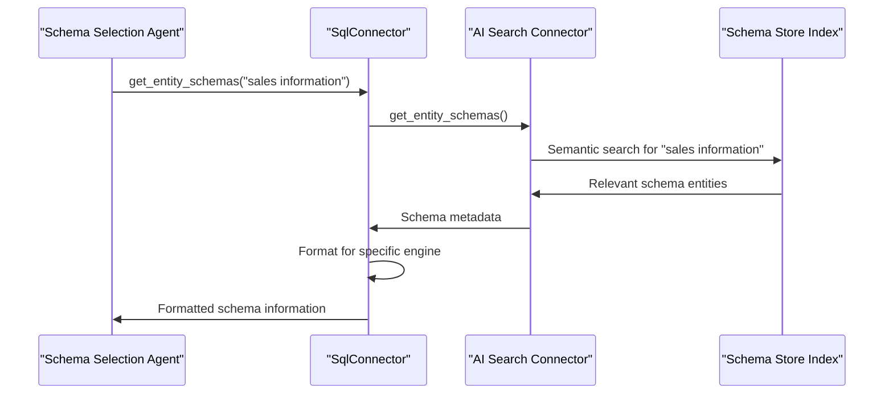

<!-- source: DeepWiki mcp.deepwiki.com · repo microsoft/dstoolkit-text2sql-and-imageprocessing · page 2.4 Database Connectors · fetched 2026-10-26 -->

# Database Connectors

<details>
<summary>Relevant source files</summary>

The following files were used as context for generating this wiki page:

- [text_2_sql/autogen/src/autogen_text_2_sql/custom_agents/parallel_query_solving_agent.py](text_2_sql/autogen/src/autogen_text_2_sql/custom_agents/parallel_query_solving_agent.py)
- [text_2_sql/autogen/src/autogen_text_2_sql/inner_autogen_text_2_sql.py](text_2_sql/autogen/src/autogen_text_2_sql/inner_autogen_text_2_sql.py)
- [text_2_sql/text_2_sql_core/src/text_2_sql_core/connectors/databricks_sql.py](text_2_sql/text_2_sql_core/src/text_2_sql_core/connectors/databricks_sql.py)
- [text_2_sql/text_2_sql_core/src/text_2_sql_core/connectors/snowflake_sql.py](text_2_sql/text_2_sql_core/src/text_2_sql_core/connectors/snowflake_sql.py)
- [text_2_sql/text_2_sql_core/src/text_2_sql_core/connectors/sql.py](text_2_sql/text_2_sql_core/src/text_2_sql_core/connectors/sql.py)
- [text_2_sql/text_2_sql_core/src/text_2_sql_core/connectors/tsql_sql.py](text_2_sql/text_2_sql_core/src/text_2_sql_core/connectors/tsql_sql.py)

</details>


## Purpose and Scope

This document details the database connector architecture in the Text-to-SQL system. The connector framework provides a standardized interface for interacting with various database engines while encapsulating database-specific logic. The architecture enables the Text-to-SQL system to execute SQL queries against different database backends without modifying the core query generation logic.

For information about how SQL queries are generated, see [SQL Query Generation and Execution](#2.5).

## Connector Architecture Overview

The database connector architecture follows an object-oriented design with an abstract base class and concrete implementations for specific database engines. This approach allows for consistent interface while accommodating the unique syntax and features of each database platform.



Sources: [text_2_sql/text_2_sql_core/src/text_2_sql_core/connectors/sql.py:17-427](), [text_2_sql/text_2_sql_core/src/text_2_sql_core/connectors/tsql_sql.py:13-158](), [text_2_sql/text_2_sql_core/src/text_2_sql_core/connectors/snowflake_sql.py:14-192](), [text_2_sql/text_2_sql_core/src/text_2_sql_core/connectors/databricks_sql.py:14-171]()

## Integration with Text-to-SQL Flow

The database connectors are integrated into the Text-to-SQL system's execution flow, serving as the bridge between the SQL queries generated by LLM agents and the actual database engines.



Sources: [text_2_sql/autogen/src/autogen_text_2_sql/inner_autogen_text_2_sql.py:40-183](), [text_2_sql/autogen/src/autogen_text_2_sql/custom_agents/parallel_query_solving_agent.py:41-301]()

## Base SqlConnector

The `SqlConnector` is an abstract base class that defines the common interface for all database connectors. It handles cross-cutting concerns like:

1. Feature flag management
2. Query validation and sanitization
3. Result formatting
4. AI Search integration
5. Row limit enforcement
6. Column value retrieval

```python
class SqlConnector(ABC):
    # Abstract methods that must be implemented by specific connectors
    @abstractmethod
    def engine_specific_rules(self) -> str:
        """Get the engine specific rules."""
        
    @abstractmethod
    def invalid_identifiers(self) -> list[str]:
        """Get the invalid identifiers upon which a sql query is rejected."""
        
    @abstractmethod
    def engine_specific_fields(self) -> list[str]:
        """Get the engine specific fields."""
        
    @abstractmethod
    def sanitize_identifier(self, identifier: str) -> str:
        """Sanitize the identifier to ensure it is valid."""
        
    @abstractmethod
    async def query_execution(
        self,
        sql_query: str,
        cast_to: any = None,
        limit=None,
    ) -> list[dict]:
        """Run the SQL query against the database."""
        
    @abstractmethod
    async def get_entity_schemas(
        self,
        text: str,
        excluded_entities: list[str] = [],
        as_json: bool = True,
    ) -> str:
        """Gets the schema of views or tables based on semantic search."""
```

Sources: [text_2_sql/text_2_sql_core/src/text_2_sql_core/connectors/sql.py:17-88](), [text_2_sql/text_2_sql_core/src/text_2_sql_core/connectors/sql.py:152-173]()

### Common Query Functionality

The base class implements several methods for query handling:

1. `clean_query`: Standardizes query formatting and sanitizes identifiers
2. `query_validation`: Validates SQL syntax and prevents unsafe operations
3. `query_execution_with_limit`: Executes queries with row limits
4. `get_column_values`: Retrieves column values through AI Search

The connector also enforces row limits for query results, which can be configured through environment variables.

Sources: [text_2_sql/text_2_sql_core/src/text_2_sql_core/connectors/sql.py:175-221](), [text_2_sql/text_2_sql_core/src/text_2_sql_core/connectors/sql.py:223-251](), [text_2_sql/text_2_sql_core/src/text_2_sql_core/connectors/sql.py:253-344]()

## Database-Specific Connectors

The system implements specialized connectors for various database engines. Each connector handles the unique syntax, connection mechanisms, and query execution for a specific database technology.

### TSQL Connector

The `TsqlSqlConnector` class provides connectivity to Microsoft SQL Server databases. It uses the `aioodbc` library for asynchronous database connections.

Key implementation details:
- Sanitizes identifiers with square brackets (`[identifier]`)
- Uses TOP instead of LIMIT for row limiting
- Connects using an ODBC connection string
- Handles T-SQL specific reserved keywords

```python
# TSQL-specific sanitization
def sanitize_identifier(self, identifier: str) -> str:
    return f"[{identifier}]"
```

Sources: [text_2_sql/text_2_sql_core/src/text_2_sql_core/connectors/tsql_sql.py:13-158]()

### Snowflake Connector

The `SnowflakeSqlConnector` supports connections to Snowflake databases. It uses the official Snowflake Python connector.

Key implementation details:
- Sanitizes identifiers with double quotes (`"identifier"`)
- Enforces "NULLS LAST" in ORDER BY clauses
- Uses warehouse, database, schema hierarchy
- Handles Snowflake-specific reserved keywords

```python
# Snowflake-specific sanitization
def sanitize_identifier(self, identifier: str) -> str:
    return f'"{identifier}"'
```

Sources: [text_2_sql/text_2_sql_core/src/text_2_sql_core/connectors/snowflake_sql.py:14-192]()

### Databricks Connector

The `DatabricksSqlConnector` provides connectivity to Databricks SQL endpoints. It uses the Databricks SQL connector.

Key implementation details:
- Sanitizes identifiers with backticks (`` `identifier` ``)
- Uses catalog, schema, table hierarchy
- Handles Databricks-specific reserved keywords
- Connects using server hostname, HTTP path, and access token

```python
# Databricks-specific sanitization
def sanitize_identifier(self, identifier: str) -> str:
    return f"`{identifier}`"
```

Sources: [text_2_sql/text_2_sql_core/src/text_2_sql_core/connectors/databricks_sql.py:14-171]()

## Connector Selection and Factory Pattern

The system uses a factory pattern to create and return the appropriate connector based on the configured database engine. This is implemented through the `ConnectorFactory` class.



The factory is used in various parts of the system to obtain the correct connector:

1. During initialization of the `InnerAutoGenText2Sql` class
2. When the schema selection agent needs to retrieve database metadata
3. For query execution by the correction agent

The connector selection is based on environment variables, specifically `Text2Sql__DatabaseEngine`.

Sources: [text_2_sql/text_2_sql_core/src/text_2_sql_core/connectors/sql.py:37-39](), [text_2_sql/autogen/src/autogen_text_2_sql/inner_autogen_text_2_sql.py:43]()

## Query Validation and Sanitization

One important aspect of the connector architecture is its query validation and sanitization functionality. This helps prevent SQL injection and execution of unsafe queries.

### Query Validation Process



The validation process:
1. Cleans the query using `clean_query()`
2. Parses the SQL using sqlglot
3. Checks for invalid/reserved identifiers
4. Ensures a row limit is applied
5. Returns the validated query or error messages

The returned query uses the appropriate dialect syntax for the target database engine.

Sources: [text_2_sql/text_2_sql_core/src/text_2_sql_core/connectors/sql.py:253-344]()

### Identifier Sanitization

Each database engine has different rules for identifier quoting. The connectors handle this through the `sanitize_identifier` method:

| Database Engine | Quoting Style | Example |
|-----------------|---------------|---------|
| TSQL            | Square brackets | `[column name]` |
| Snowflake       | Double quotes | `"column name"` |
| Databricks      | Backticks | `` `column name` `` |

This sanitization is applied during query cleaning to ensure identifiers with spaces or special characters are properly quoted.

Sources: [text_2_sql/text_2_sql_core/src/text_2_sql_core/connectors/tsql_sql.py:68-79](), [text_2_sql/text_2_sql_core/src/text_2_sql_core/connectors/snowflake_sql.py:75-86](), [text_2_sql/text_2_sql_core/src/text_2_sql_core/connectors/databricks_sql.py:59-70]()

## Integration with AI Search

The connector architecture integrates with Azure AI Search for schema discovery and query caching. This integration is controlled through environment variables and can be disabled if needed.

### Schema Retrieval

When a user asks a question, the system needs to determine which database tables and views are relevant. This is done through the `get_entity_schemas` method, which uses AI Search to perform semantic search against the data dictionary.



The retrieved schema information includes table and column metadata formatted specifically for the target database engine.

Sources: [text_2_sql/text_2_sql_core/src/text_2_sql_core/connectors/sql.py:152-173](), [text_2_sql/text_2_sql_core/src/text_2_sql_core/connectors/tsql_sql.py:122-158](), [text_2_sql/text_2_sql_core/src/text_2_sql_core/connectors/snowflake_sql.py:148-192](), [text_2_sql/text_2_sql_core/src/text_2_sql_core/connectors/databricks_sql.py:133-171]()

### Query Cache Integration

The connectors also integrate with the query cache system, allowing previously executed queries to be reused. This is implemented in the `fetch_sql_queries_with_schemas_from_cache` method.

When enabled, this feature:
1. Searches for similar questions in the cache
2. Retrieves associated SQL queries and schemas
3. Can pre-run cached queries with new parameters
4. Returns both the queries and results

Sources: [text_2_sql/text_2_sql_core/src/text_2_sql_core/connectors/sql.py:346-427]()

## Using Database Connectors in the Text-to-SQL System

The database connectors are used throughout the Text-to-SQL flow:

1. **Schema Selection**: The Schema Selection Agent uses the connector to retrieve relevant table and column information
2. **Query Generation**: The SQL Generation Agent uses schema information to construct queries
3. **Query Correction**: The Correction Agent validates and executes queries through the connector
4. **Parallel Query Execution**: The Parallel Query Solving Agent executes multiple queries in parallel using the connector

For complex questions that require multiple queries, the system can execute them in parallel using the database connector.

Sources: [text_2_sql/autogen/src/autogen_text_2_sql/custom_agents/parallel_query_solving_agent.py:41-301](), [text_2_sql/autogen/src/autogen_text_2_sql/inner_autogen_text_2_sql.py:40-183]()

## Configuration

The database connectors are configured through environment variables:

| Environment Variable | Description | Default |
|---------------------|-------------|---------|
| Text2Sql__DatabaseEngine | Target database engine (TSQL, SNOWFLAKE, DATABRICKS, etc.) | N/A |
| Text2Sql__UseQueryCache | Enable/disable query caching | True |
| Text2Sql__PreRunQueryCache | Enable/disable pre-running cached queries | True |
| Text2Sql__UseColumnValueStore | Enable/disable column value store | True |
| Text2Sql__UseAISearch | Enable/disable AI Search integration | True |
| Text2Sql__RowLimit | Maximum number of rows to return | 100 |

Each specific connector also requires its own connection variables:

- **TSQL**: `Text2Sql__Tsql__ConnectionString`
- **Snowflake**: `Text2Sql__Snowflake__User`, `Text2Sql__Snowflake__Password`, etc.
- **Databricks**: `Text2Sql__Databricks__ServerHostname`, `Text2Sql__Databricks__HttpPath`, etc.

Sources: [text_2_sql/text_2_sql_core/src/text_2_sql_core/connectors/sql.py:17-41](), [text_2_sql/text_2_sql_core/src/text_2_sql_core/connectors/tsql_sql.py:102](), [text_2_sql/text_2_sql_core/src/text_2_sql_core/connectors/snowflake_sql.py:111-116](), [text_2_sql/text_2_sql_core/src/text_2_sql_core/connectors/databricks_sql.py:95-98]()

---

