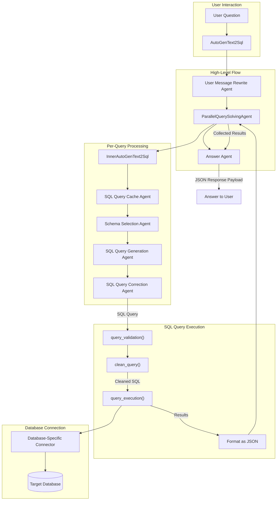
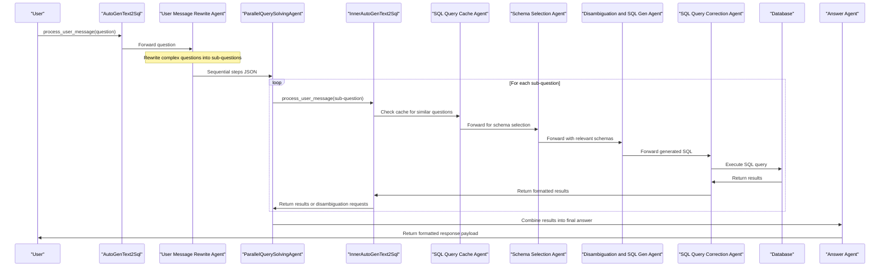
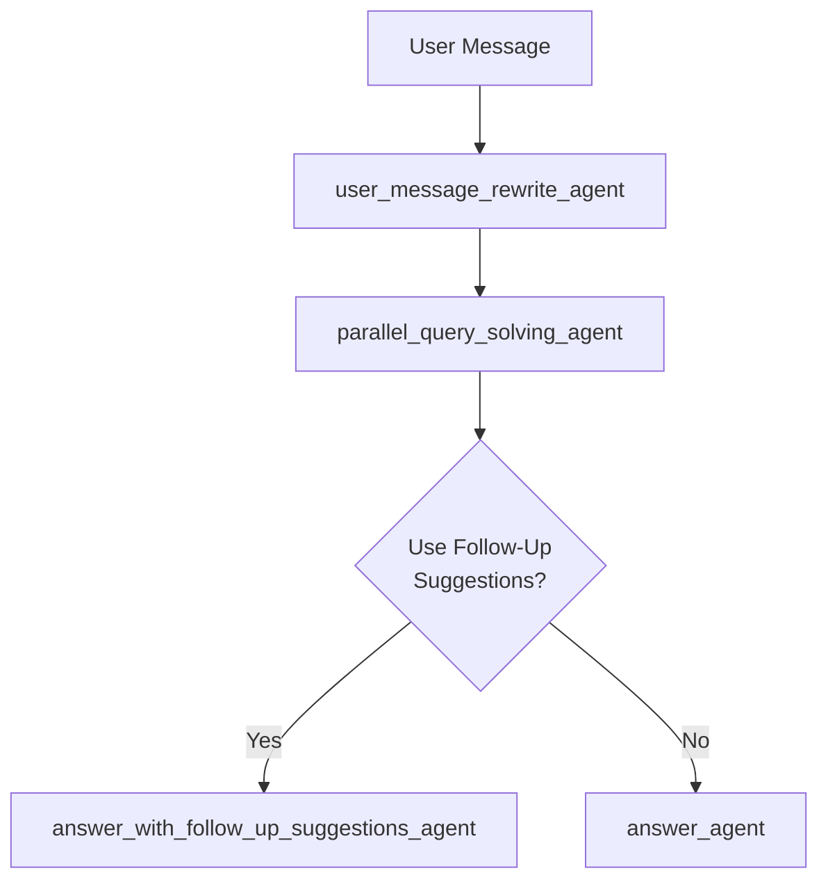
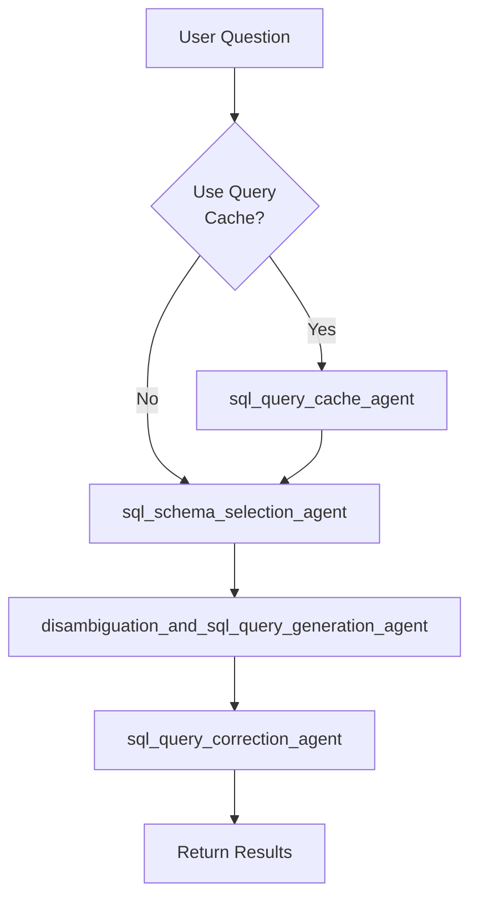
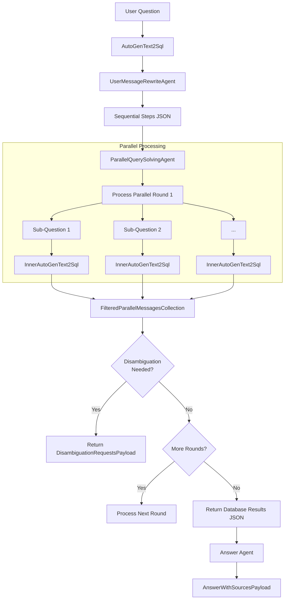
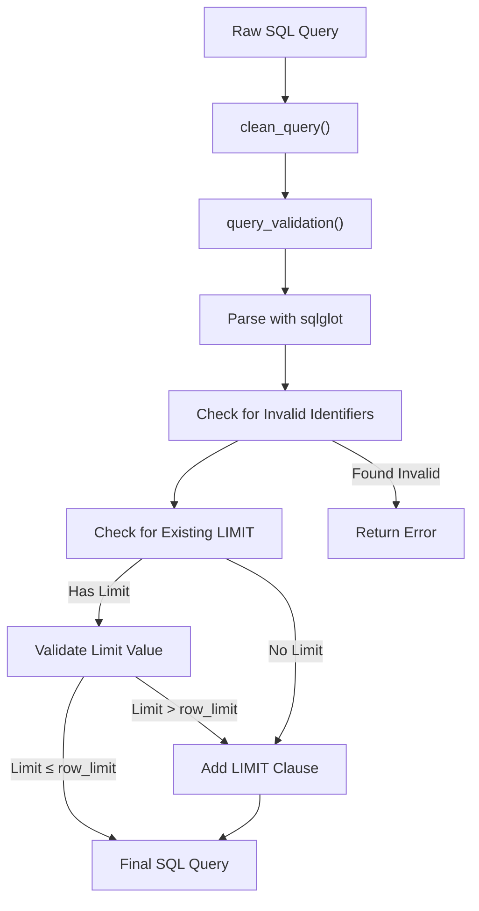
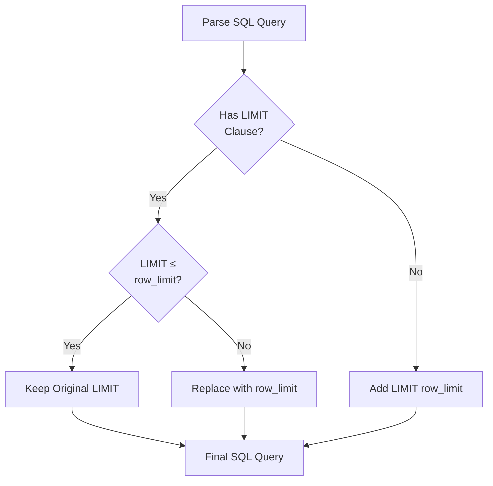
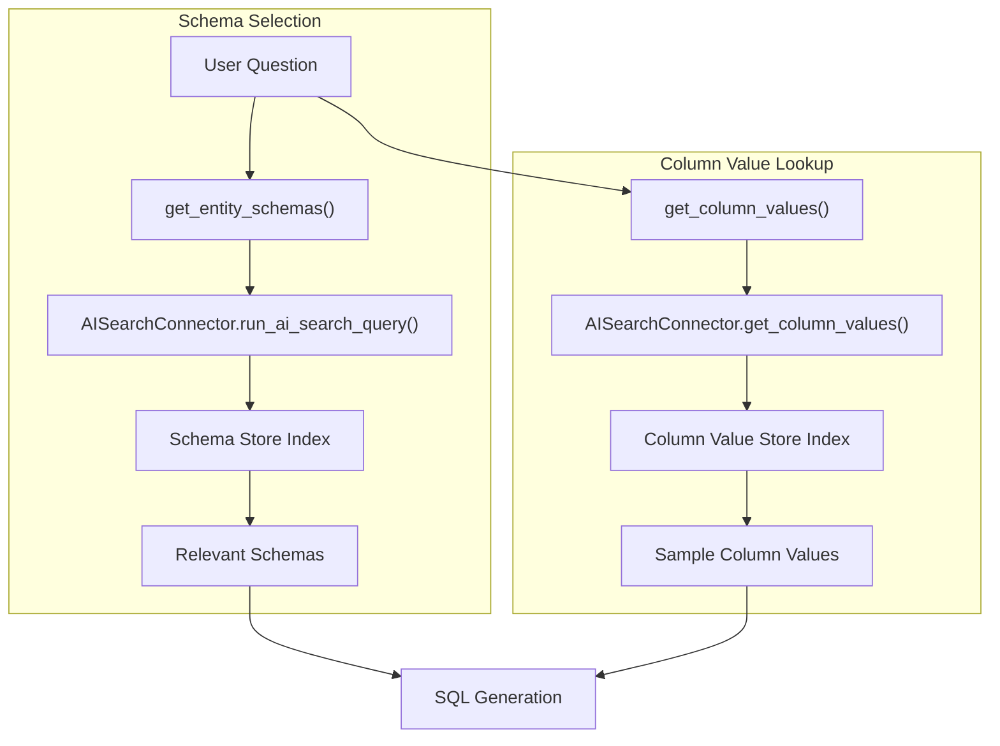
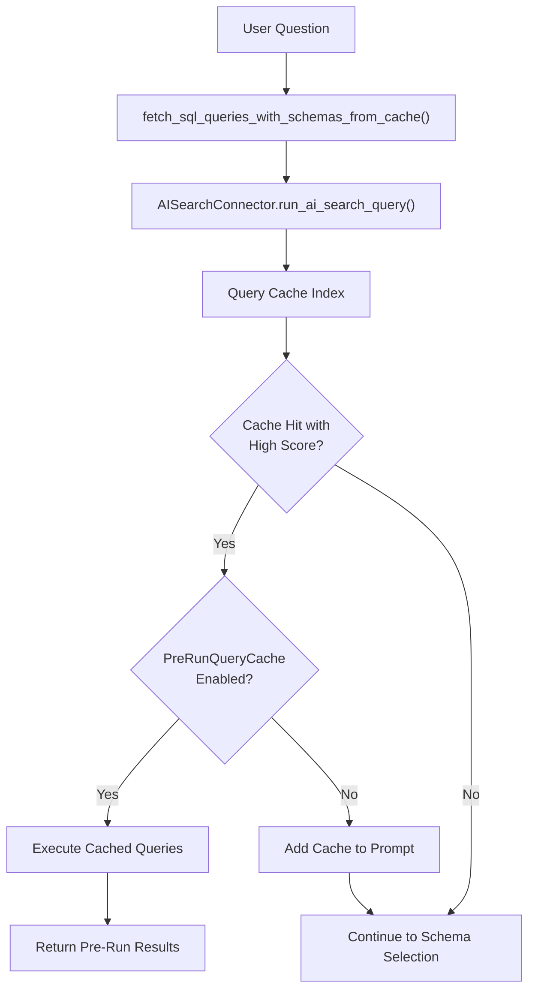
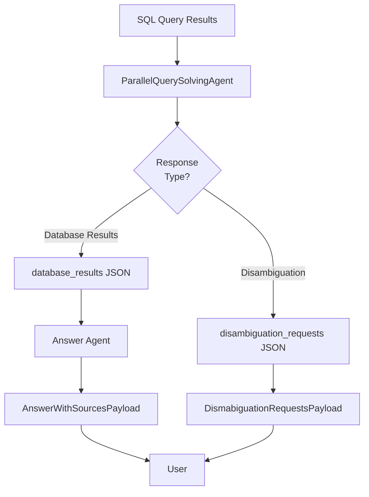

<!-- source: DeepWiki mcp.deepwiki.com · repo microsoft/dstoolkit-text2sql-and-imageprocessing · page 2.5 SQL Query Generation and Execution · fetched 2026-10-26 -->

# SQL Query Generation and Execution

Relevant source files

The following files were used as context for generating this wiki page:

- [text_2_sql/autogen/src/autogen_text_2_sql/autogen_text_2_sql.py](text_2_sql/autogen/src/autogen_text_2_sql/autogen_text_2_sql.py)
- [text_2_sql/autogen/src/autogen_text_2_sql/custom_agents/parallel_query_solving_agent.py](text_2_sql/autogen/src/autogen_text_2_sql/custom_agents/parallel_query_solving_agent.py)
- [text_2_sql/autogen/src/autogen_text_2_sql/inner_autogen_text_2_sql.py](text_2_sql/autogen/src/autogen_text_2_sql/inner_autogen_text_2_sql.py)
- [text_2_sql/text_2_sql_core/src/text_2_sql_core/connectors/sql.py](text_2_sql/text_2_sql_core/src/text_2_sql_core/connectors/sql.py)
- [text_2_sql/text_2_sql_core/src/text_2_sql_core/payloads/interaction_payloads.py](text_2_sql/text_2_sql_core/src/text_2_sql_core/payloads/interaction_payloads.py)

This document explains how the Text-to-SQL system generates SQL queries from natural language questions and executes them against various database engines. It covers the query generation process using LLMs, query validation and cleaning, and the execution flow for retrieving database results. For information about database connectors, see [Database Connectors](#2.4). For information about query caching, see [Query Cache](#2.6).

## Query Generation and Execution Overview

The SQL query generation and execution process transforms natural language questions into valid SQL queries, executes them against appropriate databases, and returns formatted results. This process involves two main orchestration classes (`AutoGenText2Sql` and `InnerAutoGenText2Sql`), multiple specialized agents, query validation, and database abstraction to support various SQL dialects.

Sources: [text_2_sql/autogen/src/autogen_text_2_sql/autogen_text_2_sql.py:34-368](), [text_2_sql/autogen/src/autogen_text_2_sql/inner_autogen_text_2_sql.py:40-183]()

## Query Generation Process

The Text-to-SQL system uses a multi-agent architecture to transform natural language questions into SQL queries. The generation process is orchestrated by the `InnerAutoGenText2Sql` class, which manages the flow between specialized agents.

### Agent Orchestration

The system uses a two-level orchestration approach:

1. `AutoGenText2Sql` manages the high-level flow and user interaction
2. `InnerAutoGenText2Sql` handles the detailed SQL generation process for each query

This hierarchical structure enables efficient processing of both simple and complex multi-part questions.

Sources: [text_2_sql/autogen/src/autogen_text_2_sql/autogen_text_2_sql.py:277-368](), [text_2_sql/autogen/src/autogen_text_2_sql/inner_autogen_text_2_sql.py:62-183]()

### Agent Selection Process

The system uses two levels of agent selection:

1. **High-Level Selection** in `AutoGenText2Sql` manages the flow between rewriting, parallel processing, and answer generation.
2. **Inner Selection** in `InnerAutoGenText2Sql` manages the detailed SQL generation flow.

#### High-Level Agent Selection

#### Inner Agent Selection

Sources: [text_2_sql/autogen/src/autogen_text_2_sql/autogen_text_2_sql.py:91-117](), [text_2_sql/autogen/src/autogen_text_2_sql/inner_autogen_text_2_sql.py:114-142]()

### Parallel Query Processing

For complex questions that require multiple SQL queries, the system uses the `ParallelQuerySolvingAgent` to orchestrate parallel processing:

1. The `UserMessageRewriteAgent` first decomposes questions into sequential steps with parallel sub-questions
2. The `ParallelQuerySolvingAgent` processes each sub-question using the full `InnerAutoGenText2Sql` flow
3. Results are collected into a `FilteredParallelMessagesCollection` structure
4. Disambiguation requests are handled before continuing to the next batch of sub-questions
5. Final results are combined and passed to the `AnswerAgent`

Sources: [text_2_sql/autogen/src/autogen_text_2_sql/custom_agents/parallel_query_solving_agent.py:41-301](), [text_2_sql/autogen/src/autogen_text_2_sql/autogen_text_2_sql.py:277-305]()

## SQL Query Execution

Once a SQL query is generated, it goes through several processing steps before being executed against the database.

### Query Validation and Cleaning

The `SqlConnector` class provides methods to validate and clean queries before execution:

1. `clean_query()`: Sanitizes identifiers and formats the query
2. `query_validation()`: Parses and validates the SQL syntax
3. Adds row limits to protect against excessive data retrieval
4. Checks for invalid identifiers that might indicate SQL injection attempts

Sources: [text_2_sql/text_2_sql_core/src/text_2_sql_core/connectors/sql.py:223-251](), [text_2_sql/text_2_sql_core/src/text_2_sql_core/connectors/sql.py:253-344]()

### Database Connection Abstraction

The system uses an abstract `SqlConnector` class that defines common functionality, with database-specific implementations:

| Method | Purpose |
|--------|---------|
| `query_execution()` | Execute SQL against the database |
| `sanitize_identifier()` | Handle database-specific identifier rules |
| `get_entity_schemas()` | Retrieve database schema information |
| `query_execution_with_limit()` | Execute with row limit protection |
| `query_validation()` | Validate query syntax and structure |

Sources: [text_2_sql/text_2_sql_core/src/text_2_sql_core/connectors/sql.py:17-42](), [text_2_sql/text_2_sql_core/src/text_2_sql_core/connectors/sql.py:68-87]()

### Row Limit Protection

The system enforces row limits to prevent excessive data retrieval:

1. Default limit is defined in environment variables (`Text2Sql__RowLimit`)
2. If a query has no LIMIT clause, one is added automatically
3. If a query has a LIMIT higher than the configured maximum, it's reduced

Sources: [text_2_sql/text_2_sql_core/src/text_2_sql_core/connectors/sql.py:308-337]()

## Integration with AI Search

The system leverages Azure AI Search for retrieving schema information and cached queries.

### Schema and Column Value Retrieval

The system uses AI Search indexes to retrieve relevant schema information and column values:

Sources: [text_2_sql/text_2_sql_core/src/text_2_sql_core/connectors/ai_search.py:142-232](), [text_2_sql/text_2_sql_core/src/text_2_sql_core/connectors/sql.py:102-150]()

### Query Cache Integration

The system can use previously cached queries for similar questions:

Sources: [text_2_sql/text_2_sql_core/src/text_2_sql_core/connectors/sql.py:346-427]()

## Response Payloads and Results Formatting

The system uses structured payload types defined in `interaction_payloads.py` to standardize communications:

### SQL Query Results Formatting

During query execution, results are formatted as JSON for consistent internal processing:

| Format Field | Description |
|--------------|-------------|
| `type` | Indicates success or error (e.g., `query_execution_with_limit`) |
| `sql_query` | The executed SQL query |
| `sql_rows` | The query results (for successful queries) |
| `errors` | Error messages (for failed queries) |

### Final Response Payload Types

The final response to the user is structured as one of several payload types:

| Payload Type | Purpose | Key Fields |
|--------------|---------|------------|
| `AnswerWithSourcesPayload` | Final answer with sources | `answer`, `sources` (SQL queries and results), `follow_up_suggestions` |
| `DismabiguationRequestsPayload` | Request user to clarify | `disambiguation_requests` (questions and choices) |
| `ProcessingUpdatePayload` | Processing status updates | `message` (status message) |
| `UserMessagePayload` | Input message with parameters | `user_message`, `injected_parameters` |

Sources: [text_2_sql/text_2_sql_core/src/text_2_sql_core/connectors/sql.py:175-221](), [text_2_sql/text_2_sql_core/src/text_2_sql_core/payloads/interaction_payloads.py:56-189](), [text_2_sql/autogen/src/autogen_text_2_sql/autogen_text_2_sql.py:206-275]()

## System Configuration

The SQL query generation and execution system is configurable through environment variables:

| Environment Variable | Purpose | Default |
|----------------------|---------|---------|
| `Text2Sql__UseQueryCache` | Enable/disable query caching | `True` |
| `Text2Sql__PreRunQueryCache` | Execute cached queries automatically | `True` |
| `Text2Sql__UseColumnValueStore` | Enable column value lookup | `True` |
| `Text2Sql__UseAISearch` | Enable AI Search integration | `True` |
| `Text2Sql__RowLimit` | Maximum rows to return | `100` |
| `Text2Sql__DatabaseEngine` | Target database engine | Required |

Sources: [text_2_sql/text_2_sql_core/src/text_2_sql_core/connectors/sql.py:17-41](), [text_2_sql/autogen/src/autogen_text_2_sql/inner_autogen_text_2_sql.py:42-60]()

---

