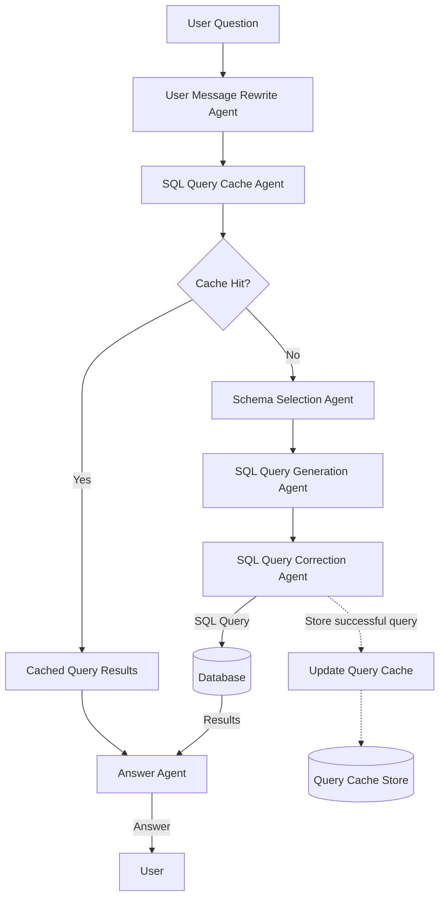
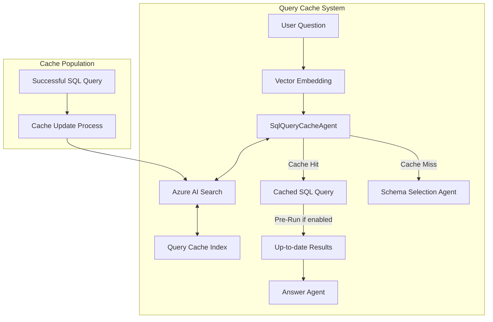
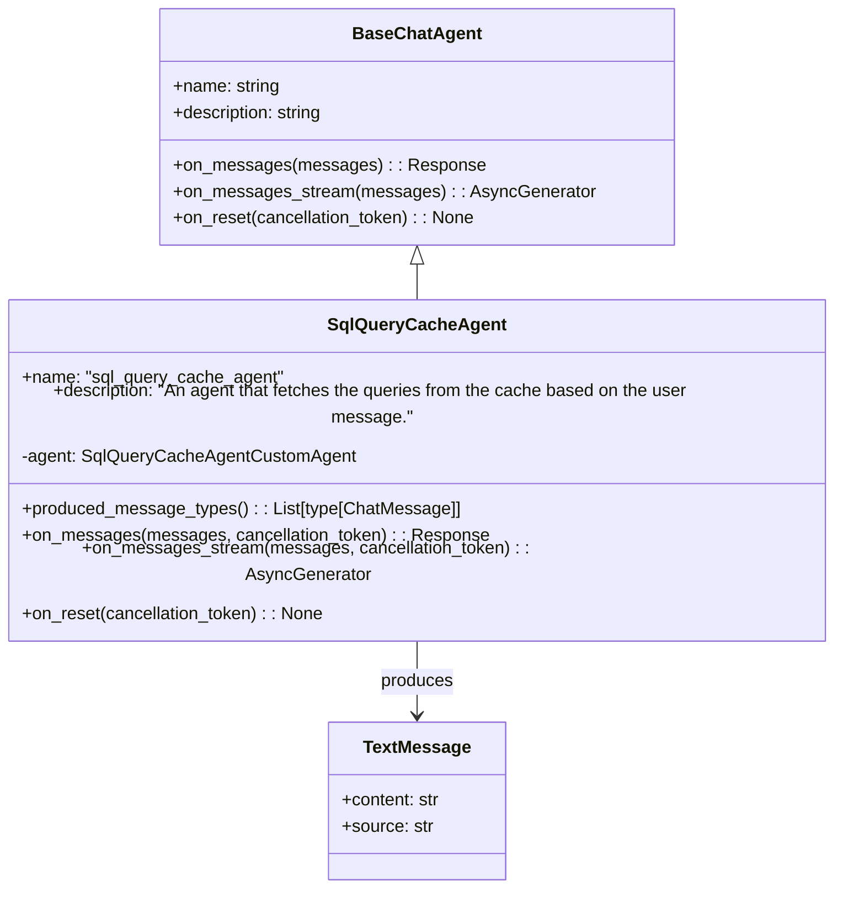
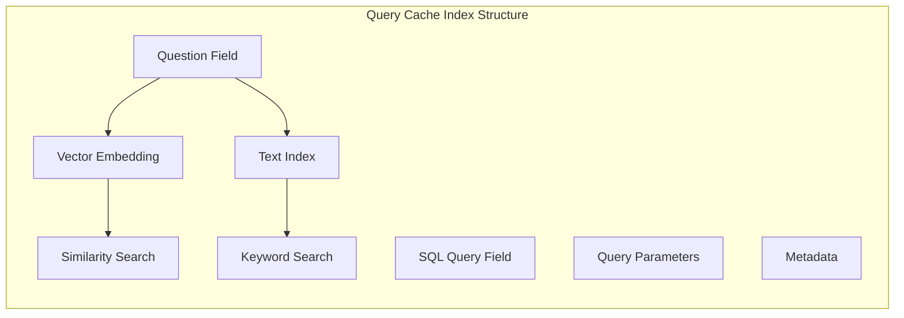
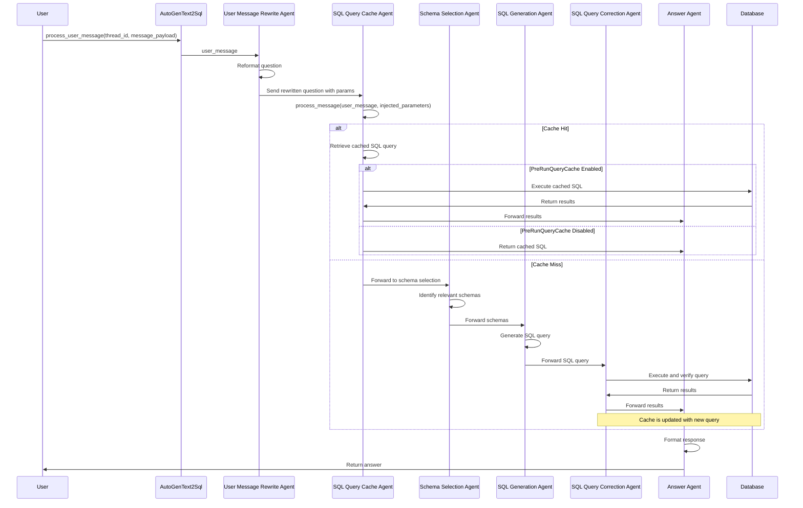

<!-- source: DeepWiki mcp.deepwiki.com · repo microsoft/dstoolkit-text2sql-and-imageprocessing · page 2.6 Query Cache · fetched 2026-10-26 -->

# Query Cache

<details>
<summary>Relevant source files</summary>

The following files were used as context for generating this wiki page:

- [.pre-commit-config.yaml](.pre-commit-config.yaml)
- [text_2_sql/GETTING_STARTED.md](text_2_sql/GETTING_STARTED.md)
- [text_2_sql/README.md](text_2_sql/README.md)
- [text_2_sql/autogen/Iteration 5 - Agentic Vector Based Text2SQL.ipynb](text_2_sql/autogen/Iteration 5 - Agentic Vector Based Text2SQL.ipynb)
- [text_2_sql/autogen/src/autogen_text_2_sql/creators/llm_agent_creator.py](text_2_sql/autogen/src/autogen_text_2_sql/creators/llm_agent_creator.py)
- [text_2_sql/autogen/src/autogen_text_2_sql/custom_agents/sql_query_cache_agent.py](text_2_sql/autogen/src/autogen_text_2_sql/custom_agents/sql_query_cache_agent.py)

</details>


This document details the Query Cache mechanism within the Text-to-SQL system. The Query Cache improves performance and reduces token usage by storing and retrieving previously executed SQL queries for similar natural language questions. For information about database connectivity, see [Database Connectors](#2.4).

## Purpose and Benefits

The Query Cache serves several critical functions in the Text-to-SQL system:

1. **Performance Optimization**: Bypasses expensive LLM-powered schema selection, SQL generation, and verification steps for previously answered questions
2. **Cost Reduction**: Minimizes API calls to LLM services for repetitive questions
3. **Response Time Improvement**: Delivers faster responses by retrieving pre-generated SQL queries
4. **Consistency**: Ensures identical SQL queries for similar questions
5. **Real-time Data Access**: Maintains the ability to get near real-time information by executing cached queries against the latest data

The Query Cache is particularly valuable in production environments where users frequently ask similar or identical questions.

Sources: [text_2_sql/README.md:45-54](), [text_2_sql/README.md:77-83]()

## Architecture Overview

The Query Cache is implemented as an agent (`SqlQueryCacheAgent`) within the agentic architecture of the Text-to-SQL system. It sits between the User Message Rewrite Agent and the Schema Selection Agent in the processing pipeline, allowing for efficient retrieval of previously generated SQL queries.

The architecture diagram below shows how the Query Cache fits into the overall Text-to-SQL system:



This architecture enables the "Pre-Fetched Cache Results Path," which provides the quickest answer generation when a user asks a question similar to one that has been previously processed.

Sources: [text_2_sql/README.md:48-56](), [text_2_sql/autogen/src/autogen_text_2_sql/custom_agents/sql_query_cache_agent.py:15-64]()

## Cache Integration with AI Search

The Query Cache leverages Azure AI Search for efficient storage and retrieval of cached queries. This integration enables semantic matching of natural language questions against previously cached queries through vector embeddings.

Unlike a traditional cache that requires exact matches, the vector-based approach allows finding semantically similar questions, making the cache more robust to variations in natural language formulations.



The diagram illustrates how user questions are converted to vector embeddings, which are then used to search the Query Cache Index for similar questions. If a match is found, the corresponding SQL query is retrieved and optionally executed to get the most up-to-date results.

Sources: [text_2_sql/README.md:45-56](), [text_2_sql/README.md:77-83]()

## SQL Query Cache Agent

The SQL Query Cache Agent is responsible for:

1. Receiving the rewritten user query from the User Message Rewrite Agent
2. Searching the cache index for semantically similar questions
3. Determining if a cache hit occurred
4. Returning either the cached SQL query or indicating a cache miss

The agent is implemented in the `SqlQueryCacheAgent` class which inherits from `BaseChatAgent` in the AutoGen framework.



The agent processes messages in JSON format containing the user message and injected parameters. It delegates the actual cache lookup to the `SqlQueryCacheAgentCustomAgent` and returns either cached results or an indication that no cache hit was found.

Sources: [text_2_sql/autogen/src/autogen_text_2_sql/custom_agents/sql_query_cache_agent.py:16-64]()

## Configuration Options

The Query Cache can be configured through environment variables:

| Environment Variable | Description | Default |
|----------------------|-------------|---------|
| `Text2Sql__UseQueryCache` | Enables or disables the Query Cache functionality | `True` |
| `Text2Sql__PreRunQueryCache` | Determines if cached queries should be executed before returning results | `True` |

When `Text2Sql__PreRunQueryCache` is enabled, cached SQL queries are executed against the database before returning results, providing the most up-to-date data without regenerating the SQL.

Sources: [text_2_sql/.env.example:5-8]()

## Cache Index Structure

The Query Cache index in Azure AI Search is designed to efficiently store and retrieve questions and their corresponding SQL queries:



The index contains:
- Original natural language questions
- Generated SQL queries
- Database engine information
- Optional execution results (if pre-cached)
- Metadata for filtering and versioning

Sources: [deploy_ai_search_indexes/README.md:62-80]()

## Deploying the Query Cache Index

To deploy the Query Cache index:

1. Create a `.env` file based on the provided `.env.example`
2. Run the deployment script with appropriate parameters

```bash
uv run deploy.py index_type text_2_sql_query_cache rebuild [suffix] [enable_cache_indexer] [single_cache__file]
```

Where:
- `rebuild`: Whether to delete and rebuild the index
- `suffix`: Optional parameter to apply a suffix to deployed index names
- `enable_cache_indexer`: Optional parameter to enable the query cache indexer (default: False)
- `single_cache__file`: Controls whether to upload a single cache file or multiple files (default: False)

Sources: [deploy_ai_search_indexes/README.md:62-80]()

## Query Cache in Action

The following sequence diagram shows how the Query Cache operates within a complete Text-to-SQL request:



The diagram illustrates the flow of a user message through the system. The `SqlQueryCacheAgent` checks for cached queries that match the user's question semantically. On a cache hit, it can either execute the query (if pre-run is enabled) or simply return the cached query. On a cache miss, the request is forwarded to the Schema Selection Agent to continue the normal query generation flow.

Sources: [text_2_sql/autogen/src/autogen_text_2_sql/custom_agents/sql_query_cache_agent.py:29-64](), [text_2_sql/autogen/Iteration 5 - Agentic Vector Based Text2SQL.ipynb:107-108]()

## Cache Update Strategy

The Query Cache can be populated using different strategies as described in the repository documentation:

1. **Pre-population**: Run an offline pipeline to generate SQL queries for known expected questions to prevent a 'cold start' problem
2. **Chat History Management Pipeline**: Run a real-time pipeline that logs chat history and analyzes Text2SQL questions to generate cache entries
3. **Positive Indication System**: Only update the cache when a user positively reacts to a question (e.g., thumbs up) or doesn't ask a follow-up question
4. **Always Update**: Add all questions into the cache when asked (implemented in the sample code)

The repository implementation uses the "Always Update" approach by default, but notes that this could lead to poor SQL queries reaching the cache. For production use, one of the other strategies is recommended.

Additionally, the cache can be populated in two ways:

1. **Direct Application Updates**: The application code writes directly to the cache index when successful queries are generated
2. **Indexer-Based Updates**: An optional indexer can be enabled to scan and index cache files from a storage location

The direct application update approach is recommended for most scenarios as it provides immediate cache updates without additional infrastructure requirements.

Sources: [text_2_sql/README.md:77-83]()

## Best Practices

For optimal Query Cache performance:

1. **Normalize Questions**: Use the User Message Rewrite Agent to standardize question formats
2. **Selective Caching**: Only cache successful and verified SQL queries
3. **Version Control**: Include database schema version in cache metadata to invalidate outdated entries
4. **Cache Pruning**: Implement strategies to remove outdated or low-value cache entries
5. **Monitoring**: Track cache hit rates to evaluate effectiveness

Sources: [text_2_sql/.env.example:5-8](), [deploy_ai_search_indexes/README.md:62-80]()

## Related Components

The Query Cache works closely with other components in the Text-to-SQL system:

1. **User Message Rewrite Agent**: Normalizes questions before cache lookup
2. **Schema Selection Agent**: Takes over when cache misses occur
3. **Data Dictionary**: Provides schema information for query generation when cache misses occur
4. **AI Search**: Stores and retrieves cached queries through vector and keyword search

For more information on these components, see [Data Dictionary](#2.3) and [Agentic Architecture](#2.1).

Sources: [text_2_sql/autogen/src/autogen_text_2_sql/custom_agents/sql_query_cache_agent.py:15-64](), [text_2_sql/.env.example:5-8]()

---

