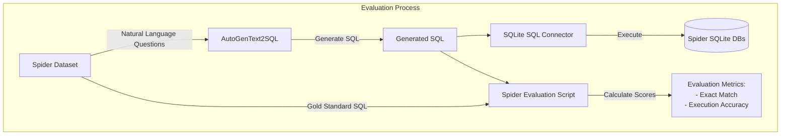
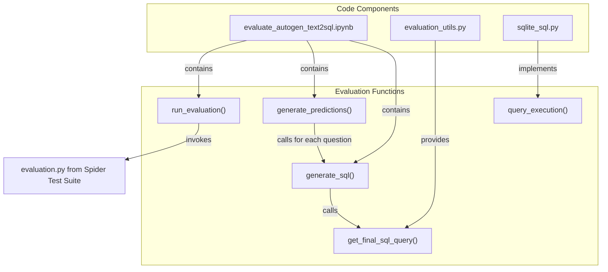
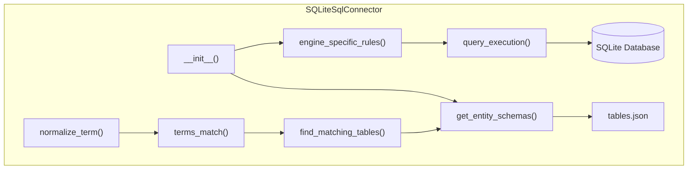

<!-- source: DeepWiki mcp.deepwiki.com · repo microsoft/dstoolkit-text2sql-and-imageprocessing · page 2.7 Evaluation · fetched 2026-10-26 -->

# Evaluation

<details>
<summary>Relevant source files</summary>

The following files were used as context for generating this wiki page:

- [text_2_sql/autogen/evaluate_autogen_text2sql.ipynb](text_2_sql/autogen/evaluate_autogen_text2sql.ipynb)
- [text_2_sql/autogen/src/autogen_text_2_sql/evaluation_utils.py](text_2_sql/autogen/src/autogen_text_2_sql/evaluation_utils.py)
- [text_2_sql/text_2_sql_core/src/text_2_sql_core/connectors/sqlite_sql.py](text_2_sql/text_2_sql_core/src/text_2_sql_core/connectors/sqlite_sql.py)

</details>


This page documents how the Text-to-SQL system is evaluated for performance and accuracy. It provides detailed information about the evaluation methodology, metrics, and process using standardized benchmarks to assess the quality of SQL translation from natural language questions.

## Evaluation Approach Overview

The Text-to-SQL system uses the Spider benchmark, a widely-recognized standard for evaluating text-to-SQL translation capabilities. The evaluation quantitatively measures how accurately the system converts natural language questions into executable SQL queries across diverse database schemas.



Sources: [text_2_sql/autogen/evaluate_autogen_text2sql.ipynb:1-37]()

## Spider Benchmark Setup

The Spider benchmark consists of 1,000+ natural language questions mapped to SQL queries across 200+ databases spanning 138 domains. Using this benchmark provides a standardized way to compare the system against other text-to-SQL solutions.

### Required Components

To evaluate the system using Spider, two main components must be set up:

1. **Spider Test Suite Evaluation Scripts**
   - Clone the repository: `https://github.com/taoyds/test-suite-sql-eval`
   - Contains the official evaluation scripts that calculate metrics

2. **Spider Dataset**
   - Contains the following key components:
     - `database/`: Directory with all SQLite databases
     - `tables.json`: Schema information for all databases
     - `dev.json`: Development set with natural language questions and gold SQL queries

Sources: [text_2_sql/autogen/evaluate_autogen_text2sql.ipynb:7-35]()

## Evaluation Implementation

The evaluation system is implemented in the `evaluate_autogen_text2sql.ipynb` notebook, which orchestrates the entire evaluation process.



Sources: 
- [text_2_sql/autogen/evaluate_autogen_text2sql.ipynb:52-107]()
- [text_2_sql/autogen/src/autogen_text_2_sql/evaluation_utils.py:1-92]()

### SQL Generation Process

The evaluation process generates SQL queries for Spider test questions using the following steps:

1. Initialize `AutoGenText2Sql` with SQLite-specific syntax rules
2. For each question in the Spider dev set:
   - Set the appropriate database connection string
   - Process the question through `AutoGenText2Sql.process_user_message()`
   - Extract the final SQL query from the results
   - Save the query with its corresponding database ID

This is implemented in the `generate_sql()` and `generate_predictions()` functions:

```python
# Initialize with SQLite-specific rules
sqlite_rules = """
1. Use SQLite syntax
2. Do not use Azure SQL specific functions
3. Use strftime for date/time operations
"""

autogen_text2sql = AutoGenText2Sql(
    engine_specific_rules=sqlite_rules,
    use_case="Evaluating with Spider SQLite databases"
)
```

Sources: 
- [text_2_sql/autogen/evaluate_autogen_text2sql.ipynb:96-107]()
- [text_2_sql/autogen/evaluate_autogen_text2sql.ipynb:114-178]()

### SQL Query Extraction

The `evaluation_utils.py` module contains specialized functions for extracting SQL queries from the system output:

1. `extract_sql_queries_from_results()`: Extracts queries from the structured results dictionary by scanning through the nested results structure and identifying entries containing the `sql_query` key.
2. `extract_sql_queries_from_logs()`: Extracts queries from log output using two regex patterns:
   - Queries found after "Running query against" statements
   - Queries embedded in JSON results with the `sql_query` key
3. `get_final_sql_query()`: Selects the most appropriate query for evaluation by first checking results, then falling back to log extraction if needed.

The system implements specific heuristics to select the optimal query when multiple candidates are generated:

```python
# For questions about unique values, prefer queries with DISTINCT
question_lower = question.lower()
needs_distinct = any(word in question_lower for word in ['different', 'distinct', 'unique', 'all'])

for query in reversed(all_queries):  # Look at queries in reverse order
    if needs_distinct and 'DISTINCT' in query.upper():
        final_query = query
        break
```

This selection logic ensures that queries about uniqueness correctly include the `DISTINCT` keyword, even modifying the query to add it when needed but missing.

Sources:
- [text_2_sql/autogen/src/autogen_text_2_sql/evaluation_utils.py:7-92]()
- [text_2_sql/autogen/evaluate_autogen_text2sql.ipynb:162-178]()

### SQLite Connector for Evaluation

The `SQLiteSqlConnector` class provides the specialized database interface for the evaluation process:



The connector implements:

1. **SQLite-specific rules**: Provides syntax guidelines for generating correct SQLite queries
   ```python
   # Engine-specific rules for SQLite
   def engine_specific_rules(self) -> list[str]:
       return [
           "Use SQLite syntax for queries",
           "Use double quotes for identifiers",
           "Use single quotes for string literals",
           "LIMIT clause comes after ORDER BY",
           # Additional syntax rules...
       ]
   ```

2. **Query execution**: Processes queries against Spider SQLite databases
   - Connects to the database specified in `Text2Sql__Tsql__ConnectionString` environment variable
   - Executes the query and returns results as dictionaries

3. **Schema retrieval**: Accesses schema information from Spider's `tables.json` file
   - Uses `SPIDER_DATA_DIR` environment variable to locate the schema file
   - Matches relevant tables using flexible matching algorithms

4. **Flexible matching**: Implements term normalization and matching rules
   - Removes underscores, spaces, and plurals
   - Performs exact and partial matching of table names
   - Handles compound table names by matching term subsets

This specialized connector allows the Text-to-SQL system to properly interact with Spider's database structure during evaluation.

Sources:
- [text_2_sql/text_2_sql_core/src/text_2_sql_core/connectors/sqlite_sql.py:15-37]()
- [text_2_sql/text_2_sql_core/src/text_2_sql_core/connectors/sqlite_sql.py:60-109]()
- [text_2_sql/text_2_sql_core/src/text_2_sql_core/connectors/sqlite_sql.py:111-167]()
- [text_2_sql/text_2_sql_core/src/text_2_sql_core/connectors/sqlite_sql.py:169-256]()

## Running the Evaluation

The evaluation process is executed in two main steps:

1. **Generate Predictions**
   ```python
   # Generate predictions for n samples
   await generate_predictions(num_samples=20)  # Process 20 samples (faster for testing)
   # Or generate predictions for the full dataset
   await generate_predictions()  # Process all samples in the dataset
   ```

2. **Run Evaluation Script**
   ```python
   # Run evaluation
   run_evaluation()
   ```

The `generate_predictions()` function:
- Reads natural language questions from the Spider `dev.json` file
- Processes each question through the AutoGenText2SQL system 
- Dynamically updates the database connection for each question
- Saves the generated SQL and gold standard SQL for each question

The `run_evaluation()` function executes the Spider evaluation script with these parameters:
- `--gold`: Path to gold queries file (contains correct SQL queries)
- `--pred`: Path to predictions file (contains system-generated SQL queries)
- `--db`: Path to database directory (contains SQLite databases)
- `--table`: Path to table schemas file (contains database structure information)
- `--etype`: Evaluation type ("all" for both exact match and execution accuracy)
- `--plug_value`: Enable value plugging for comparison (normalizes constant values)
- `--progress_bar_for_each_datapoint`: Show progress for each test case

The evaluation process tracks and reports timing information, making it easy to measure system performance across different sample sizes.

Sources:
- [text_2_sql/autogen/evaluate_autogen_text2sql.ipynb:187-235]()
- [text_2_sql/autogen/evaluate_autogen_text2sql.ipynb:243-296]()
- [text_2_sql/autogen/evaluate_autogen_text2sql.ipynb:284-285]()

## Evaluation Metrics

The Spider evaluation script calculates several metrics to assess system performance:

| Metric | Description |
|--------|-------------|
| **Exact Match** | Percentage of generated queries that match gold queries after normalization |
| **Execution Accuracy** | Percentage of queries that produce correct results when executed |
| **Component Accuracy** | Accuracy for specific SQL components (SELECT, WHERE, GROUP BY, etc.) |
| **Hardness Level** | Performance broken down by query complexity (easy, medium, hard, extra) |

### Interpreting Results

The evaluation results help identify:

1. Overall system accuracy and performance
2. Specific strengths and weaknesses in different SQL components
3. Performance across different types of questions and complexity levels
4. Opportunities for targeted improvements in the system

Sources:
- [text_2_sql/autogen/evaluate_autogen_text2sql.ipynb:265-275]()

## Limitations and Considerations

When evaluating the Text-to-SQL system with Spider, it's important to understand:

1. Spider focuses on cross-domain generalization rather than domain-specific optimization
2. The evaluation is based on academic databases that may differ from real-world enterprise schemas
3. Exact match metrics can be strict and may penalize semantically equivalent queries with different syntax
4. The system is specifically configured for SQLite syntax during evaluation, which may differ from other SQL dialects supported by the system

Sources:
- [text_2_sql/text_2_sql_core/src/text_2_sql_core/connectors/sqlite_sql.py:20-35]()
- [text_2_sql/autogen/evaluate_autogen_text2sql.ipynb:96-107]()

---

