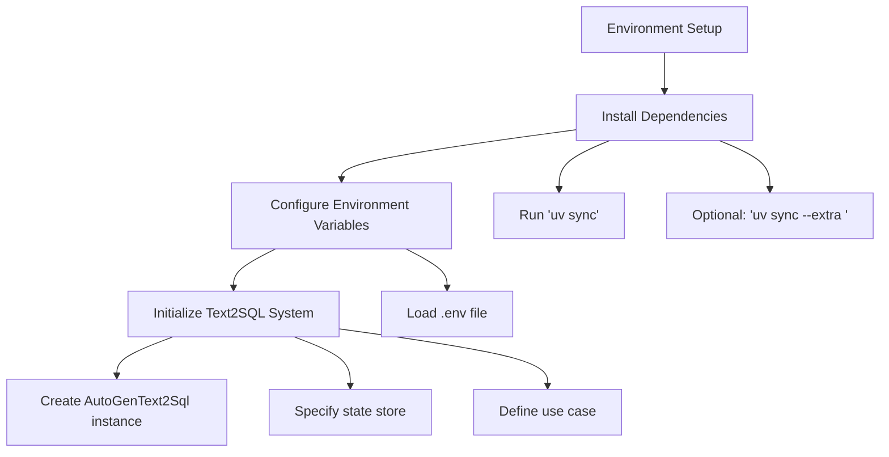
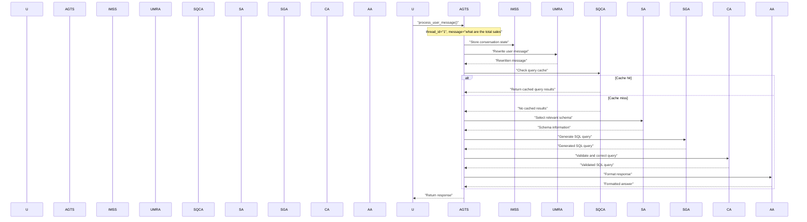
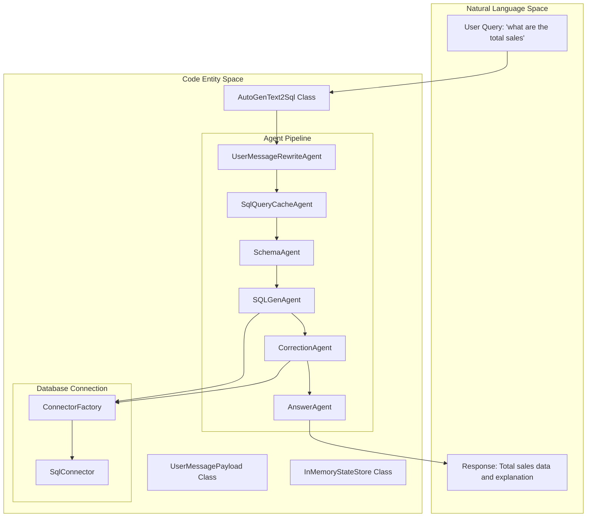
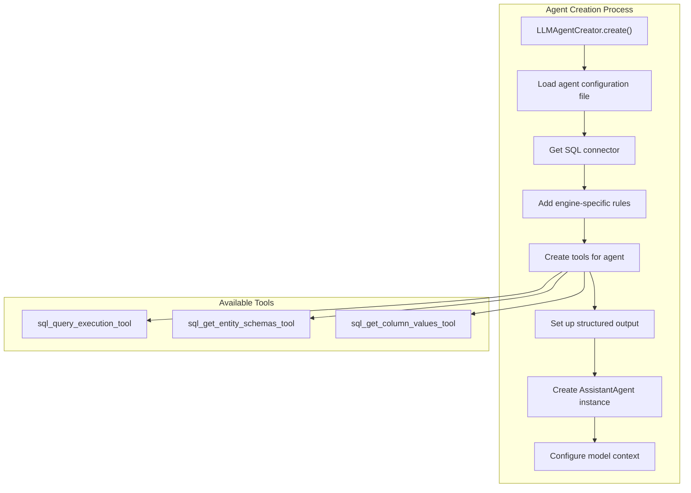
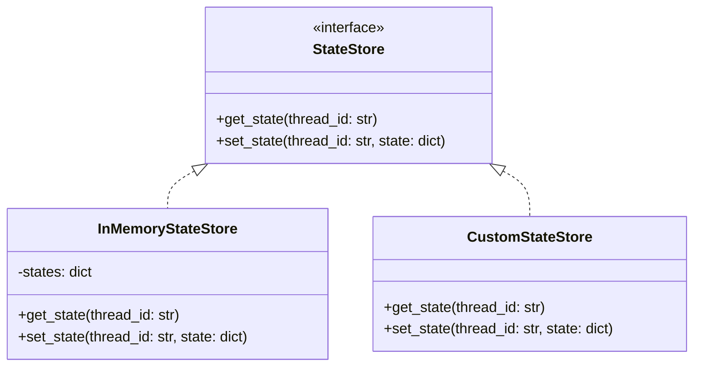

<!-- source: DeepWiki mcp.deepwiki.com · repo microsoft/dstoolkit-text2sql-and-imageprocessing · page 2.8 Usage Examples · fetched 2026-10-26 -->

# Usage Examples

<details>
<summary>Relevant source files</summary>

The following files were used as context for generating this wiki page:

- [text_2_sql/autogen/Iteration 5 - Agentic Vector Based Text2SQL.ipynb](text_2_sql/autogen/Iteration 5 - Agentic Vector Based Text2SQL.ipynb)
- [text_2_sql/autogen/src/autogen_text_2_sql/creators/llm_agent_creator.py](text_2_sql/autogen/src/autogen_text_2_sql/creators/llm_agent_creator.py)
- [text_2_sql/autogen/src/autogen_text_2_sql/custom_agents/sql_query_cache_agent.py](text_2_sql/autogen/src/autogen_text_2_sql/custom_agents/sql_query_cache_agent.py)

</details>


This page provides practical examples of how to use the Text-to-SQL system within the DSToolkit. These examples demonstrate the integration of AutoGen agents with Azure OpenAI to convert natural language questions into SQL queries for database interaction. For information about image processing usage, see [Image Processing System](#3).

## Setting Up the Environment

Before using the Text-to-SQL system, you need to set up your environment with the necessary dependencies.



To set up the environment:

1. Install dependencies by running `uv sync` in the autogen directory
2. For database engines other than TSQL, use `uv sync --extra <DATABASE ENGINE>`
3. Configure environment variables (typically in a .env file)
4. Initialize the Text2SQL system

Sources: [text_2_sql/autogen/Iteration 5 - Agentic Vector Based Text2SQL.ipynb:17-56]()

## Basic Usage Example

The following example demonstrates how to process a simple user query with the Text-to-SQL system:



### Code Example

Here's a simple example of how to use the system:

```python
# Initialize the Text2SQL system
agentic_text_2_sql = AutoGenText2Sql(
    state_store=InMemoryStateStore(), 
    use_case="Analysing sales data"
)

# Process a user message
async for message in agentic_text_2_sql.process_user_message(
    thread_id="1", 
    message_payload=UserMessagePayload(user_message="what are the total sales")
):
    logging.info("Received %s Message from Text2SQL System", message)
```

Sources: [text_2_sql/autogen/Iteration 5 - Agentic Vector Based Text2SQL.ipynb:85-108]()

## Component Interaction During Query Processing

The following diagram illustrates how different components interact when processing a natural language query:



Sources: [text_2_sql/autogen/src/autogen_text_2_sql/custom_agents/sql_query_cache_agent.py:1-64](), [text_2_sql/autogen/src/autogen_text_2_sql/creators/llm_agent_creator.py:84-144]()

## Advanced Configuration

The Text-to-SQL system can be configured with various options to customize its behavior.

### Agent Creation and Configuration

Each agent in the Text-to-SQL system can be customized using the `LLMAgentCreator`:



To create a custom agent, you can use the following approach:

```python
# Create an agent with specific configuration
answer_agent = LLMAgentCreator.create(
    name="answer_agent",
    engine_specific_fields="SQL Server specific rules here"
)
```

Sources: [text_2_sql/autogen/src/autogen_text_2_sql/creators/llm_agent_creator.py:18-144]()

### Available Tools

Agents have access to several tools for interacting with the database:

| Tool Name | Description | Function |
|-----------|-------------|----------|
| `sql_query_execution_tool` | Runs SQL queries against the database | `query_execution_with_limit` |
| `sql_get_entity_schemas_tool` | Retrieves schema information for relevant tables | `get_entity_schemas` |
| `sql_get_column_values_tool` | Gets sample values from columns | `get_column_values` |

Sources: [text_2_sql/autogen/src/autogen_text_2_sql/creators/llm_agent_creator.py:34-60]()

## State Management

The Text-to-SQL system uses a state store to maintain conversation context across interactions. By default, the system uses an `InMemoryStateStore`, but you can implement custom state stores for persistence.



Example usage with state management:

```python
# Using the default in-memory state store
agentic_text_2_sql = AutoGenText2Sql(
    state_store=InMemoryStateStore(),
    use_case="Analysing sales data"
)

# Process multiple messages in the same thread to maintain context
async for message in agentic_text_2_sql.process_user_message(
    thread_id="conversation_1", 
    message_payload=UserMessagePayload(user_message="what are the total sales")
):
    # Process first response
    pass

# Later, in the same thread
async for message in agentic_text_2_sql.process_user_message(
    thread_id="conversation_1", 
    message_payload=UserMessagePayload(user_message="how does that compare to last year?")
):
    # The system will remember context from the previous question
    pass
```

Sources: [text_2_sql/autogen/Iteration 5 - Agentic Vector Based Text2SQL.ipynb:85-108]()

## Best Practices

When using the Text-to-SQL system, consider the following best practices:

1. **Provide specific use cases** when initializing the system to help it understand the context of questions
2. **Maintain thread IDs** for related questions to leverage conversation history
3. **Use database-specific connectors** for optimal performance with your database engine
4. **Monitor and log responses** to understand system behavior and troubleshoot issues

Example of logging responses:

```python
async for message in agentic_text_2_sql.process_user_message(
    thread_id="1", 
    message_payload=UserMessagePayload(user_message="what are the total sales")
):
    logging.info("Received %s Message from Text2SQL System", message)
    # You can further process or store the message here
```

Sources: [text_2_sql/autogen/Iteration 5 - Agentic Vector Based Text2SQL.ipynb:102-108]()

---

