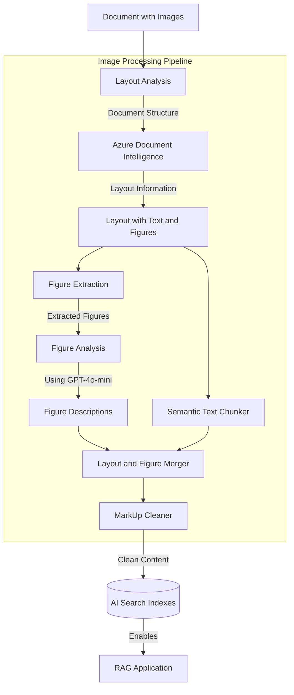
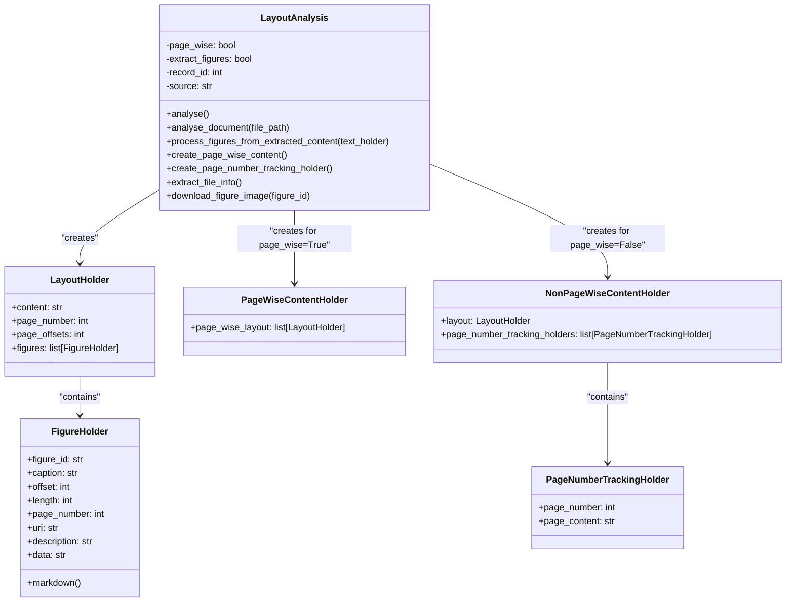
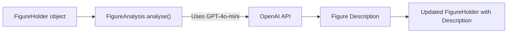
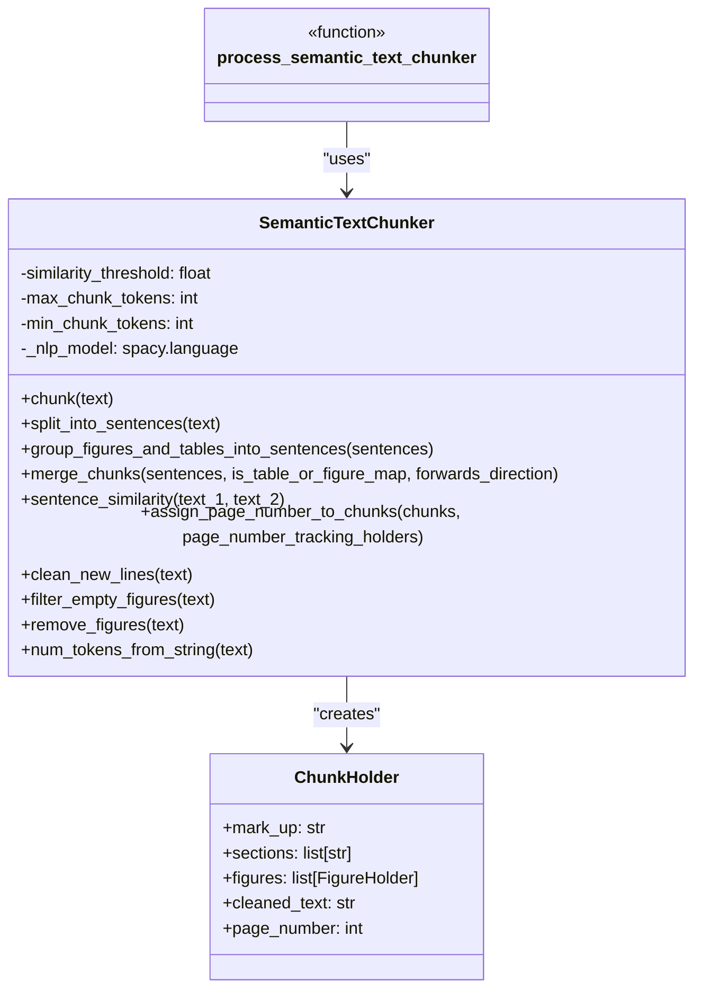
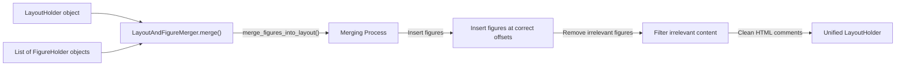
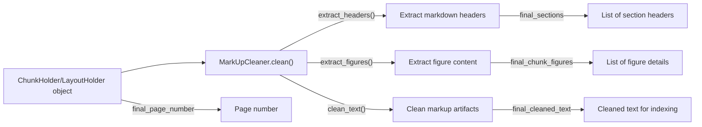
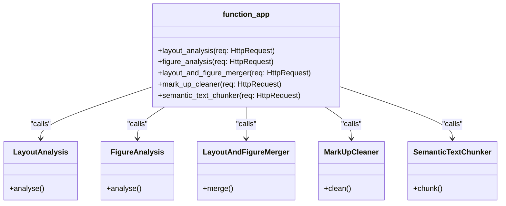
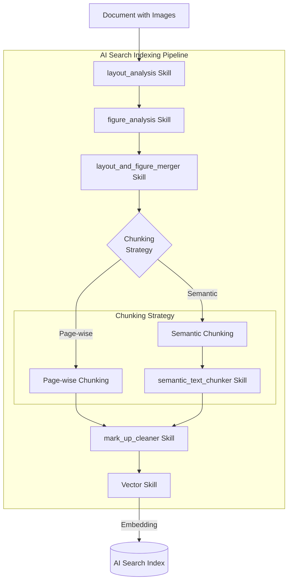
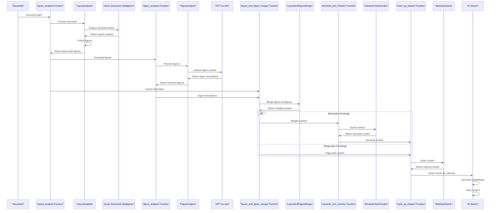

<!-- source: DeepWiki mcp.deepwiki.com · repo microsoft/dstoolkit-text2sql-and-imageprocessing · page 3 Image Processing System · fetched 2026-10-26 -->

# Image Processing System

<details>
<summary>Relevant source files</summary>

The following files were used as context for generating this wiki page:

- [image_processing/README.md](image_processing/README.md)
- [image_processing/images/Image Based RAG.png](image_processing/images/Image Based RAG.png)
- [image_processing/src/image_processing/function_app.py](image_processing/src/image_processing/function_app.py)
- [image_processing/src/image_processing/layout_and_figure_merger.py](image_processing/src/image_processing/layout_and_figure_merger.py)
- [image_processing/src/image_processing/requirements.txt](image_processing/src/image_processing/requirements.txt)
- [image_processing/tests/image_processing/test_figure_app.py](image_processing/tests/image_processing/test_figure_app.py)
- [image_processing/tests/image_processing/test_layout_analysis.py](image_processing/tests/image_processing/test_layout_analysis.py)
- [image_processing/tests/image_processing/test_layout_holders.py](image_processing/tests/image_processing/test_layout_holders.py)
- [image_processing/tests/image_processing/test_semantic_text_chunker.py](image_processing/tests/image_processing/test_semantic_text_chunker.py)

</details>


## Purpose and Scope

The Image Processing System is designed to enhance Retrieval-Augmented Generation (RAG) applications by effectively processing documents that contain images, charts, and complex layouts. Traditional document indexing methods often extract only text content or use simple OCR, which works well for simple documents but loses valuable information contained in visual elements like charts and figures.

This system addresses this limitation using a pipeline approach that combines:
- **Layout analysis** using Azure Document Intelligence to extract structured document information
- **Figure analysis** with multi-modal models (GPT-4o-mini) to interpret visual elements
- **Semantic chunking** that preserves the context and meaning of both text and visual content
- **AI Search integration** for effective retrieval in RAG applications

The implementation is built as a series of Azure Functions that can be orchestrated by AI Search to process complex documents, ensuring that information from charts, tables, and figures is preserved during indexing.

This document covers the architecture, components, and implementation details of the Image Processing System within the DSToolkit Text2SQL and Image Processing repository. For information about the Text-to-SQL system, see [Text-to-SQL System](#2).

Sources: image_processing/README.md

## High-Level Architecture

The Image Processing System processes documents through a pipeline of specialized components that work together to extract and understand both textual and visual content.



The system is implemented as a series of Azure Functions orchestrated by AI Search to process documents through custom skills. Each component is specialized for a specific task in the document processing pipeline.

Sources: image_processing/README.md, deploy_ai_search_indexes/src/deploy_ai_search_indexes/ai_search.py

## Core Components and Implementation

### Layout Analysis

The Layout Analysis component analyzes document structure using Azure Document Intelligence (ADI) and extracts both textual content and figure information.



The Layout Analysis process:
1. Takes a document from a specified source (blob storage path)
2. Uses Azure Document Intelligence to analyze document layout
3. Extracts textual content in Markdown format
4. Identifies and extracts figures
5. Stores extracted figures in blob storage
6. Returns structured layout information with content and figure references

The component supports two modes:
- **Page-wise**: Each page is processed as a separate chunk, returning a `PageWiseContentHolder` with multiple `LayoutHolder` objects
- **Non-page-wise**: The entire document is processed as continuous text (for later semantic chunking), returning a `NonPageWiseContentHolder` with a single `LayoutHolder` and `PageNumberTrackingHolder` objects to track page boundaries

Key implementation details:
- The `LayoutAnalysis` class downloads document files from blob storage, sends them to Azure Document Intelligence, processes the results, and handles figure extraction
- Figures are downloaded using the Document Intelligence API and uploaded to blob storage for later retrieval
- Page tracking is preserved to enable mapping content chunks back to their original page location
- Retry logic is implemented for figure downloads to handle transient failures
- `extract_file_info()` parses the blob URL to extract container and file information
- `process_figures_from_extracted_content()` processes figures identified by Azure Document Intelligence

Implementation files:
- `LayoutAnalysis` class in [image_processing/src/image_processing/layout_analysis.py:143-569]()
- `process_layout_analysis` function in [image_processing/src/image_processing/layout_analysis.py:575-613]()
- Data holders in [image_processing/src/image_processing/layout_holders.py:1-74]()

Sources: image_processing/src/image_processing/layout_analysis.py, image_processing/src/image_processing/layout_holders.py, image_processing/tests/image_processing/test_layout_analysis.py

### Figure Analysis

The Figure Analysis component interprets figures and charts extracted during layout analysis using GPT-4o-mini, a multimodal model.



The Figure Analysis process:
1. Takes extracted figures (identified by `FigureId`) as base64-encoded images
2. Sends the figure image to GPT-4o-mini through the OpenAI API
3. Uses a specialized prompt to generate a detailed description of the figure
4. Adds the description to the figure metadata
5. Returns the enriched figure information with updated description

The goal is to generate sufficient context to enable retrieval when users query for information contained in charts or images. Rather than completely describing every aspect of the figure, it focuses on generating a technical analysis that would help with retrieval. The prompt instructs the model to provide:
- An overview of what the figure shows
- Analysis of axes and data representations
- Data interpretation and key insights
- Summary conclusions

The implementation is exposed through the `/figure_analysis` HTTP endpoint in the function app, which delegates to the `FigureAnalysis.analyse()` method. Error handling is implemented to handle failures during image analysis.

Implementation files:
- `FigureAnalysis` class in [image_processing/src/image_processing/figure_analysis.py]()
- `figure_analysis` function in [image_processing/src/image_processing/function_app.py:56-84]()

Sources: image_processing/README.md, image_processing/src/image_processing/function_app.py, image_processing/tests/image_processing/test_figure_app.py

### Semantic Text Chunking

The Semantic Text Chunker divides document content into semantically meaningful chunks for effective retrieval. This component is critical for RAG applications as the quality of chunking directly impacts retrieval performance.



The chunking strategy:
1. Splits text into sentences using spaCy's NLP model
2. Groups sentences that contain figures and tables to maintain context
3. Performs special handling of Markdown elements (headings, tables, etc.)
4. Merges sentences into chunks based on semantic similarity:
   - Forward pass: Groups similar sentences from document start
   - Backward pass: Groups similar sentences from document end
5. Assigns page numbers to chunks based on `PageNumberTrackingHolder` objects

Key parameters (configurable via HTTP headers):
- `similarity_threshold`: Controls sentence similarity threshold for merging (default: 0.8)
- `max_chunk_tokens`: Maximum size of a chunk in tokens (default: 500)
- `min_chunk_tokens`: Minimum size of a chunk in tokens (default: 50)

Implementation details:
- Uses spaCy's `en_core_web_md` model for sentence segmentation
- Employs cosine similarity for comparing sentence embeddings
- Special handling for:
  - Tables and figures to keep them intact in chunks
  - Markdown headings (padding with newlines)
  - HTML comments and empty figures (removal)
  - Special characters and non-English content
- Error handling for empty content and chunking failures
- Page number assignment to preserve source context

The `chunk()` method implements the core algorithm:
1. Preprocesses text (cleaning, removing HTML comments)
2. Splits into sentences
3. Groups tables and figures
4. Merges sentences into semantic chunks
5. Returns a list of `ChunkHolder` objects

Implementation files:
- `SemanticTextChunker` class in [image_processing/src/image_processing/semantic_text_chunker.py:13-549]()
- `process_semantic_text_chunker` function in [image_processing/src/image_processing/semantic_text_chunker.py:552-608]()
- HTTP endpoint in [image_processing/src/image_processing/function_app.py:158-212]()

Sources: image_processing/src/image_processing/semantic_text_chunker.py, image_processing/README.md, image_processing/tests/image_processing/test_semantic_text_chunker.py

### Layout and Figure Merger

The Layout and Figure Merger component combines processed layout information with enriched figure descriptions to create a unified document representation.



This component:
1. Takes a `LayoutHolder` object with the document content
2. Takes a list of `FigureHolder` objects with enriched descriptions
3. Inserts each figure's markdown representation at the correct offset in the content
4. Removes irrelevant figures (marked as "Irrelevant Image")
5. Removes empty figures and HTML comments
6. Preserves document structure while integrating visual element descriptions
7. Returns an updated `LayoutHolder` with the unified content

Key implementation details:
- `insert_figure_description()` method handles the insertion of figure markdown at the correct offset
- Adjusts offsets of subsequent figures as the content length changes during insertion
- Uses regex patterns to clean up the resulting content:
  - `irrelevant_figure_pattern` removes figures marked as irrelevant
  - `empty_or_whitespace_figure_pattern` removes empty figure tags
  - `html_comments_pattern` removes HTML comments
- Error handling for invalid figure offsets or other merging failures

The implementation is exposed through the `/layout_and_figure_merger` HTTP endpoint in the function app, which delegates to the `LayoutAndFigureMerger.merge()` method.

Implementation files:
- `LayoutAndFigureMerger` class in [image_processing/src/image_processing/layout_and_figure_merger.py:10-158]()
- HTTP endpoint in [image_processing/src/image_processing/function_app.py:87-115]()

Sources: image_processing/src/image_processing/function_app.py, image_processing/src/image_processing/layout_and_figure_merger.py, image_processing/README.md

### MarkUp Cleaner

The MarkUp Cleaner prepares processed content for vectorization and indexing, ensuring it's clean, well-structured, and optimized for retrieval.



The MarkUp Cleaner:
1. Processes the merged content from either `ChunkHolder` or `LayoutHolder` objects
2. Extracts Markdown headers (e.g., `# Heading`) as sections for improved retrieval
3. Extracts figure information from the markup for proper indexing
4. Cleans up remaining markup artifacts:
   - Removes HTML comments
   - Removes table formatting while preserving content
   - Normalizes whitespace
   - Handles special characters
5. Preserves page number information for source attribution
6. Returns a structured output with:
   - `final_cleaned_text`: Clean text for vectorization
   - `final_sections`: List of extracted headers
   - `final_chunk_figures`: List of figures with properties
   - `final_page_number`: Page number for source tracking

Key implementation details:
- `extract_headers()` uses regex to identify and extract Markdown headings
- `extract_figures()` finds and extracts figure content with their attributes
- `clean_text()` removes markup artifacts while preserving content
- Error handling for parsing failures

The implementation is exposed through the `/mark_up_cleaner` HTTP endpoint in the function app, which delegates to the `MarkUpCleaner.clean()` method.

Implementation files:
- `MarkUpCleaner` class in [image_processing/src/image_processing/mark_up_cleaner.py]()
- HTTP endpoint in [image_processing/src/image_processing/function_app.py:118-154]()

Sources: image_processing/src/image_processing/function_app.py, image_processing/README.md, image_processing/tests/image_processing/test_figure_app.py

## Function App Implementation

The Image Processing System is implemented as Azure Functions exposing HTTP endpoints for each processing step, which are then orchestrated by AI Search as custom skills.



Each function endpoint:
1. Processes HTTP requests in the AI Search custom skill format
2. Extracts configuration from headers
3. Delegates processing to specialized component classes
4. Returns results in the expected format

The function app provides the following endpoints:

| Endpoint | Description | Processor Class | Configuration Headers |
|----------|-------------|-----------------|----------------------|
| `/layout_analysis` | Analyzes document layout | `LayoutAnalysis` | `chunk_by_page`, `extract_figures` |
| `/figure_analysis` | Analyzes extracted figures | `FigureAnalysis` | - |
| `/layout_and_figure_merger` | Merges layout and figures | `LayoutAndFigureMerger` | - |
| `/mark_up_cleaner` | Cleans markup for indexing | `MarkUpCleaner` | - |
| `/semantic_text_chunker` | Performs semantic chunking | `SemanticTextChunker` | `similarity_threshold`, `max_chunk_tokens`, `min_chunk_tokens` |

Sources: image_processing/src/image_processing/function_app.py

## AI Search Integration

The Image Processing System integrates with Azure AI Search through custom skills to create enriched document indexes for RAG applications.



The system supports two main indexing pipelines:

1. **Page-wise Chunking**:
   - Document → Layout Analysis → Figure Analysis → Layout/Figure Merger → MarkUp Cleaner → Vectorization → Indexing

2. **Semantic Chunking**:
   - Document → Layout Analysis → Figure Analysis → Layout/Figure Merger → Semantic Text Chunker → MarkUp Cleaner → Vectorization → Indexing

AI Search orchestrates these pipelines through a skillset that invokes the appropriate function endpoints in sequence.

Key implementation details:
- Custom skill integration in [deploy_ai_search_indexes/src/deploy_ai_search_indexes/ai_search.py:199-560]()
- Skillset deployment in [deploy_ai_search_indexes/src/deploy_ai_search_indexes/ai_search.py:660-680]()

Sources: deploy_ai_search_indexes/src/deploy_ai_search_indexes/ai_search.py, image_processing/README.md

## Processing Workflow

The complete document processing workflow combines all components into a coherent pipeline:



The choice between page-wise and semantic chunking depends on document characteristics and retrieval requirements:

- **Page-wise Chunking**: Better for documents with natural page boundaries
- **Semantic Chunking**: Better for content where semantic relationships cross page boundaries

Sources: image_processing/README.md, image_processing/src/image_processing/function_app.py

## Performance and Production Considerations

When deploying the Image Processing System in production environments, several important considerations should be kept in mind:

1. **Document Type Quality Variance**:
   - Azure Document Intelligence output quality varies significantly by file type
   - PDF files generally produce richer outputs for figure detection compared to PPTX files
   - Consider pre-converting documents to PDF if figure extraction is critical

2. **Cost Considerations**:
   - Document Intelligence Layout model analysis is computationally expensive
   - GPT-4o-mini analysis of figures adds significant cost per image
   - Consider using selective processing based on document importance
   - For cost-sensitive deployments, consider:
     - Limiting figure extraction to specific document types
     - Implementing filtering to process only relevant figures
     - Batching documents for more efficient processing

3. **Processing Time**:
   - The complete pipeline can be time-intensive, especially with many figures
   - Figure analysis with GPT-4o-mini can take several seconds per image
   - Configure appropriate timeouts in the AI Search skillset and indexer
   - Consider implementing asynchronous processing for large document sets

4. **Storage Requirements**:
   - Extracted figures are stored in blob storage (`container-figures`)
   - Ensure sufficient storage capacity based on expected document volume
   - Implement lifecycle management policies for figure storage

5. **Error Handling**:
   - The system implements retry logic for transient failures (especially for figure downloads)
   - Failed document processing is properly reported to AI Search
   - Metadata updates track processing status on the original documents

Sources: image_processing/README.md, image_processing/src/image_processing/requirements.txt

## Example Output

Here's a simplified example showing how the system processes a document with figures, in this case from the Phi-3 Technical Report:

```
<table>
<caption>Table 1: Comparison results on RepoQA benchmark.</caption>
<tr>
<th>Model</th>
<th>Ctx Size</th>
<th>Python</th>
<th>Average</th>
</tr>
<tr>
<td>gpt-4O-2024-05-13</td>
<td>128k</td>
<td>95</td>
<td>90.6</td>
</tr>
<tr>
<td>Phi-3.5-MoE</td>
<td>128k</td>
<td>89</td>
<td>85</td>
</tr>
</table>

MMLU(5-shot) MultiLingual

Phi-3-mini
Phi-3.5-mini
Phi-3.5-MoE

<!-- FigureContent="**Technical Analysis of Figure 4: Comparison of phi-3-mini, phi-3.5-mini and phi-3.5-MoE on MMLU-Multilingual tasks**

1. **Overview:**
   - The image is a bar chart comparing the performance of three different models on MMLU-Multilingual tasks across various languages.

2. **Axes:**
   - The x-axis represents the languages: Arabic, Chinese, Dutch, French, German, Italian, Russian, Spanish, Ukrainian, Vietnamese, and English.
   - The y-axis represents performance scores from 0 to 90.

3. **Data Interpretation:**
   - Across all languages, the phi-3.5-MoE consistently outperforms the other two models.
   - The phi-3.5-mini shows better performance than phi-3-mini in most languages.

4. **Conclusion:**
   - The phi-3.5-MoE model consistently outperforms the phi-3-mini and phi-3.5-mini models across all MMLU-Multilingual tasks." -->

We evaluate the phi-3.5-mini and phi-3.5-MoE models on two long-context understanding tasks.
As shown in Tables 1 and 2, both phi-3.5-MoE and phi-3.5-mini outperform other open-source models.
```

In this example:
1. The table structure is preserved in Markdown format
2. The figure (a bar chart comparing model performance) has been analyzed
3. The figure description is included as an HTML comment, enabling retrieval of information contained in the chart
4. The original document flow and context are maintained

This enriched representation allows RAG applications to understand and retrieve information from both the textual content and the visual elements in the document.

Sources: image_processing/README.md

---

