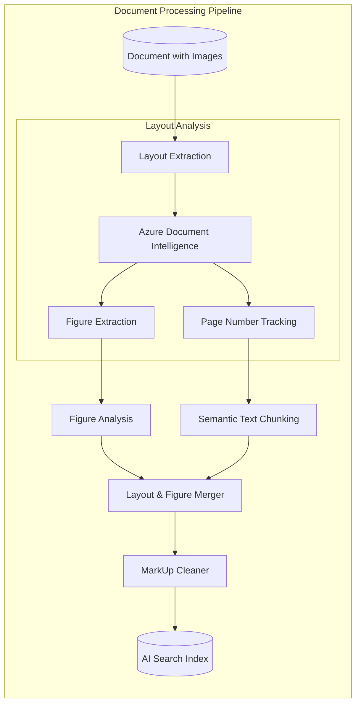
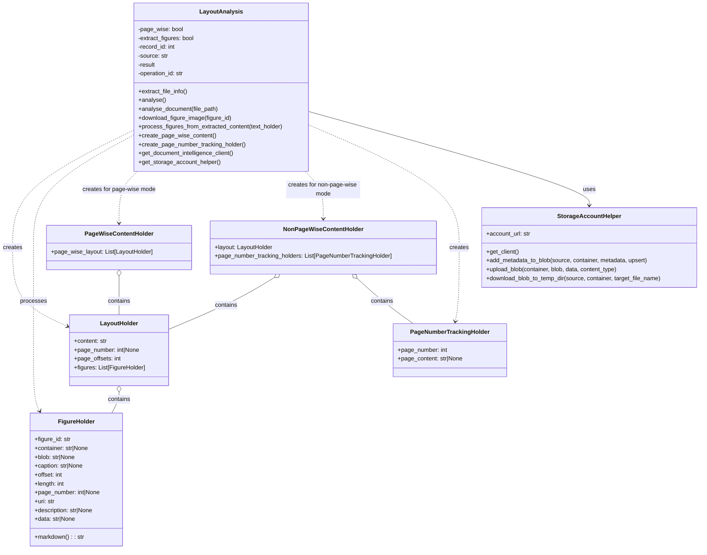
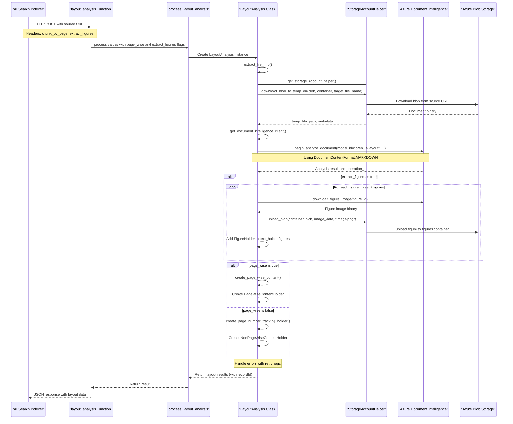
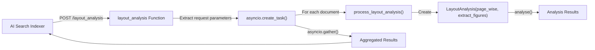
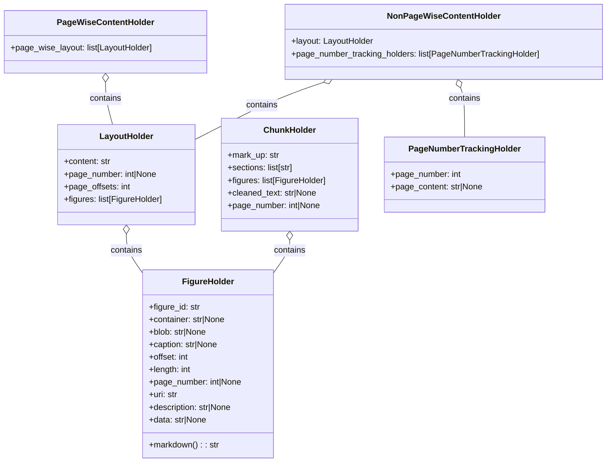
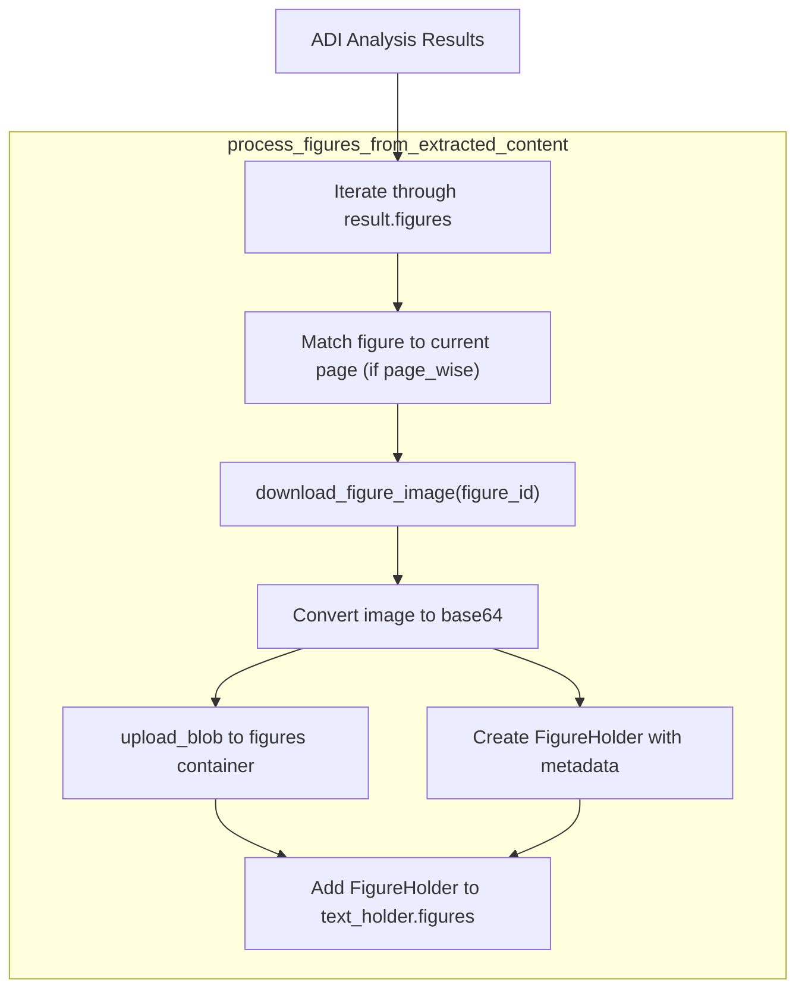
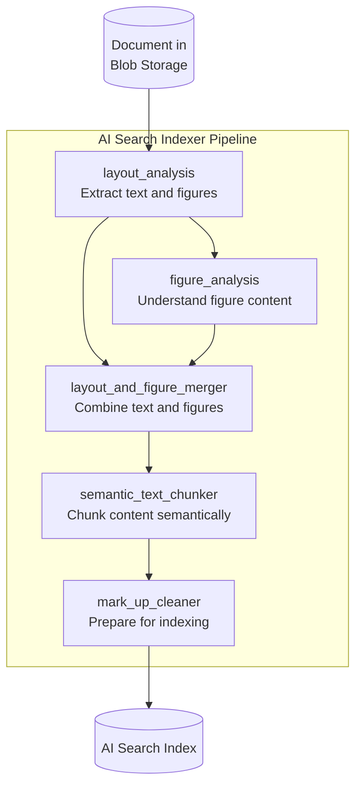
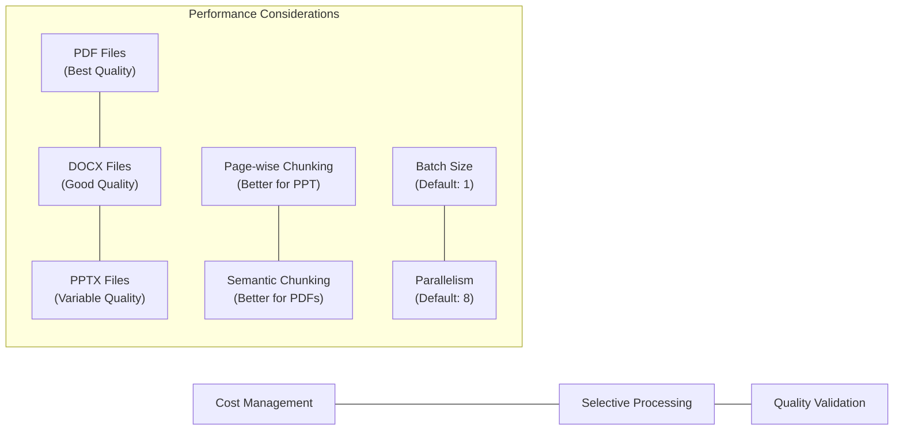

<!-- source: DeepWiki mcp.deepwiki.com · repo microsoft/dstoolkit-text2sql-and-imageprocessing · page 3.1 Layout Analysis · fetched 2026-10-26 -->

# Layout Analysis

<details>
<summary>Relevant source files</summary>

The following files were used as context for generating this wiki page:

- [deploy_ai_search_indexes/src/deploy_ai_search_indexes/ai_search.py](deploy_ai_search_indexes/src/deploy_ai_search_indexes/ai_search.py)
- [image_processing/README.md](image_processing/README.md)
- [image_processing/images/Image Based RAG.png](image_processing/images/Image Based RAG.png)
- [image_processing/src/image_processing/function_app.py](image_processing/src/image_processing/function_app.py)
- [image_processing/src/image_processing/layout_analysis.py](image_processing/src/image_processing/layout_analysis.py)
- [image_processing/src/image_processing/layout_holders.py](image_processing/src/image_processing/layout_holders.py)
- [image_processing/src/image_processing/semantic_text_chunker.py](image_processing/src/image_processing/semantic_text_chunker.py)
- [image_processing/tests/image_processing/test_figure_app.py](image_processing/tests/image_processing/test_figure_app.py)
- [image_processing/tests/image_processing/test_layout_analysis.py](image_processing/tests/image_processing/test_layout_analysis.py)
- [image_processing/tests/image_processing/test_layout_holders.py](image_processing/tests/image_processing/test_layout_holders.py)
- [image_processing/tests/image_processing/test_semantic_text_chunker.py](image_processing/tests/image_processing/test_semantic_text_chunker.py)

</details>


## Purpose and Scope

This document explains how the Image Processing system analyzes document layout using Azure Document Intelligence (ADI). Layout Analysis is the first critical step in the document processing pipeline, converting complex documents with text, tables, and figures into a structured Markdown format that preserves the original layout while enabling further processing. For information about how extracted text is processed after layout analysis, see [Semantic Text Chunking](#3.2).

## Overview

When processing documents with images and charts, simply extracting text content is insufficient. Layout Analysis addresses this by using Azure Document Intelligence to:

1. Identify document structure (headings, paragraphs, tables)
2. Extract figures and their captions
3. Preserve layout information in Markdown format
4. Track page numbers for elements within the document

This structured output enables downstream processes to understand both the textual content and visual elements, significantly improving RAG application performance for documents with charts and figures.

Sources: [image_processing/README.md:13-27]()

## Architecture

### Layout Analysis in Document Processing Pipeline



Sources: [image_processing/README.md:11-41]()

### Component Architecture



Sources: [image_processing/src/image_processing/layout_analysis.py:143-572](), [image_processing/src/image_processing/layout_holders.py:1-74]()

Sources: [image_processing/src/image_processing/layout_holders.py:1-74]()

## Processing Flow

Layout Analysis processes documents through the following key steps:

### Document Analysis Flow



Sources: [image_processing/src/image_processing/layout_analysis.py:458-571](), [image_processing/src/image_processing/layout_analysis.py:575-613](), [image_processing/src/image_processing/function_app.py:18-53]()

Sources: [image_processing/src/image_processing/layout_analysis.py:458-571](), [image_processing/src/image_processing/layout_analysis.py:575-613](), [image_processing/src/image_processing/function_app.py:18-53]()

## Key Components

### HTTP Function Endpoint

The system exposes the layout analysis functionality through an Azure Function HTTP endpoint at `/layout_analysis`. This endpoint accepts document references and configuration parameters and returns the analyzed layout.



The HTTP endpoint processes the following parameters:
- `page_wise` (header): Whether to chunk by page (default: False)
- `extract_figures` (header): Whether to extract figures (default: True)
- Request body: Must contain a JSON object with a `values` array containing document references

Sources: [image_processing/src/image_processing/function_app.py:18-53]()

Sources: [image_processing/src/image_processing/function_app.py:18-53]()

### LayoutAnalysis Class

The `LayoutAnalysis` class is the core component responsible for:

1. Downloading document files from blob storage
2. Interacting with Azure Document Intelligence 
3. Processing figures (when extraction is enabled)
4. Creating layout holders based on the processing mode (page-wise or non-page-wise)

```python
class LayoutAnalysis:
    def __init__(
        self,
        page_wise: bool = False,
        extract_figures: bool = True,
        record_id: int = None,
        source: str = None,
    ):
        # Configuration and state properties
        self.page_wise = page_wise        # Process page-by-page
        self.extract_figures = extract_figures  # Extract figures from document
        self.record_id = record_id        # Unique identifier
        self.source = source              # URL to document
        self.result = None                # ADI analysis result
        self.operation_id = None          # ADI operation ID
```

Key methods:
- `extract_file_info()`: Parses source URL to extract blob and container information
- `analyse()`: Main orchestration method for document analysis
- `analyse_document()`: Sends document to Azure Document Intelligence for analysis
- `download_figure_image()`: Downloads figure images identified by ADI
- `process_figures_from_extracted_content()`: Processes and stores figures
- `create_page_wise_content()`: Creates page-by-page layout holders
- `create_page_number_tracking_holder()`: Creates page tracking information

Sources: [image_processing/src/image_processing/layout_analysis.py:143-195](), [image_processing/src/image_processing/layout_analysis.py:458-571]()

Sources: [image_processing/tests/image_processing/test_layout_analysis.py:117-142]()

### Data Models

The system uses several Pydantic models to represent the layout analysis results:



| Model | Purpose | Key Properties |
|-------|---------|----------------|
| `LayoutHolder` | Stores document content with optional page information and figures | `content`, `page_number`, `page_offsets`, `figures` |
| `FigureHolder` | Represents an extracted figure with its metadata and content | `figure_id`, `offset`, `length`, `uri`, `caption`, `description`, `data` |
| `PageWiseContentHolder` | Contains multiple layout holders when processing by page | `page_wise_layout` list |
| `NonPageWiseContentHolder` | Contains a single layout holder and page tracking information | `layout`, `page_number_tracking_holders` list |
| `PageNumberTrackingHolder` | Tracks which content belongs to which page | `page_number`, `page_content` |
| `ChunkHolder` | Used in subsequent processing for chunked content | `mark_up`, `page_number`, `figures` |

Sources: [image_processing/src/image_processing/layout_holders.py:1-74]()

Sources: [image_processing/tests/image_processing/test_layout_holders.py:13-106]()

## Figure Processing

When `extract_figures` is enabled, Layout Analysis:

1. Identifies figures within the document using Azure Document Intelligence
2. Downloads each figure image using the Document Intelligence API with built-in retry logic
3. Uploads each figure to a dedicated container in blob storage
4. Creates `FigureHolder` objects with metadata about each figure
5. Preserves figure placement information (offset, length) for later processing



The method uses `@retry` decorator with exponential backoff to handle transient failures when downloading figure images from Azure Document Intelligence. Each figure is stored in a container named `{original-container}-figures` with a path that preserves its relationship to the original document.

This extracted figure information is passed to Figure Analysis for content interpretation (see [Figure Analysis](#3.3)).

Sources: [image_processing/src/image_processing/layout_analysis.py:179-216](), [image_processing/src/image_processing/layout_analysis.py:217-315]()

Sources: [image_processing/src/image_processing/layout_analysis.py:179-216](), [image_processing/src/image_processing/layout_analysis.py:217-315]()

## Page Mode Processing

### Page-wise Processing

When `page_wise` is set to `true`, the document is processed page by page:

```python
if self.page_wise:
    cleaned_text_holders = []
    page_wise_text_holders = self.create_page_wise_content()
    content_with_figures_tasks = []

    for page_wise_text_holder in page_wise_text_holders:
        if self.extract_figures:
            content_with_figures_tasks.append(
                self.process_figures_from_extracted_content(
                    page_wise_text_holder
                )
            )

        if len(page_wise_text_holder.content) == 0:
            logging.error(
                "No content found in the cleaned result for slide %s.",
                page_wise_text_holder.page_number,
            )
        else:
            cleaned_text_holders.append(page_wise_text_holder)

    if self.extract_figures:
        await asyncio.gather(*content_with_figures_tasks)

    output_record = PageWiseContentHolder(
        page_wise_layout=cleaned_text_holders
    )
```

1. Each page is processed separately and its content is extracted via `create_page_wise_content()`
2. Figures are associated with their respective pages
3. The output is a `PageWiseContentHolder` containing multiple `LayoutHolder` objects (one per page)

This mode is useful for maintaining strict page boundaries and for documents where page context is important.

### Non-page-wise Processing

When `page_wise` is set to `false`, the document is processed as a whole:

```python
else:
    text_content = LayoutHolder(
        content=self.result.content, page_number=None, page_offsets=0
    )

    if self.extract_figures:
        await self.process_figures_from_extracted_content(text_content)

    page_number_tracking_holders = self.create_page_number_tracking_holder()

    output_record = NonPageWiseContentHolder(
        layout=text_content,
        page_number_tracking_holders=page_number_tracking_holders,
    )
```

1. The entire document content is extracted into a single layout holder
2. Page number tracking information is maintained separately through `create_page_number_tracking_holder()`
3. The output is a `NonPageWiseContentHolder` with a single `LayoutHolder` and a list of `PageNumberTrackingHolder` objects

This mode is better for documents where content flows across pages and semantic chunking will be applied later. The `page_number_tracking_holders` list contains information that helps associate content with page numbers even when the content is chunked in later processing.

Sources: [image_processing/src/image_processing/layout_analysis.py:506-547]()

Sources: [image_processing/src/image_processing/layout_analysis.py:506-547]()

## Integration with Other Components

Layout Analysis is the first step in a pipeline that includes:



1. **Layout Analysis** (`layout_analysis` function):
   - Extracts document structure using Azure Document Intelligence
   - Identifies and extracts figures
   - Creates either page-wise or document-wide layout holders

2. **Figure Analysis** (`figure_analysis` function):
   - Processes figures extracted during layout analysis
   - Uses multimodal models (GPT-4o-mini) to analyze figure content
   - Generates descriptions suitable for retrieval

3. **Layout and Figure Merger** (`layout_and_figure_merger` function):
   - Combines layout information with figure analysis results
   - Integrates figure descriptions into the document content

4. **Semantic Text Chunking** (`semantic_text_chunker` function):
   - Splits text into semantically meaningful chunks
   - Preserves figure and table contexts within chunks
   - Tracks page numbers for each chunk

5. **MarkUp Cleaner** (`mark_up_cleaner` function):
   - Cleans and prepares final content for indexing
   - Extracts sections and headers as additional metadata
   - Formats content for optimal retrieval

This pipeline ensures that both textual and visual elements of documents are properly processed for RAG applications. Each component is implemented as a separate Azure Function endpoint that can be called independently or as part of the AI Search skillset.

Sources: [image_processing/src/image_processing/function_app.py:1-213](), [image_processing/README.md:43-56]()

Sources: [image_processing/README.md:43-56]()

## Usage Example

Layout Analysis transforms complex documents with figures and tables into structured markdown that preserves layout and context. Here's an example from the Phi-3 Technical Report:

### Original Content
A complex page with table, text, and a figure bar chart comparing model performance across languages.

### After Layout Analysis Processing

```
\n<table>\n<caption>Table 1: Comparison results on RepoQA benchmark.</caption>\n<tr>\n<th>Model</th>\n<th>Ctx Size</th>\n<th>Python</th>\n<th>C++</th>\n<th>Rust</th>\n<th>Java</th>\n<th>TypeScript</th>\n<th>Average</th>\n</tr>\n<tr>\n<td>gpt-4O-2024-05-13</td>\n<td>128k</td>\n<td>95</td>\n<td>80</td>\n<td>85</td>\n<td>96</td>\n<td>97</td>\n<td>90.6</td>\n</tr>\n<tr>\n<td>gemini-1.5-flash-latest</td>\n<td>1000k</td>\n<td>93</td>\n<td>79</td>\n<td>87</td>\n<td>94</td>\n<td>97</td>\n<td>90</td>\n</tr>\n<tr>\n<td>Phi-3.5-MoE</td>\n<td>128k</td>\n<td>89</td>\n<td>74</td>\n<td>81</td>\n<td>88</td>\n<td>95</td>\n<td>85</td>\n</tr>\n<tr>\n<td>Phi-3.5-Mini</td>\n<td>128k</td>\n<td>86</td>\n<td>67</td>\n<td>73</td>\n<td>77</td>\n<td>82</td>\n<td>77</td>\n</tr>\n<tr>\n<td>Llama-3.1-8B-Instruct</td>\n<td>128k</td>\n<td>80</td>\n<td>65</td>\n<td>73</td>\n<td>76</td>\n<td>63</td>\n<td>71</td>\n</tr>\n<tr>\n<td>Mixtral-8x7B-Instruct-v0.1</td>\n<td>32k</td>\n<td>66</td>\n<td>65</td>\n<td>64</td>\n<td>71</td>\n<td>74</td>\n<td>68</td>\n</tr>\n<tr>\n<td>Mixtral-8x22B-Instruct-v0.1</td>\n<td>64k</td>\n<td>60</td>\n<td>67</td>\n<td>74</td>\n<td>83</td>\n<td>55</td>\n<td>67.8</td>\n</tr>\n</table>\n\n\nsuch as Arabic, Chinese, Russian, Ukrainian, and Vietnamese, with average MMLU-multilingual scores\nof 55.4 and 47.3, respectively. Due to its larger model capacity, phi-3.5-MoE achieves a significantly\nhigher average score of 69.9, outperforming phi-3.5-mini.\n\nMMLU(5-shot) MultiLingual\n\nPhi-3-mini\n\nPhi-3.5-mini\n\nPhi-3.5-MoE\n\n\n<!-- FigureContent=\"**Technical Analysis of Figure 4: Comparison of phi-3-mini, phi-3.5-mini and phi-3.5-MoE on MMLU-Multilingual tasks**\n...figure description...\n\" -->\n\n\n We evaluate the phi-3.5-mini and phi-3.5-MoE models on two long-context understanding tasks:
```

Key transformations:
1. Tables are properly formatted in Markdown with rows and columns preserved
2. Figures are identified and extracted as image files in blob storage
3. Figure placeholders are inserted with unique IDs (to be processed by Figure Analysis)
4. Page numbers are tracked for each content block
5. Document structure (headings, paragraphs) is preserved
6. The entire layout is converted to a consistent Markdown format

At this stage, figure content isn't yet analyzed - that happens in the subsequent Figure Analysis step. The Layout Analysis component focuses on extracting the document structure and preparing it for further processing.

Sources: [image_processing/README.md:64-72]()

Sources: [image_processing/README.md:64-72]()

## Production Considerations

### Performance and Scaling



- **File Type Impact**: Azure Document Intelligence output quality varies significantly by file type
  - PDF produces the best output with most reliable figure detection
  - DOCX/PPTX files may have less reliable layout detection
  
- **Processing Efficiency**:
  - Layout analysis has configurable batch size (1 by default) and parallelism (8 by default)
  - For production deployments, consider adjusting these values based on throughput requirements
  
- **Cost Management**:
  - Document Intelligence and figure analysis (using GPT-4o-mini) can become expensive at scale
  - Consider selective processing for only certain document types or those that truly need image analysis
  - Use metadata tagging (`AzureSearch_Skip`) to mark documents that failed processing

- **Error Handling**:
  - The implementation includes retry logic for transient failures
  - Failed documents are tagged with metadata to prevent repeated processing attempts

- **Storage Requirements**:
  - Extracted figures are stored in a separate blob container (original-container-figures)
  - Plan for additional storage needs when processing documents with many figures

Sources: [image_processing/src/image_processing/layout_analysis.py:418-455](), [image_processing/README.md:107-112]()

Sources: [image_processing/README.md:107-112]()

---

