<!-- source: DeepWiki mcp.deepwiki.com · repo microsoft/dstoolkit-text2sql-and-imageprocessing · page 3.2 Semantic Text Chunking · fetched 2026-10-26 -->

# Semantic Text Chunking

<details>
<summary>Relevant source files</summary>

The following files were used as context for generating this wiki page:

- [deploy_ai_search_indexes/src/deploy_ai_search_indexes/ai_search.py](deploy_ai_search_indexes/src/deploy_ai_search_indexes/ai_search.py)
- [image_processing/README.md](image_processing/README.md)
- [image_processing/images/Image Based RAG.png](image_processing/images/Image Based RAG.png)
- [image_processing/src/image_processing/function_app.py](image_processing/src/image_processing/function_app.py)
- [image_processing/src/image_processing/layout_analysis.py](image_processing/src/image_processing/layout_analysis.py)
- [image_processing/src/image_processing/layout_holders.py](image_processing/src/image_processing/layout_holders.py)
- [image_processing/src/image_processing/semantic_text_chunker.py](image_processing/src/image_processing/semantic_text_chunker.py)
- [image_processing/tests/image_processing/test_figure_app.py](image_processing/tests/image_processing/test_figure_app.py)
- [image_processing/tests/image_processing/test_layout_analysis.py](image_processing/tests/image_processing/test_layout_analysis.py)
- [image_processing/tests/image_processing/test_layout_holders.py](image_processing/tests/image_processing/test_layout_holders.py)
- [image_processing/tests/image_processing/test_semantic_text_chunker.py](image_processing/tests/image_processing/test_semantic_text_chunker.py)

</details>


## Purpose and Scope

This document describes the Semantic Text Chunking component of the Image Processing system. Semantic Text Chunking intelligently divides document content into semantically coherent chunks while preserving contextual relationships. This is particularly important for effective Retrieval Augmented Generation (RAG) applications, as it ensures that related information remains together during indexing and retrieval.

Unlike page-wise chunking (covered in [Layout Analysis](#3.1)), the semantic text chunking approach creates chunks based on content similarity rather than physical page boundaries, which can result in more meaningful segments for AI processing.

## System Context

Semantic Text Chunking is a critical step in the document processing pipeline that feeds into AI Search for RAG applications. It processes content extracted by the Layout Analysis component after figures have been analyzed.

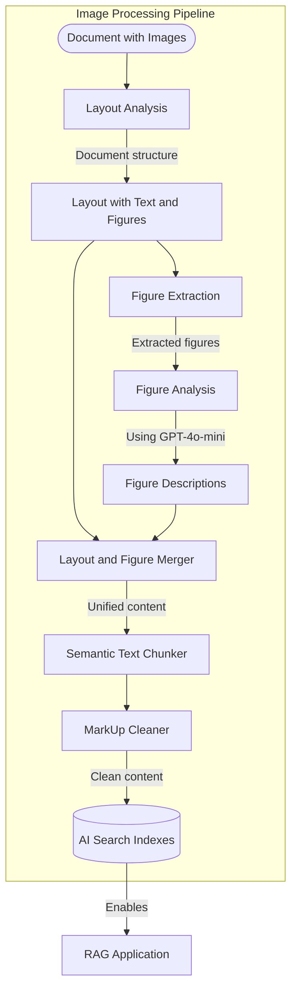

Sources: 
- `image_processing/README.md`
- `image_processing/src/image_processing/function_app.py`

## How Semantic Text Chunking Works

The semantic chunker takes a document's content as input and divides it into chunks by following these key principles:

1. Preserving structural elements (tables, figures)
2. Keeping semantically similar sentences together
3. Respecting natural content boundaries (headings, paragraphs)
4. Optimizing chunk size for effective embedding and retrieval

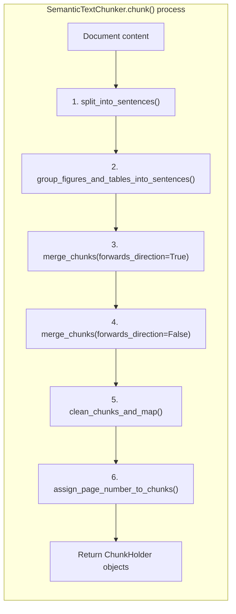

Sources:
- [image_processing/src/image_processing/semantic_text_chunker.py:77-138]()
- [image_processing/README.md]()

### Key Processing Steps

The chunking process involves several sophisticated steps:

1. **Sentence Splitting**: Using spaCy, the document content is split into sentences while preserving markdown elements
2. **Structural Preservation**: Tables and figures are kept intact by grouping related sentences
3. **Two-Pass Merging**:
   - Forward pass: Starting from the beginning, sentences are grouped based on semantic similarity
   - Backward pass: Starting from the end, similar groups are further consolidated
4. **Page Number Mapping**: Each chunk is mapped to its original page number for source tracking

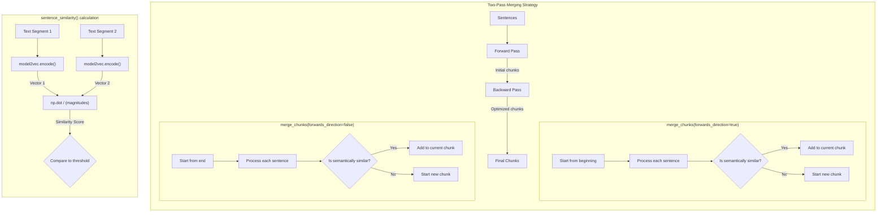

Sources:
- [image_processing/src/image_processing/semantic_text_chunker.py:358-452]()
- [image_processing/src/image_processing/semantic_text_chunker.py:454-467]()

## Implementation Details

### Core Class and Component Structure

The semantic text chunking functionality is implemented through a core class that manages the chunking process and provides methods for different chunking stages.

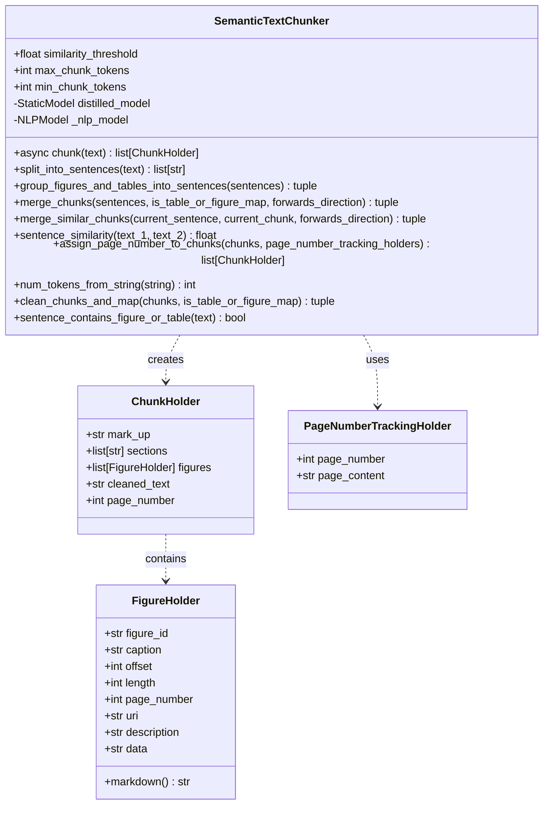

Sources:
- [image_processing/src/image_processing/semantic_text_chunker.py:13-468]()
- [image_processing/src/image_processing/layout_holders.py:66-74]()
- [image_processing/src/image_processing/layout_holders.py:50-55]()
- [image_processing/src/image_processing/layout_holders.py:8-33]()

### Algorithm Highlights

#### Sentence Splitting

The `split_into_sentences` method uses spaCy to intelligently split text into sentences, with special handling for:

- Markdown headings (ensuring they start with `\n\n` and end with `\n\n`)
- Figure and table tags (preserving them intact)
- Line breaks and whitespace management

The method first cleans newlines and empty figures using `clean_new_lines` and `filter_empty_figures`, then applies spaCy's sentence segmentation with specialized post-processing for HTML tags and markdown headings:

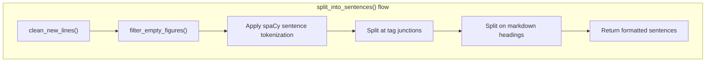

Sources:
- [image_processing/src/image_processing/semantic_text_chunker.py:160-219]()
- [image_processing/src/image_processing/semantic_text_chunker.py:149-158]()
- [image_processing/src/image_processing/semantic_text_chunker.py:140-148]()

#### Figure and Table Grouping

To ensure that tables and figures are kept intact within chunks, the `group_figures_and_tables_into_sentences` method:

1. Detects sentences containing table or figure tags
2. Groups consecutive sentences that are part of the same table or figure
3. Creates a mapping of which sentences contain tables/figures for later processing

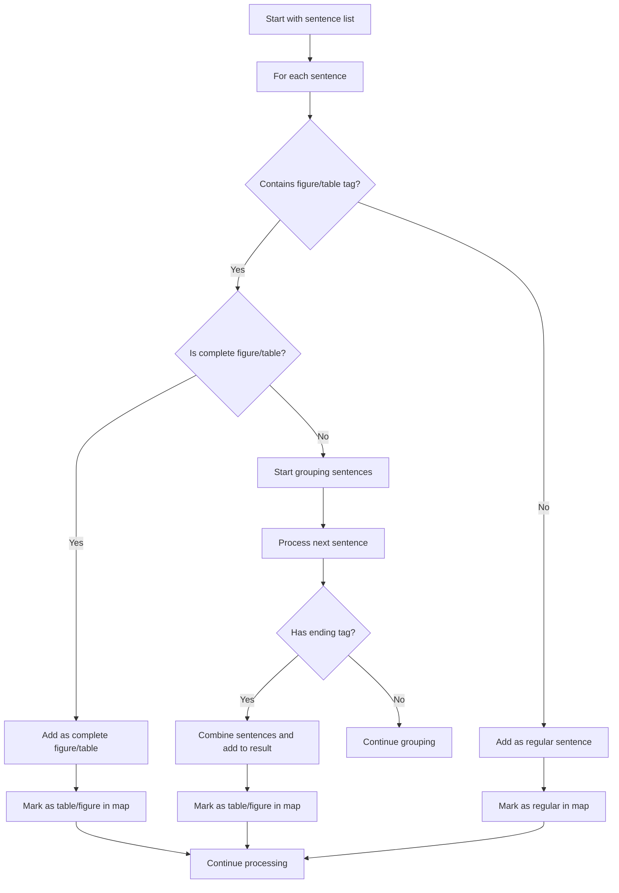

Sources:
- [image_processing/src/image_processing/semantic_text_chunker.py:221-260]()
- [image_processing/src/image_processing/semantic_text_chunker.py:32-46]()

#### Semantic Similarity Calculation

The chunker uses a pre-trained `model2vec` model to calculate the semantic similarity between text segments:

1. Text segments are encoded into vector representations using `distilled_model.encode()`
2. The cosine similarity between vectors is calculated using dot product and vector magnitudes
3. If the similarity is above the configured threshold, segments are merged
4. Additional checks ensure chunks don't exceed the maximum token limit

The vector similarity check is implemented in the `sentence_similarity` method:

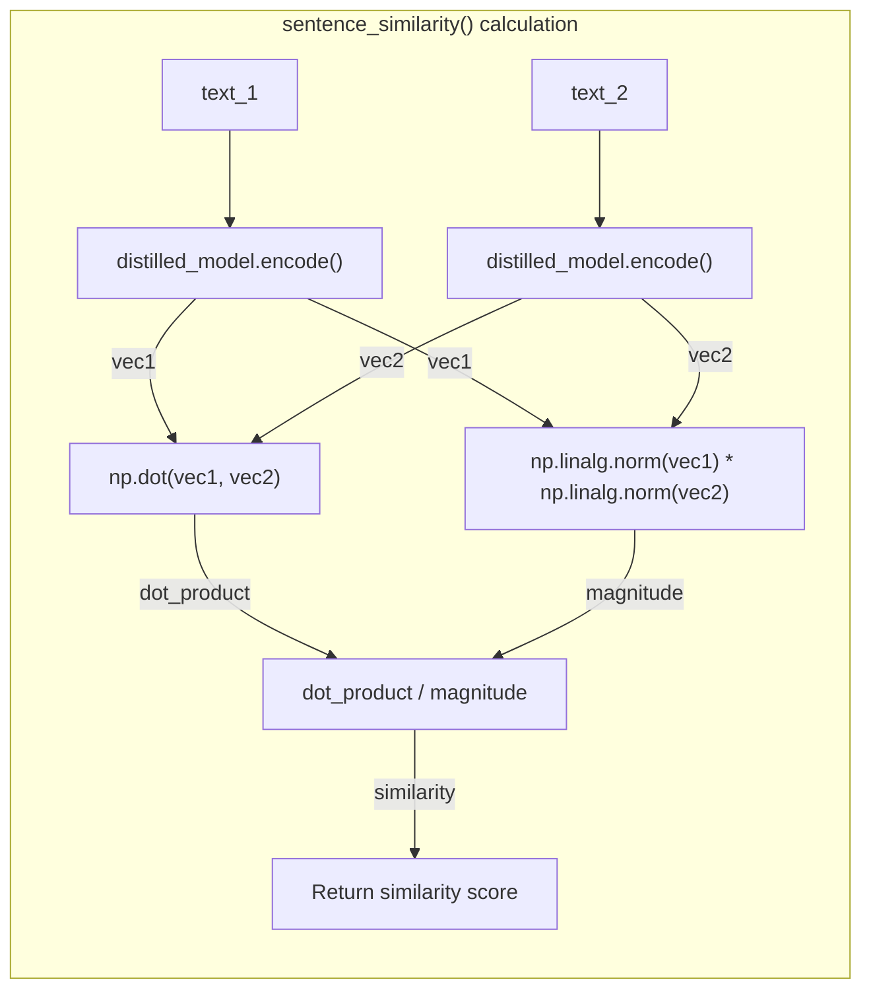

Sources:
- [image_processing/src/image_processing/semantic_text_chunker.py:454-467]()
- [image_processing/src/image_processing/semantic_text_chunker.py:268-353]()
- [image_processing/src/image_processing/semantic_text_chunker.py:24-25]()

#### Page Number Tracking

To maintain source attribution, each chunk is mapped to its original page number:

1. The first sentence of each page is recorded during layout analysis
2. During chunking, each chunk's first sentence is compared with these page markers
3. The page number is assigned based on the matching page marker

```
Sources:
- `image_processing/src/image_processing/semantic_text_chunker.py:468-549`
```

## Configuration Parameters

The semantic text chunker can be customized through several parameters to optimize chunking behavior for different types of documents:

| Parameter | Description | Default | Impact |
|-----------|-------------|---------|--------|
| `similarity_threshold` | Threshold for considering text segments as semantically related | 0.8 | Higher values create more chunks with tighter semantic coherence |
| `max_chunk_tokens` | Maximum size of a chunk in tokens | 500 | Controls the upper limit for chunk sizes |
| `min_chunk_tokens` | Minimum size of a chunk in tokens | 200 | Prevents creation of very small chunks |

These parameters can be adjusted via HTTP headers when calling the semantic text chunker endpoint:

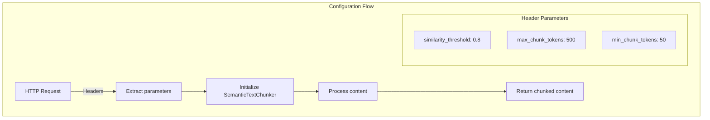

Sources:
- [image_processing/src/image_processing/semantic_text_chunker.py:14-22]()
- [image_processing/src/image_processing/function_app.py:174-195]()

## Integration with AI Search

The Semantic Text Chunker is deployed as a custom skill in the AI Search enrichment pipeline. It's implemented as an Azure Function that can be called by AI Search during document processing.

```mermaid
flowchart TB
    subgraph "AI Search Enrichment Pipeline with Semantic Chunking"
        direction LR
        Document[(Document Blob)] --> LayoutAnalysis["layout_analysis() Skill"]
        LayoutAnalysis --> |"layout"| FigureAnalysis["figure_analysis() Skill"]
        FigureAnalysis --> |"updated_figure"| LayoutFigureMerger["layout_and_figure_merger() Skill"]
        LayoutFigureMerger --> |"layout_merged_content"| SemanticChunker["semantic_text_chunker() Skill"]
        SemanticChunker --> |"chunk_mark_ups"| MarkUpCleaner["mark_up_cleaner() Skill"]
        MarkUpCleaner --> |"final_mark_up"| VectorSkill["Vector Embedding Skill"]
        VectorSkill --> AISearchIndex[(AI Search Index)]
    end
```

The Semantic Text Chunker skill is configured in the AI Search deployment process with these parameters:

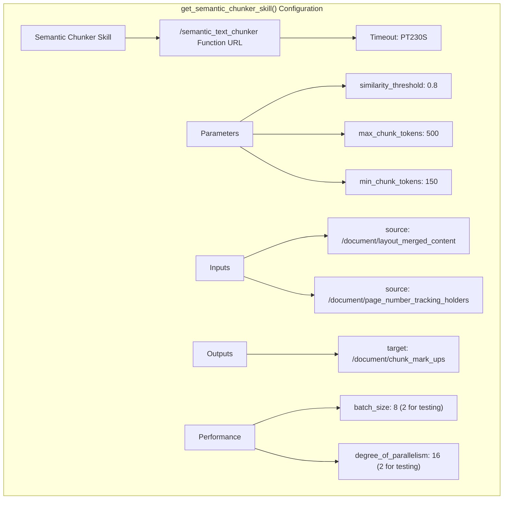

Sources:
- [deploy_ai_search_indexes/src/deploy_ai_search_indexes/ai_search.py:284-352]()
- [image_processing/README.md]()
- [image_processing/src/image_processing/function_app.py:157-212]()

## Performance Considerations

### Token Usage Optimization

The chunker uses token counting to ensure chunks are appropriately sized for embedding models:

1. The `num_tokens_from_string` method uses the `cl100k_base` tokenizer to accurately count tokens
2. Chunks are optimized to balance size and semantic coherence
3. Configuration parameters allow fine-tuning for different document types and embedding models

```
Sources:
- `image_processing/src/image_processing/semantic_text_chunker.py:48-59`
```

### Processing Efficiency

For large documents, the chunking process includes several optimizations:

1. Using spaCy's efficient NLP pipeline with disabled unnecessary components
2. Configurable batch sizes and parallelism for function app processing
3. Two-pass strategy to minimize the number of chunks while preserving semantic relationships

```
Sources:
- `image_processing/src/image_processing/semantic_text_chunker.py:177-180`
- `deploy_ai_search_indexes/src/deploy_ai_search_indexes/ai_search.py:306-309`
```

## HTTP Endpoint Integration

The Semantic Text Chunker is exposed as an HTTP endpoint in the Function App, making it available for integration with AI Search or direct API calls:

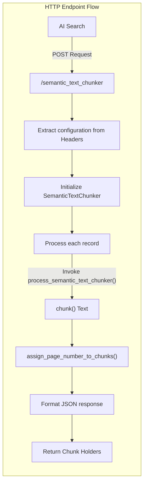

The endpoint accepts JSON payloads in the AI Search custom skill format:

```json
{
  "values": [
    {
      "recordId": "1",
      "data": {
        "content": "The document content to chunk...",
        "page_number_tracking_holders": [
          {"page_content": "First page content", "page_number": 1},
          {"page_content": "Second page content", "page_number": 2}
        ]
      }
    }
  ]
}
```

And returns chunks with preserved semantic relationships and structure:

```json
{
  "values": [
    {
      "recordId": "1",
      "data": {
        "chunks": [
          {
            "mark_up": "Semantically coherent chunk of content...",
            "page_number": 1
          },
          {
            "mark_up": "Another semantically coherent chunk...",
            "page_number": 2
          }
        ]
      }
    }
  ]
}
```

Sources:
- [image_processing/src/image_processing/function_app.py:158-212]()
- [image_processing/src/image_processing/semantic_text_chunker.py:552-608]()

## Conclusion

The Semantic Text Chunking component provides sophisticated document segmentation capabilities that go beyond simple page-based or fixed-length chunking. By preserving semantic relationships and structure, it enables more effective information retrieval and better RAG application performance when dealing with complex documents containing figures, tables, and varied content.

---

