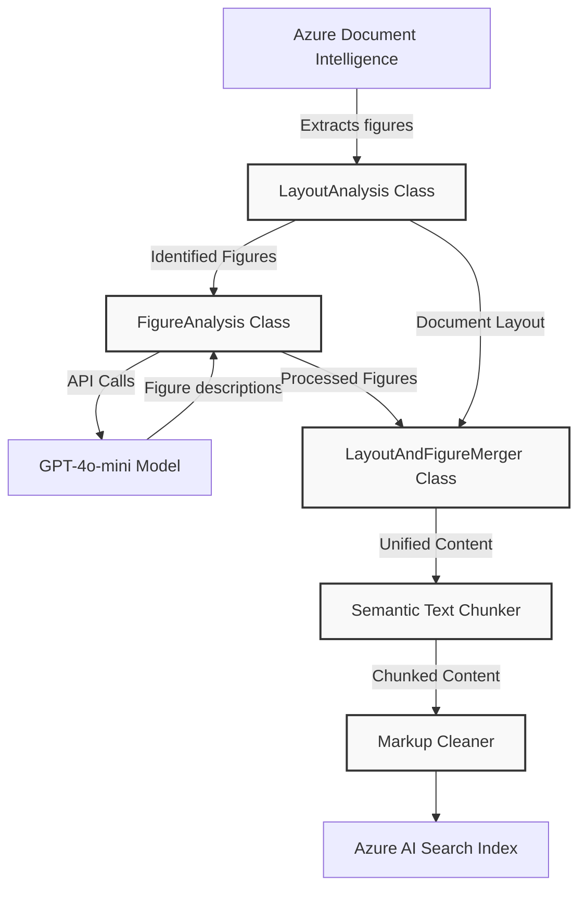
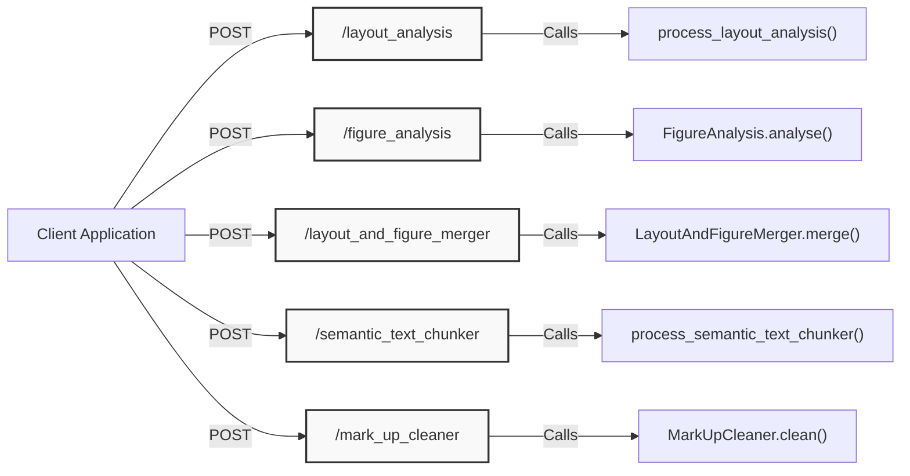
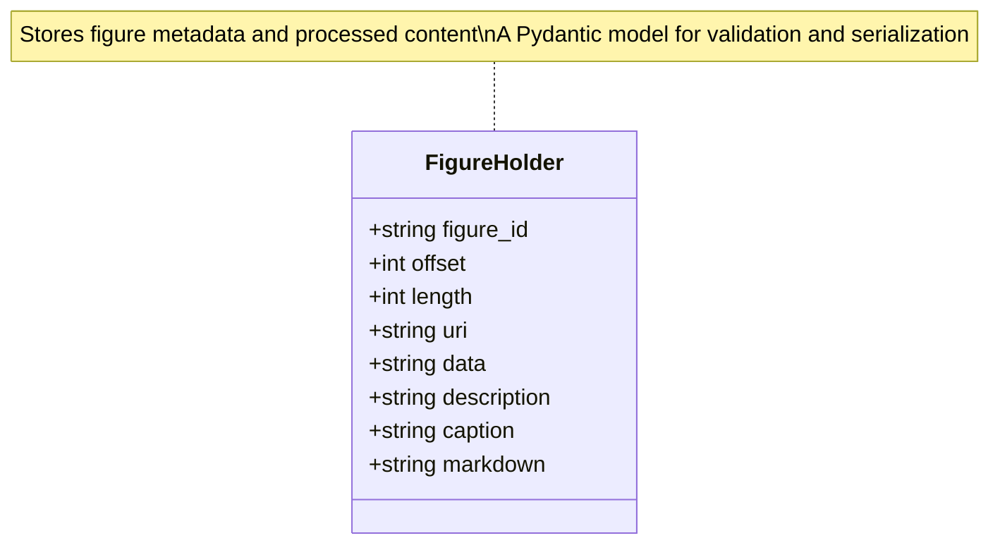
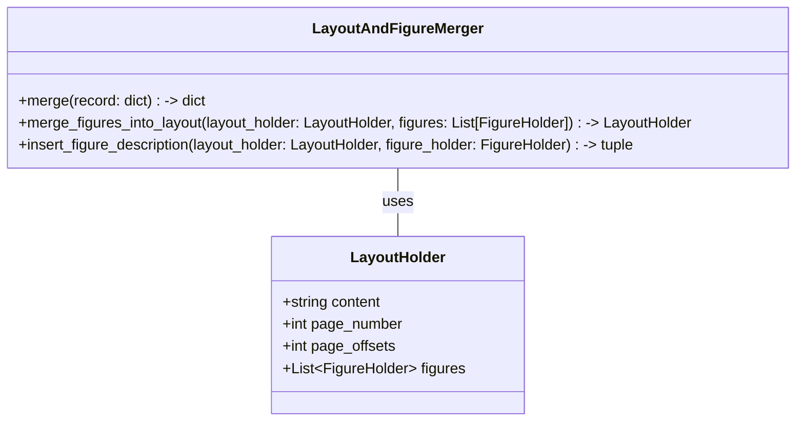
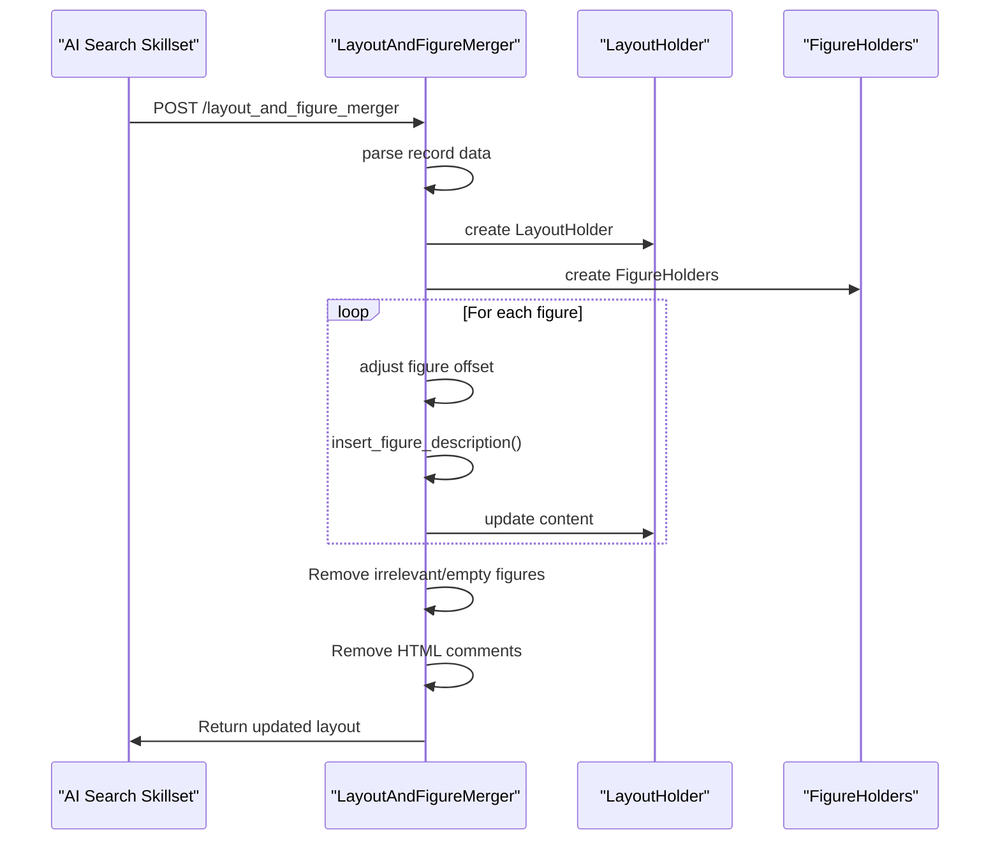
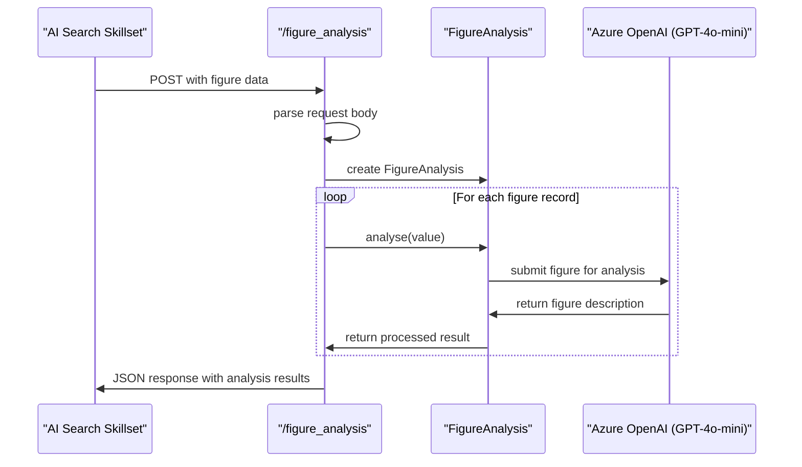
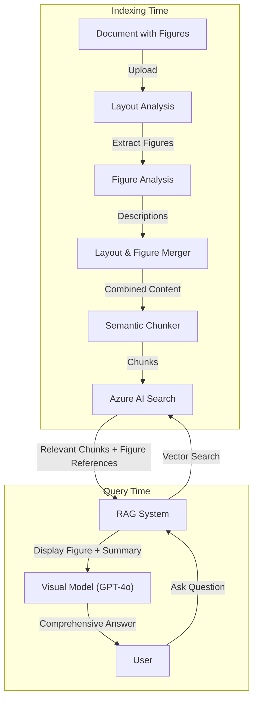

<!-- source: DeepWiki mcp.deepwiki.com · repo microsoft/dstoolkit-text2sql-and-imageprocessing · page 3.3 Figure Analysis and Processing · fetched 2026-10-26 -->

# Figure Analysis and Processing

<details>
<summary>Relevant source files</summary>

The following files were used as context for generating this wiki page:

- [image_processing/README.md](image_processing/README.md)
- [image_processing/images/Image Based RAG.png](image_processing/images/Image Based RAG.png)
- [image_processing/src/image_processing/function_app.py](image_processing/src/image_processing/function_app.py)
- [image_processing/src/image_processing/layout_and_figure_merger.py](image_processing/src/image_processing/layout_and_figure_merger.py)
- [image_processing/src/image_processing/requirements.txt](image_processing/src/image_processing/requirements.txt)
- [image_processing/tests/image_processing/test_figure_app.py](image_processing/tests/image_processing/test_figure_app.py)
- [image_processing/tests/image_processing/test_layout_analysis.py](image_processing/tests/image_processing/test_layout_analysis.py)
- [image_processing/tests/image_processing/test_layout_holders.py](image_processing/tests/image_processing/test_layout_holders.py)
- [image_processing/tests/image_processing/test_semantic_text_chunker.py](image_processing/tests/image_processing/test_semantic_text_chunker.py)

</details>


## Purpose and Scope

This document details the Figure Analysis and Processing component of the Image Processing system, which is responsible for analyzing and understanding figures, charts, and images in documents using multimodal models. This component extracts visual information that would otherwise be lost in traditional text-only processing, making it accessible for retrieval in RAG applications.

For information about the overall Image Processing system architecture, see [Image Processing System](#3). For details on layout analysis, which handles the initial document structure extraction, see [Layout Analysis](#3.1).

Sources: [image_processing/README.md:22-28]()

## Architecture and Workflow

The Figure Analysis component operates within the broader document processing pipeline. After the Layout Analysis component extracts document structure and identifies figures, the Figure Analysis component processes these figures to extract meaningful insights from visual elements.

### Figure Analysis Pipeline



Sources: [image_processing/README.md:10-28](), [image_processing/src/image_processing/function_app.py:56-84]()

### Function App Routes

The Figure Analysis component is implemented as part of an Azure Function App with multiple HTTP endpoints:



Sources: [image_processing/src/image_processing/function_app.py:18-212](), [image_processing/tests/image_processing/test_figure_app.py:8-16]()

## FigureAnalysis Component

The `FigureAnalysis` class is the core component responsible for analyzing figures using the GPT-4o-mini multimodal model. It processes figures extracted during the layout analysis phase.

### Key Features

- Takes figure data extracted by the Layout Analysis component
- Connects to Azure OpenAI to access the GPT-4o-mini multimodal model
- Submits figure images to the model with specialized prompts
- Generates descriptive text and summaries of the visual information
- Formats the analysis into structured figure descriptions that can be indexed and searched

Sources: [image_processing/src/image_processing/function_app.py:56-84](), [image_processing/tests/image_processing/test_figure_app.py:97-120]()

### Figure Extraction Process

1. **Initial Extraction**: Azure Document Intelligence identifies figures in the document during layout analysis
2. **Figure Isolation**: Identified figures are extracted as image data
3. **Storage**: Figures are saved to Azure Blob Storage for later access
4. **Reference Creation**: Each figure gets a unique ID and URI for retrieval

Sources: [image_processing/README.md:25-28](), [image_processing/tests/image_processing/test_layout_analysis.py:243-268]()

## Multimodal Analysis with GPT-4o-mini

The Figure Analysis component leverages GPT-4o-mini's visual understanding capabilities to extract meaning from images, charts, and diagrams.

### Prompt Structure

The prompt is designed to generate comprehensive descriptions of figures with specific focus on:

1. Technical analysis of the figure
2. Overview of what the figure represents
3. Data interpretation for charts and graphs
4. Identification of key elements and relationships
5. Summary of key findings and insights

Importantly, the prompt focuses on generating retrievable descriptions rather than exhaustive details. This approach ensures that:

- Figure information can be found during vector searches
- The full figure can be presented during retrieval for detailed analysis
- The indexed description contains enough context to understand the figure's purpose

Sources: [image_processing/README.md:25-28](), [image_processing/README.md:62-72]()

### Sample Figure Description

Below is an example of how the system processes a figure from a technical document:

```
<!-- FigureContent="**Technical Analysis of Figure 4: Comparison of phi-3-mini, phi-3.5-mini and phi-3.5-MoE on MMLU-Multilingual tasks**

1. **Overview:**
   - The image is a bar chart comparing the performance of three different models—phi-3-mini, phi-3.5-mini, and phi-3.5-MoE—on MMLU-Multilingual tasks across various languages.

2. **Axes:**
   - The x-axis represents the languages in which the tasks were performed. The languages listed are: Arabic, Chinese, Dutch, French, German, Italian, Russian, Spanish, Ukrainian, Vietnamese, and English.
   - The y-axis represents the performance, likely measured in percentage or score, ranging from 0 to 90.

3. **Legend:**
   - The chart uses three different colors to represent the three models:
     - Orange bars represent the phi-3-mini model.
     - Green bars represent the phi-3.5-mini model.
     - Blue bars represent the phi-3.5-MoE model.

4. **Data Interpretation:**
   - Across all languages, the phi-3.5-MoE (blue bars) consistently outperforms the other two models, showing the highest bars.
   - The phi-3.5-mini (green bars) shows better performance than the phi-3-mini (orange bars) in most languages, but not at the level of phi-3.5-MoE.

5. **Language-specific Insights:**
   - **Arabic**: phi-3.5-MoE shows significantly higher performance compared to the other two models, with phi-3.5-mini outperforming phi-3-mini.
   - **Chinese**: A similar trend is observed as in Arabic, with phi-3.5-MoE leading by a wide margin.
   - **Dutch**: Performance is roughly similar between phi-3.5-mini and phi-3.5-MoE, with phi-3.5-MoE being slightly better.
   - **French**: A clear distinction in performance, with phi-3.5-MoE far exceeding the other two.
   - **German**: phi-3.5-MoE leads, followed by phi-3.5-mini, while phi-3-mini lags significantly behind.
   - **Italian**: The performance gap narrows between phi-3.5-mini and phi-3.5-MoE, but the latter is still superior.
   - **Russian**: phi-3.5-MoE shows noticeably higher performance.
   - **Spanish**: The performance trend is consistent with the previous languages, with phi-3.5-MoE leading.
   - **Ukrainian**: A substantial lead by phi-3.5-MoE.
   - **Vietnamese**: An anomaly where all models show closer performance, yet phi-3.5-MoE still leads.
   - **English**: The highest performance is seen in English, with phi-3.5-MoE nearly reaching the maximum score.

6. **Conclusion:**
   - The phi-3.5-MoE model consistently outperforms the phi-3-mini and phi-3.5-mini models across all MMLU-Multilingual tasks.
   - The phi-3.5-mini model shows a general improvement over the phi-3-mini, but the improvement is not as significant as phi-3.5-MoE.

This structured analysis provides a comprehensive understanding of the comparative performance of the mentioned models across multilingual tasks." -->
```

Sources: [image_processing/README.md:62-72]()

## Data Structures and Holders

The Figure Analysis component uses several data structures to handle figures and their processed information:

### FigureHolder Class

`FigureHolder` encapsulates figure metadata and content:



### Key Fields:

- `figure_id`: Unique identifier for the figure
- `offset`: Position in the document where the figure appears
- `length`: Length of the figure content in the document
- `uri`: The URI where the figure image is stored
- `data`: Base64-encoded image data
- `description`: AI-generated description of the figure
- `caption`: Original caption from the document (if available)
- `markdown`: Figure formatted as markdown for insertion into the document

Sources: [image_processing/tests/image_processing/test_layout_holders.py:14-29]()

## LayoutAndFigureMerger Component

After figures are analyzed, the `LayoutAndFigureMerger` class integrates figure descriptions back into the document content.

### Key Methods



Sources: [image_processing/src/image_processing/layout_and_figure_merger.py:10-158]()

### Figure Insertion Process

1. **Position Calculation**: Determines where in the document content to insert figure descriptions
2. **Content Replacement**: Replaces the original figure reference with the enriched figure description
3. **Offset Management**: Adjusts offsets to handle multiple figures
4. **Cleanup**: Removes irrelevant or empty figures and HTML comments

The merger process follows this sequence:



Sources: [image_processing/src/image_processing/layout_and_figure_merger.py:55-118]()

## HTTP Function Interface

The Figure Analysis component exposes an HTTP endpoint for processing figures:

### `/figure_analysis` Endpoint

This endpoint handles figure analysis requests as part of the AI Search skillset:

- **Method**: POST
- **Request Format**: AI Search custom skill format
- **Request Body**: Contains figure data extracted from documents
- **Response**: Analysis results in AI Search compatible format

### Request/Response Flow



Sources: [image_processing/src/image_processing/function_app.py:56-84](), [image_processing/tests/image_processing/test_figure_app.py:97-120]()

## Integration with RAG Applications

The Figure Analysis component enables enhanced RAG capabilities by making visual information available for retrieval:

### Runtime RAG Flow



Sources: [image_processing/README.md:58-62]()

### Key Benefits

1. **Enhanced Information Retrieval**: Makes visual information searchable through text descriptions
2. **Context Preservation**: Maintains the relationship between figures and surrounding text
3. **Multimodal Understanding**: Enables systems to comprehend both textual and visual content
4. **Improved Response Quality**: Provides more comprehensive answers by including visual elements

Sources: [image_processing/README.md:11-15]()

## Production Considerations

When deploying the Figure Analysis component in production environments:

### Performance and Cost

- **File Type Impact**: PDF files produce richer figure detection outputs compared to other formats like PPTX
- **Processing Cost**: Using GPT-4o-mini for figure analysis can be expensive for large document collections
- **Selective Processing**: Consider only processing a subset of documents or figures if cost is a concern

### Optimization Strategies

1. **Filtering**: Process only figures above a certain size or importance threshold
2. **Caching**: Cache analyzed figures to avoid reprocessing
3. **Batch Processing**: Process figures in batches to optimize API calls
4. **Content Targeting**: Focus on documents where visual elements are critical to understanding

Sources: [image_processing/README.md:107-112]()

## Summary

The Figure Analysis and Processing component is a critical part of the Image Processing system that enables RAG applications to understand and retrieve information from visual elements in documents. By leveraging multimodal AI models like GPT-4o-mini, it converts visual information into searchable text descriptions that can be indexed alongside document content. This significantly enhances the quality and comprehensiveness of responses for documents containing charts, diagrams, and other visual elements.

---

