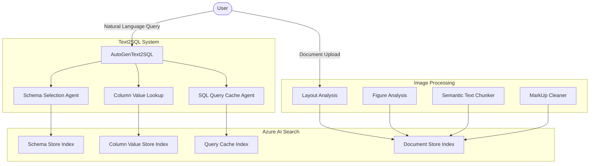
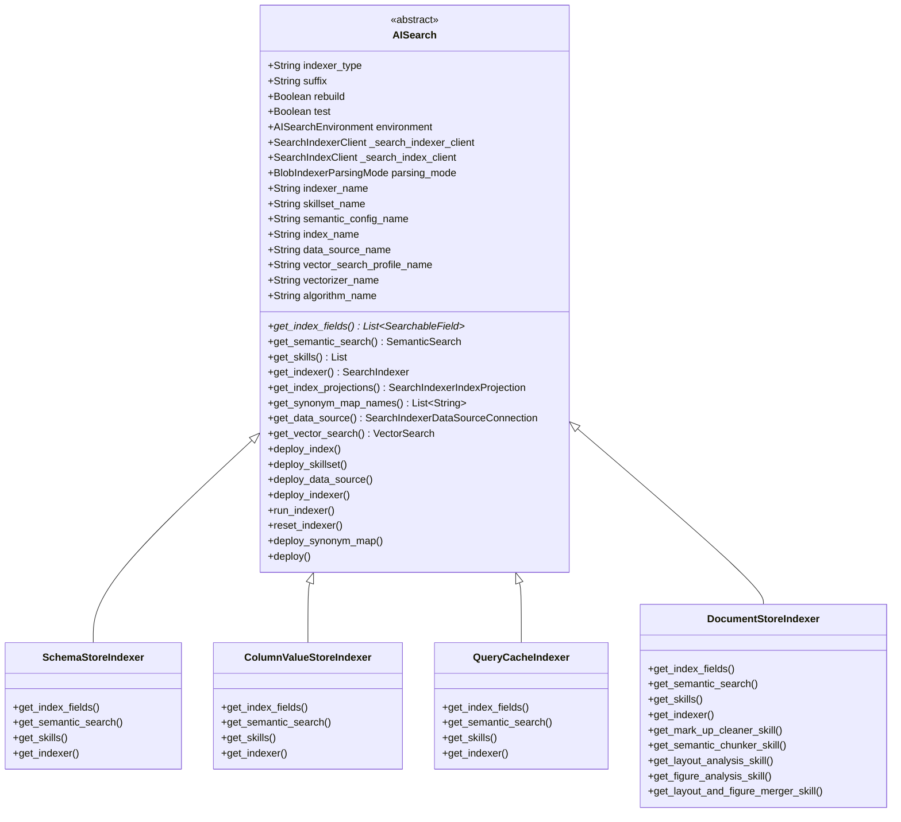
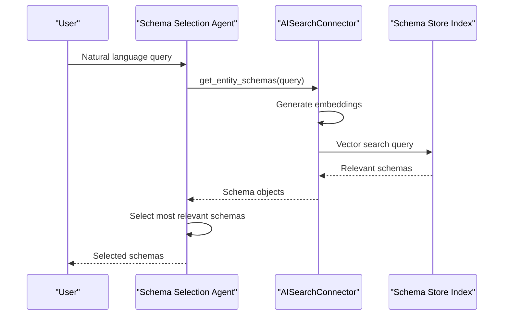
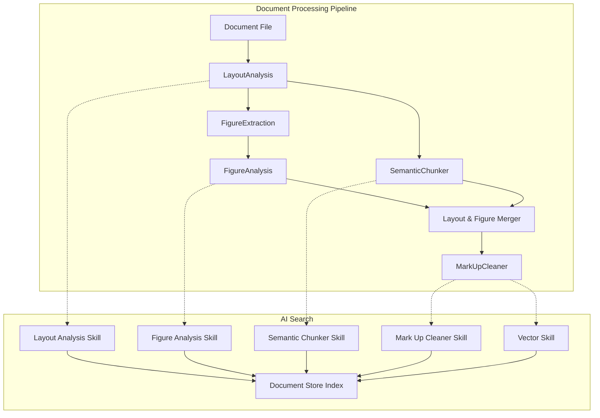
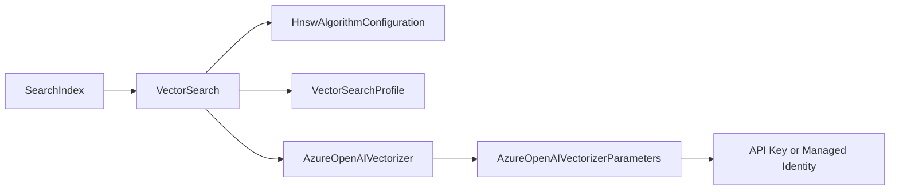

<!-- source: DeepWiki mcp.deepwiki.com · repo microsoft/dstoolkit-text2sql-and-imageprocessing · page 4 AI Search Integration · fetched 2026-10-26 -->

# AI Search Integration

<details>
<summary>Relevant source files</summary>

The following files were used as context for generating this wiki page:

- [deploy_ai_search_indexes/README.md](deploy_ai_search_indexes/README.md)
- [text_2_sql/data_dictionary/README.md](text_2_sql/data_dictionary/README.md)
- [text_2_sql/text_2_sql_core/src/text_2_sql_core/connectors/ai_search.py](text_2_sql/text_2_sql_core/src/text_2_sql_core/connectors/ai_search.py)
- [text_2_sql/text_2_sql_core/src/text_2_sql_core/connectors/open_ai.py](text_2_sql/text_2_sql_core/src/text_2_sql_core/connectors/open_ai.py)
- [text_2_sql/text_2_sql_core/src/text_2_sql_core/data_dictionary/cli.py](text_2_sql/text_2_sql_core/src/text_2_sql_core/data_dictionary/cli.py)

</details>


This document explains how Azure AI Search is integrated as a central component in both the Text-to-SQL and Image Processing systems. Azure AI Search powers semantic retrieval, vector search capabilities, and enables efficient caching across the solution.

For details on deploying AI Search indexes, see [AI Search Index Deployment](#4.1). For information about the Text-to-SQL system, see [Text-to-SQL System](#2).

## Overview

Azure AI Search serves as a critical infrastructure component that enables:

1. Schema selection for Text-to-SQL through semantic matching of user queries to database schemas
2. Query caching to improve performance and reduce costs
3. Column value storage for entity recognition and disambiguation
4. Storage and retrieval of processed documents with semantic chunking and image analysis



Sources:
- [deploy_ai_search_indexes/src/deploy_ai_search_indexes/ai_search.py:34-131]()
- [text_2_sql/text_2_sql_core/src/text_2_sql_core/connectors/ai_search.py:18-33]()

## AI Search Base Class

The system uses an extensible architecture based on the abstract `AISearch` class that provides common functionality for deploying and managing AI Search indexes. This class handles:

- Index creation and updates
- Skillset deployment for processing documents
- Data source configuration
- Indexer management
- Vector search configuration



Sources:
- [deploy_ai_search_indexes/src/deploy_ai_search_indexes/ai_search.py:35-131]()
- [deploy_ai_search_indexes/src/deploy_ai_search_indexes/ai_search.py:642-750]()

## Text-to-SQL AI Search Integration

Azure AI Search powers several critical features in the Text-to-SQL system:

### Schema Selection

The Schema Selection Agent uses AI Search to find the most relevant database tables and views based on the user's natural language query. This process involves:

1. Extracting query intent from natural language
2. Sending a semantic search request to the Schema Store Index
3. Retrieving relevant database objects with their schemas
4. Selecting the appropriate schema for SQL generation



Sources:
- [text_2_sql/text_2_sql_core/src/text_2_sql_core/connectors/ai_search.py:142-232]()

### Column Value Lookups

The system uses Azure AI Search to discover column values and entities in the database that match user queries. This allows:

- Entity disambiguation
- Entity recognition
- Value validation

These lookups are performed through the `get_column_values` method in the `AISearchConnector` class.

Sources:
- [text_2_sql/text_2_sql_core/src/text_2_sql_core/connectors/ai_search.py:107-140]()

### Query Caching

The Query Cache uses AI Search to:

1. Store previously generated SQL queries with their natural language questions
2. Match new questions to similar previously asked questions
3. Retrieve and reuse SQL queries for similar questions

This caching mechanism improves performance and reduces costs by avoiding redundant SQL generation.

Sources:
- [text_2_sql/text_2_sql_core/src/text_2_sql_core/connectors/ai_search.py:234-282]()

## Image Processing AI Search Integration

The Image Processing system uses Azure AI Search to index and retrieve document content with rich semantic understanding and image analysis.

### Document Processing Pipeline

The document processing pipeline consists of several key components integrated with AI Search:

1. **Layout Analysis**: Extracts structure from documents using Azure Document Intelligence
2. **Figure Analysis**: Processes images and diagrams with multimodal AI
3. **Semantic Text Chunking**: Splits content into semantically meaningful chunks
4. **MarkUp Cleaning**: Prepares content for indexing



Sources:
- [deploy_ai_search_indexes/src/deploy_ai_search_indexes/ai_search.py:199-282]()
- [deploy_ai_search_indexes/src/deploy_ai_search_indexes/ai_search.py:354-486]()
- [image_processing/src/image_processing/layout_analysis.py:143-572]()

### Semantic Text Chunking

The `SemanticTextChunker` is a key component for document processing that creates semantically meaningful chunks for optimal retrieval. It:

1. Splits text into sentences
2. Groups tables and figures together
3. Merges semantically similar chunks
4. Assigns page numbers to chunks
5. Prepares content for vector embedding

The chunking process respects document structure while creating optimal-sized chunks for retrieval.


Sources:
- [image_processing/src/image_processing/semantic_text_chunker.py:13-468]()
- [deploy_ai_search_indexes/src/deploy_ai_search_indexes/ai_search.py:284-352]()

## Azure AI Search Queries

The system uses several types of queries to Azure AI Search:

### Vector Search Queries

Vector search uses embeddings to find semantically similar content. This is implemented in the `run_ai_search_query` method of the `AISearchConnector` class:

1. Generate embeddings for the user query
2. Create a `VectorizableTextQuery` with appropriate fields
3. Send the query to Azure AI Search
4. Process and return the results

Vector search is particularly effective for semantic matching of questions to schemas or documents.

### Keyword Search

The system also supports traditional keyword search for exact matching, especially useful for column value lookups where fuzzy matching is needed:

```python
# Example of fuzzy search in get_column_values
text = " ".join([f"{word}~" for word in text.split()])
```

### Authentication Methods

The system supports three authentication methods for Azure AI Search:

1. **API Key**: Using `AzureKeyCredential` with an API key
2. **System-Assigned Managed Identity**: Using `DefaultAzureCredential`
3. **User-Assigned Managed Identity**: Using `DefaultAzureCredential` with a specific identity

The authentication method is determined by the `IdentityType` enum and is handled automatically.

Sources:
- [text_2_sql/text_2_sql_core/src/text_2_sql_core/connectors/ai_search.py:22-105]()
- [text_2_sql/text_2_sql_core/src/text_2_sql_core/connectors/open_ai.py:14-28]()

## AI Search Skillsets

Azure AI Search skillsets are used to process and enrich document content during indexing. The system uses several custom skills:

1. **Layout Analysis Skill**: Extracts document structure using Azure Document Intelligence
2. **Figure Analysis Skill**: Processes images and diagrams
3. **Semantic Chunker Skill**: Splits content into semantically meaningful chunks
4. **Mark Up Cleaner Skill**: Prepares content for indexing
5. **Vector Skill**: Generates embeddings for vector search

These skills are defined as `WebApiSkill` objects for custom skills and `AzureOpenAIEmbeddingSkill` for embedding generation.

| Skill Name | Purpose | Input | Output |
|------------|---------|-------|--------|
| Layout Analysis Skill | Extract document structure | Document source | Layout with text and figures |
| Figure Analysis Skill | Process images and diagrams | Extracted figures | Figure descriptions |
| Semantic Chunker Skill | Split content into chunks | Document content | Semantically coherent chunks |
| Mark Up Cleaner Skill | Clean and prepare content | Chunks with markup | Clean text for indexing |
| Vector Skill | Generate embeddings | Cleaned text | Vector embeddings |

Sources:
- [deploy_ai_search_indexes/src/deploy_ai_search_indexes/ai_search.py:199-596]()

## Vector Search Configuration

Azure AI Search vector search is configured through several components:

1. **Algorithm Configuration**: Configures the HNSW algorithm for approximate nearest neighbor search
2. **Vector Search Profile**: Links the algorithm and vectorizer
3. **Vectorizer**: Configures Azure OpenAI for embedding generation



Sources:
- [deploy_ai_search_indexes/src/deploy_ai_search_indexes/ai_search.py:598-640]()

## Deployment Process

The deployment process for AI Search components follows this sequence:

1. Deploy data source connection
2. Deploy synonym maps (if any)
3. Create or update the search index
4. Deploy skillsets
5. Create or update the indexer
6. Run the indexer to start processing data

This process is encapsulated in the `deploy()` method of the `AISearch` class.

Sources:
- [deploy_ai_search_indexes/src/deploy_ai_search_indexes/ai_search.py:742-750]()

---

