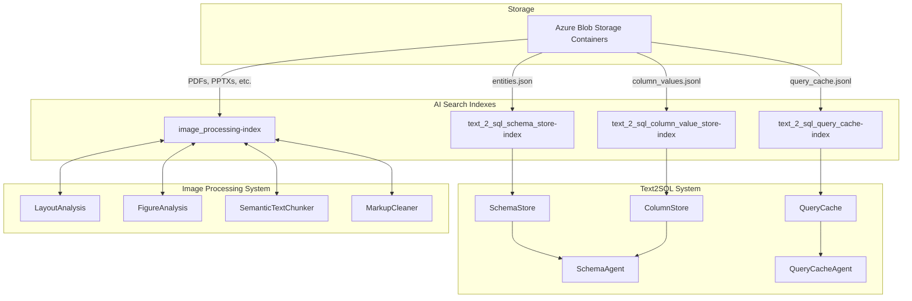
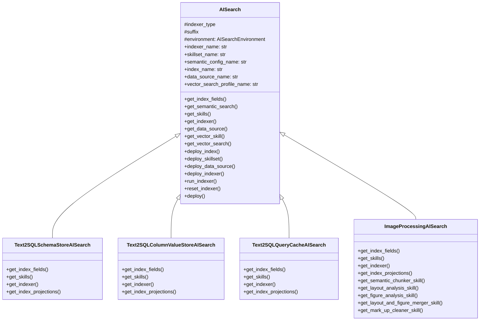
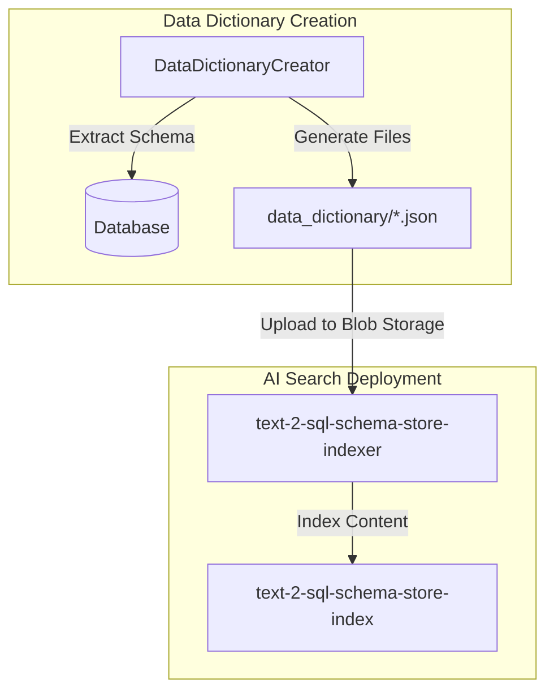
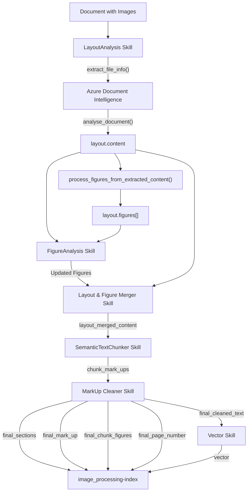
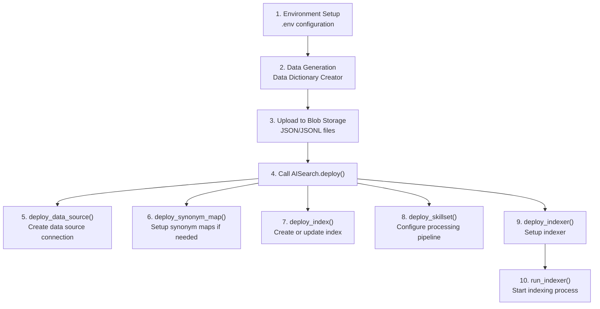
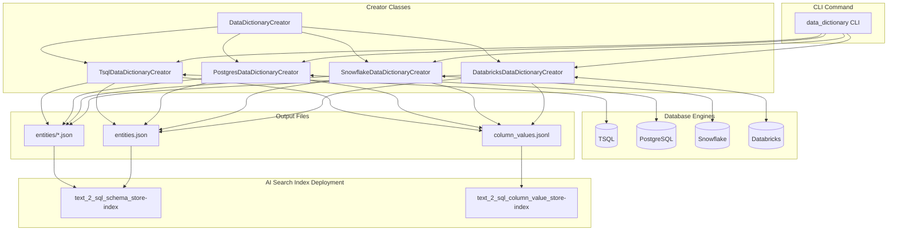

<!-- source: DeepWiki mcp.deepwiki.com · repo microsoft/dstoolkit-text2sql-and-imageprocessing · page 4.1 AI Search Index Deployment · fetched 2026-10-26 -->

# AI Search Index Deployment

<details>
<summary>Relevant source files</summary>

The following files were used as context for generating this wiki page:

- [deploy_ai_search_indexes/README.md](deploy_ai_search_indexes/README.md)
- [deploy_ai_search_indexes/src/deploy_ai_search_indexes/ai_search.py](deploy_ai_search_indexes/src/deploy_ai_search_indexes/ai_search.py)
- [image_processing/src/image_processing/layout_analysis.py](image_processing/src/image_processing/layout_analysis.py)
- [image_processing/src/image_processing/layout_holders.py](image_processing/src/image_processing/layout_holders.py)
- [image_processing/src/image_processing/semantic_text_chunker.py](image_processing/src/image_processing/semantic_text_chunker.py)
- [text_2_sql/data_dictionary/README.md](text_2_sql/data_dictionary/README.md)
- [text_2_sql/text_2_sql_core/src/text_2_sql_core/data_dictionary/cli.py](text_2_sql/text_2_sql_core/src/text_2_sql_core/data_dictionary/cli.py)

</details>


This page documents the process of deploying and configuring Azure AI Search indexes for both the Text-to-SQL and Image Processing systems. These indexes serve as the foundation for metadata retrieval, query caching, and content processing capabilities.

For information about how these indexes are used within the system, see [AI Search Integration](#4).

## Overview and Architecture

The project uses multiple Azure AI Search indexes to support different aspects of the system:

1. **Text-to-SQL Indexes**:
   - Schema Store Index - Contains database schema metadata
   - Column Value Store Index - Contains string values from dimension tables
   - Query Cache Index - Stores previous questions and their SQL queries

2. **Image Processing Index**:
   - Stores processed documents with extracted layout, figures, and semantic chunks

### System Integration Diagram



Sources: [deploy_ai_search_indexes/README.md:1-84](), [text_2_sql/data_dictionary/README.md:1-176](), [image_processing/src/image_processing/semantic_text_chunker.py:13-138](), [image_processing/src/image_processing/layout_analysis.py:143-573]()

## Deployment Infrastructure

All index deployments are built on a common abstraction layer provided by the `AISearch` base class. This class handles the deployment of indexes, skillsets, data sources, and indexers, with specialized subclasses for each index type.

### AI Search Class Hierarchy



The `AISearch` base class provides the core functionality for deploying all components of an AI Search pipeline. Each specialized subclass implements the abstract methods to define the specific fields, skills, and configuration needed for that particular index type.

Sources: [deploy_ai_search_indexes/src/deploy_ai_search_indexes/ai_search.py:35-751]()

## Text-to-SQL Indexes

### Schema Store Index

The Schema Store Index contains metadata about database tables, views, columns, relationships, and definitions. This information powers the LLM's understanding of the database structure.

**Content Example:**
```json
{
    "Entity": "SalesOrderDetail",
    "Definition": null,
    "Schema": "SalesLT",
    "EntityName": null,
    "Database": "text2sql-adventure-works",
    "EntityRelationships": [
        {
            "ForeignEntity": "Product",
            "ForeignSchema": "SalesLT",
            "ForeignKeys": [
                {
                    "Column": "ProductID",
                    "ForeignColumn": "ProductID"
                }
            ],
            "ForeignDatabase": "text2sql-adventure-works",
            "FQN": "text2sql-adventure-works.SalesLT.SalesOrderDetail",
            "ForeignFQN": "text2sql-adventure-works.SalesLT.Product"
        }
    ],
    "CompleteEntityRelationshipsGraph": [
        "text2sql-adventure-works.SalesLT.SalesOrderDetail -> text2sql-adventure-works.SalesLT.Product -> text2sql-adventure-works.SalesLT.ProductCategory -> Product",
        "text2sql-adventure-works.SalesLT.SalesOrderDetail -> text2sql-adventure-works.SalesLT.SalesOrderHeader -> SalesOrderDetail"
    ],
    "Columns": [
        {
            "Name": "SalesOrderID",
            "DataType": "int",
            "Definition": null,
            "SampleValues": [71898, 71831, 71899, 71796, 71946]
        }
    ],
    "FQN": "text2sql-adventure-works.SalesLT.SalesOrderDetail"
}
```

The Schema Store structure has several critical components:
- **EntityName**: A human-readable name for the entity
- **Entity**: The actual table/view name used in SQL queries
- **Definition**: Provides a comprehensive description of what the entity contains
- **Columns**: Contains details about each column including datatype and sample values
- **EntityRelationships**: Maps the immediate relationships to other entities
- **CompleteEntityRelationshipsGraph**: Contains a directed graph of all entity relationships

Sources: [text_2_sql/data_dictionary/README.md:3-175]()

**Deployment Steps:**

1. Generate data dictionary files using the `data_dictionary_creator.py` utility
2. Upload JSON files to the specified Azure Storage container
3. Deploy the Schema Store index and indexer



Sources: [text_2_sql/data_dictionary/README.md:1-176](), [text_2_sql_core/src/text_2_sql_core/data_dictionary/cli.py:1-143](), [deploy_ai_search_indexes/README.md:25-42]()

### Column Value Store Index

The Column Value Store Index contains string values from dimension tables to help the LLM identify and disambiguate entities mentioned in user questions. This avoids having to index large fact tables while still allowing the Text2SQL system to recognize entity values mentioned by users.

**Content Example (JSONL format):**
```json
{"Entity": "Product", "Schema": "SalesLT", "Database": "text2sql-adventure-works", "FQN": "text2sql-adventure-works.SalesLT.Product.ProductNumber", "Column": "ProductNumber", "Value": "WB-H098", "Synonyms": []}
{"Entity": "Product", "Schema": "SalesLT", "Database": "text2sql-adventure-works", "FQN": "text2sql-adventure-works.SalesLT.Product.ProductNumber", "Column": "ProductNumber", "Value": "VE-C304-S", "Synonyms": []}
{"Entity": "Product", "Schema": "SalesLT", "Database": "text2sql-adventure-works", "FQN": "text2sql-adventure-works.SalesLT.Product.ProductNumber", "Column": "ProductNumber", "Value": "VE-C304-M", "Synonyms": []}
```

Each line represents a single column value with its metadata, enabling semantic search over the values when a user refers to them in a question (e.g., "What are the total sales for product VE-C304-S?").

**Deployment Steps:**

1. Generate column value JSONL files using the `data_dictionary_creator.py` utility
2. Upload JSONL files to the specified Azure Storage container
3. Deploy the Column Value Store index and indexer with:
   ```
   uv run deploy.py index_type text_2_sql_column_value_store [--rebuild] [--suffix <suffix>]
   ```

Sources: [text_2_sql/data_dictionary/README.md:177-202](), [deploy_ai_search_indexes/README.md:44-60]()

### Query Cache Index

The Query Cache Index stores previous questions, their corresponding SQL queries, and optionally the results, to improve performance for similar future questions.

**Deployment Steps:**

1. Deploy the Query Cache index using the deployment script
2. Enable the Query Cache indexer if using file-based caching
3. Configure the application to use the Query Cache index

Sources: [deploy_ai_search_indexes/README.md:62-80]()

## Image Processing Index

The Image Processing Index stores processed documents with extracted layout, figures, and semantic chunks. It enables rich document analysis and retrieval for RAG applications.

### Processing Pipeline Architecture



**Key Components:**

1. **Layout Analysis Skill** (`LayoutAnalysis` class):
   - Extracts document structure using Azure Document Intelligence
   - Downloads and processes the source document from blob storage
   - Creates `LayoutHolder` objects with page content and figure metadata
   - Tracks page numbers with `PageNumberTrackingHolder` objects

2. **Figure Analysis Skill**:
   - Processes extracted figures from documents
   - Uses GPT-4o-mini to generate descriptions of visual content
   - Stores figure data in `FigureHolder` objects

3. **Semantic Text Chunker Skill** (`SemanticTextChunker` class):
   - Splits documents into semantically coherent chunks
   - Parameters:
     - `similarity_threshold`: Controls when to split chunks (default: 0.8)
     - `max_chunk_tokens`: Maximum tokens per chunk (default: 500)
     - `min_chunk_tokens`: Minimum tokens per chunk (default: 200)
   - Uses semantic similarity to merge related content
   - Preserves tables, figures, and markdown headings during chunking
   - Creates `ChunkHolder` objects with processed content

4. **MarkUp Cleaner Skill**:
   - Cleans up markup for better indexing and retrieval
   - Processes the final output before embedding

5. **Vector Skill**:
   - Generates embeddings using Azure OpenAI models
   - Creates vector representations for semantic search

**Deployment Steps:**

1. Configure environment settings in `.env` file
2. Deploy the Image Processing index with:
   ```
   uv run deploy.py index_type image_processing [--enable_page_wise_chunking True|False] [--rebuild] [--suffix <suffix>]
   ```
3. Run the indexer to process documents in the source container

Sources: [deploy_ai_search_indexes/README.md:5-22](), [image_processing/src/image_processing/layout_analysis.py:143-614](), [image_processing/src/image_processing/semantic_text_chunker.py:13-138](), [image_processing/src/image_processing/layout_holders.py:8-74]()

## Environment Configuration

All index deployments require proper environment configuration. The main settings are defined in the `.env` file:

| Setting | Description | Example |
|---------|-------------|---------|
| `AIService__AzureSearchOptions__Endpoint` | AI Search endpoint | https://your-search.search.windows.net |
| `AIService__AzureSearchOptions__Key` | AI Search key (if using key auth) | your-key |
| `AIService__AzureSearchOptions__Text2SqlSchemaStore__Index` | Schema store index name | text-2-sql-schema-store-index |
| `AIService__AzureSearchOptions__Text2SqlColumnValueStore__Index` | Column value store index name | text-2-sql-column-value-store-index |
| `AIService__AzureSearchOptions__Text2SqlQueryCache__Index` | Query cache index name | text-2-sql-query-cache-index |
| `OpenAI__Endpoint` | Azure OpenAI endpoint | https://your-openai.openai.azure.com |
| `OpenAI__EmbeddingDeployment` | Azure OpenAI embedding model deployment | text-embedding-ada-002 |
| `StorageAccount__Name` | Storage account name | yourstorageaccount |

Sources: [text_2_sql/.env.example:1-51](), [deploy_ai_search_indexes/README.md:1-84]()

## Deployment Workflow

The deployment process for AI Search indexes follows a structured workflow implemented in the `AISearch.deploy()` method. Each specialized index type extends this workflow with its own implementation details.

### Deployment Process



### Running Deployment Scripts

The deployment scripts are located in the `deploy_ai_search_indexes` directory and can be run for each index type:

```bash
# From the deploy_ai_search_indexes/src/deploy_ai_search_indexes directory
uv run deploy.py index_type <index_type> [options]
```

#### Index Types and Options

| Index Type | Description | Specific Options |
|------------|-------------|------------------|
| `text_2_sql_schema_store` | Deploys the schema store index | `--single_data_dictionary_file` |
| `text_2_sql_column_value_store` | Deploys the column value store index | None |
| `text_2_sql_query_cache` | Deploys the query cache index | `--enable_cache_indexer`, `--single_cache_file` |
| `image_processing` | Deploys the image processing index | `--enable_page_wise_chunking` |

#### Common Options

- `--rebuild`: Delete and rebuild the index completely
- `--suffix <suffix>`: Apply a suffix to the deployed resources for testing purposes
- `--run_indexer`: Automatically run the indexer after deployment

### AISearch Base Implementation

The core deployment logic in `AISearch.deploy()` handles:

1. Connecting to AI Search using the endpoint and credentials from environment
2. Creating or updating the data source configuration
3. Setting up synonym maps if specified
4. Deploying the index with vector search and semantic search capabilities
5. Creating the skillset with all processing steps
6. Configuring and deploying the indexer
7. Optionally running the indexer

Each specialized subclass implements the abstract methods to define the specific fields, skills, and indexer configuration required for that index type.

Sources: [deploy_ai_search_indexes/README.md:1-84](), [deploy_ai_search_indexes/src/deploy_ai_search_indexes/ai_search.py:742-751]()

## Data Dictionary Creator

The system includes a specialized command-line utility to automatically generate data dictionaries for various database engines. These data dictionaries are then uploaded to Azure Storage where they are indexed by the AI Search indexes.

### Data Dictionary Creator Architecture



### Usage

To generate a data dictionary:

1. Configure your database connection in `.env`
2. Run the command from within the `text_2_sql_core` directory:
   ```
   uv run data_dictionary <DATABASE_ENGINE> [OPTIONS]
   ```

   Where `<DATABASE_ENGINE>` is one of:
   - `tsql` - Microsoft SQL Server
   - `postgres` - PostgreSQL
   - `snowflake` - Snowflake
   - `databricks` - Databricks

   Available options:
   - `--output-directory` or `-o`: Optional directory for output files
   - `--single_file` or `-s`: Write all schemas to a single file
   - `--generate_definitions` or `-gen`: Use OpenAI to generate descriptions

3. Upload the generated files to Azure Storage containers:
   - Upload `entities.json` (or the individual entity JSON files) to the schema store blob container
   - Upload `column_values.jsonl` to the column value store blob container

The data dictionary creator will extract schema information, table/column definitions, relationships, and sample data to create comprehensive metadata files that power the Text2SQL system.

Sources: [text_2_sql/data_dictionary/README.md:206-246](), [text_2_sql_core/src/text_2_sql_core/data_dictionary/cli.py:16-139]()

## References

The AI Search indexes are referenced by the following components:

1. **Text-to-SQL System**: Uses the Schema Store, Column Value Store, and Query Cache indexes
2. **Image Processing System**: Uses the Image Processing index for document analysis

For more details on how these systems utilize the indexes, see [Text-to-SQL System](#2) and [Image Processing System](#3).

---

