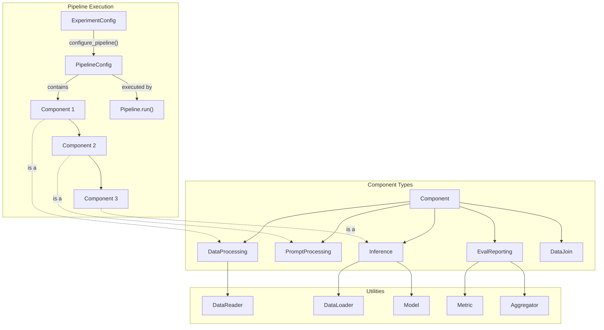
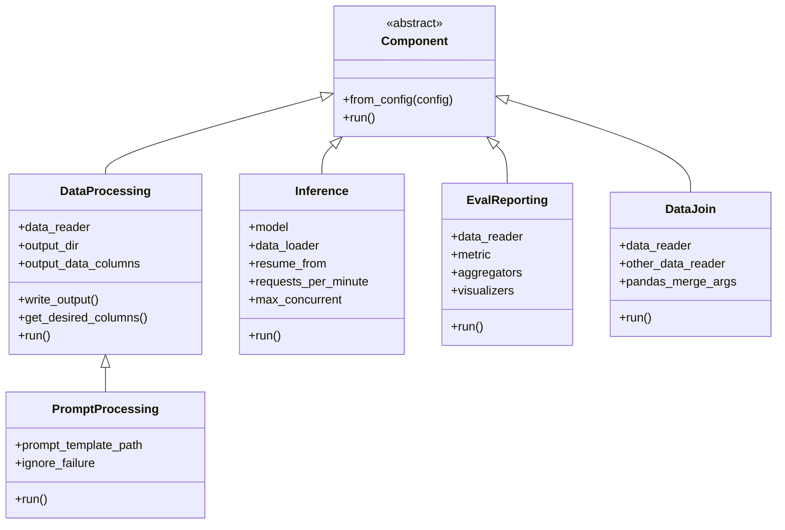
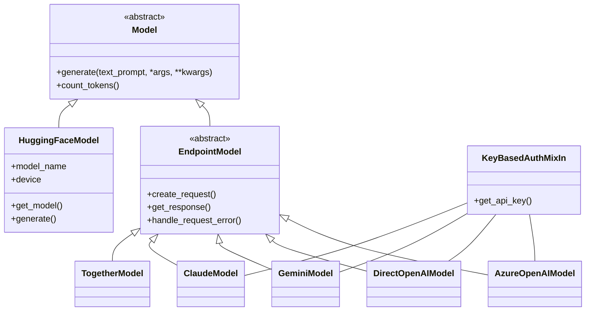
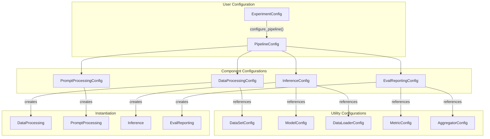

<!-- source: DeepWiki mcp.deepwiki.com · repo microsoft/eureka-ml-insights · page 1 Overview · fetched 2026-10-26 -->

# Overview

<details>
<summary>Relevant source files</summary>

The following files were used as context for generating this wiki page:

- [.github/workflows/eureka-tests.yml](.github/workflows/eureka-tests.yml)
- [README.md](README.md)
- [docs/figures/eureka_logo.png](docs/figures/eureka_logo.png)
- [environment.yml](environment.yml)
- [environment_gpu.yml](environment_gpu.yml)
- [eureka_ml_insights/core/data_processing.py](eureka_ml_insights/core/data_processing.py)
- [eureka_ml_insights/metrics/ifeval_instruction_utils.py](eureka_ml_insights/metrics/ifeval_instruction_utils.py)
- [setup.py](setup.py)
- [tests/component_tests.py](tests/component_tests.py)

</details>


Eureka ML Insights is a comprehensive framework designed for evaluating machine learning models, particularly Large Language Models (LLMs), across various benchmarks in a systematic and reproducible manner. This page provides a high-level understanding of the framework's purpose, architecture, and capabilities.

## Purpose and Scope

Eureka ML Insights helps researchers and practitioners:

- Run reproducible evaluations of generative models using a variety of benchmarks and metrics efficiently
- Define custom pipelines for data processing, inference, and evaluation
- Leverage pre-defined evaluation pipelines for key benchmarks
- Evaluate multimodal models (text, image, vision-language)
- Compare multiple models across standardized tasks

For specific details about the system implementation, see [Architecture](#2).

## Core Architecture



Sources: [README.md:96-116](), [eureka_ml_insights/core/data_processing.py:22-75]()

The framework is built around a pipeline-component architecture that allows flexible composition of evaluation workflows. The main execution flow begins with an experiment configuration that defines a pipeline of components, each handling a specific part of the evaluation process.

## Component System



Sources: [tests/component_tests.py:32-267](), [README.md:101-124]()

The component system forms the backbone of the evaluation framework, with each component serving a specific purpose:

- **DataProcessing**: Loads and processes input data
- **PromptProcessing**: Prepares data for model inference, often applying prompt templates
- **Inference**: Runs models on processed data
- **EvalReporting**: Evaluates model outputs and generates reports
- **DataJoin**: Joins data from multiple sources

## Model System



Sources: [setup.py:15-44](), [README.md:115]()

The model system provides a unified interface for accessing different types of language models:

- Abstract `Model` class defines the common interface
- Support for API-based models (OpenAI, Claude, Gemini)
- Support for locally-hosted models via Hugging Face
- Authentication handling via mixins

## Configuration System



Sources: [tests/component_tests.py:32-49](), [README.md:85-91]()

The configuration system uses a hierarchical approach:

- **ExperimentConfig**: Top-level configuration that defines a pipeline
- **Component Configs**: Configure individual pipeline components
- **Utility Configs**: Configuration for utility classes used by components

## Benchmark Suite

Eureka ML Insights includes pre-configured pipelines for several benchmarks:

| Benchmark | Modality | Capability | Pipeline Config |
|-----------|----------|------------|----------------|
| GeoMeter | Image -> Text | Geometric Reasoning | `geometer.py` |
| MMMU | Image -> Text | Multimodal QA | `mmmu.py` |
| Image Understanding | Image -> Text | Object Recognition, Detection | Various configs |
| Vision Language | Image -> Text | Spatial Understanding | Various configs |
| IFEval | Text -> Text | Instruction Following | `ifeval.py` |
| FlenQA | Text -> Text | Long Context Multi-hop QA | `flenqa.py` |
| Kitab | Text -> Text | Information Retrieval | `kitab.py` |
| ToxiGen | Text -> Text | Toxicity Detection | `toxigen.py` |

Sources: [README.md:40-57](), [eureka_ml_insights/metrics/ifeval_instruction_utils.py:20-3404]()

## Getting Started

To use Eureka ML Insights, you typically:

1. Choose or define an experiment configuration
2. Select a model configuration
3. Run the evaluation pipeline
4. Analyze the results

Basic usage:

```bash
python main.py --exp_config <experiment_config> --model_config <model_config> --exp_logdir <output_directory>
```

Example:

```bash
python main.py --exp_config FlenQA_Experiment_Pipeline --model_config OAI_GPT4_1106_PREVIEW_CONFIG --exp_logdir gpt4_flenqa
```

Sources: [README.md:84-94](), [README.md:58-83]()

## Installation

Eureka ML Insights can be installed in several ways:

### Using pip (for development)

```bash
python3 -m venv .venv
# Activate venv
pip install -e .
```

### Using pip (from wheel package)

```bash
pip install eureka_ml_insights.whl
```

### Using Conda

```bash
conda env create --name myenv --file environment.yml
conda activate myenv
# Optional for GPU support
conda env update --file environment_gpu.yml
```

Sources: [README.md:58-82](), [environment.yml:1-490](), [environment_gpu.yml:1-14]()

## Key Features

- **Modular Design**: Components can be independently configured and combined
- **Comprehensive Model Support**: API-based and self-hosted models
- **Flexible Data Processing**: Various data sources and formats
- **Rich Evaluation Capabilities**: Extensive metrics and aggregators
- **Extensive Benchmark Suite**: Pre-configured for many tasks
- **Parallel Inference**: Support for concurrent model requests
- **Resumable Operations**: Continue interrupted evaluations

Sources: [README.md:19-18](), [tests/component_tests.py:191-232]()

Eureka ML Insights provides a systematic way to evaluate machine learning models across a diverse set of tasks, with particular focus on LLMs and multimodal models. Its modular architecture allows for flexibility and extensibility, enabling researchers to create custom evaluation pipelines tailored to their specific needs.

---

