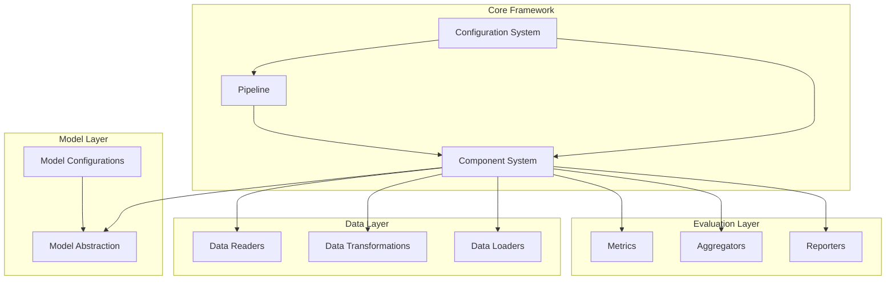
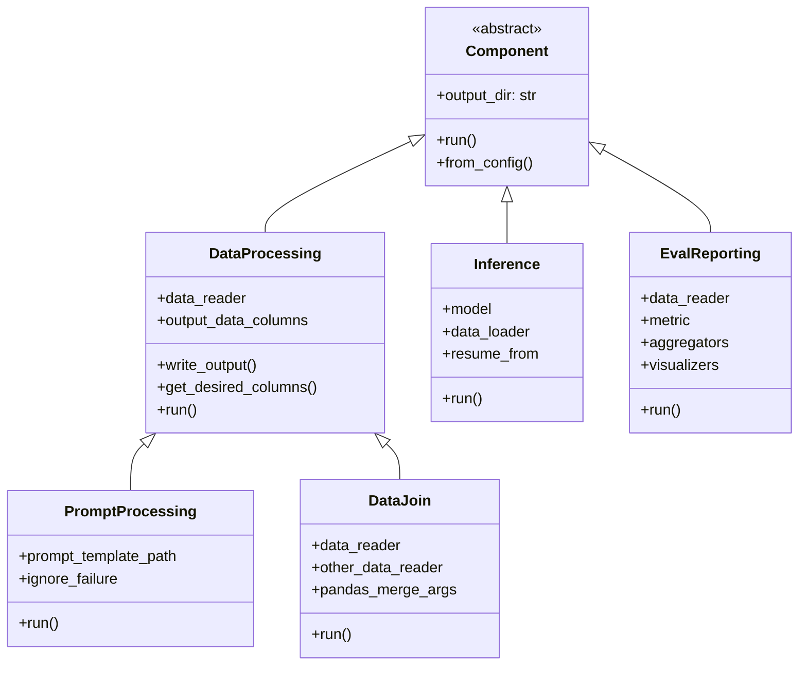
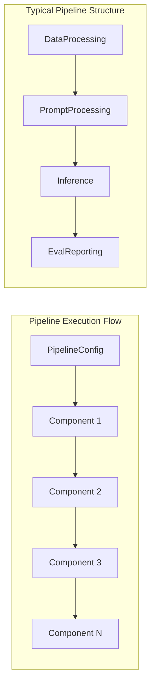
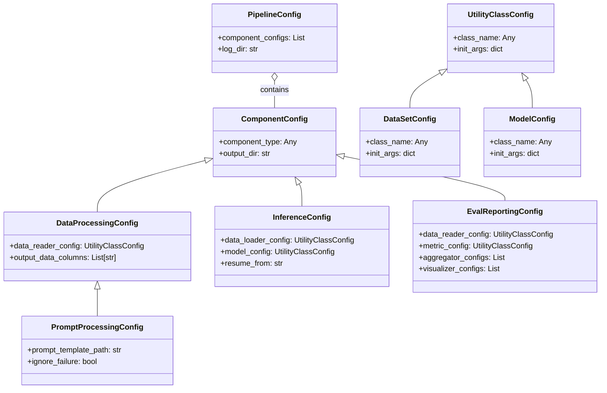
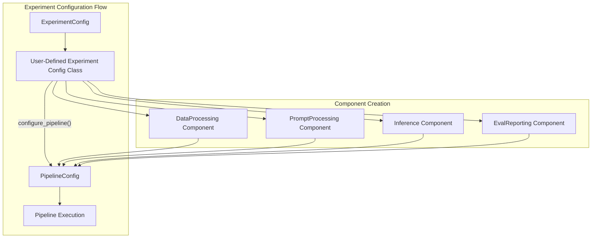
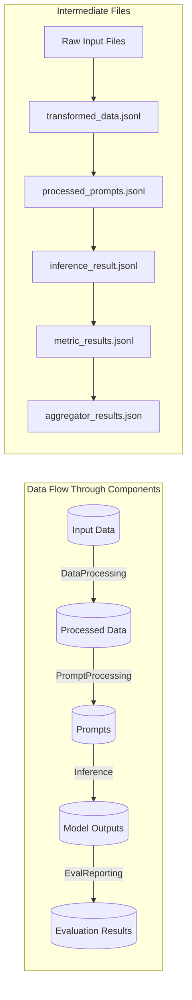
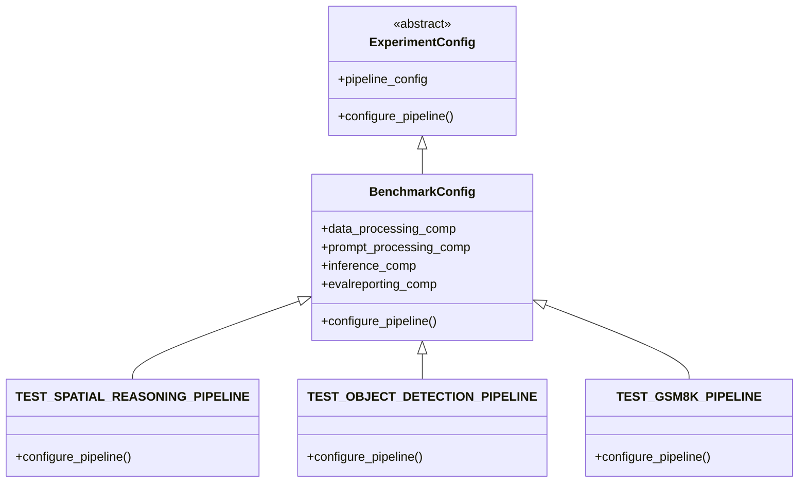

<!-- source: DeepWiki mcp.deepwiki.com · repo microsoft/eureka-ml-insights · page 2 Architecture · fetched 2026-10-26 -->

# Architecture

Relevant source files

The following files were used as context for generating this wiki page:

- [.github/workflows/eureka-tests.yml](.github/workflows/eureka-tests.yml)
- [.gitignore](.gitignore)
- [README.md](README.md)
- [docs/figures/eureka_logo.png](docs/figures/eureka_logo.png)
- [eureka_ml_insights/configs/config.py](eureka_ml_insights/configs/config.py)
- [eureka_ml_insights/core/data_processing.py](eureka_ml_insights/core/data_processing.py)
- [eureka_ml_insights/metrics/ifeval_instruction_utils.py](eureka_ml_insights/metrics/ifeval_instruction_utils.py)
- [tests/component_tests.py](tests/component_tests.py)
- [tests/pipeline_tests.py](tests/pipeline_tests.py)

## Purpose and Scope

This document describes the high-level architecture of the Eureka ML Insights framework, designed for evaluating machine learning models, particularly Large Language Models (LLMs), across various benchmarks. It explains the main components of the system, their relationships, and the design principles behind them.

For detailed information about specific subsystems, please refer to:
- For Pipeline System details, see [Pipeline System](#2.1)
- For Configuration System details, see [Configuration System](#2.2)
- For Model System details, see [Model System](#3)
- For Data Processing details, see [Data Processing](#4)

## High-Level Architecture Overview

Eureka ML Insights is built on a modular, component-based architecture that enables flexible evaluation pipeline construction. The architecture consists of several key systems that work together to create, configure, and execute evaluation pipelines.

Sources: [README.md:17-20]()

## Component System

The component system is the backbone of the framework, enabling modular and composable evaluation pipelines. Each component encapsulates a specific functionality in the evaluation process, and components can be chained together to create complete evaluation pipelines.

Sources: [README.md:100-113](), [eureka_ml_insights/core/data_processing.py:15-75](), [tests/component_tests.py:1-50]()

### Component Types

Eureka ML Insights defines several types of components, each serving a specific function in the evaluation process:

1. **DataProcessing**: Handles data loading and transformation.
2. **PromptProcessing**: Extends DataProcessing with capabilities for preparing prompts for model inference.
3. **Inference**: Manages model inference on processed data.
4. **EvalReporting**: Evaluates model outputs using metrics and generates reports.
5. **DataJoin**: Joins data from multiple sources.

Each component is configurable through a corresponding configuration class.

Sources: [README.md:100-113]()

## Pipeline Architecture

The Pipeline is the orchestration layer that connects components together and manages their execution. It takes a list of component configurations and executes them in sequence, passing data between components.

Sources: [tests/pipeline_tests.py:1-48](), [README.md:94-99]()

### Pipeline Flow

1. The pipeline receives a list of component configurations.
2. It instantiates each component using its configuration.
3. It executes each component in sequence.
4. Each component produces output that can be consumed by the next component.
5. Results are stored in component-specific output directories.

Sources: [tests/pipeline_tests.py:380-406]()

## Configuration System

The configuration system provides a structured way to define the behavior of components and pipelines. It uses a hierarchy of configuration classes that correspond to different aspects of the system.

Sources: [eureka_ml_insights/configs/config.py:1-154]()

### Configuration Hierarchy

The configuration system consists of two main types of configurations:

1. **Utility Class Configurations**: Configure standalone utility classes like models, metrics, or data readers.
   - `UtilityClassConfig`: Base class for utility configurations
   - `DataSetConfig`: For data readers and loaders
   - `ModelConfig`: For model configurations
   - `MetricConfig`: For metric configurations

2. **Component Configurations**: Configure components within a pipeline.
   - `ComponentConfig`: Base class for component configurations
   - `DataProcessingConfig`: For data processing components
   - `PromptProcessingConfig`: For prompt processing components
   - `InferenceConfig`: For inference components
   - `EvalReportingConfig`: For evaluation and reporting components

3. **Pipeline Configuration**: Combines multiple component configurations.
   - `PipelineConfig`: Contains a list of component configurations and specifies the output directory for logs

Sources: [eureka_ml_insights/configs/config.py:10-154]()

## Experiment Configuration and Pipeline Creation

Experiment configurations are user-defined classes that encapsulate the logic for creating pipeline configurations for specific benchmark evaluations. These classes inherit from `ExperimentConfig` and implement a `configure_pipeline` method.

Sources: [tests/pipeline_tests.py:65-376](), [README.md:94-99]()

### Creating Custom Evaluations

Users can define custom evaluation pipelines by:

1. Creating a class that inherits from `ExperimentConfig`
2. Implementing the `configure_pipeline` method to define components and their configurations
3. Connecting components in the desired order
4. Configuring each component with appropriate utility classes and parameters

The resulting pipeline can then be executed to perform the evaluation.

Sources: [tests/pipeline_tests.py:65-115](), [README.md:94-99]()

## Data Flow

The data flow in Eureka ML Insights follows a well-defined path through various components:

Sources: [eureka_ml_insights/core/data_processing.py:50-58](), [tests/component_tests.py:50-100](), [tests/pipeline_tests.py:390-406]()

### Data Processing Flow

1. **Data Reading**: Input data is loaded using a `DataReader` configured through `DataReaderConfig`.
2. **Data Transformation**: Loaded data can be transformed using various transformation classes.
3. **Prompt Generation**: If using `PromptProcessing`, prompts are generated according to templates.
4. **Model Inference**: The `Inference` component uses a model to generate outputs for the prompts.
5. **Evaluation**: The `EvalReporting` component applies metrics to the model outputs and generates reports.

Each step outputs files that can be consumed by the next step:
- `transformed_data.jsonl`: Output of data processing
- `processed_prompts.jsonl`: Output of prompt processing
- `inference_result.jsonl`: Output of inference
- `metric_results.jsonl`: Output of metric evaluation
- Various aggregator and visualizer outputs

Sources: [eureka_ml_insights/core/data_processing.py:50-75](), [tests/pipeline_tests.py:390-406]()

## Implementation of User Configurations

User configurations define specific benchmarks or evaluation scenarios. They create and configure the pipeline components needed for a specific evaluation task.

Sources: [tests/pipeline_tests.py:65-376](), [README.md:31-65]()

### Example User Configuration

The test pipeline configurations in `tests/pipeline_tests.py` demonstrate how to create custom evaluation pipelines for different benchmarks, such as spatial reasoning, object detection, and mathematical reasoning. These configurations:

1. Define the necessary components for the evaluation
2. Configure data readers and loaders
3. Specify models to use
4. Define evaluation metrics and reporting

Users can create similar configurations for their own evaluation needs.

Sources: [tests/pipeline_tests.py:65-188](), [README.md:88-125]()

## Conclusion

The Eureka ML Insights architecture provides a flexible, modular framework for evaluating machine learning models. Its key features include:

1. **Component-Based Design**: Enables modular, reusable evaluation components
2. **Configuration System**: Provides a structured way to define component behavior
3. **Pipeline Architecture**: Facilitates the connection of components into coherent evaluation flows
4. **Extensibility**: Allows users to define custom evaluation scenarios

This architecture makes it easy to create reproducible, systematic evaluations of machine learning models across a wide range of benchmarks.

---

