<!-- source: DeepWiki mcp.deepwiki.com · repo microsoft/eureka-ml-insights · page 2.1 Pipeline System · fetched 2026-10-26 -->

# Pipeline System

<details>
<summary>Relevant source files</summary>

The following files were used as context for generating this wiki page:

- [.github/workflows/eureka-tests.yml](.github/workflows/eureka-tests.yml)
- [README.md](README.md)
- [docs/figures/eureka_logo.png](docs/figures/eureka_logo.png)
- [eureka_ml_insights/core/data_processing.py](eureka_ml_insights/core/data_processing.py)
- [eureka_ml_insights/metrics/ifeval_instruction_utils.py](eureka_ml_insights/metrics/ifeval_instruction_utils.py)
- [tests/component_tests.py](tests/component_tests.py)
- [tests/pipeline_tests.py](tests/pipeline_tests.py)

</details>


The Pipeline System is the core orchestration framework in Eureka ML Insights that manages the execution flow of evaluation tasks. It provides a structured way to chain together modular components that handle different aspects of model evaluation, from data loading and transformation to model inference and result evaluation. This page documents the design, implementation, and usage of the Pipeline System.

For information about the specific components that can be used within a pipeline, see [Architecture](#2). For details on how pipelines are configured, see [Configuration System](#2.2).

## Overview

The Pipeline System in Eureka ML Insights enables the composition of complex evaluation workflows by connecting specialized components in a sequential chain. Each component in the pipeline performs a specific function (such as data processing or model inference) and passes its output to subsequent components. This modular design allows users to create evaluation pipelines tailored to specific benchmarks or testing scenarios.

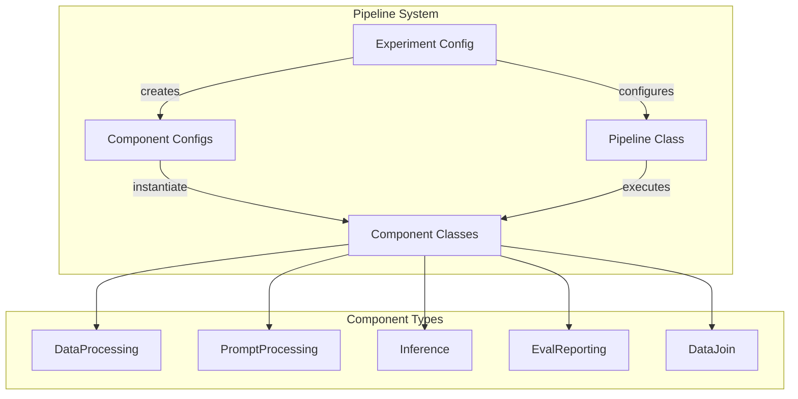

Sources: [README.md:96-107](), [tests/pipeline_tests.py:382-386]()

## Pipeline Architecture

The Pipeline System follows a component-based architecture where each component is responsible for a specific stage in the evaluation process. Components are executed sequentially, with the output of one component serving as input for the next.

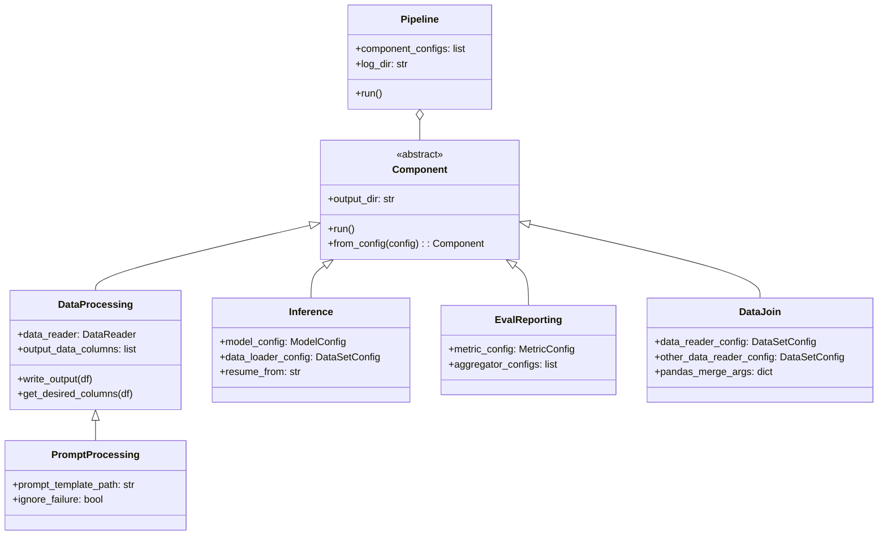

Sources: [eureka_ml_insights/core/data_processing.py:23-75](), [README.md:100-107](), [tests/component_tests.py:32-266]()

## Pipeline Execution Flow

The Pipeline class orchestrates the execution of components in sequence. When the pipeline is run, each component processes data and produces output that serves as input for the next component.

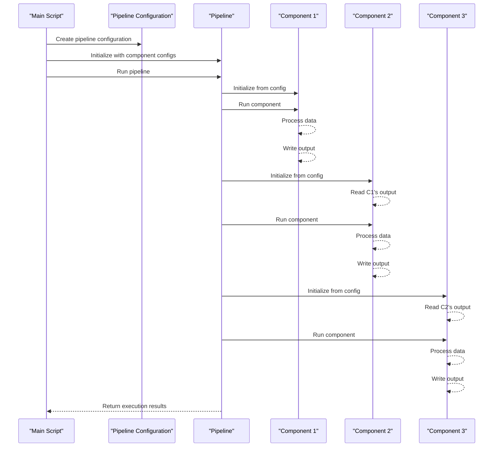

Sources: [tests/pipeline_tests.py:379-386](), [README.md:84-92]()

## Component Types

The Pipeline System includes several component types, each designed for a specific stage in the evaluation process:

### DataProcessing Component

The `DataProcessing` component is responsible for loading data from a source and applying transformations. It reads data using a configured `DataReader`, applies optional transformations, and writes the processed data to an output directory.

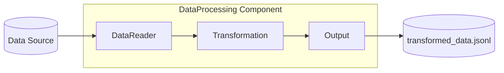

Sources: [eureka_ml_insights/core/data_processing.py:23-75](), [README.md:124-130]()

### PromptProcessing Component

The `PromptProcessing` component extends the DataProcessing component and adds the ability to apply prompt templates to data. It can use a Jinja template to format data for model inference.

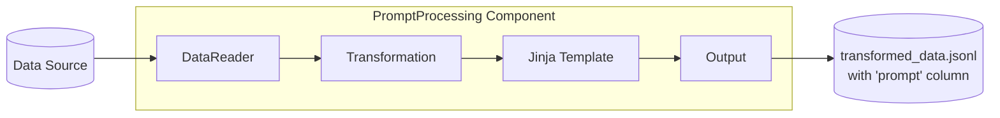

Sources: [README.md:134-137]()

### Inference Component

The `Inference` component runs model inference on processed data. It loads data using a configured `DataLoader`, passes it to a model, and collects the model outputs.

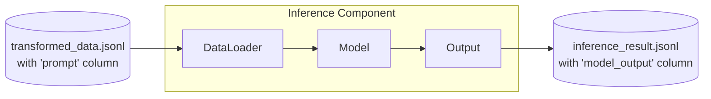

Sources: [README.md:140-142]()

### EvalReporting Component

The `EvalReporting` component evaluates model outputs using metrics and generates reports. It applies configured metrics to the model outputs and uses aggregators to summarize results.

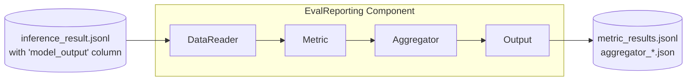

Sources: [README.md:144-147]()

### DataJoin Component

The `DataJoin` component combines data from multiple sources. It merges data from two sources using pandas' merge operations.

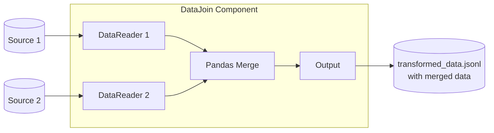

Sources: [README.md:107](), [tests/component_tests.py:103-147]()

## Configuring a Pipeline

Pipelines are configured using a series of configuration objects that specify the components, their parameters, and how they're connected. The configuration approach follows a hierarchy:

1. **ExperimentConfig**: Top-level configuration that defines a complete experiment
2. **PipelineConfig**: Configuration for a specific pipeline
3. **Component Configs**: Configurations for individual components (DataProcessingConfig, InferenceConfig, etc.)

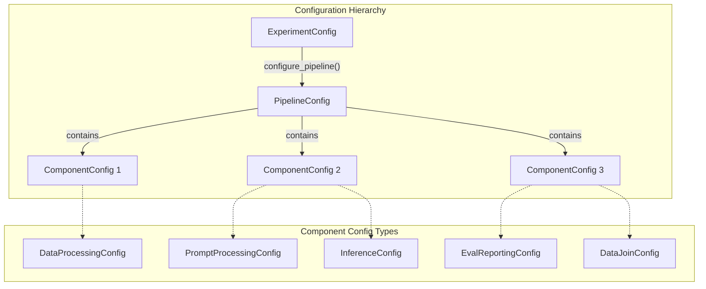

Sources: [README.md:96-99](), [tests/pipeline_tests.py:68-79]()

## Creating Custom Pipelines

To create a custom pipeline, you can define a class that inherits from `ExperimentConfig` and implements the `configure_pipeline` method. This method should return a `PipelineConfig` object that contains configurations for all the components in your pipeline.

The following example shows a simplified version of how a pipeline configuration might be defined:

```python
class MyExperimentPipeline(ExperimentConfig):
    def configure_pipeline(self, model_config=None):
        # Configure a data processing component
        self.data_processing_comp = DataProcessingConfig(
            component_type=DataProcessing,
            data_reader_config=DataSetConfig(...),
            output_dir="data_processing_output"
        )
        
        # Configure an inference component
        self.inference_comp = InferenceConfig(
            component_type=Inference,
            model_config=model_config,
            data_loader_config=DataSetConfig(...),
            output_dir="inference_output"
        )
        
        # Configure an evaluation component
        self.eval_reporting_comp = EvalReportingConfig(
            component_type=EvalReporting,
            data_reader_config=DataSetConfig(...),
            metric_config=MetricConfig(...),
            aggregator_configs=[...],
            output_dir="eval_output"
        )
        
        # Create and return the pipeline configuration
        return PipelineConfig(
            component_configs=[
                self.data_processing_comp,
                self.inference_comp,
                self.eval_reporting_comp
            ],
            log_dir="logs/my_experiment"
        )
```

Sources: [tests/pipeline_tests.py:68-210](), [README.md:97-99]()

## Running a Pipeline

Once a pipeline is configured, it can be executed using the `Pipeline` class. The pipeline will run each component in sequence, passing the output of one component as input to the next.

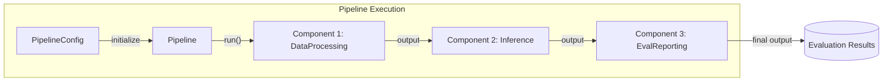

Sources: [tests/pipeline_tests.py:383-386](), [README.md:84-92]()

## Data Flow Between Components

Components in a pipeline communicate by writing and reading files. Each component writes its output to its designated output directory, and subsequent components read from these directories. This file-based communication mechanism ensures that the state of the pipeline execution is persistent and can be resumed if interrupted.

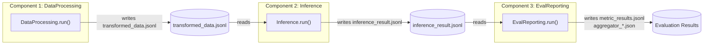

Sources: [eureka_ml_insights/core/data_processing.py:50-58](), [tests/pipeline_tests.py:390-405]()

## Extending the Pipeline System

The Pipeline System is designed to be extensible. New component types can be added by creating new classes that inherit from the `Component` base class and implement the `run` method. Similarly, new configurations can be created by extending the configuration classes.

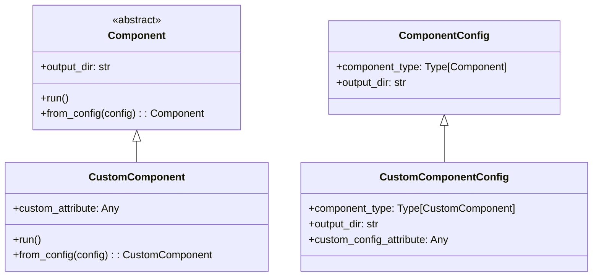

Sources: [README.md:149-152]()

## Summary

The Pipeline System is a core part of the Eureka ML Insights framework that enables the creation of modular, configurable evaluation pipelines. By chaining together specialized components, users can create complex evaluation workflows that are easy to understand, maintain, and extend.

The key features of the Pipeline System include:

1. **Modularity**: Each component focuses on a specific task, making the system easier to understand and extend.
2. **Configurability**: Components and pipelines can be configured to suit different evaluation scenarios.
3. **File-based communication**: Components communicate through files, ensuring persistence and allowing for pipeline resumption.
4. **Extensibility**: New components and configurations can be added to extend the system's capabilities.

For information on how to configure specific components for your evaluation scenarios, see [Configuration System](#2.2).

---

