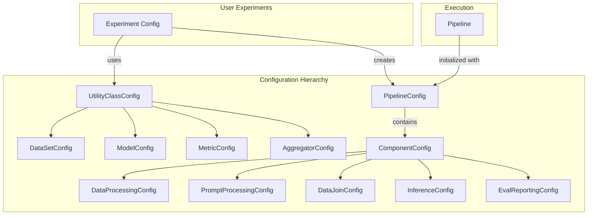
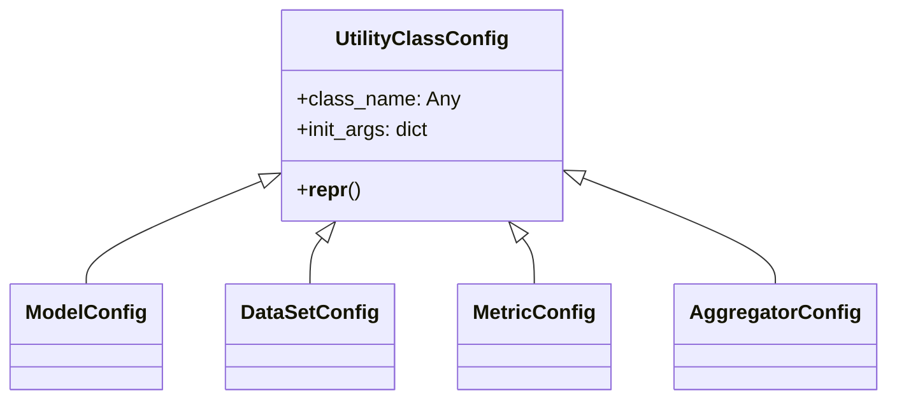
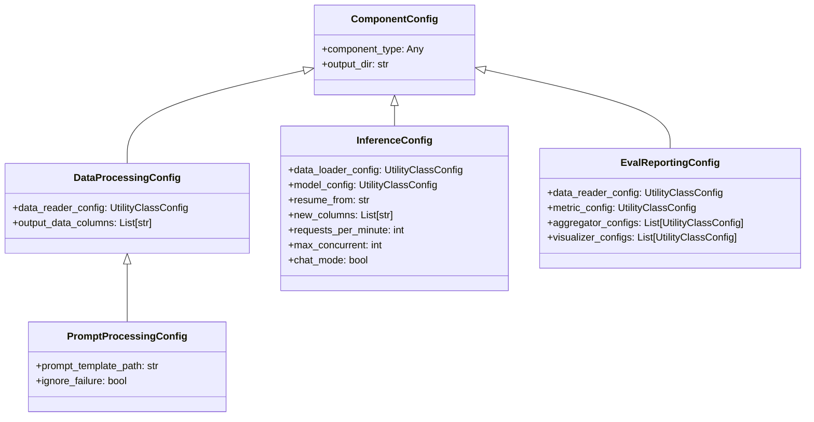
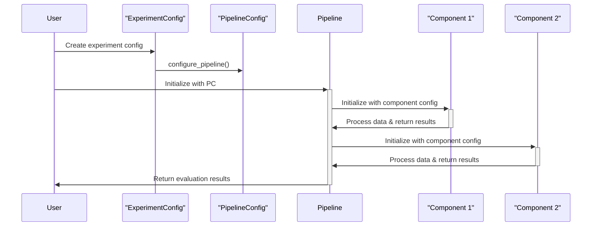
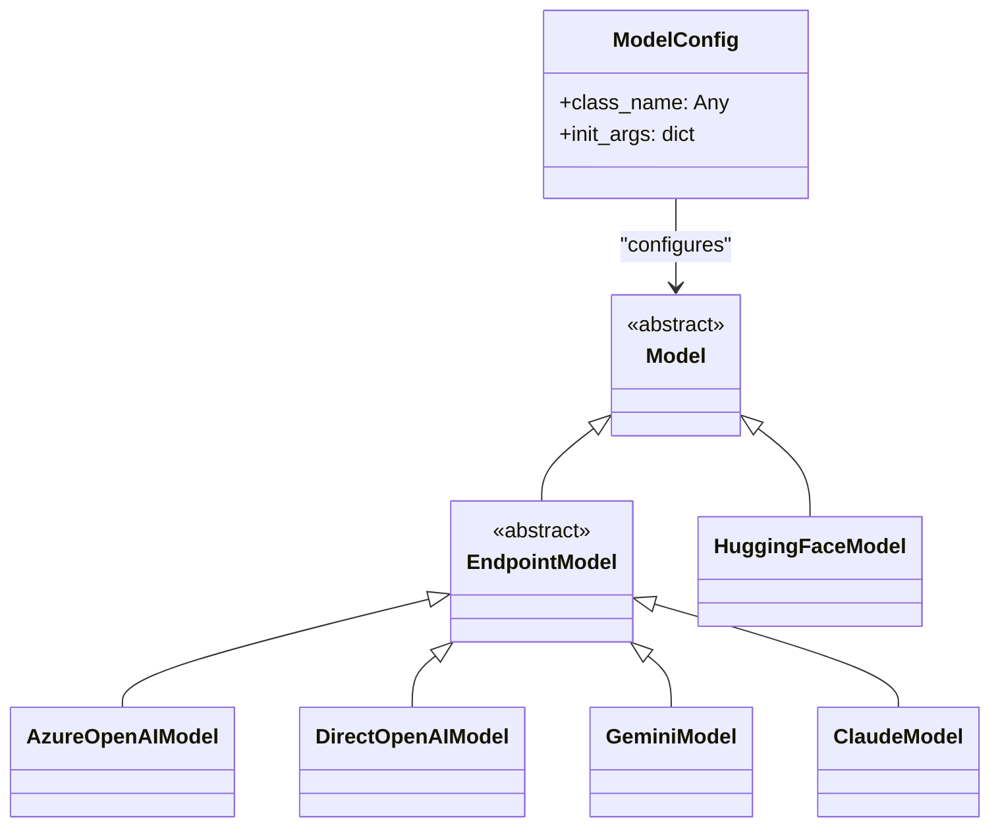
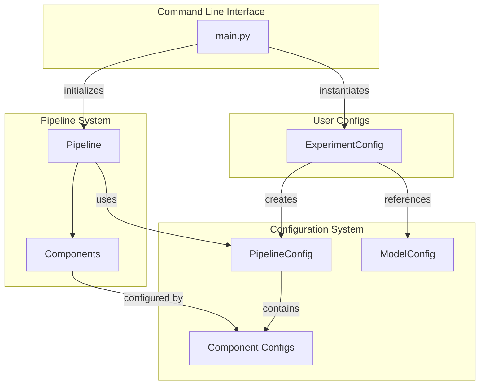

<!-- source: DeepWiki mcp.deepwiki.com · repo microsoft/eureka-ml-insights · page 2.2 Configuration System · fetched 2026-10-26 -->

# Configuration System

<details>
<summary>Relevant source files</summary>

The following files were used as context for generating this wiki page:

- [.gitignore](.gitignore)
- [deploy_vllm_and_run_eval.sh](deploy_vllm_and_run_eval.sh)
- [eureka_ml_insights/configs/config.py](eureka_ml_insights/configs/config.py)
- [eureka_ml_insights/configs/model_configs.py](eureka_ml_insights/configs/model_configs.py)
- [main.py](main.py)

</details>


## Purpose and Scope

The Configuration System in Eureka ML Insights provides a structured way to define, organize, and manage the components and parameters used in ML evaluation pipelines. This system enables users to configure various aspects of the evaluation framework including data processing, model settings, inference parameters, and evaluation metrics.

This page documents the architecture and usage of the configuration classes that form the backbone of experiment definition in the framework. For information about specific model configurations, see [Model Configurations](#3.2).

## Architecture Overview

The Configuration System consists of several hierarchical configuration classes that represent different aspects of the evaluation pipeline. These classes provide a type-safe and structured way to define the behavior of components in the system.



Sources: [eureka_ml_insights/configs/config.py:1-155]()

## Core Configuration Classes

The configuration system is built around two main types of configurations: utility class configurations and component configurations.

### UtilityClassConfig

The `UtilityClassConfig` is the base class for all utility configurations. It defines the structure for configuring utility classes like models, datasets, and metrics.



Key fields:
- `class_name`: The utility class to be used with this configuration
- `init_args`: Dictionary of arguments to be passed to the utility class constructor

Sources: [eureka_ml_insights/configs/config.py:10-30]()

### ComponentConfig

The `ComponentConfig` is the base class for all component configurations. It defines the structure for configuring pipeline components like data processing, prompt processing, and inference.



Key fields of `ComponentConfig`:
- `component_type`: The component class to be used with this configuration
- `output_dir`: The directory to save the output files of this component

Sources: [eureka_ml_insights/configs/config.py:53-64]()

### PipelineConfig

The `PipelineConfig` represents the configuration for an entire evaluation pipeline, containing a sequence of component configurations.

```python
@dataclass
class PipelineConfig:
    component_configs: list[ComponentConfigType] = field(default_factory=list)
    log_dir: str = None
```

Key fields:
- `component_configs`: A list of component configurations that define the pipeline workflow
- `log_dir`: The directory to save the logs and outputs of the pipeline

Sources: [eureka_ml_insights/configs/config.py:139-154]()

## Configuration Flow

The following diagram shows how configurations flow through the system from definition to execution:



Sources: [main.py:1-93]()

## Model Configuration System

The model configuration system is a specific implementation of the utility configuration classes. It provides a way to define and manage model parameters for various model types.



The `ModelConfig` class is used to configure model instances with appropriate parameters.

Sources: [eureka_ml_insights/configs/model_configs.py:1-349]()

### Pre-defined Model Configurations

The framework includes a wide range of pre-defined model configurations for various model providers. Here's an example of some model configurations:

```python
# Test model
TEST_MODEL_CONFIG = ModelConfig(TestModel, {})

# Claude models
CLAUDE_3_OPUS_CONFIG = ModelConfig(
    ClaudeModel,
    {
        "model_name": "claude-3-opus-20240229",
        "secret_key_params": CLAUDE_SECRET_KEY_PARAMS,
    },
)

# OpenAI models
OAI_GPT4O_2024_05_13_CONFIG = ModelConfig(
    DirectOpenAIModel,
    {
        "model_name": "gpt-4o-2024-05-13",
        "secret_key_params": OPENAI_SECRET_KEY_PARAMS,
    },
)
```

These configurations encapsulate all the information needed to initialize and use a model, including:
- The model class to instantiate
- The specific model name/version
- Authentication parameters
- Generation parameters (temperature, max tokens, etc.)

Sources: [eureka_ml_insights/configs/model_configs.py:32-349]()

## Component Configuration Details

Each component type has its own configuration class with specific parameters. Below are details of the key component configurations:

### DataProcessingConfig

```python
@dataclass
class DataProcessingConfig(ComponentConfig):
    data_reader_config: UtilityClassConfigType = None
    output_data_columns: List[str] = None
```

Purpose: Configure data processing components to read and transform input data.

Sources: [eureka_ml_insights/configs/config.py:66-76]()

### PromptProcessingConfig

```python
@dataclass
class PromptProcessingConfig(DataProcessingConfig):
    prompt_template_path: str = None
    ignore_failure: bool = False
```

Purpose: Configure prompt generation using template files.

Sources: [eureka_ml_insights/configs/config.py:78-88]()

### InferenceConfig

```python
@dataclass
class InferenceConfig(ComponentConfig):
    data_loader_config: UtilityClassConfigType = None
    model_config: UtilityClassConfigType = None
    resume_from: str = None
    new_columns: List[str] = None
    requests_per_minute: int = None
    max_concurrent: int = 1
    chat_mode: bool = False
```

Purpose: Configure model inference parameters, including the model to use, concurrency settings, and rate limiting.

Sources: [eureka_ml_insights/configs/config.py:102-118]()

### EvalReportingConfig

```python
@dataclass
class EvalReportingConfig(ComponentConfig):
    data_reader_config: UtilityClassConfigType = None
    metric_config: UtilityClassConfigType = None
    aggregator_configs: List[UtilityClassConfigType] = field(default_factory=list)
    visualizer_configs: List[UtilityClassConfigType] = field(default_factory=list)
```

Purpose: Configure evaluation metrics, result aggregation, and visualization.

Sources: [eureka_ml_insights/configs/config.py:120-134]()

## Security Considerations

The configuration system includes built-in security features to avoid exposing sensitive information:

```python
def __repr__(self):
    # remove "secret_key_params" from the init_args representation for security reasons
    # but keep it in the actual config
    init_args_copy = copy.deepcopy(self.init_args)
    init_args_copy.pop("secret_key_params", None)
    init_args_copy.pop("api_key", None)
    return f"{self.__class__.__name__}(class_name={self.class_name.__name__}, init_args={init_args_copy})"
```

This ensures that sensitive API keys and credentials are not inadvertently exposed in logs or debug output.

Sources: [eureka_ml_insights/configs/config.py:22-28]()

## Usage in Pipeline Execution

The configuration system plays a central role in the pipeline execution process. Here's how it's used in the main execution flow:



The main execution process:
1. User specifies an experiment configuration class via command line
2. The experiment config is instantiated, possibly with overrides from command line args
3. The experiment config creates a pipeline configuration
4. A pipeline is initialized with the pipeline configuration
5. The pipeline initializes components based on their configurations
6. The components execute in sequence, processing data and generating results

Sources: [main.py:10-92]()

## Configuration for Model Authentication

The configuration system supports multiple methods for handling authentication keys:

```python
# Example key parameter structure
OPENAI_SECRET_KEY_PARAMS = {
    "key_name": "your_openai_secret_key_name",
    "local_keys_path": "keys/keys.json",
    "key_vault_url": None,
}
```

The system supports:
1. Loading keys from a local JSON file
2. Fetching keys from Azure Key Vault
3. Directly providing keys (not recommended for production)

Note that the actual key files are excluded from version control, as seen in the `.gitignore` file: `/keys`.

Sources: [eureka_ml_insights/configs/model_configs.py:25-40](), [.gitignore:401-402]()

## Integration with Deployment Scripts

The configuration system integrates with deployment scripts, allowing for dynamic configuration of models in deployment scenarios:

```bash
# Call Eureka to initiate evals
ports=$(seq -s ' ' $base_port $((base_port + num_servers - 1)))
EUREKA_ARGS="\
    --model_config=${model_name} \
    --exp_config=${exp_config} \
    --local_vllm \
    --ports ${ports} \
"
python main.py ${EUREKA_ARGS} >> $log_dir/out.log 2>&1
```

This shows how command-line arguments can override or extend configuration parameters at runtime.

Sources: [deploy_vllm_and_run_eval.sh:58-67]()

## Summary

The configuration system is a core architectural component of the Eureka ML Insights framework that:

1. Provides a structured way to define evaluation pipelines
2. Enables modular and reusable configuration of components
3. Supports secure handling of authentication credentials
4. Allows for flexible runtime configuration via command-line arguments
5. Facilitates the integration of various model types and evaluation metrics

The design follows object-oriented principles with a clear hierarchy of configurations that map to the different aspects of the evaluation pipeline, making it both flexible and extensible.

---

