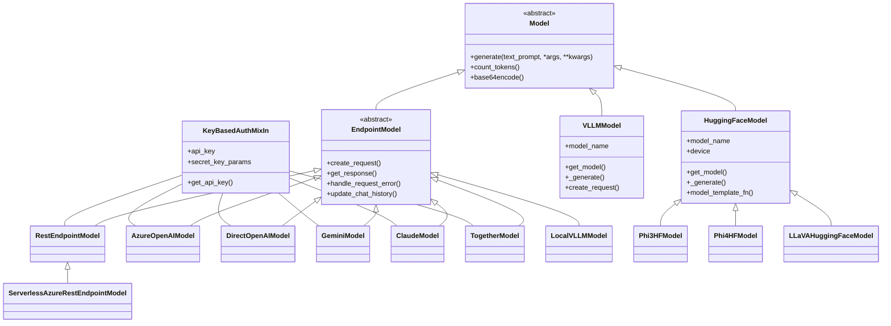
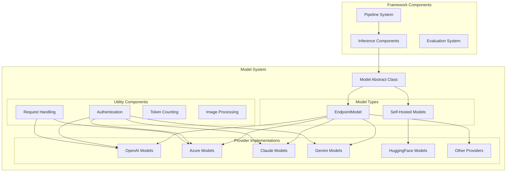
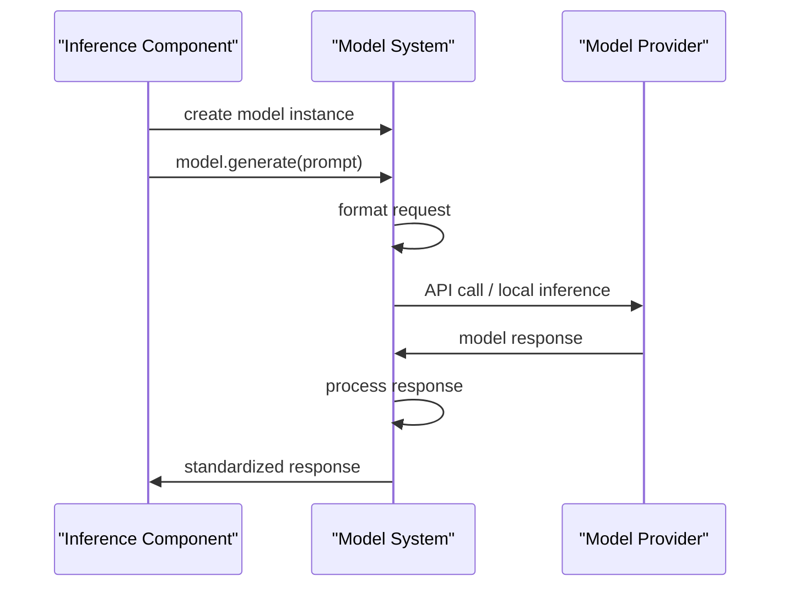
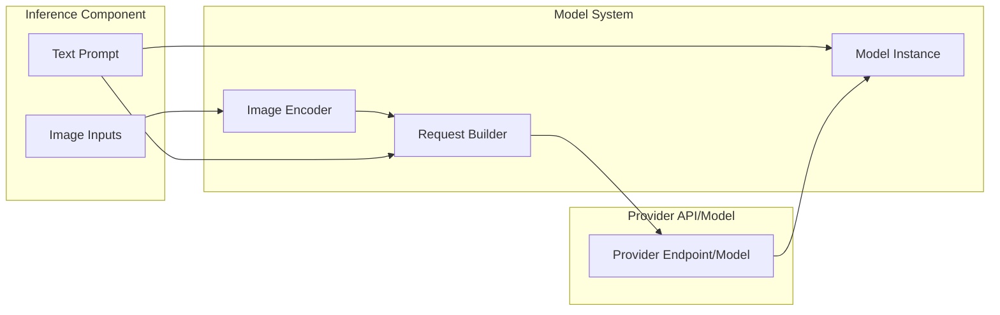
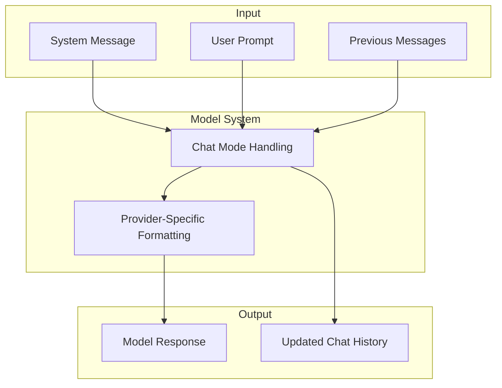
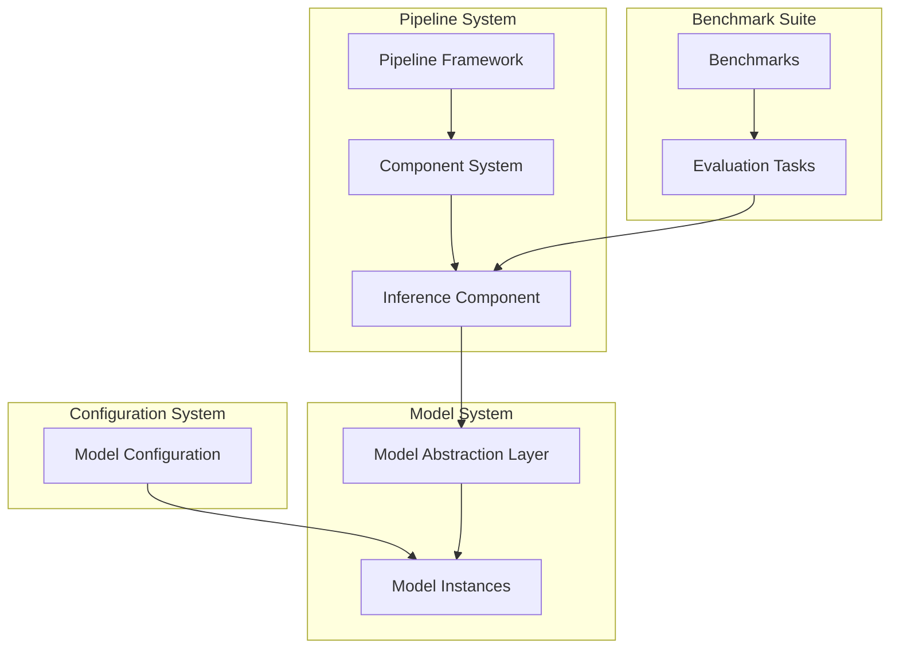

<!-- source: DeepWiki mcp.deepwiki.com · repo microsoft/eureka-ml-insights · page 3 Model System · fetched 2026-10-26 -->

# Model System

<details>
<summary>Relevant source files</summary>

The following files were used as context for generating this wiki page:

- [eureka_ml_insights/models/__init__.py](eureka_ml_insights/models/__init__.py)
- [eureka_ml_insights/models/models.py](eureka_ml_insights/models/models.py)

</details>


The Model System in Eureka ML Insights provides a unified abstraction layer for interacting with various Large Language Models (LLMs). This system enables seamless integration of different model providers and deployment types (API-based or self-hosted) through a common interface, allowing the framework to work with diverse models while maintaining a consistent evaluation methodology.

This page provides an overview of the Model System architecture and its key components. For more detailed information, see [Model Classes](#3.1), [Model Configurations](#3.2), and [Inference](#3.3).

## Core Architecture

The Model System is built around a flexible class hierarchy that abstracts away the implementation details of different model providers. This allows the rest of the framework to interact with models in a consistent way, regardless of whether they're API-based (like OpenAI or Claude) or self-hosted (like HuggingFace models).

### Model Class Hierarchy



Sources: [eureka_ml_insights/models/models.py:20-65](), [eureka_ml_insights/models/models.py:92-181](), [eureka_ml_insights/models/__init__.py:1-47]()

### Model System Components

The Model System consists of several key components:

1. **Base Model Class**: An abstract class that defines the common interface for all models
2. **Model Type Classes**: Implementations for different types of models (API-based, self-hosted)
3. **Provider-Specific Classes**: Concrete implementations for specific model providers
4. **Utility Mixins**: Reusable components for common functionality (authentication, request handling)



Sources: [eureka_ml_insights/models/models.py:20-181](), [eureka_ml_insights/models/models.py:439-808](), [eureka_ml_insights/models/models.py:857-1096]()

## Key Components

### Model Abstract Base Class

The `Model` abstract base class is the foundation of the Model System. It defines the common interface that all model implementations must adhere to.

```python
@dataclass
class Model(ABC):
    """This class is used to define the structure of a model class.
    Any model class should inherit from this class and implement the generate method that returns a dict
    containing the model_output, is_valid, and other relevant information.
    """

    chat_mode: bool = False
    system_message: str = None

    @abstractmethod
    def generate(self, text_prompt, *args, **kwargs):
        raise NotImplementedError

    def count_tokens(self, model_output: str = None, is_valid: bool = False):
        # Token counting implementation
        pass

    def base64encode(self, query_images):
        # Image encoding implementation
        pass
```

The most important method in this interface is `generate()`, which all model implementations must override. This method takes a text prompt and optional arguments (such as system messages or images) and returns a standardized response containing the model's output, validation status, response time, and token counts.

Sources: [eureka_ml_insights/models/models.py:20-65]()

### EndpointModel

The `EndpointModel` class extends the base `Model` class to provide functionality specific to API-based models. It handles common operations like making API requests, processing responses, and managing errors and retries.

```python
@dataclass
class EndpointModel(Model):
    """This class is used to interact with API-based models."""

    num_retries: int = 3

    @abstractmethod
    def create_request(self, text_prompt, *args, **kwargs):
        raise NotImplementedError

    @abstractmethod
    def get_response(self, request):
        # must return the model output and the response time
        raise NotImplementedError
        
    def update_chat_history(self, query_text, model_output, *args, **kwargs):
        # Implementation for chat history management
        pass
        
    def generate(self, query_text, *args, **kwargs):
        # Implementation for generating responses with retry logic
        pass
        
    @abstractmethod
    def handle_request_error(self, e):
        raise NotImplementedError
```

The `EndpointModel` defines three additional abstract methods that its subclasses must implement:
- `create_request()`: Builds the request payload for the API
- `get_response()`: Handles the API call and processes the response
- `handle_request_error()`: Manages error conditions from the API

It also implements the `generate()` method, which orchestrates the process of creating a request, sending it to the API, handling retries on failure, and formatting the response.

Sources: [eureka_ml_insights/models/models.py:92-181]()

### HuggingFaceModel

The `HuggingFaceModel` class implements the `Model` interface for self-hosted models using the HuggingFace Transformers library. It handles model loading, inference, and prompt formatting.

```python
@dataclass
class HuggingFaceModel(Model):
    """This class is used to run a self-hosted language model via HuggingFace apis."""

    model_name: str = None
    device: str = "cpu"
    max_tokens: int = 2000
    temperature: float = 0.001
    top_p: float = 0.95
    do_sample: bool = True
    apply_model_template: bool = True

    quantize: bool = False
    use_flash_attn: bool = False
    
    def __post_init__(self):
        # The device need to be set before get_model() is called
        self.device = self.pick_available_device()
        self.get_model()
        
    def get_model(self):
        # Load the model from HuggingFace
        pass
        
    def pick_available_device(self):
        # Select the best available device
        pass
        
    def _generate(self, text_prompt, query_images=None):
        # Core generation implementation
        pass
        
    def generate(self, text_prompt, query_images=None, system_message=None):
        # Implementation of the Model interface
        pass
        
    def model_template_fn(self, text_prompt, system_message=None):
        # Format the prompt according to model requirements
        pass
```

This class provides additional functionality specific to self-hosted models, such as:
- `get_model()`: Loads the model from HuggingFace
- `pick_available_device()`: Automatically selects the best available device (CPU or GPU)
- `model_template_fn()`: Applies model-specific templates to prompts

There are specialized subclasses for specific model families like `Phi3HFModel`, `Phi4HFModel`, and `LLaVAHuggingFaceModel` that customize the template function and other aspects for those models.

Sources: [eureka_ml_insights/models/models.py:857-1096]()

### Utility Components

#### KeyBasedAuthMixIn

The `KeyBasedAuthMixIn` class provides authentication functionality for API-based models. It can either use a directly provided API key or retrieve one from a secret management system.

```python
@dataclass
class KeyBasedAuthMixIn:
    """This class is used to handle key-based authentication for models."""

    api_key: str = None
    secret_key_params: dict = None

    def __post_init__(self):
        if self.api_key is None and self.secret_key_params is None:
            raise ValueError("Either api_key or secret_key_params must be provided.")
        self.api_key = self.get_api_key()

    def get_api_key(self):
        """
        This method is used to get the api_key for the models that require key-based authentication.
        Either api_key (str) or secret_key_params (dict) must be provided.
        if api_key is not directly provided, secret_key_params must be provided to get the api_key using get_secret method.
        """
        if self.api_key is None:
            self.api_key = get_secret(**self.secret_key_params)
        return self.api_key
```

Sources: [eureka_ml_insights/models/models.py:69-88]()

## Model Types and Provider Integrations

The Model System includes implementations for a wide range of LLM providers, both API-based and self-hosted. The following table summarizes the main provider integrations:

| Model Type | Provider | Class | Description |
|------------|---------|-------|-------------|
| API-based  | OpenAI  | `DirectOpenAIModel` | Direct access to OpenAI models |
| API-based  | Azure OpenAI | `AzureOpenAIModel` | Access to OpenAI models hosted on Azure |
| API-based  | Google Gemini | `GeminiModel` | Access to Google's Gemini models |
| API-based  | Anthropic | `ClaudeModel` | Access to Anthropic's Claude models |
| API-based  | Together | `TogetherModel` | Access to Together's model APIs |
| API-based  | Azure Serverless | `ServerlessAzureRestEndpointModel` | Base class for Azure serverless deployments |
| API-based  | Azure Serverless | `LlamaServerlessAzureRestEndpointModel` | Access to Llama models on Azure serverless |
| API-based  | Azure Serverless | `MistralServerlessAzureRestEndpointModel` | Access to Mistral models on Azure serverless |
| API-based  | Azure Serverless | `DeepseekR1ServerlessAzureRestEndpointModel` | Access to DeepSeek models on Azure serverless |
| Self-hosted | HuggingFace | `HuggingFaceModel` | Base class for self-hosted HuggingFace models |
| Self-hosted | Microsoft Phi | `Phi3HFModel`, `Phi4HFModel` | Self-hosted Microsoft Phi models |
| Self-hosted | LLaVA | `LLaVAHuggingFaceModel`, `LLaVAModel` | Self-hosted LLaVA vision-language models |
| Self-hosted | vLLM | `VLLMModel` | Models deployed with vLLM |
| Self-hosted | vLLM Local | `LocalVLLMModel` | Local vLLM server deployments |

Sources: [eureka_ml_insights/models/models.py:185-1531](), [eureka_ml_insights/models/__init__.py:1-47]()

## Model System Use Cases

The Model System is designed to support a variety of use cases within the Eureka ML Insights framework:

### Model-Based Inference

The primary use case is to provide a unified interface for model inference within evaluation pipelines. Components that need to interact with LLMs can use the Model System without needing to know the specific details of the underlying model implementation.



Sources: [eureka_ml_insights/models/models.py:120-177]()

### Multimodal Support

The Model System includes support for multimodal models that can process both text and images. This allows for evaluating models on tasks that require visual understanding.



Sources: [eureka_ml_insights/models/models.py:51-65](), [eureka_ml_insights/models/models.py:446-466](), [eureka_ml_insights/models/models.py:1066-1087]()

### Chat Modes and System Messages

Many modern LLMs support chat-based interfaces with system messages. The Model System provides standardized support for these features across different providers.



Sources: [eureka_ml_insights/models/models.py:106-118](), [eureka_ml_insights/models/models.py:446-466]()

## Integration with the Framework

The Model System is integrated with other components of the Eureka ML Insights framework, particularly:

1. The Pipeline Component System, where models are used in inference components
2. The Configuration System, which provides model configurations
3. The Benchmark Suite, which uses models to evaluate performance on various tasks



Sources: [eureka_ml_insights/models/models.py:20-65](), [eureka_ml_insights/models/__init__.py:1-47]()

## Summary

The Model System in Eureka ML Insights provides a flexible and extensible abstraction layer for working with various LLM providers. Its key features include:

- A unified interface for model interactions, regardless of provider or deployment type
- Support for both API-based and self-hosted models
- Robust error handling and retry mechanisms
- Multimodal support for models that can process images
- Chat mode and system message support
- Integration with the framework's configuration and component systems

This abstraction allows the framework to be model-agnostic, making it easy to evaluate and compare different models across a wide range of benchmarks and tasks.

For more detailed information about specific model classes, see [Model Classes](#3.1). For information about model configuration, see [Model Configurations](#3.2). For details about the inference process, see [Inference](#3.3).

---

