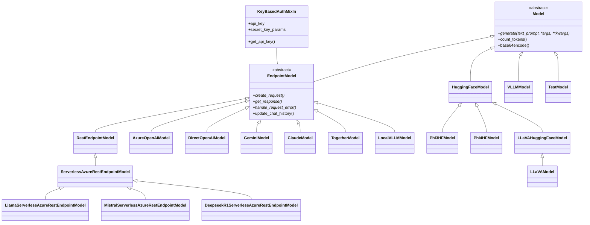
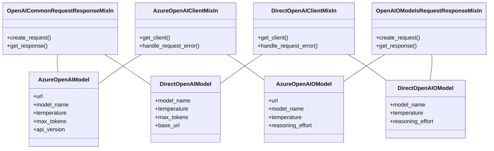
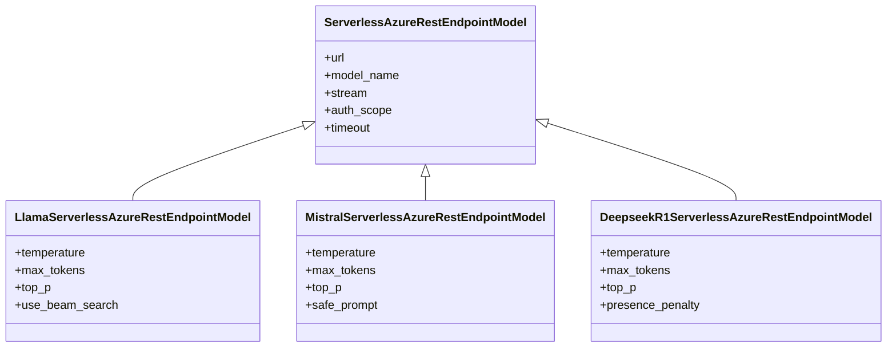

<!-- source: DeepWiki mcp.deepwiki.com · repo microsoft/eureka-ml-insights · page 3.1 Model Classes · fetched 2026-10-26 -->

# Model Classes

<details>
<summary>Relevant source files</summary>

The following files were used as context for generating this wiki page:

- [eureka_ml_insights/models/__init__.py](eureka_ml_insights/models/__init__.py)
- [eureka_ml_insights/models/models.py](eureka_ml_insights/models/models.py)

</details>


This document covers the model abstraction layer within the Eureka ML Insights framework that provides a unified interface for interacting with various language models (LLMs). The model system enables seamless integration with both API-based models (like OpenAI, Claude, or Gemini) and self-hosted models (like HuggingFace implementations).

For configuration information about these models, see [Model Configurations](#3.2), and for details on how inference is performed, see [Inference](#3.3).

## Class Hierarchy Overview

The model system is organized around a clear inheritance hierarchy that enables flexibility while maintaining a consistent interface.



Sources: [eureka_ml_insights/models/models.py:1-1666](), [eureka_ml_insights/models/__init__.py:1-48]()

## Base Classes

### Model Abstract Base Class

The `Model` class serves as the abstract base class for all model implementations. It defines the core interface that all models must implement, ensuring consistency across different model types.

```python
@dataclass
class Model(ABC):
    chat_mode: bool = False
    system_message: str = None

    @abstractmethod
    def generate(self, text_prompt, *args, **kwargs):
        raise NotImplementedError

    def count_tokens(self, model_output: str = None, is_valid: bool = False):
        # Token counting logic
        pass

    def base64encode(self, query_images):
        # Image encoding logic
        pass
```

Key features:
- Abstract `generate()` method that must be implemented by all subclasses
- Token counting functionality using `tiktoken`
- Image encoding functionality for multimodal models
- Support for chat mode and system messages

Sources: [eureka_ml_insights/models/models.py:20-65]()

### EndpointModel Base Class

The `EndpointModel` class extends `Model` to provide a foundation for API-based models. It handles the common patterns of creating API requests, handling responses, and managing retries.

```python
@dataclass
class EndpointModel(Model):
    num_retries: int = 3

    @abstractmethod
    def create_request(self, text_prompt, *args, **kwargs):
        raise NotImplementedError

    @abstractmethod
    def get_response(self, request):
        raise NotImplementedError

    @abstractmethod
    def handle_request_error(self, e):
        raise NotImplementedError
```

Key features:
- Abstract methods for creating requests, handling responses, and managing errors
- Built-in retry mechanism for handling API failures
- Support for chat history management
- Standardized response dictionary format

Sources: [eureka_ml_insights/models/models.py:91-181]()

### KeyBasedAuthMixIn

The `KeyBasedAuthMixIn` provides a reusable implementation for key-based authentication used by many API-based models.

```python
@dataclass
class KeyBasedAuthMixIn:
    api_key: str = None
    secret_key_params: dict = None

    def get_api_key(self):
        # API key retrieval logic
        pass
```

Key features:
- Support for direct API key provision or secret key retrieval
- Integration with the framework's secret management system

Sources: [eureka_ml_insights/models/models.py:68-88]()

## API-Based Model Implementations

The framework provides implementations for various API-based LLM providers. These classes handle the specific requirements and formats of each provider while maintaining a consistent interface.

### OpenAI Models



The framework supports both direct OpenAI API access and Azure-hosted OpenAI models through these classes:

- **AzureOpenAIModel**: For accessing OpenAI models deployed on Azure
- **DirectOpenAIModel**: For accessing OpenAI models directly through their API
- **AzureOpenAIOModel**: For Azure-hosted O models (Claude Sonnet and O1 models) 
- **DirectOpenAIOModel**: For direct access to O models

These implementations handle authentication, request formatting, and response parsing specific to OpenAI's API.

Sources: [eureka_ml_insights/models/models.py:442-691]()

### Claude Models

```python
@dataclass
class ClaudeModel(EndpointModel, KeyBasedAuthMixIn):
    model_name: str = None
    temperature: float = 0
    max_tokens: int = 2000
    top_p: float = 0.95
    timeout: int = 60
```

The framework provides two Claude model implementations:

- **ClaudeModel**: For standard Claude API access
- **ClaudeReasoningModel**: Special implementation for Claude models with reasoning capabilities

The Claude implementations include support for images in prompts for multimodal models like Claude 3.

Sources: [eureka_ml_insights/models/models.py:1535-1651]()

### Gemini Models

```python
@dataclass
class GeminiModel(EndpointModel, KeyBasedAuthMixIn):
    timeout: int = 600
    model_name: str = None
    temperature: float = 0
    max_tokens: int = 2000
    top_p: float = 0.95
```

The `GeminiModel` class provides integration with Google's Gemini models. It includes:

- Custom safety settings configuration
- Support for image inputs
- Error handling specific to Gemini's API behavior

Sources: [eureka_ml_insights/models/models.py:694-807]()

### Together Models

```python
@dataclass
class TogetherModel(OpenAICommonRequestResponseMixIn, KeyBasedAuthMixIn, EndpointModel):
    timeout: int = 600
    model_name: str = None
    temperature: float = 0
    max_tokens: int = 65536
    top_p: float = 0.95
    presence_penalty: float = 0
    stop = ["<｜end▁of▁sentence｜>"]
```

The `TogetherModel` class enables access to models hosted on the Together API platform, using their OpenAI-compatible interface.

Sources: [eureka_ml_insights/models/models.py:810-853]()

### Serverless Azure Models



The framework provides specialized implementations for Azure Serverless model deployments:

- **LlamaServerlessAzureRestEndpointModel**: For Llama models (including vision capabilities)
- **MistralServerlessAzureRestEndpointModel**: For Mistral Large models
- **DeepseekR1ServerlessAzureRestEndpointModel**: For DeepSeek models

These implementations handle the specific API requirements and parameters for each model family.

Sources: [eureka_ml_insights/models/models.py:250-438]()

## Self-Hosted Model Implementations

The framework provides implementations for locally deployed models using various backends.

### HuggingFace Models

```python
@dataclass
class HuggingFaceModel(Model):
    model_name: str = None
    device: str = "cpu"
    max_tokens: int = 2000
    temperature: float = 0.001
    top_p: float = 0.95
    do_sample: bool = True
    apply_model_template: bool = True
    quantize: bool = False
    use_flash_attn: bool = False
```

The base `HuggingFaceModel` provides functionality for loading and running models from the HuggingFace ecosystem. Specialized implementations include:

- **Phi3HFModel**: Optimized for Microsoft's Phi-3 models
- **Phi4HFModel**: Optimized for Microsoft's Phi-4 models
- **LLaVAHuggingFaceModel**: For LLaVA multimodal models using HuggingFace

Key features:
- Automatic device selection based on GPU availability
- Support for model quantization
- Specialized prompt templating for different model families

Sources: [eureka_ml_insights/models/models.py:856-1117]()

### vLLM Models

```python
@dataclass
class VLLMModel(Model):
    model_name: str = None
    trust_remote_code: bool = False
    tensor_parallel_size: int = 1
    dtype: str = "auto"
    quantization: str = None
    seed: int = 0
    gpu_memory_utilization: float = 0.9
    cpu_offload_gb: float = 0
```

The framework provides two ways to use vLLM for efficient model serving:

- **VLLMModel**: Direct integration with vLLM for self-hosted models
- **LocalVLLMModel**: Manages local vLLM deployments with automatic server creation

The LocalVLLM implementation includes sophisticated server management:
- Dynamic deployment of vLLM servers
- Load balancing across multiple servers
- Automatic server health checking

Sources: [eureka_ml_insights/models/models.py:1197-1532]()

## Multimodal Model Support

The framework includes specialized implementations for multimodal models that can process both text and images.

### LLaVA Models

```python
@dataclass
class LLaVAHuggingFaceModel(HuggingFaceModel):
    # Inherits parameters from HuggingFaceModel
```

```python
@dataclass
class LLaVAModel(LLaVAHuggingFaceModel):
    model_base: str = None
    num_beams: int = 1
```

The framework provides two implementations for LLaVA models:

- **LLaVAHuggingFaceModel**: Using HuggingFace's transformers library
- **LLaVAModel**: Using the native LLaVA package

Both handle the specialized processing required for vision-language models, including image preprocessing and prompt formatting.

Sources: [eureka_ml_insights/models/models.py:1014-1193]()

## Usage Patterns

### Common Instantiation Pattern

Model classes are typically instantiated with the necessary configuration parameters:

```python
model = AzureOpenAIModel(
    url="https://example.openai.azure.com/",
    model_name="gpt-4",
    api_key="your_api_key",  # Or use secret_key_params for secure key retrieval
    temperature=0.7,
    max_tokens=1000
)
```

### Generating Responses

All model classes provide a consistent `generate()` method:

```python
response = model.generate(
    text_prompt="What is machine learning?",
    system_message="You are a helpful AI assistant.",
    query_images=[image1, image2]  # For multimodal models
)

# Access response elements
model_output = response["model_output"]
is_valid = response["is_valid"]
response_time = response["response_time"]
token_count = response["n_output_tokens"]
```

### Handling Authentication

For API-based models requiring authentication, you can provide credentials in two ways:

1. Direct API key:
```python
model = GeminiModel(
    model_name="gemini-1.0-pro",
    api_key="your_api_key"
)
```

2. Using the secret management system:
```python
model = DirectOpenAIModel(
    model_name="gpt-4",
    secret_key_params={
        "secret_name": "openai-key",
        "key_vault_name": "my-key-vault"
    }
)
```

## Testing Support

For testing and development, the framework provides a `TestModel` class that returns fixed responses without making actual API calls.

```python
@dataclass
class TestModel(Model):
    def generate(self, text_prompt, **kwargs):
        output = "This is a test response."
        is_valid = True
        return {
            "model_output": output,
            "is_valid": is_valid,
            "response_time": 0.1,
            "n_output_tokens": self.count_tokens(output, is_valid),
        }
```

Sources: [eureka_ml_insights/models/models.py:1653-1665]()

## Common Response Format

All model classes return responses in a consistent dictionary format:

| Key | Type | Description |
|-----|------|-------------|
| `model_output` | str | The text response from the model |
| `is_valid` | bool | Whether the response was successfully generated |
| `response_time` | float | Time taken to generate the response in seconds |
| `n_output_tokens` | int | Number of tokens in the model output |
| `usage` | dict | (Optional) Detailed token usage information if available |
| `previous_messages` | list | (Optional) Updated chat history for chat mode |

This standardized format enables consistent evaluation and analytics across different model types.

Sources: [eureka_ml_insights/models/models.py:122-177]()

---

