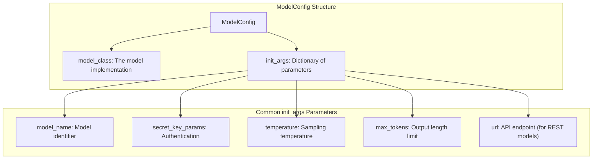
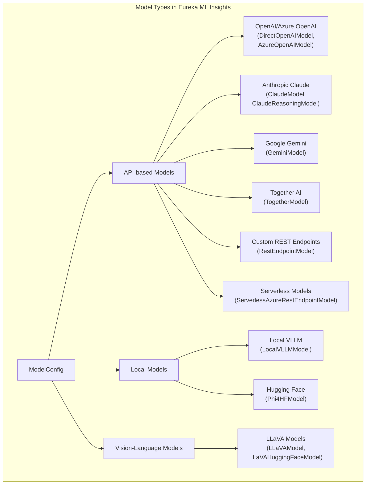
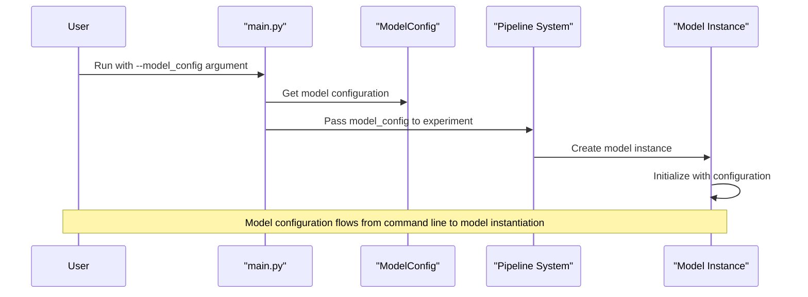

<!-- source: DeepWiki mcp.deepwiki.com · repo microsoft/eureka-ml-insights · page 3.2 Model Configurations · fetched 2026-10-26 -->

# Model Configurations

<details>
<summary>Relevant source files</summary>

The following files were used as context for generating this wiki page:

- [deploy_vllm_and_run_eval.sh](deploy_vllm_and_run_eval.sh)
- [eureka_ml_insights/configs/model_configs.py](eureka_ml_insights/configs/model_configs.py)
- [main.py](main.py)

</details>


## Introduction

This document explains how to configure different Language Models (LLMs) and multimodal models for use in Eureka ML Insights evaluations. Model configurations define the specific parameters and connection details required to use a particular model, including API endpoints, authentication keys, and generation parameters.

For information about the underlying model classes that implement these configurations, see [Model Classes](#3.1). For details on how inference is performed using these models, see [Inference](#3.3).

Sources: [eureka_ml_insights/configs/model_configs.py:1-3]()

## Configuration Structure

Model configurations in Eureka ML Insights are defined using the `ModelConfig` class, which connects a specific model implementation with its initialization parameters.

```mermaid
classDiagram
    class ModelConfig {
        +model_class
        +init_args
        +__init__(model_class, init_args)
    }
    
    class "Model System" {
        <<System>>
    }
    
    class "Configuration System" {
        <<System>>
    }
    
    class "Pipeline System" {
        <<System>>
    }
    
    "Configuration System" --> ModelConfig
    ModelConfig --> "Model System"
    "Pipeline System" ..> ModelConfig: uses
    
    note for ModelConfig "Connects a model implementation\nwith its configuration"
```

Each `ModelConfig` instance requires:
1. A model class - the implementation class for the model
2. Initialization arguments - parameters needed to instantiate the model

Sources: [eureka_ml_insights/configs/model_configs.py:25]()

### Basic Structure



Sources: [eureka_ml_insights/configs/model_configs.py:33-349]()

## Authentication and Secret Management

Model configurations support multiple authentication methods for accessing API-based models. Secret keys can be managed in multiple ways:

| Method | Configuration | Description |
|--------|--------------|-------------|
| Local JSON file | `local_keys_path` | Path to a local JSON file containing API keys |
| Azure Key Vault | `key_vault_url` | URL for Azure Key Vault to retrieve keys securely |
| Key name | `key_name` | Name of the key to retrieve from the storage method |

Example secret key configuration:

```python
SECRET_KEY_PARAMS = {
    "key_name": "your_api_secret_key_name",
    "local_keys_path": "keys/keys.json",
    "key_vault_url": None,  # Optional Azure Key Vault URL
}
```

Sources: [eureka_ml_insights/configs/model_configs.py:27-29](), [eureka_ml_insights/configs/model_configs.py:36-40]()

## Supported Model Types

Eureka ML Insights supports a wide range of model types through different model classes. Each model type has specific configuration requirements.



Sources: [eureka_ml_insights/configs/model_configs.py:5-22]()

### API-Based Models

These models access LLMs through REST endpoints or provider-specific SDKs:

1. **OpenAI/Azure OpenAI**
   - Direct OpenAI access: `DirectOpenAIModel`, `DirectOpenAIOModel` 
   - Azure-hosted OpenAI: `AzureOpenAIModel`, `AzureOpenAIOModel`

2. **Claude Models**
   - Standard: `ClaudeModel`
   - With reasoning: `ClaudeReasoningModel`

3. **Google Gemini**: `GeminiModel`

4. **Together AI**: `TogetherModel`

5. **Custom REST Endpoints**: `RestEndpointModel` and its subclasses

Sources: [eureka_ml_insights/configs/model_configs.py:67-121](), [eureka_ml_insights/configs/model_configs.py:197-237](), [eureka_ml_insights/configs/model_configs.py:165-194](), [eureka_ml_insights/configs/model_configs.py:36-64]()

### Local Models

These models run locally or on accessible servers:

1. **VLLM-hosted Models**: `LocalVLLMModel`
2. **Hugging Face Models**: `Phi4HFModel` and other HF-based models

Sources: [eureka_ml_insights/configs/model_configs.py:316-333](), [eureka_ml_insights/configs/model_configs.py:262-268]()

### Vision-Language Models

Models that support both text and image inputs:

1. **LLaVA Models**: 
   - Standard: `LLaVAModel`
   - Hugging Face: `LLaVAHuggingFaceModel`

2. **Multimodal API Models**:
   - GPT-4 Vision: `DirectOpenAIModel` with vision-capable model names
   - Gemini: `GeminiModel` with vision-capable model variants
   - Claude: `ClaudeModel` with vision-capable model variants

Sources: [eureka_ml_insights/configs/model_configs.py:241-259](), [eureka_ml_insights/configs/model_configs.py:124-130]()

## Common Model Configurations

The repository provides pre-configured `ModelConfig` instances for widely used models. Here are some examples:

### OpenAI Models

```python
OAI_GPT4O_2024_05_13_CONFIG = ModelConfig(
    DirectOpenAIModel,
    {
        "model_name": "gpt-4o-2024-05-13",
        "secret_key_params": OPENAI_SECRET_KEY_PARAMS,
    },
)
```

### Claude Models

```python
CLAUDE_3_7_SONNET_THINKING_CONFIG = ModelConfig(
    ClaudeReasoningModel,
    {
        "secret_key_params": CLAUDE_SECRET_KEY_PARAMS,
        "model_name": "claude-3-7-sonnet-20250219",
        "thinking_enabled": True,
        "thinking_budget": 30720,
        "max_tokens": 32768,
        "temperature": 1.0,
        "timeout": 600,
    },
)
```

### Local Models

```python
PHI4_LOCAL_CONFIG = ModelConfig(
    LocalVLLMModel,
    {
        "model_name": "microsoft/phi-4",
        "ports": ["8002", "8003"],
    },
)
```

Sources: [eureka_ml_insights/configs/model_configs.py:74-154](), [eureka_ml_insights/configs/model_configs.py:203-230](), [eureka_ml_insights/configs/model_configs.py:316-324]()

## Using Model Configurations

Model configurations connect to the pipeline system through the command-line interface or direct code references.



Sources: [main.py:12-76]()

### Command-Line Usage

Model configurations can be specified when running evaluations:

```bash
python main.py --exp_config=EXPERIMENT_NAME --model_config=OAI_GPT4O_2024_05_13_CONFIG
```

For local VLLM models, additional parameters can be specified:

```bash
python main.py --exp_config=EXPERIMENT_NAME --model_config=PHI4_LOCAL_CONFIG --local_vllm --ports 8000 8001
```

Sources: [main.py:12-76](), [deploy_vllm_and_run_eval.sh:59-67]()

### In-Code Usage

Model configurations are passed to experiment configurations, which include them in pipeline configurations:

```python
experiment_config = ExperimentConfig(model_config=OAI_GPT4O_2024_05_13_CONFIG)
pipeline_config = experiment_config.pipeline_config
pipeline = Pipeline(pipeline_config.component_configs, pipeline_config.log_dir)
```

Sources: [main.py:82-88]()

## Creating Custom Model Configurations

You can create custom model configurations for new models or with different parameters:

1. **For existing model classes**:
   ```python
   MY_CUSTOM_GPT4_CONFIG = ModelConfig(
       DirectOpenAIModel,
       {
           "model_name": "gpt-4-1106-preview",
           "secret_key_params": MY_SECRET_KEY_PARAMS,
           "temperature": 0.2,  # Lower temperature for more deterministic outputs
           "max_tokens": 4096,
       },
   )
   ```

2. **For local VLLM deployments**:
   ```python
   MY_LOCAL_MODEL_CONFIG = ModelConfig(
       LocalVLLMModel,
       {
           "model_name": "path/to/my/model",
           "tensor_parallel_size": 4,  # For multi-GPU inference
           "ports": ["8000", "8001"],  # Existing deployments
       },
   )
   ```

Sources: [eureka_ml_insights/configs/model_configs.py:316-333](), [eureka_ml_insights/configs/model_configs.py:116-162]()

## Performance and Resource Considerations

Different model configurations may have different resource requirements and performance characteristics:

| Configuration Type | Considerations |
|--------------------|----------------|
| API-based models | - API costs<br>- Network latency<br>- Request rate limits<br>- Higher timeout values needed for complex tasks |
| Local models | - GPU memory requirements<br>- Inference speed<br>- Number of parallel servers<br>- Tensor parallelism for large models |
| Vision models | - Higher resource requirements<br>- Longer inference times<br>- Special image preprocessing needs |

For local VLLM deployments, you can script deployment and evaluation:

```bash
# Example from deploy_vllm_and_run_eval.sh
CUDA_VISIBLE_DEVICES=${devices} vllm serve ${model_name} "$@" --port ${port} ${VLLM_ARGS}
python main.py --model_config=${model_name} --exp_config=${exp_config} --local_vllm --ports ${ports}
```

Sources: [deploy_vllm_and_run_eval.sh:24-67](), [eureka_ml_insights/configs/model_configs.py:316-333]()

## Related Pages

- [Model Classes](#3.1) - Details on the model class implementations
- [Inference](#3.3) - How inference is performed using configured models
- [Pipeline System](#2.1) - How model configurations are used in evaluation pipelines
- [Configuration System](#2.2) - The broader configuration framework

---

