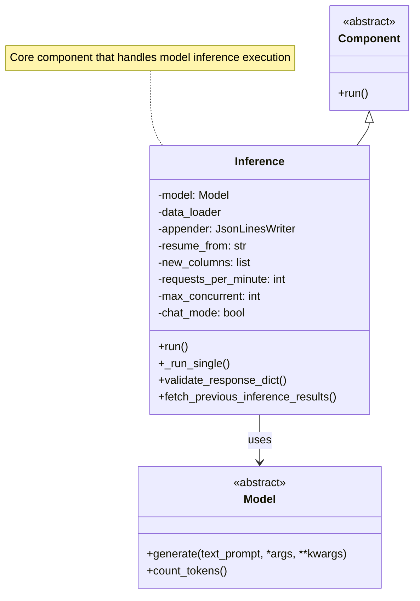
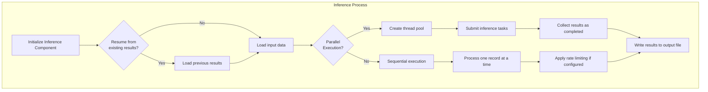
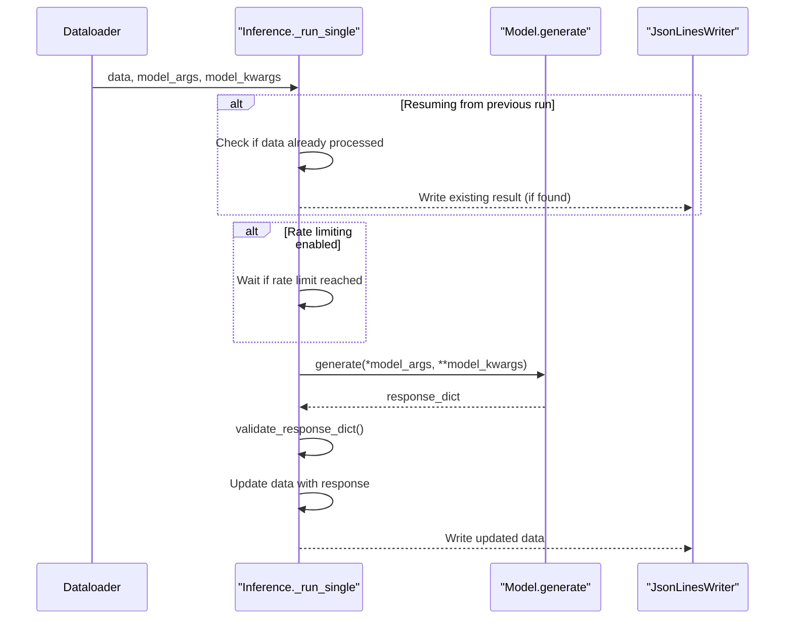
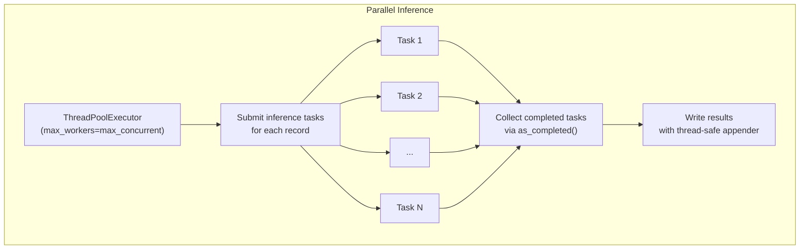
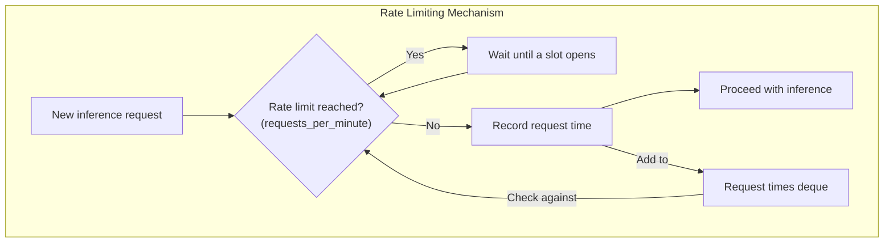
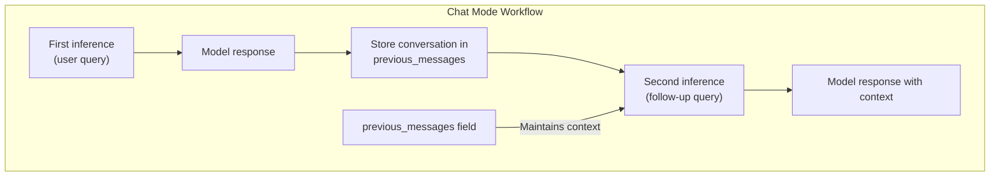
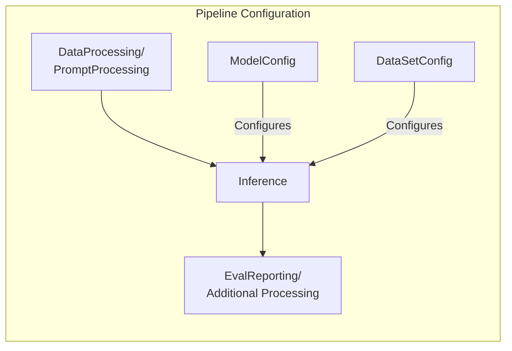
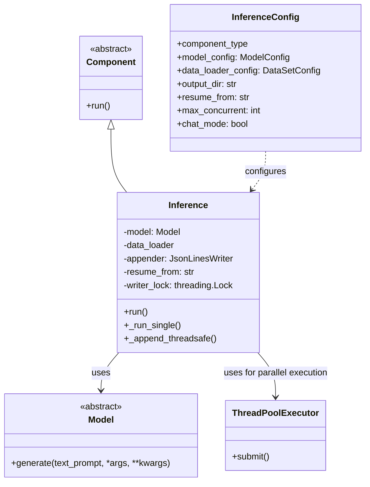
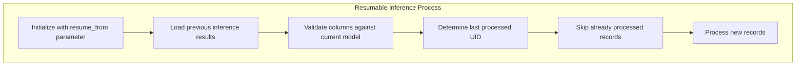

<!-- source: DeepWiki mcp.deepwiki.com · repo microsoft/eureka-ml-insights · page 3.3 Inference · fetched 2026-10-26 -->

# Inference

Relevant source files

The following files were used as context for generating this wiki page:

- [eureka_ml_insights/core/inference.py](eureka_ml_insights/core/inference.py)
- [eureka_ml_insights/models/models.py](eureka_ml_insights/models/models.py)
- [eureka_ml_insights/user_configs/chat_test.py](eureka_ml_insights/user_configs/chat_test.py)

## Purpose and Scope

This document details the Inference component of the Eureka ML Insights framework, which is responsible for executing model inference on input data. The Inference component acts as the bridge between data processing and evaluation, handling the actual model invocation and result collection. This page covers the design, configuration, and execution flow of the Inference system, including advanced features like parallel inference, rate limiting, and chat mode.

For information about model implementations, see [Model Classes](#3.1). For details on configuring models, see [Model Configurations](#3.2).

## Inference Component Overview

The Inference component is designed to efficiently manage the process of running model predictions on prepared data. It handles various execution scenarios, from simple sequential inference to complex parallel executions with rate limiting.

Sources: [eureka_ml_insights/core/inference.py:21-218](), [eureka_ml_insights/models/models.py:20-32]()

## Inference Flow and Execution

The Inference component follows a structured flow to process data through the model and collect results. The system is designed to be flexible, supporting both sequential and parallel execution modes.

Sources: [eureka_ml_insights/core/inference.py:178-192](), [eureka_ml_insights/core/inference.py:193-218]()

### Single Inference Execution

For each data point, the Inference component executes the following process:

1. If resuming from previous results, check if this data point was already processed
2. Apply rate limiting if configured (for sequential execution only)
3. Call the model's `generate()` method with input data
4. Validate response and update the data record with results
5. Write results to output file

Sources: [eureka_ml_insights/core/inference.py:193-218](), [eureka_ml_insights/models/models.py:31-32]()

## Parallel Inference and Rate Limiting

The Inference component supports parallel execution through multi-threading, allowing multiple inference requests to be processed concurrently.

### Parallel Inference

When configured with `max_concurrent` > 1, the component creates a thread pool to handle multiple inference requests simultaneously:

Sources: [eureka_ml_insights/core/inference.py:181-186](), [eureka_ml_insights/core/inference.py:188-191]()

### Rate Limiting

For API-based models that have rate constraints, the Inference component provides rate limiting functionality to prevent exceeding API limits:

Sources: [eureka_ml_insights/core/inference.py:205-213]()

## Chat Mode for Conversational Models

The Inference component supports a chat mode for conversational models, maintaining a history of previous interactions.

Sources: [eureka_ml_insights/core/inference.py:64-65](), [eureka_ml_insights/user_configs/chat_test.py:42-57](), [eureka_ml_insights/user_configs/chat_test.py:79-93]()

## Configuration and Integration

The Inference component is configured via the `InferenceConfig` class within the pipeline configuration system.

### Example Configuration

This table shows the key configuration parameters for the Inference component:

| Parameter | Type | Description |
|-----------|------|-------------|
| `component_type` | Class | Set to `Inference` |
| `model_config` | ModelConfig | Configuration for the model to use |
| `data_loader_config` | DataSetConfig | Configuration for the data loader |
| `output_dir` | str | Directory to save inference results |
| `resume_from` | str | Optional path to previous inference results |
| `new_columns` | list | Optional list of new columns to add to resumed data |
| `requests_per_minute` | int | Optional rate limiting parameter |
| `max_concurrent` | int | Number of concurrent inference processes |
| `chat_mode` | bool | Whether to maintain conversation history |

Sources: [eureka_ml_insights/core/inference.py:22-66](), [eureka_ml_insights/user_configs/chat_test.py:44-57]()

### Integration with Pipeline

The Inference component integrates with the pipeline system as shown in this example configuration:

Sources: [eureka_ml_insights/user_configs/chat_test.py:44-57](), [eureka_ml_insights/user_configs/chat_test.py:96-104]()

## Inference Component Architecture

The following diagram illustrates the key classes and interfaces involved in the Inference system and their relationships:

Sources: [eureka_ml_insights/core/inference.py:21-68](), [eureka_ml_insights/core/inference.py:181-186]()

## Resumable Inference

The Inference component supports resuming from a previous inference run, which is useful for:
- Continuing after interruptions
- Extending inference with new models
- Adding columns to existing inference results

Sources: [eureka_ml_insights/core/inference.py:82-129](), [eureka_ml_insights/core/inference.py:137-176](), [eureka_ml_insights/core/inference.py:199-202]()

## Model Response Handling

The Inference component expects a standardized response format from all model implementations:

| Required Field | Type | Description |
|---------------|------|-------------|
| `model_output` | str | The text output from the model |
| `is_valid` | bool | Whether the response is valid |
| `response_time` | float | Time taken to get the response (in seconds) |
| `n_output_tokens` | int | Number of tokens in the output (optional) |

Sources: [eureka_ml_insights/core/inference.py:131-135](), [eureka_ml_insights/models/models.py:167-174]()

## Conclusion

The Inference component serves as a critical bridge between data processing and evaluation in the Eureka ML Insights framework. It provides a flexible and robust system for executing model inference with support for advanced features like parallel execution, rate limiting, and conversational history. By abstracting the complexities of model invocation and result collection, it allows researchers to focus on model evaluation rather than infrastructure concerns.

---

