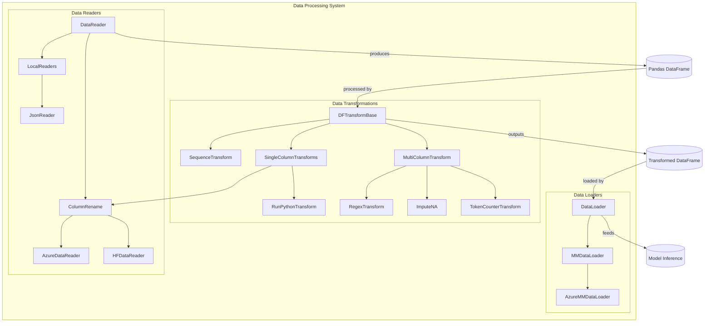
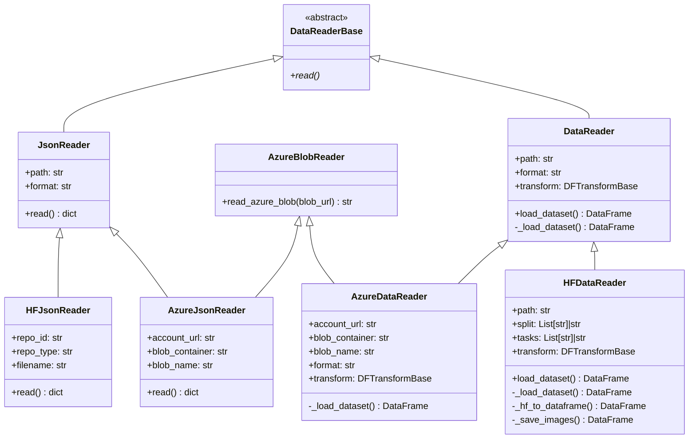
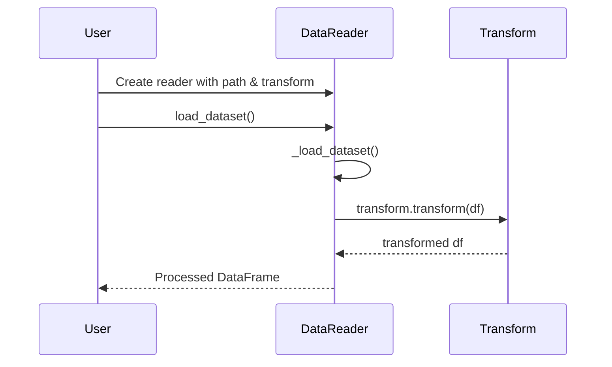
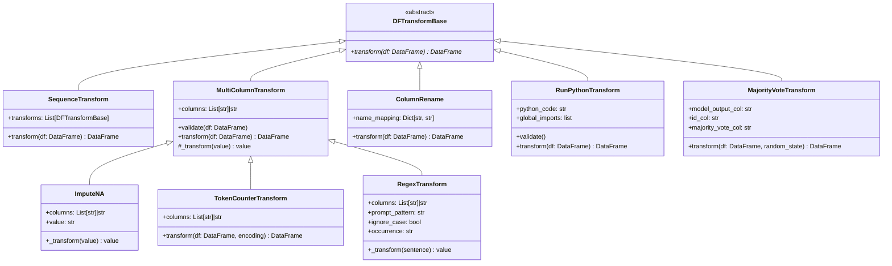
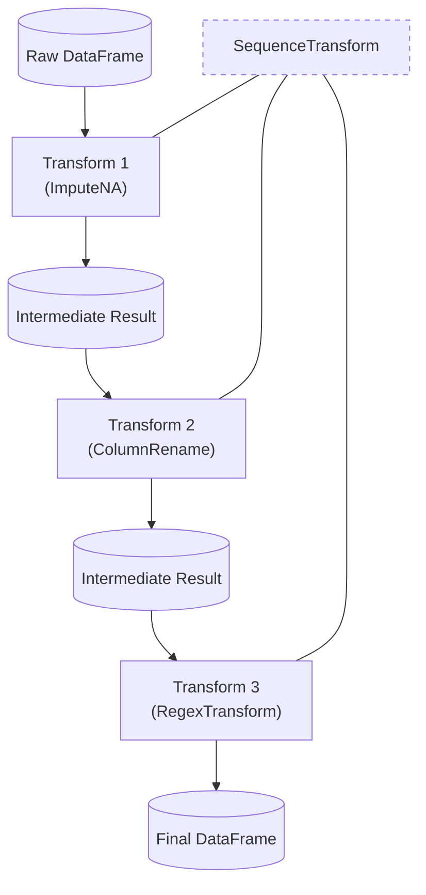
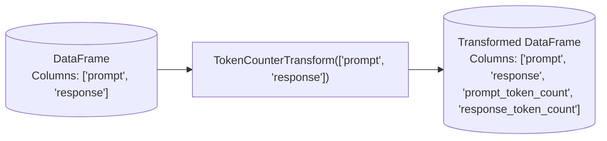
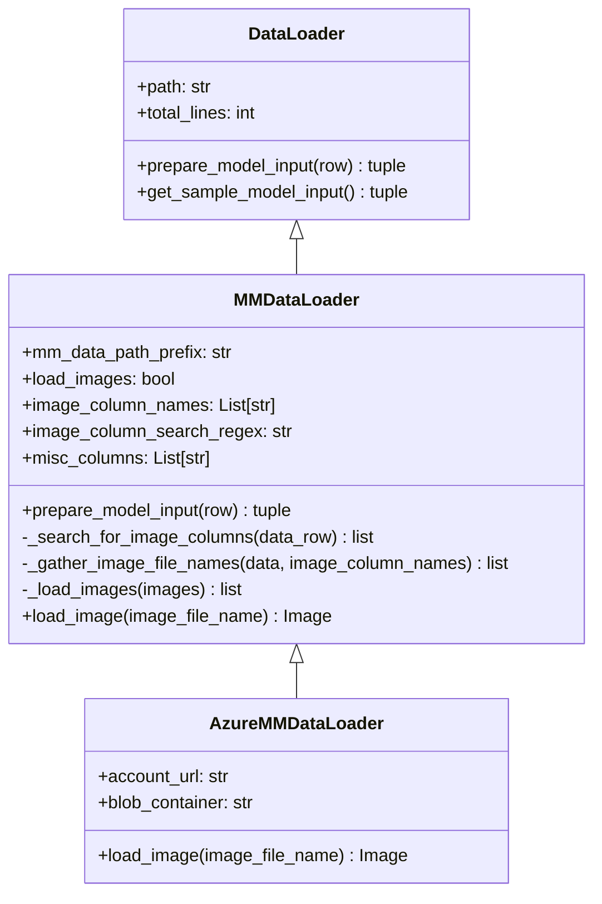
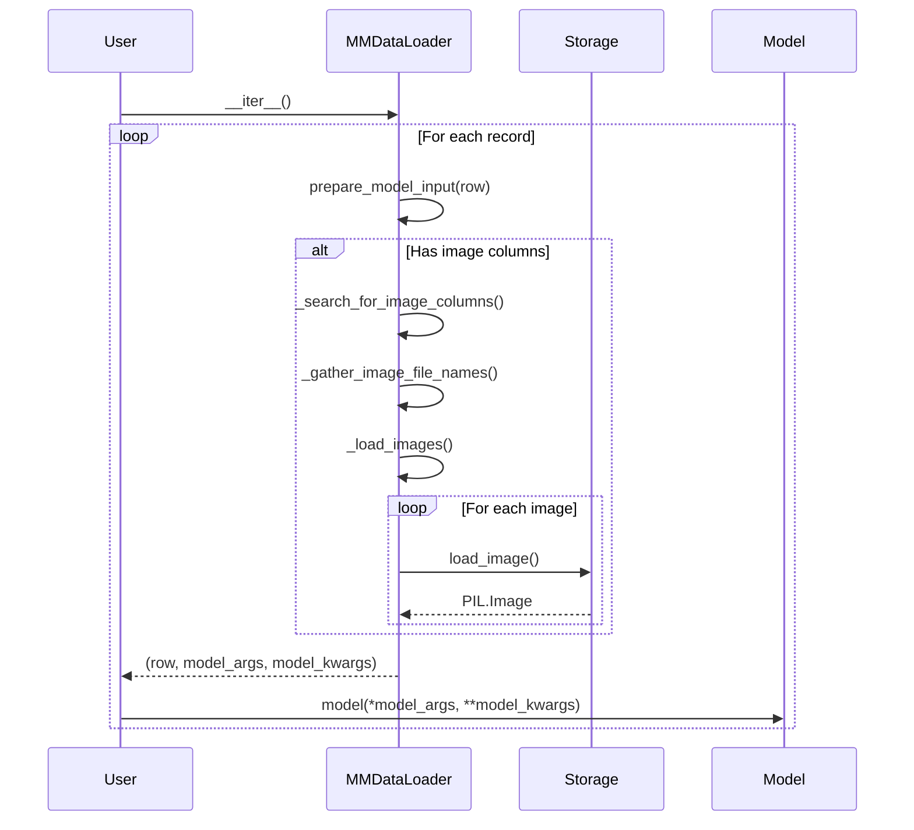
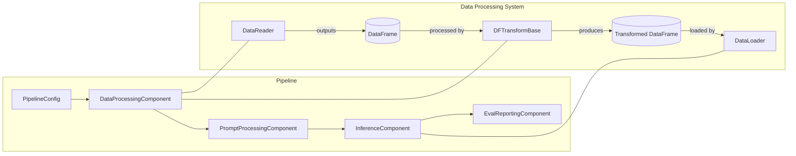
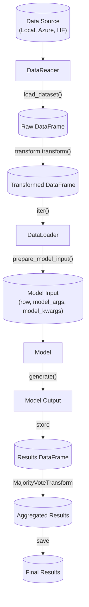

<!-- source: DeepWiki mcp.deepwiki.com · repo microsoft/eureka-ml-insights · page 4 Data Processing · fetched 2026-10-26 -->

# Data Processing

Relevant source files

The following files were used as context for generating this wiki page:

- [eureka_ml_insights/data_utils/__init__.py](eureka_ml_insights/data_utils/__init__.py)
- [eureka_ml_insights/data_utils/data.py](eureka_ml_insights/data_utils/data.py)
- [eureka_ml_insights/data_utils/transform.py](eureka_ml_insights/data_utils/transform.py)
- [tests/data_utils_tests/data_tests.py](tests/data_utils_tests/data_tests.py)

The Data Processing system in Eureka ML Insights is responsible for loading, transforming, and preparing data for model evaluation. It includes components for reading data from various sources, applying transformations to prepare the data for inference, and delivering data to models during evaluation.

For information about model-specific components, see [Model System](#3). For details about how to configure data processing pipelines, see [Configuration System](#2.2).

## Overview

The Data Processing system consists of three main component types:

1. **Data Readers** - Load data from various sources (local files, Azure storage, HuggingFace)
2. **Data Transformations** - Modify and prepare data for model evaluation
3. **Data Loaders** - Feed data to models during inference

Sources: [eureka_ml_insights/data_utils/data.py:32-504](), [eureka_ml_insights/data_utils/transform.py:29-506]()

## Data Readers

Data Readers are classes responsible for loading data from various sources into pandas DataFrames.

### Class Hierarchy

Sources: [eureka_ml_insights/data_utils/data.py:32-650]()

### Key Data Reader Classes

| Class | Description | Source |
|-------|-------------|--------|
| `DataReaderBase` | Abstract base class for all data readers | [data.py:32-35]() |
| `DataReader` | Base implementation for reading datasets and applying transformations | [data.py:418-468]() |
| `JsonReader` | Reads JSON or JSONL files from local paths | [data.py:302-321]() |
| `AzureDataReader` | Reads data from Azure Blob Storage | [data.py:471-504]() |
| `HFDataReader` | Reads data from HuggingFace datasets | [data.py:507-650]() |
| `AzureJsonReader` | Reads JSON data from Azure Blob Storage | [data.py:340-371]() |
| `HFJsonReader` | Reads JSON data from HuggingFace repositories | [data.py:374-390]() |

Sources: [eureka_ml_insights/data_utils/data.py:32-650]()

#### Common Usage Pattern

Sources: [eureka_ml_insights/data_utils/data.py:445-453]()

## Data Transformations

Data Transformations allow manipulation of DataFrames to prepare data for model evaluation. The framework is built around the `DFTransformBase` abstract class and provides numerous implementations for specific transformation needs.

### Transform Class Hierarchy

Sources: [eureka_ml_insights/data_utils/transform.py:29-506]()

### Key Transformation Classes

| Category | Class | Description | Source |
|----------|-------|-------------|--------|
| **Base** | `DFTransformBase` | Abstract base class for all transformations | [transform.py:29-32]() |
| **Composition** | `SequenceTransform` | Applies multiple transformations in sequence | [transform.py:35-42]() |
| **Column Operations** | `ColumnRename` | Renames columns according to a mapping | [transform.py:45-50]() |
| | `CopyColumn` | Copies data from one column to another | [transform.py:158-168]() |
| | `AddColumn` | Adds an empty column | [transform.py:138-144]() |
| | `AddColumnAndData` | Adds a column with specified data | [transform.py:147-155]() |
| **Data Manipulation** | `ImputeNA` | Fills missing values | [transform.py:264-275]() |
| | `ReplaceStringsTransform` | Replaces strings in selected columns | [transform.py:278-294]() |
| | `MapStringsTransform` | Maps values according to a dictionary | [transform.py:297-311]() |
| | `RegexTransform` | Extracts patterns using regex | [transform.py:334-361]() |
| **Advanced** | `RunPythonTransform` | Runs arbitrary Python code | [transform.py:53-100]() |
| | `MajorityVoteTransform` | Applies majority voting across repeats | [transform.py:404-429]() |
| **MCQ Specific** | `ShuffleColumnsTransform` | Shuffles values across columns for MCQ benchmarks | [transform.py:204-228]() |
| | `ColumnMatchMapTransform` | Identifies columns with matching values | [transform.py:231-261]() |

Sources: [eureka_ml_insights/data_utils/transform.py:29-506]()

### Transformation Workflow

Sources: [eureka_ml_insights/data_utils/transform.py:35-42]()

### Example: Token Counting

The `TokenCounterTransform` class illustrates a practical transformation that counts tokens in string columns, which is useful for working with LLMs:

Sources: [eureka_ml_insights/data_utils/transform.py:377-401]()

## Data Loaders

Data Loaders are responsible for feeding data to models during inference. They handle the iteration through dataset records and prepare the input for models in the expected format.

### Loader Class Hierarchy

Sources: [eureka_ml_insights/data_utils/data.py:38-281]()

### Key Data Loader Classes

| Class | Description | Source |
|-------|-------------|--------|
| `DataLoader` | Base loader for JSONL data | [data.py:38-73]() |
| `MMDataLoader` | Loader for multimodal data with images | [data.py:75-219]() |
| `AzureMMDataLoader` | Loader for multimodal data from Azure | [data.py:237-281]() |

Sources: [eureka_ml_insights/data_utils/data.py:38-281]()

### Multimodal Data Loading Process

Sources: [eureka_ml_insights/data_utils/data.py:75-219]()

## Task-Specific Utilities

The Data Processing system includes specialized utilities for processing benchmark-specific data:

| Task Type | Utilities | Purpose |
|-----------|-----------|---------|
| Spatial Reasoning | `ExtractAnswerGrid`, `ExtractAnswerSpatialMapAndMaze` | Extract answers from spatial reasoning tasks |
| Math Problems | `AIMEExtractAnswer` | Extract answers from AIME math problems |
| Multiple Choice | `ShuffleColumnsTransform`, `ColumnMatchMapTransform` | Handle randomization and answer matching in MCQ benchmarks |

Sources: [eureka_ml_insights/data_utils/__init__.py:1-83]()

## Integration with Pipeline System

Sources: [eureka_ml_insights/data_utils/data.py:32-650](), [eureka_ml_insights/data_utils/transform.py:29-506]()

## End-to-End Data Processing Flow

Sources: [eureka_ml_insights/data_utils/data.py:32-650](), [eureka_ml_insights/data_utils/transform.py:29-506]()

## Conclusion

The Data Processing system in Eureka ML Insights provides a comprehensive framework for working with evaluation data throughout the model evaluation lifecycle. Its modular design allows for flexibility in data sources, transformations, and loading strategies, making it adaptable to various evaluation scenarios.

For information about specific task implementations, see the [Benchmarks](#5) section.

---

