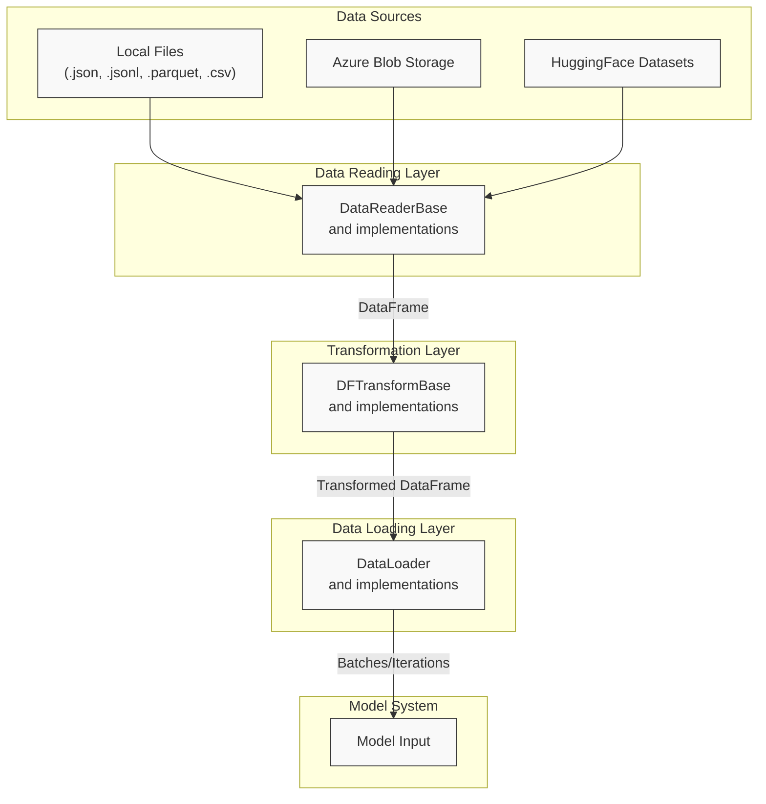
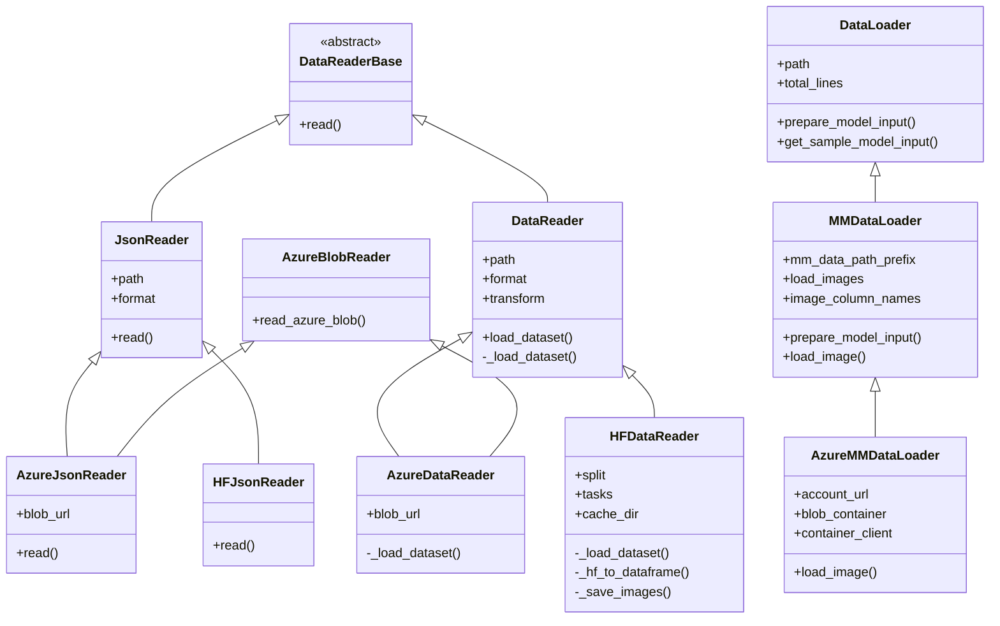
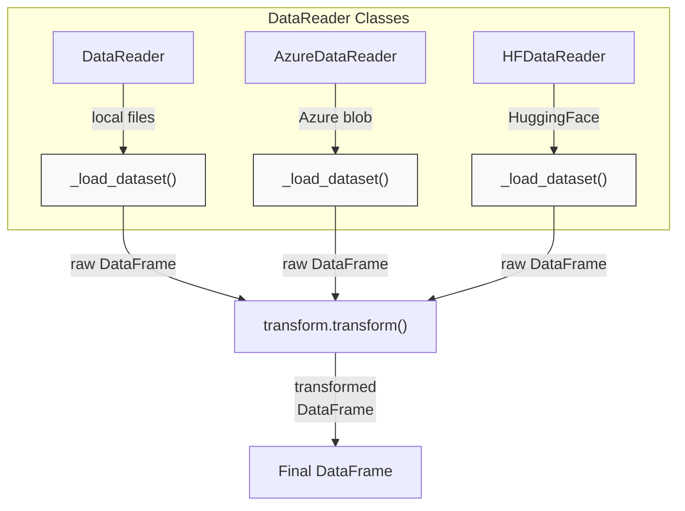
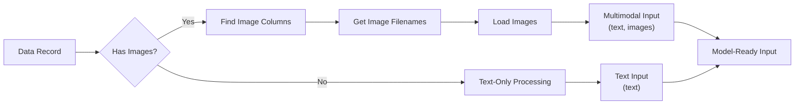

<!-- source: DeepWiki mcp.deepwiki.com · repo microsoft/eureka-ml-insights · page 4.1 Data Readers and Loaders · fetched 2026-10-26 -->

# Data Readers and Loaders

<details>
<summary>Relevant source files</summary>

The following files were used as context for generating this wiki page:

- [eureka_ml_insights/data_utils/data.py](eureka_ml_insights/data_utils/data.py)

</details>


## Purpose and Scope

This document covers the data reading and loading components within the Eureka ML Insights framework. These components handle data acquisition from various sources (local, cloud, external repositories), transformation, and preparation for model inference. For information about data transformations specifically, see [Data Transformations](#4.2).

The Data Readers and Loaders system serves as the critical bridge between raw data sources and the model inference process, supporting both standard text data and multimodal inputs containing images.

## System Overview

The Data Readers and Loaders system provides a flexible framework for:
1. Reading data from different sources (local files, Azure Blob Storage, HuggingFace datasets)
2. Supporting multiple file formats (JSON, JSONL, Parquet, CSV)
3. Handling multimodal data with images
4. Applying transformations to prepare data for model inference
5. Efficiently iterating through data during model evaluation



Sources: [eureka_ml_insights/data_utils/data.py:32-650]()

## Class Architecture

The system is structured into a hierarchy of classes that handle different aspects of data operations:



Sources: [eureka_ml_insights/data_utils/data.py:32-50](), [eureka_ml_insights/data_utils/data.py:302-371](), [eureka_ml_insights/data_utils/data.py:418-650](), [eureka_ml_insights/data_utils/data.py:38-73](), [eureka_ml_insights/data_utils/data.py:75-218](), [eureka_ml_insights/data_utils/data.py:237-281]()

## Data Readers

Data Readers are responsible for loading data from various sources into pandas DataFrames for processing. They support different file formats and can apply transformations to the loaded data.

### Core Data Reader Classes

1. **`DataReaderBase`**: Abstract base class that defines the reader interface
2. **`DataReader`**: Base implementation for reading local files
3. **`AzureDataReader`**: Reads data from Azure Blob Storage
4. **`HFDataReader`**: Reads data from HuggingFace datasets
5. **`JsonReader`**: Specialized reader for JSON/JSONL files
6. **`AzureJsonReader`**: Reads JSON/JSONL from Azure Blob Storage
7. **`HFJsonReader`**: Reads JSON/JSONL from HuggingFace

### Data Reader Data Flow



Sources: [eureka_ml_insights/data_utils/data.py:32-37](), [eureka_ml_insights/data_utils/data.py:418-468](), [eureka_ml_insights/data_utils/data.py:471-504](), [eureka_ml_insights/data_utils/data.py:507-650]()

### Example Usage Patterns

#### Reading Local Data
- Use `DataReader` for Parquet, CSV, or JSONL files
- Apply optional transformations during loading

#### Reading from Azure Blob Storage
- Use `AzureDataReader` with account URL, container, and blob name
- Supports JSONL format with potential transformations

#### Reading from HuggingFace Datasets
- Use `HFDataReader` with dataset path, split, and optional task names
- Handles multimodal data with image caching

## Data Loaders

Data Loaders provide an iterable interface to feed data to models during inference. They prepare data records in the format required by the model, including handling multimodal content.

### Core Data Loader Classes

1. **`DataLoader`**: Base class for loading data from local files
2. **`MMDataLoader`**: Extends DataLoader with support for multimodal (image) data
3. **`AzureMMDataLoader`**: Loads multimodal data with images from Azure Blob Storage

### Key Features

- Iterator interface for efficient data processing
- Specialized handling of multimodal data with images
- Methods to prepare model inputs in the correct format
- Support for multiple image columns and different storage locations

### Multimodal Data Flow



Sources: [eureka_ml_insights/data_utils/data.py:38-73](), [eureka_ml_insights/data_utils/data.py:75-218](), [eureka_ml_insights/data_utils/data.py:237-281]()

## Specialized Components

### JSON Readers

The framework provides specialized readers for JSON and JSONL data:

- **`JsonReader`**: Base class for JSON/JSONL reading
- **`AzureJsonReader`**: Reads JSON/JSONL from Azure Blob Storage
- **`HFJsonReader`**: Reads JSON/JSONL from HuggingFace datasets

### Writer Components

The framework also includes writers for saving data:

- **`Writer`**: Base class for writing data
- **`TXTWriter`**: Writes to text files
- **`JsonLinesWriter`**: Writes JSONL files

Sources: [eureka_ml_insights/data_utils/data.py:284-299](), [eureka_ml_insights/data_utils/data.py:302-371](), [eureka_ml_insights/data_utils/data.py:393-415]()

## Azure Integration

The framework provides extensive support for Azure Blob Storage through several components:

- **`AzureBlobReader`**: Core functionality for reading from Azure blobs
- **`AzureStorageLogger`**: Logger for Azure Storage operations
- **`AzureDataAuthenticator`**: Authentication for Azure services
- **`AzureDataReader`**: Reads data from Azure Blob Storage
- **`AzureJsonReader`**: Specialized JSON reader for Azure Blob Storage
- **`AzureMMDataLoader`**: Loads multimodal data with images from Azure Blob Storage

These components use the `DefaultAzureCredential` for authentication and support various Azure-specific features.

Sources: [eureka_ml_insights/data_utils/data.py:25-29](), [eureka_ml_insights/data_utils/data.py:221-235](), [eureka_ml_insights/data_utils/data.py:324-337](), [eureka_ml_insights/data_utils/data.py:340-371](), [eureka_ml_insights/data_utils/data.py:471-504](), [eureka_ml_insights/data_utils/data.py:237-281]()

## HuggingFace Integration

The framework integrates with HuggingFace datasets through:

- **`HFDataReader`**: Loads data from HuggingFace datasets
- **`HFJsonReader`**: Specialized JSON reader for HuggingFace repositories

These components support loading datasets based on split and task, handling multimodal data, and applying transformations.

Sources: [eureka_ml_insights/data_utils/data.py:374-390](), [eureka_ml_insights/data_utils/data.py:507-650]()

## Implementation Details

### Data Reader Base Classes

The `DataReaderBase` is an abstract base class that defines the interface for all data readers:

```python
class DataReaderBase(ABC):
    @abstractmethod
    def read(self):
        raise NotImplementedError
```

The concrete implementation in `DataReader` provides the foundation for reading various file formats:

```python
class DataReader:
    def __init__(self, path, format=None, transform=None, **kwargs):
        # Initialize with path, format, transform, and other args
        
    def load_dataset(self) -> pd.DataFrame:
        # Load dataset, apply transform, and return DataFrame
        
    def _load_dataset(self) -> pd.DataFrame:
        # Implementation for different file formats
```

Sources: [eureka_ml_insights/data_utils/data.py:32-37](), [eureka_ml_insights/data_utils/data.py:418-468]()

### Data Loader Implementation

The base `DataLoader` class provides an iterator interface for data:

```python
class DataLoader:
    def __init__(self, path, total_lines=None):
        # Initialize with path and optional line count
        
    def __iter__(self):
        # Iterate through data, yielding prepared inputs
        
    def prepare_model_input(self, row):
        # Convert data row to model input format
```

The `MMDataLoader` extends this for multimodal data:

```python
class MMDataLoader(DataLoader):
    def __init__(self, path, mm_data_path_prefix="", total_lines=None, 
                 load_images=True, image_column_names=None, 
                 image_column_search_regex="image", misc_columns=None):
        # Initialize with multimodal specific parameters
        
    def prepare_model_input(self, row):
        # Handle text and images for model input
```

Sources: [eureka_ml_insights/data_utils/data.py:38-73](), [eureka_ml_insights/data_utils/data.py:75-218]()

## Summary

The Data Readers and Loaders system in Eureka ML Insights provides a flexible framework for loading, transforming, and feeding data to models. Key features include:

1. Support for multiple data sources (local, Azure, HuggingFace)
2. Handling of various file formats
3. Built-in support for multimodal data with images
4. Transformation pipeline integration
5. Efficient iteration for model inference

This system forms a critical part of the evaluation pipeline, bridging between raw data and model inference.

---

