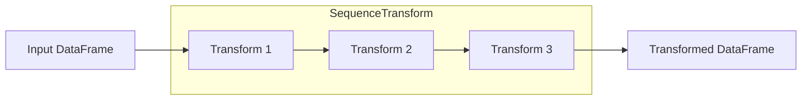
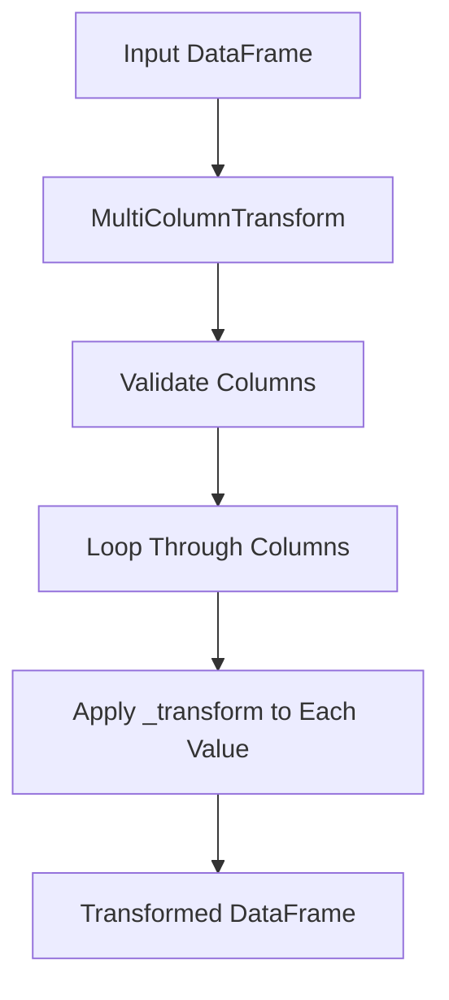
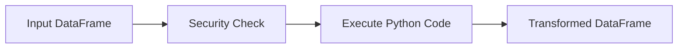
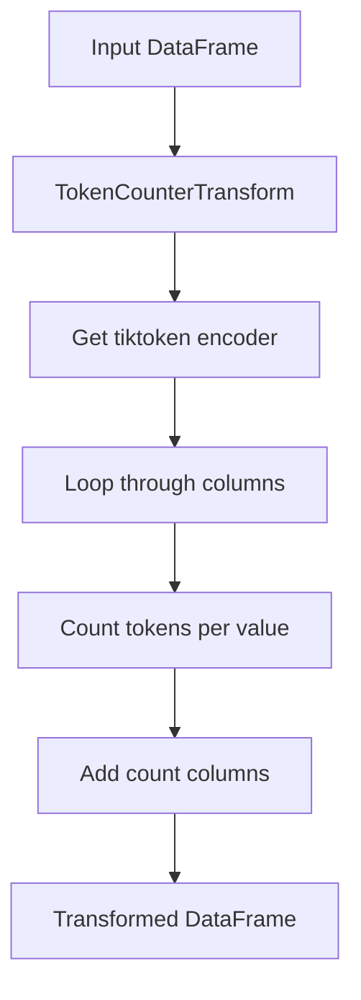
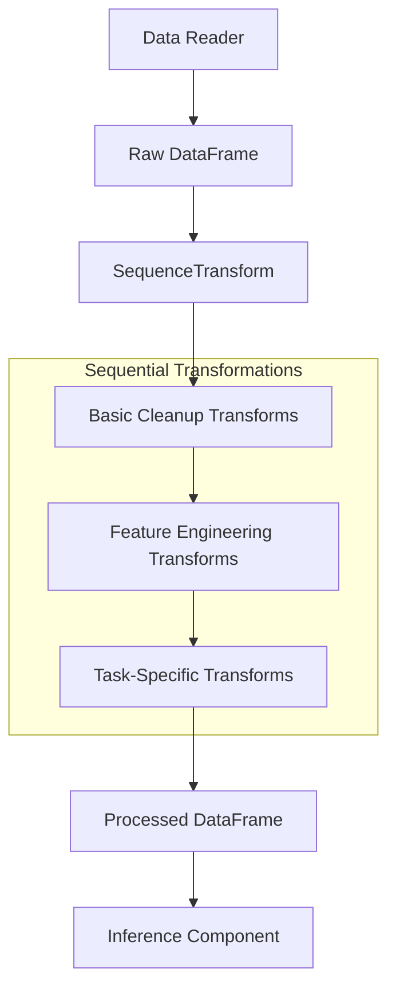

<!-- source: DeepWiki mcp.deepwiki.com · repo microsoft/eureka-ml-insights · page 4.2 Data Transformations · fetched 2026-10-26 -->

# Data Transformations

<details>
<summary>Relevant source files</summary>

The following files were used as context for generating this wiki page:

- [eureka_ml_insights/data_utils/__init__.py](eureka_ml_insights/data_utils/__init__.py)
- [eureka_ml_insights/data_utils/transform.py](eureka_ml_insights/data_utils/transform.py)
- [tests/data_utils_tests/data_tests.py](tests/data_utils_tests/data_tests.py)

</details>


This page documents the data transformation framework in Eureka ML Insights, which provides a flexible system for manipulating data in evaluation pipelines. The framework is built around pandas DataFrames and offers various transformation types that can be composed together to build complex data processing logic.

For information about loading data from different sources, see [Data Readers and Loaders](#4.1). For task-specific data processing utilities, see [Task-Specific Utilities](#4.3).

## Core Architecture

The data transformation framework is designed around a simple, composable architecture that allows transformations to be chained together and reused across different evaluation pipelines.

```mermaid
classDiagram
    class "DFTransformBase" {
        <<abstract>>
        +transform(df: DataFrame): DataFrame
    }
    
    class "SequenceTransform" {
        +transforms: List[DFTransformBase]
        +transform(df: DataFrame): DataFrame
    }
    
    class "MultiColumnTransform" {
        <<abstract>>
        +columns: List[str] | str
        +validate(df: DataFrame): void
        +transform(df: DataFrame): DataFrame
        +_transform(value): any
    }
    
    class "SingleColumnTransforms" {
        ColumnRename
        AddColumn
        AddColumnAndData
        CopyColumn
        SamplerTransform
        MultiplyTransform
        RunPythonTransform
    }
    
    class "DerivedMultiColumnTransforms" {
        ImputeNA
        MapStringsTransform
        ReplaceStringsTransform
        PrependStringTransform
        RegexTransform
        ASTEvalTransform
        TokenCounterTransform
    }
    
    class "SpecializedTransforms" {
        ShuffleColumnsTransform
        ColumnMatchMapTransform
        MajorityVoteTransform
        ExtractUsageTransform
    }
    
    DFTransformBase <|-- SequenceTransform
    DFTransformBase <|-- MultiColumnTransform
    DFTransformBase <|-- SingleColumnTransforms
    MultiColumnTransform <|-- DerivedMultiColumnTransforms
    DFTransformBase <|-- SpecializedTransforms
```

**Diagram: Data Transformation Class Hierarchy**

Sources: [eureka_ml_insights/data_utils/transform.py:29-32](), [eureka_ml_insights/data_utils/transform.py:35-42](), [eureka_ml_insights/data_utils/transform.py:171-201]()

The architecture follows these principles:

1. **Composability**: All transformations implement a common interface through the `DFTransformBase` abstract class
2. **Chainability**: `SequenceTransform` allows multiple transformations to be applied in sequence
3. **Column-centric**: Many transformations operate on specific columns of the DataFrame
4. **Type safety**: Transformations validate input data before processing

## Base Classes

### DFTransformBase

`DFTransformBase` is the abstract base class for all data transformations, providing a simple, consistent interface:

```mermaid
classDiagram
    class "DFTransformBase" {
        <<abstract>>
        +transform(df: DataFrame): DataFrame
    }
```

**Diagram: DFTransformBase Interface**

Sources: [eureka_ml_insights/data_utils/transform.py:29-32]()

All transformation classes must implement the `transform` method, which:
- Takes a pandas DataFrame as input
- Returns a transformed pandas DataFrame as output

### SequenceTransform

`SequenceTransform` allows multiple transformations to be chained together:



**Diagram: SequenceTransform Operation**

Sources: [eureka_ml_insights/data_utils/transform.py:35-42]()

`SequenceTransform` takes a list of transformations and applies them sequentially, passing the output of one transformation as the input to the next.

### MultiColumnTransform

`MultiColumnTransform` is a base class for transformations that apply a common operation to multiple columns:



**Diagram: MultiColumnTransform Operation Flow**

Sources: [eureka_ml_insights/data_utils/transform.py:171-201]()

Key features of `MultiColumnTransform`:
- Validates that specified columns exist in the DataFrame
- Applies the same transformation to each specified column
- Subclasses implement the `_transform` method to define the specific transformation

## General Purpose Transformations

### Column Operations

These transformations modify the structure of the DataFrame by operating on columns:

| Transformation | Description | Key Parameters |
|----------------|-------------|----------------|
| `ColumnRename` | Renames columns using a mapping | `name_mapping`: Dictionary of old to new column names |
| `AddColumn` | Adds a new empty column | `column_name`: Name of the column to add |
| `AddColumnAndData` | Adds a new column with specified data | `column_name`, `data`: Name and value for the new column |
| `CopyColumn` | Copies data from one column to another | `column_name_src`, `column_name_dst`: Source and destination columns |

Sources: [eureka_ml_insights/data_utils/transform.py:45-168]()

### Row Operations

These transformations operate on rows or alter the number of rows:

| Transformation | Description | Key Parameters |
|----------------|-------------|----------------|
| `SamplerTransform` | Randomly samples rows | `sample_count`: Number of rows to sample, `random_seed`: For reproducibility, `stratify_by`: Optional column(s) for stratified sampling |
| `MultiplyTransform` | Repeats each row multiple times | `n_repeats`: Number of times to repeat each row |

Sources: [eureka_ml_insights/data_utils/transform.py:104-135]()

### Python Code Execution

`RunPythonTransform` allows executing arbitrary Python code on the DataFrame:



**Diagram: RunPythonTransform Operation**

Sources: [eureka_ml_insights/data_utils/transform.py:53-100]()

Key features:
- Security validation to allow only safe operations
- Support for global imports from a restricted safe list
- Execution in a controlled environment

## Text and String Transformations

These transformations are designed for manipulating text data:

| Transformation | Description | Key Parameters |
|----------------|-------------|----------------|
| `ImputeNA` | Replaces missing values | `columns`: Columns to process, `value`: Replacement value |
| `MapStringsTransform` | Maps strings to other values using a dictionary | `columns`, `mapping`: Dictionary mapping from old to new values |
| `ReplaceStringsTransform` | Replaces substrings | `columns`, `mapping`: Dictionary of substrings to replace, `case`: Whether to be case-sensitive |
| `PrependStringTransform` | Adds a prefix to strings | `columns`, `string`: The prefix to add |
| `RegexTransform` | Extracts patterns using regex | `columns`, `prompt_pattern`: Regex pattern, `occurrence`: Which match to extract |
| `ASTEvalTransform` | Parses strings using Python's AST | `columns`: Columns containing string representations of Python literals |

Sources: [eureka_ml_insights/data_utils/transform.py:265-374]()

### Token Counter Transform

`TokenCounterTransform` counts tokens in text using the `tiktoken` library:



**Diagram: TokenCounterTransform Operation**

Sources: [eureka_ml_insights/data_utils/transform.py:377-401]()

This transformation is particularly useful for:
- Estimating token usage in LLM prompts and responses
- Planning or optimizing prompts to fit within token limits
- Analyzing model output length

## Specialized Transformations

### MCQ Benchmark Transformations

These transformations are specialized for multiple-choice question (MCQ) benchmarks:

| Transformation | Description | Key Parameters |
|----------------|-------------|----------------|
| `ShuffleColumnsTransform` | Shuffles values across columns for each row | `columns`: Columns to shuffle, `rng`: Random number generator |
| `ColumnMatchMapTransform` | Finds which column matches a key value | `key_col`: Column containing the value to match, `new_col`: Column to store the result, `columns`: Columns to search in |

Sources: [eureka_ml_insights/data_utils/transform.py:204-261]()

### Aggregation and Analysis Transformations

| Transformation | Description | Key Parameters |
|----------------|-------------|----------------|
| `MajorityVoteTransform` | Calculates majority vote per group | `model_output_col`: Column with model outputs, `id_col`: Column for grouping, `majority_vote_col`: Column to store results |
| `ExtractUsageTransform` | Extracts token usage metrics | `model_config`: Configuration of the model, `usage_completion_output_col`: Column to store results |

Sources: [eureka_ml_insights/data_utils/transform.py:404-506]()

## Usage Patterns

The data transformation framework is typically used in these ways:



**Diagram: Typical Data Transformation Pipeline**

Sources: [eureka_ml_insights/data_utils/transform.py:35-42]()

Common patterns include:
1. **Preprocessing**: Clean and prepare data before inference
2. **Feature Engineering**: Create new features from existing data
3. **Post-processing**: Extract and format model outputs for evaluation
4. **Answer Extraction**: Parse model responses to get structured answers

## Examples

Here's an example of how to chain transformations together:

```python
transforms = SequenceTransform([
    # Rename columns for consistency
    ColumnRename({"input": "question", "output": "ground_truth"}),
    
    # Add a placeholder for model output
    AddColumn("model_output"),
    
    # Clean up missing values
    ImputeNA(["question", "ground_truth"], ""),
    
    # Extract numerical answers using regex
    RegexTransform("model_output", r"\d+(\.\d+)?", occurrence="first"),
    
    # Count tokens in the questions
    TokenCounterTransform("question")
])

processed_df = transforms.transform(input_df)
```

Another example showing transformations for multiple-choice questions:

```python
mcq_transforms = SequenceTransform([
    # Shuffle the answer choices
    ShuffleColumnsTransform(columns=["option_A", "option_B", "option_C", "option_D"]),
    
    # Track which column has the correct answer
    ColumnMatchMapTransform(
        key_col="correct_answer", 
        new_col="answer_key", 
        columns=["option_A", "option_B", "option_C", "option_D"]
    )
])
```

Sources: [tests/data_utils_tests/data_tests.py:28-257](), [eureka_ml_insights/data_utils/transform.py:35-42]()

## Creating Custom Transformations

To create a custom transformation, you can either:

1. **Extend DFTransformBase** - For completely custom transformations
2. **Extend MultiColumnTransform** - For transformations that apply to specific columns

Example structure for a custom transformation:

```python
@dataclass
class MyCustomTransform(DFTransformBase):
    # Define any parameters needed for the transformation
    param1: str
    param2: int
    
    def transform(self, df: pd.DataFrame) -> pd.DataFrame:
        # Implement transformation logic here
        result_df = df.copy()
        # ... transformation code ...
        return result_df
```

For column-based transformations:

```python
@dataclass
class MyColumnTransform(MultiColumnTransform):
    columns: List[str] | str
    additional_param: str
    
    def _transform(self, value):
        # Implement per-value transformation
        # ... transformation code ...
        return transformed_value
```

Sources: [eureka_ml_insights/data_utils/transform.py:29-32](), [eureka_ml_insights/data_utils/transform.py:171-201]()

## Summary

The data transformation framework in Eureka ML Insights provides a flexible, composable system for manipulating DataFrame data throughout the evaluation pipeline. The system's design emphasizes:

1. **Modularity**: Individual transformations can be combined in different ways
2. **Extensibility**: New transformations can be easily added
3. **Safety**: Built-in validation and security checks
4. **Specialization**: Purpose-built transformations for common ML evaluation tasks

This framework plays a crucial role in the overall evaluation pipeline, connecting data loading to model inference by ensuring that data is in the correct format for models and that model outputs are properly processed for evaluation.

Sources: [eureka_ml_insights/data_utils/__init__.py:22-43](), [eureka_ml_insights/data_utils/transform.py:29-506]()

---

