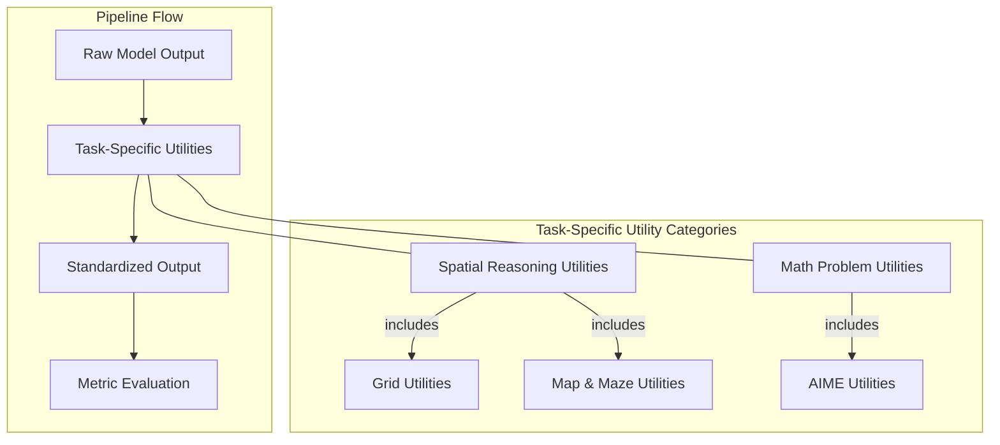
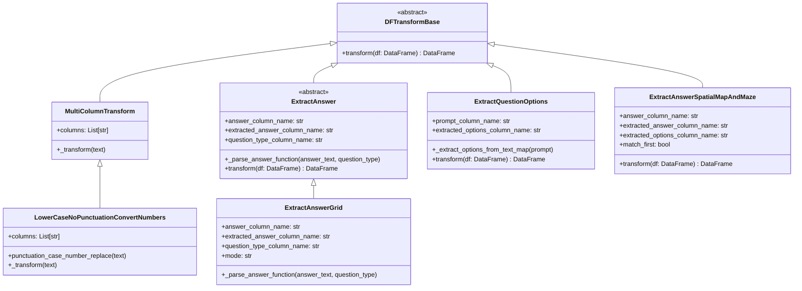
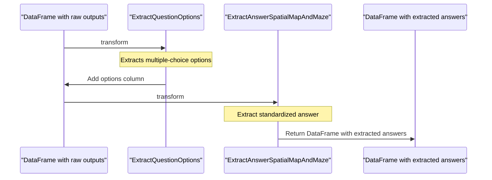
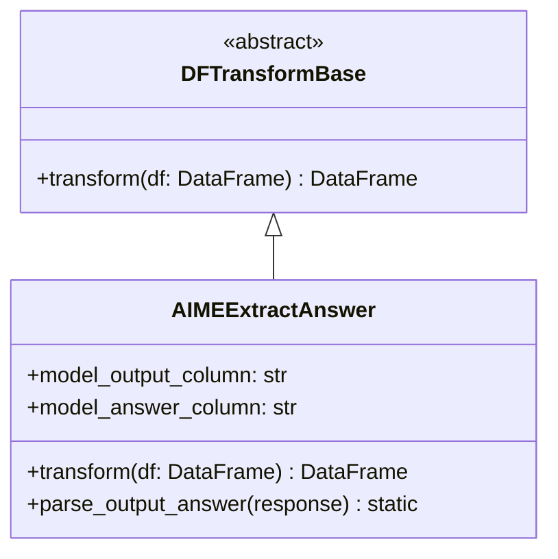
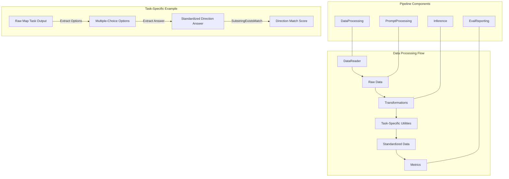

<!-- source: DeepWiki mcp.deepwiki.com · repo microsoft/eureka-ml-insights · page 4.3 Task-Specific Utilities · fetched 2026-10-26 -->

# Task-Specific Utilities

<details>
<summary>Relevant source files</summary>

The following files were used as context for generating this wiki page:

- [eureka_ml_insights/core/data_join.py](eureka_ml_insights/core/data_join.py)
- [eureka_ml_insights/data_utils/aime_utils.py](eureka_ml_insights/data_utils/aime_utils.py)
- [eureka_ml_insights/data_utils/spatial_utils.py](eureka_ml_insights/data_utils/spatial_utils.py)
- [eureka_ml_insights/prompt_templates/gpqa_templates/extract_gpqa_answer.jinja](eureka_ml_insights/prompt_templates/gpqa_templates/extract_gpqa_answer.jinja)
- [eureka_ml_insights/prompt_templates/gpqa_templates/gpqa_basic.jinja](eureka_ml_insights/prompt_templates/gpqa_templates/gpqa_basic.jinja)
- [eureka_ml_insights/prompt_templates/gpqa_templates/gpqa_brief.jinja](eureka_ml_insights/prompt_templates/gpqa_templates/gpqa_brief.jinja)
- [eureka_ml_insights/prompt_templates/gpqa_templates/gpqa_cot.jinja](eureka_ml_insights/prompt_templates/gpqa_templates/gpqa_cot.jinja)
- [eureka_ml_insights/prompt_templates/gpqa_templates/gpqa_solution.jinja](eureka_ml_insights/prompt_templates/gpqa_templates/gpqa_solution.jinja)
- [eureka_ml_insights/user_configs/vision_language/maze.py](eureka_ml_insights/user_configs/vision_language/maze.py)
- [eureka_ml_insights/user_configs/vision_language/spatial_map.py](eureka_ml_insights/user_configs/vision_language/spatial_map.py)
- [tests/data_utils_tests/aime_utils_tests.py](tests/data_utils_tests/aime_utils_tests.py)
- [tests/data_utils_tests/vision_language_data_utils_tests.py](tests/data_utils_tests/vision_language_data_utils_tests.py)

</details>


## Purpose and Scope

This document describes the specialized utility classes and functions designed to handle task-specific data processing needs within the Eureka ML Insights framework. These utilities primarily focus on answer extraction, formatting, and standardization for various benchmark tasks such as spatial reasoning, mathematical problem-solving, and other specialized evaluations.

Task-specific utilities serve as an essential bridge between raw model outputs and standardized evaluation metrics. They transform unstructured or semi-structured model responses into normalized formats that can be consistently evaluated against reference answers.

For general data transformation utilities that are not specific to particular tasks, see [Data Transformations](#4.2).

## Overview of Task-Specific Utilities



Sources:
- [eureka_ml_insights/data_utils/spatial_utils.py]()
- [eureka_ml_insights/data_utils/aime_utils.py]()

## Spatial Reasoning Utilities

Spatial reasoning utilities parse and standardize model outputs for tasks that involve spatial relationships, such as understanding relative positions in grids, maps, and mazes.

### Class Hierarchy



Sources:
- [eureka_ml_insights/data_utils/spatial_utils.py:11-347]()
- [eureka_ml_insights/data_utils/transform.py]()

### Key Classes and Functions

#### Text Normalization

`LowerCaseNoPunctuationConvertNumbers` is a transformation class that normalizes text by:
- Converting to lowercase
- Removing punctuation
- Converting textual numbers (e.g., "one", "two") to numeric equivalents

This standardization helps improve the robustness of answer matching by handling common variations in model outputs.

```python
# Example of how number mapping works
number_mapping = {
    "zero": 0,
    "one": 1,
    "two": 2,
    # ...and so on
}
```

Sources:
- [eureka_ml_insights/data_utils/spatial_utils.py:11-42]()

#### Answer Extraction Functions

The spatial utilities module provides several specialized functions for extracting answers from model outputs:

1. `extract_answer_from_text_grid`: Extracts numerical or categorical answers from grid-based spatial reasoning tasks
   
2. `extract_answer_from_text_map_and_maze`: Extracts directional or positional answers from map and maze tasks

These functions employ various pattern matching techniques to identify answers in different formats, including:
- Detecting letter-based answers (e.g., "A", "B", "C", "D")
- Finding numeric counts
- Identifying directional terms (e.g., "northeast", "southwest")
- Parsing specific phrases (e.g., "there are X blocks")

Sources:
- [eureka_ml_insights/data_utils/spatial_utils.py:70-266]()

#### Answer Extraction Classes

The module defines several DataFrame transformation classes that apply the extraction functions:

1. `ExtractAnswer`: Abstract base class for answer extractors
   
2. `ExtractAnswerGrid`: Implementation for grid-based spatial tasks
   
3. `ExtractAnswerSpatialMapAndMaze`: Implementation for map and maze tasks
   
4. `ExtractQuestionOptions`: Extracts the available options from multiple-choice prompts

These classes integrate with the data processing pipeline to transform raw model outputs into standardized formats for evaluation.

Sources:
- [eureka_ml_insights/data_utils/spatial_utils.py:269-347]()

### Usage Example



Here's how these utilities are typically used in a pipeline configuration:

```python
# Extract options and then extract answer
ExtractQuestionOptions(
    prompt_column_name="prompt",
    extracted_options_column_name="target_options_answers",
),
ColumnRename(name_mapping={"model_output": "model_output_raw"}),
ExtractAnswerSpatialMapAndMaze(
    answer_column_name="model_output_raw",
    extracted_answer_column_name="model_output",
    extracted_options_column_name="target_options_answers",
),
```

Sources:
- [eureka_ml_insights/user_configs/vision_language/spatial_map.py:95-107]()
- [eureka_ml_insights/user_configs/vision_language/maze.py:95-107]()

## Mathematical Reasoning Utilities

### AIME Utilities

The AIME (American Invitational Mathematics Examination) utilities provide specialized functions for parsing numerical answers from mathematical problem-solving tasks.



The `AIMEExtractAnswer` class handles:
- Extracting numeric answers from the format "Final Answer: X"
- Handling various number formats, including currency symbols and percentages
- Converting to standardized float values for consistent evaluation

Sources:
- [eureka_ml_insights/data_utils/aime_utils.py:1-43]()

### Pattern Matching for Numerical Answers

The AIME utilities use regular expressions to identify and extract numerical answers from model outputs:

```python
# Pattern to extract answers in the format "Final Answer: X"
match = re.search(r"Final Answer:\s*([\$]?-?[\d,]+(?:\.\d+)?%?)", response)
```

This pattern can match:
- Integer values: "Final Answer: 42"
- Decimal values: "Final Answer: 3.14"
- Currency values: "Final Answer: $100"
- Percentage values: "Final Answer: 75%"
- Negative values: "Final Answer: -17"

Sources:
- [eureka_ml_insights/data_utils/aime_utils.py:30-43]()
- [tests/data_utils_tests/aime_utils_tests.py:1-32]()

## Integration with Evaluation Pipelines

Task-specific utilities are integral components within evaluation pipelines. The following diagram illustrates how these utilities fit into the broader data processing workflow:



Sources:
- [eureka_ml_insights/user_configs/vision_language/spatial_map.py:54-165]()
- [eureka_ml_insights/user_configs/vision_language/maze.py:54-165]()

### Pipeline Configuration Examples

Task-specific utilities are typically configured within data processing transforms as part of the evaluation pipeline. Here's how they are used in spatial reasoning tasks:

#### Spatial Map Task

```python
# SequenceTransform with task-specific utilities
SequenceTransform([
    ExtractUsageTransform(model_config),                        
    ExtractQuestionOptions(
        prompt_column_name="prompt",
        extracted_options_column_name="target_options_answers",
    ),
    ColumnRename(name_mapping={"model_output": "model_output_raw"}),
    ExtractAnswerSpatialMapAndMaze(
        answer_column_name="model_output_raw",
        extracted_answer_column_name="model_output",
        extracted_options_column_name="target_options_answers",
    ),
])
```

Sources:
- [eureka_ml_insights/user_configs/vision_language/spatial_map.py:95-108]()

#### Maze Task

The configuration for maze tasks is almost identical to spatial map tasks, as they use the same answer extraction utilities:

```python
# Similar configuration for maze tasks
SequenceTransform([
    ExtractUsageTransform(model_config),                        
    ExtractQuestionOptions(
        prompt_column_name="prompt",
        extracted_options_column_name="target_options_answers",
    ),
    ColumnRename(name_mapping={"model_output": "model_output_raw"}),
    ExtractAnswerSpatialMapAndMaze(
        answer_column_name="model_output_raw",
        extracted_answer_column_name="model_output",
        extracted_options_column_name="target_options_answers",
    ),
])
```

Sources:
- [eureka_ml_insights/user_configs/vision_language/maze.py:95-108]()

## Creating Custom Task-Specific Utilities

To create a new task-specific utility for a specialized benchmark:

1. Inherit from `DFTransformBase` or an appropriate subclass
2. Implement the `transform` method to process a DataFrame
3. Create specialized extraction functions as needed
4. Integrate the utility into your pipeline configuration

The existing utilities provide patterns to follow for answer extraction:

- For multiple-choice answers: See `ExtractAnswerSpatialMapAndMaze`
- For numerical answers: See `AIMEExtractAnswer`
- For text-based answers: See `extract_answer_from_text_grid`

Sources:
- [eureka_ml_insights/data_utils/spatial_utils.py:269-347]()
- [eureka_ml_insights/data_utils/aime_utils.py:9-43]()

## Summary

Task-specific utilities in the Eureka ML Insights framework serve as specialized data transformation tools that convert raw model outputs into standardized formats for evaluation. They handle the idiosyncrasies of different benchmark tasks, ensuring consistent and accurate metric computation.

These utilities provide:
- Robust answer extraction from semi-structured text
- Standardization of text formats and number representations
- Specialized pattern matching for different answer types
- Integration with the broader data processing pipeline

The modular design allows for easy extension to new benchmark tasks by creating custom extractors following the established patterns.

---

