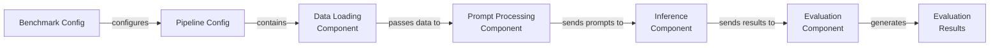
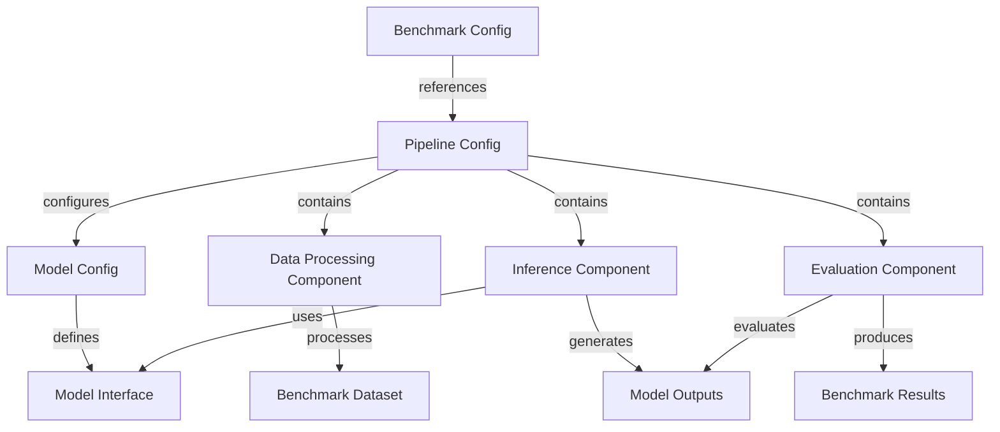
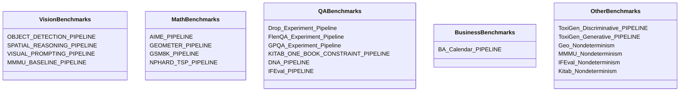

<!-- source: DeepWiki mcp.deepwiki.com · repo microsoft/eureka-ml-insights · page 5 Benchmarks · fetched 2026-10-26 -->

# Benchmarks

Relevant source files

The following files were used as context for generating this wiki page:

- [eureka_ml_insights/user_configs/__init__.py](eureka_ml_insights/user_configs/__init__.py)

## Overview

The Benchmarks system in Eureka ML Insights provides a comprehensive suite of standardized evaluation tasks designed to assess Large Language Model (LLM) capabilities across multiple domains. This page provides an overview of the available benchmarks and their organization within the framework.

For information about the metrics used to evaluate benchmark performance, see [Metrics and Evaluation](#6).

## Benchmark Categories

Eureka ML Insights organizes benchmarks into several major categories, each targeting different aspects of model capabilities.

```mermaid
graph TD
    Benchmarks["Benchmarks"] --> VIU["Vision and Image Understanding"]
    Benchmarks --> MR["Mathematical Reasoning"]
    Benchmarks --> QAK["Question Answering & Knowledge"]
    Benchmarks --> BLC["Business Logic & Calendaring"]
    Benchmarks --> Other["Other Benchmarks"]
    
    VIU --> OD["Object Detection"]
    VIU --> OR["Object Recognition"]
    VIU --> SR["Spatial Reasoning"]
    VIU --> VP["Visual Prompting"]
    VIU --> MMMU["Multimodal Understanding"]
    VIU --> VL["Vision Language Tasks"]
    
    MR --> AIME["AIME Math Competition"]
    MR --> GEO["GEOMETER"]
    MR --> GSM["GSM8K"]
    MR --> TSP["NP-Hard TSP"]
    
    QAK --> DROP["DROP QA"]
    QAK --> FLEN["FlenQA"]
    QAK --> GPQA["GPQA"]
    QAK --> KITAB["Kitab"]
    QAK --> DNA["DNA"]
    QAK --> IFE["IFEval"]
    
    BLC --> BAC["BA Calendar"]
    
    Other --> TOX["ToxiGen"]
    Other --> ND["Nondeterminism"]
```

Sources: [eureka_ml_insights/user_configs/__init__.py:1-149]()

## Benchmark Implementation

Each benchmark in Eureka ML Insights is implemented as a pipeline configuration that orchestrates the data loading, prompt processing, model inference, and evaluation components. These pipeline configurations are defined in the `user_configs` module.

Sources: [eureka_ml_insights/user_configs/__init__.py:1-149]()

## Vision and Image Understanding Benchmarks

The vision and image understanding benchmarks evaluate a model's ability to understand, interpret, and reason about visual information.

### Object Detection

Object detection benchmarks assess a model's ability to identify and locate objects within images. They include:

- `OBJECT_DETECTION_PAIRS_PIPELINE`: Evaluates the model on paired object detection tasks
- `OBJECT_DETECTION_SINGLE_PIPELINE`: Evaluates the model on single object detection tasks
- Local variants for offline testing: `OBJECT_DETECTION_PAIRS_LOCAL_PIPELINE`, `OBJECT_DETECTION_SINGLE_LOCAL_PIPELINE`

### Object Recognition

Object recognition benchmarks test a model's ability to recognize and classify objects:

- `OBJECT_RECOGNITION_PAIRS_PIPELINE`: Evaluates paired object recognition tasks
- `OBJECT_RECOGNITION_SINGLE_PIPELINE`: Evaluates single object recognition tasks
- Local variants: `OBJECT_RECOGNITION_PAIRS_LOCAL_PIPELINE`, `OBJECT_RECOGNITION_SINGLE_LOCAL_PIPELINE`

### Spatial Reasoning

Spatial reasoning benchmarks assess a model's understanding of spatial relationships between objects:

- `SPATIAL_REASONING_PAIRS_PIPELINE`: Tests paired spatial reasoning tasks
- `SPATIAL_REASONING_SINGLE_PIPELINE`: Tests single spatial reasoning tasks
- Local variants: `SPATIAL_REASONING_PAIRS_LOCAL_PIPELINE`, `SPATIAL_REASONING_SINGLE_LOCAL_PIPELINE`

### Visual Prompting

Visual prompting benchmarks evaluate how models respond to visual cues in prompts:

- `VISUAL_PROMPTING_PAIRS_PIPELINE`: Tests paired visual prompting tasks
- `VISUAL_PROMPTING_SINGLE_PIPELINE`: Tests single visual prompting tasks
- Local variants: `VISUAL_PROMPTING_PAIRS_LOCAL_PIPELINE`, `VISUAL_PROMPTING_SINGLE_LOCAL_PIPELINE`

### Multimodal Understanding (MMMU)

- `MMMU_BASELINE_PIPELINE`: Tests the model on the MMMU benchmark for multimodal understanding

### Vision Language Tasks

The framework includes specialized benchmarks for complex vision-language reasoning:

- Maze navigation: `MAZE_PIPELINE`, `MAZE_COT_PIPELINE`, `MAZE_TEXTONLY_PIPELINE`
- Spatial grid understanding: `SPATIAL_GRID_PIPELINE`, `SPATIAL_GRID_TEXTONLY_PIPELINE`
- Spatial map reasoning: `SPATIAL_MAP_PIPELINE`, `SPATIAL_MAP_COT_PIPELINE`, `SPATIAL_MAP_TEXTONLY_PIPELINE`

Sources: [eureka_ml_insights/user_configs/__init__.py:23-46](), [eureka_ml_insights/user_configs/__init__.py:55-55](), [eureka_ml_insights/user_configs/__init__.py:67-85]()

## Mathematical Reasoning Benchmarks

Mathematical reasoning benchmarks assess a model's ability to solve mathematical problems of varying difficulty.

### AIME (American Invitational Mathematics Examination)

- `AIME_PIPELINE`: Standard pipeline for AIME problems
- Multiple run variants for robustness testing: `AIME_PIPELINE5Run`, `AIME_PIPELINE16Run`, `AIME_PIPELINE32Run`, `AIME_PIPELINE64Run`, `AIME_PIPELINE256Run`, `AIME_PIPELINE512Run`, `AIME_PIPELINE1024Run`

### GSM8K (Grade School Math 8K)

- `GSM8K_PIPELINE`: Standard pipeline for GSM8K problems
- `GSM8K_MUTATED_PIPELINE`: Tests GSM8K with problem variations
- `GSMSYMBOLIC_PIPELINE`: Tests symbolic reasoning on GSM8K problems

### GEOMETER

- `GEOMETER_PIPELINE`: Evaluates geometric reasoning capabilities

### NP-Hard TSP (Traveling Salesman Problem)

- `NPHARD_TSP_PIPELINE`: Tests performance on NP-hard problems
- `NPHARD_TSP_PIPELINE_MULTIPLE_RUNS`: Multiple run version for robustness testing

Sources: [eureka_ml_insights/user_configs/__init__.py:1-10](), [eureka_ml_insights/user_configs/__init__.py:20-21](), [eureka_ml_insights/user_configs/__init__.py:62-62]()

## Question Answering and Knowledge Benchmarks

These benchmarks evaluate a model's ability to retrieve and apply knowledge to answer questions.

### DROP (Discrete Reasoning Over Paragraphs)

- `Drop_Experiment_Pipeline`: Tests reasoning over paragraphs

### FlenQA

- `FlenQA_Experiment_Pipeline`: Evaluates factual knowledge and reasoning

### GPQA (Graduate-level Professional QA)

- `GPQA_Experiment_Pipeline`: Tests graduate-level professional knowledge
- `GPQA_PIPELINE_5Run`: Multiple run variant for robustness testing

### Kitab (Book-related QA)

- `KITAB_ONE_BOOK_CONSTRAINT_PIPELINE`: Tests knowledge about books with one-book constraint
- `KITAB_ONE_BOOK_CONSTRAINT_PIPELINE_WITH_CONTEXT`: Includes context for the questions
- `KITAB_ONE_BOOK_CONSTRAINT_PIPELINE_SELF_CONTEXT`: Uses self-generated context
- `KITAB_TWO_BOOK_CONSTRAINT_PIPELINE`: Tests with two-book constraints
- `KITAB_TWO_BOOK_CONSTRAINT_PIPELINE_WITH_CONTEXT`: Two-book constraints with context
- `GPT35_KITAB_ONE_BOOK_CONSTRAINT_PIPELINE`: GPT-3.5 specific pipeline

### Other QA Benchmarks

- `DNA_PIPELINE`: Tests knowledge about DNA and genetics
- `IFEval_PIPELINE`: Evaluates instruction following capabilities

Sources: [eureka_ml_insights/user_configs/__init__.py:16-22](), [eureka_ml_insights/user_configs/__init__.py:47-54]()

## Business Logic and Calendaring Benchmarks

These benchmarks test a model's ability to perform business-oriented tasks.

### BA Calendar

- `BA_Calendar_PIPELINE`: Tests calendar reasoning and scheduling
- `BA_Calendar_Parallel_PIPELINE`: Parallel version for efficiency
- `BA_Calendar_RunEvals_PIPELINE`: Focuses on evaluation aspects

Sources: [eureka_ml_insights/user_configs/__init__.py:11-15]()

## Other Benchmarks

### ToxiGen

Evaluates model safety and toxicity handling:

- `ToxiGen_Discriminative_PIPELINE`: Tests discrimination of toxic content
- `ToxiGen_Generative_PIPELINE`: Tests generation of potentially toxic content

### Nondeterminism Benchmarks

Tests the consistency of model outputs:

- `Geo_Nondeterminism`: Tests geometric reasoning consistency
- `MMMU_Nondeterminism`: Tests multimodal understanding consistency
- `IFEval_Nondeterminism`: Tests instruction following consistency
- `Kitab_Nondeterminism`: Tests book knowledge consistency

Sources: [eureka_ml_insights/user_configs/__init__.py:56-66]()

## Benchmark Integration with Model System

The following diagram illustrates how benchmarks integrate with the model system in Eureka ML Insights:

Sources: [eureka_ml_insights/user_configs/__init__.py:1-149]()

## Benchmark Registry

The following diagram maps natural language benchmark names to their corresponding code entities in the system:

Sources: [eureka_ml_insights/user_configs/__init__.py:87-149]()

## Running Benchmarks

Benchmarks can be run through the pipeline system by referencing the pre-configured pipeline for the benchmark of interest. Each benchmark pipeline is a composite of configurations that specify:

1. The dataset to use
2. The model(s) to evaluate
3. The prompt processing approach
4. The evaluation metrics

For more detailed information about specific benchmark categories, refer to:
- [Vision and Image Understanding](#5.1)
- [Mathematical Reasoning](#5.2)
- [Question Answering and Knowledge](#5.3)
- [Business Logic and Calendaring](#5.4)

For information about the pipeline system used to execute benchmarks, see [Pipeline System](#2.1).

---

